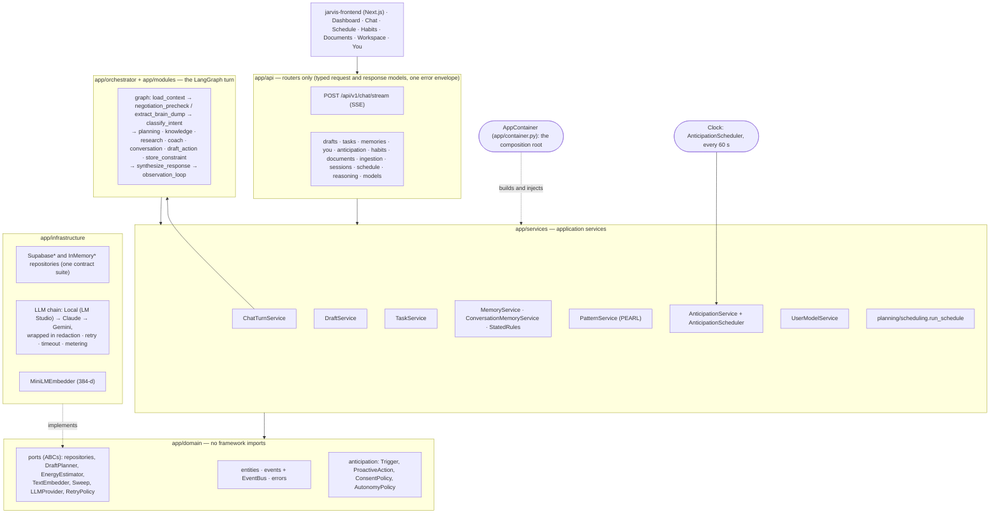

# Jarvis Engine — Project Status

**Last updated:** 2026-11-15
**Branch:** `main` (the capstone work is merged) · **Checked against:** `e76bff9` (end of capstone plan 3, "finish the restructure"); the fixes up to `c956a8f` are folded in where they change a claim. `path:line` references are at `e76bff9`.
**Scope:** what the code does today. Every claim below names the file it was checked in. Where something is a stub or not built, it says so. This is the one current architecture document; the capstone documents (§10) expand each part.

---

## 1. Architecture on one page



**The rules the code keeps** (each pinned by a test):
- **Layers.** Nothing below `app/api` imports it, the domain imports no outer layer, and no service talks to the Supabase driver (`tests/test_layering.py`). Only the container builds repositories, and every LLM call outside the transport goes through `route_llm_call`. The allow-lists are exact (`test_layering__allow_lists__are_exactly_the_documented_leftovers`): the raw-table list has 8 documented leftovers (§10), `core/model_router.py` is the one file in services, orchestrator, modules, core or api that imports infrastructure, `workspace_builder._search_web` is the one web-search caller, and the rest are empty.
- **One composition root.** `AppContainer.build` (`app/container.py:110`) picks the repository family (Supabase, or in-memory when Supabase is unreachable), builds the services and hands each its settings record (`Settings.from_config`, `app/core/settings.py:90`). The container lives on `app.state`, rides in a chat turn's state under `container`, and reaches the planning sub-graph as `planning` (`PlanningServices`). There is no global lookup (`tests/test_injection.py`).
- **One write path to `user_tasks` for plans.** A plan is a draft until accepted; `DraftService.accept` (`app/services/draft_service.py:185`) writes the tasks and closes the draft in one call to the `accept_draft()` SQL function. A second accept is a 409.
- **One way to call a model.** `route_llm_call` (`app/core/model_router.py:347`) maps a task to a role and runs the provider chain (`test_llm_calls__outside_the_transport__go_through_route_llm_call`).
- **One frame catalogue.** Every SSE frame is a Pydantic model in `app/schemas/chat_stream.py`, encoded by `SseEncoder` (`:334`); a golden test pins the bytes of 11 recorded turns (`tests/test_sse_golden.py`).
- **The user's clock.** Minute 0 of a plan is 08:00 in the user's zone (`user_zone`, `app/services/planning/local_time.py:37`); before 08:00 the logical day is yesterday and from 22:00 it is tomorrow (`logical_day_start`, `:77`).

**A chat turn** (`POST /api/v1/chat/stream`):
1. The router (`app/api/v1/endpoints/chat.py`) validates `ChatStreamRequest` (message ≤ 8,000 characters, upload ≤ 10 MB, `model_mode` and `media_type` from fixed lists; anything else is a 422 envelope) and calls `ChatTurnService.open_turn` (`app/services/chat_turn/service.py:240`).
2. The turn sets the cloud flag and usage attribution, opens the session, takes the conversation's lock (one turn at a time per `user_id:session_id`; a queued turn waits at most 120 s, `app/services/turn_locks.py:24`), reads the conversation window and the memories in use, and runs the graph (`build_jarvis_graph`, `app/orchestrator/graph.py:762`) on the SQLite checkpointer.
3. A planning turn ends in a draft: decompose → fuse with pending tasks → CP-SAT (`run_schedule`, `app/services/planning/scheduling.py:174`), widening the horizon 3 → 5 → 7 → 14 → 30 days when nothing fits → `DraftService.propose`. Nothing is written to `user_tasks`.
4. The observation loop learns inside the turn, before `complete`: stated facts from the turn's one extraction call are remembered, PEARL looks at the outcome history (bounded at 0.5 s), and `memory_extracted` / `pattern_detected` frames go out (`app/core/observation.py:1-23`).
5. The stream ends with one `complete` frame (`ChatCompletePayload`) or one `error` frame (the envelope). `ClosingStreamingResponse` (`app/api/sse.py:16`) closes the stream under a shielded cancel scope, so a closed tab frees the turn lock at once.

**The first move** (`app/services/anticipation/`): every tick runs the due sweeps (passed slots → `missed`; memory decay; session summaries; checkpoint retention), then each user's triggers. `MorningBriefTrigger` drafts today's plan from the user's wake time; `PatternRuleTrigger` offers an hour the user keeps setting aside as a rule, and also runs as soon as PEARL publishes such a pattern. Each proposal passes `ConsentPolicy` before it is stored; a schedule change always asks.

---

## 2. Repository layout (what matters)

```
app/
├── main.py                    lifespan: Supabase client, checkpointer, model detection,
│                              AppContainer, the anticipation scheduler
├── container.py               AppContainer — the composition root
├── api/                       error_handlers.py (the envelope), sse.py, deps.py (CurrentUser seam)
│   └── v1/endpoints/          14 routers; chat.py only routes
├── domain/                    entities, ports, events, anticipation, errors, clock, anti_guilt
├── infrastructure/            persistence/ (Supabase + InMemory repos, mapping, factory),
│                              llm/ (local, claude, gemini, decorators, chain, factory),
│                              embedding.py
├── services/
│   ├── chat_turn/             service, context, reply, frames — one chat turn
│   ├── planning/              scheduling (run_schedule), services (PlanningServices),
│   │                          goal_ids, brain_dump_prompt, task_rows, local_time,
│   │                          rule_windows (the hours a stated rule keeps free)
│   ├── anticipation/          scheduler, service, triggers, actions, user_locks
│   ├── memory/                memory_service, conversation_memory, patterns (PEARL),
│   │                          stated_rules, constraint_bridge, context, since_last_spoke
│   ├── draft_service.py, draft_actions.py, task_service.py, user_model_service.py,
│   │   energy.py, usage_ledger.py, chat_history.py, turn_locks.py, background.py
│   ├── analytical/            workspace_builder, sm2_engine, rule_check_ins, mastery_tracker,
│   │                          missed_deadlines, habit_translator, horizon_expander, …
│   ├── extraction/            ingestion orchestrator, calendar, knowledge, linker
│   └── documents/             document type registry and pipeline
├── orchestrator/              graph, state, routing, checkpoint, module_wrapper, hooks
├── modules/                   planning_graph, planning_replan, research_graph,
│                              knowledge_graph, conversation, coach
├── core/                      config, settings, model_router, observation, user_model,
│                              module_framework, or_tools/
├── schemas/                   chat_stream, errors, draft, schedule, upload, decomposition, …
└── db/supabase_py.py          the one Supabase client builder (HTTP/1.1)
supabase/migrations/           19 migration files — the schema's source of truth
scripts/                       seed_demo_user.py, live_e2e.py
tests/                         88 test files; behaviour/ drives the real turn over a fake DB
```

Deleted in the restructure: `control_policy.py` (v1 and `execute_agentic_flow`), `intent_registry.py`, `task_editor.py`, `task_rearranger.py`, `task_retrieval.py`, `memory/pearl.py`, `memory/extractor.py`, `memory/retriever.py`, `memory/store.py` (`MemoryStore`), `draft_store.py` (`DraftStore`) and `core/runtime.py`.

---

## 3. What is built

| Area | What works | Where |
|---|---|---|
| Chat | One SSE endpoint; typed frames; per-conversation lock; checkpointed threads (`user_id:session_id`); request limits; the reply names the model that wrote it; a resumed conversation reads its draft's real status first, so a plan accepted or discarded from its card ends the review (`_close_review_of_a_closed_draft`); the extraction prompt tells the model that a question about work already planned ("what should I do first today?") is not a planning goal (`app/services/planning/brain_dump_prompt.py`); the reply about a drafted plan is given its real counts and the new work (`_drafted_plan_facts`, `app/services/analytical/voice_of_jarvis.py`) | `app/services/chat_turn/`, `app/schemas/chat_stream.py`, `app/orchestrator/checkpoint.py:292` |
| Planning | Brain dump → ≤ 25-minute tasks with if-then plans → multi-goal fusion → CP-SAT (hard and soft blocks, dependencies, TMT, adaptive daily cap, night block) → draft; horizon ladder; anti-guilt reply when nothing fits | `app/modules/planning_graph.py`, `app/services/planning/scheduling.py`, `app/core/or_tools/solver.py` |
| Learned focus | `HistoryEnergyEstimator` learns a 24-hour focus profile from outcomes; a learned profile adds a soft solver term (weight 900 × difficulty, zero for tasks due within 24 h) | `app/services/energy.py:67`, `app/services/planning/scheduling.py:96-111` |
| Drafts | Propose, read (with `schedule` and a computed `version`), edit, rearrange, reject, discard, accept; accept is atomic and idempotent; a stale `expected_version` is a 409 `stale_version`; a draft whose slots have partly passed is re-solved from now | `app/services/draft_service.py:93`, `app/services/draft_actions.py:61`, `app/api/v1/endpoints/drafts.py` |
| Task outcomes | Complete and Skip write one task event each; the slot sweep marks passed slots `missed`; passed deadlines are `deadline_missed`; a missed task can be brought back | `app/services/task_service.py:87` |
| Rules | A stated rule and the memory of stating it are linked; letting go of one lets go of both; plans read only rules that apply now | `app/services/memory/stated_rules.py:62`, `app/core/user_model.py:77` |
| Rule check-ins | Jarvis checks in on every rule it learned ("Still how you work?", 0–5), spaced out by SM-2 while the rule holds and back the next day after an answer under 3. Every way a rule is stored starts its tracker (first due the next day); a rule older than its tracker gets one when the list is read, counting from when it was learned; deleting a rule deletes its tracker first. `GET /habits/tracker/due` lists every rule, due and not due yet | `app/services/analytical/rule_check_ins.py`, `app/api/v1/endpoints/habits.py` |
| Memory | Remember, recall (pgvector `match_memories`), confirm, dismiss, forget (sticks), decay; provenance said / inferred | `app/services/memory/memory_service.py:179` |
| Conversations | Recent window, background compaction into a summary, "since we last spoke" | `app/services/memory/conversation_memory.py:184` |
| PEARL | Four detectors over the outcome history (skip window, peak hour, deadline crunch, repeated skip); runs after every outcome, one run per user at a time | `app/services/memory/patterns.py:399`, `app/container.py:70` |
| Anticipation | Scheduler, morning brief, pattern → rule proposal, consent chain, suggestions API, manual run with a cooldown | `app/services/anticipation/`, `app/domain/anticipation.py` |
| You page | Patterns, rules, memories in use, focus profile, privacy receipt (30 days), `streak_days`, settings (autonomy mode, wake time, timezone) | `app/services/user_model_service.py:166`, `app/api/v1/endpoints/you.py` |
| LLM chain | Local Gemma (auto-detected PRIMARY + FAST) → Claude → Gemini; regex PII redaction before any cloud send; retries with backoff; timeouts; every call metered into `llm_usage_events`; one PRIMARY local call at a time | `app/infrastructure/llm/`, `app/core/model_router.py:204-211` |
| Documents | Docling → ChromaDB ingestion, user-scoped document search, timetable extraction with approval. Docling runs on a worker thread, one document at a time, at most 120 s (503 `document_read_timeout`, `read_document` in `app/utils/docling_helper.py`). `POST /ingestion/process` keeps the upload's `file_name`. The uploaded file itself is kept in a private Supabase Storage bucket (`jarvis-documents`, at `{user_id}/{source_id}`, best effort) and opens from `GET /documents/{source_id}/file`; the list says `has_file` and names linked tasks with titles. Documents and tasks are linked topic by topic (cosine ≥ 0.52 between a topic, or the file name's subject, and a task title): a new document to the user's pending tasks, and an accepted plan's tasks to the user's documents (`DocumentLinkListener` on `DraftAccepted`, after the commit). A task's workspace lists its `linked_documents`. A short text message that mentions the user's notes is answered from the stored documents; only pasted material of 400+ characters is ingested (`PASTED_MATERIAL_MIN_CHARS`, `app/orchestrator/graph.py`) | `app/services/extraction/`, `app/services/documents/{service,linker}.py`, `app/api/v1/endpoints/documents.py`, `ingestion.py` |
| Also | Workspace builder (RAG + web links + practice; after a failed web search it waits 5 minutes before searching again, `WEB_SEARCH_COOLDOWN_S`), mastery coach, checkpoint retention (newest 20 per thread, daily) | `app/services/analytical/`, `app/modules/coach.py`, `app/orchestrator/checkpoint.py:271` |

---

## 4. What is not built

- **Triggers:** PreTaskPrep and DeadlineRisk. Only the morning brief and the pattern rule exist (`app/container.py:208-217`). The brief preps no workspace.
- **Ask-back:** no `clarify_gate` and no `clarify_request` frame.
- **Research cognition:** `summarize` returns "Found N results…" with no model call, and `link_to_tasks` returns nothing (`app/modules/research_graph.py:69-75`). The knowledge module's `extract_calendar`, `link_to_tasks`, `propose_actions` and `file_operations` are thin.
- **Hooks:** 7 handlers are registered, but only `PreCloudLLM` and `PreModuleExecution` have call sites, and aggregation is first DENY or ASK (`app/orchestrator/hooks.py:39-55, 132-138`).
- **From the restructure (dropped tasks):** the `CognitiveModule` registry with derived routing (routing is still `INTENT_TO_MODULE`), and repositories for chat sessions and messages and pending-calendar rows.
- **Auth:** `CurrentUser` reads `user_id` from the query string; it is the seam a JWT would replace (`app/api/deps.py:16`).
- **Planned analytics:** DKT, RL and SARIMAX are stubs in `app/models/` and need real usage data first.

---

## 5. API surface

49 operations on 43 paths in the OpenAPI schema. Every JSON route declares a typed response model; the chat stream documents its `complete` frame. Every operation documents the error envelope (`ErrorResponse`, `app/schemas/errors.py`) for 422, 4XX and 5XX. The routes, models, status codes and the SSE frame catalogue are in [07 — API design](capstone/07-api-design.md); the error hierarchy is in [09 — Error handling](capstone/09-error-handling.md).

Retired in the restructure: the v1 chat routes (`POST /chat/`, the v1 `/chat/stream` handler, `/chat/confirm-schedule`, `/chat/accept-schedule`, `/chat/modify-schedule`), `POST /drafts/{id}/chat` (501), `PATCH` and `DELETE /tasks/{id}`, `DELETE /tasks/` and `DELETE /ingestion/behavioral-constraint/{id}`.

---

## 6. Storage

- **Supabase (Postgres)** is the store; `supabase/migrations/` is the source of truth. RLS is on for every table, the backend uses the service-role key, and every repository query filters by `user_id`. Tables, keys, functions and the class → table map: [08 — Database schema](capstone/08-database-schema.md); how to apply: [schema notes](capstone/_schema_notes.md).
- **The Supabase client** (`app/db/supabase_py.py`) speaks pooled HTTP/1.1. `ConnectRetryTransport` sends a request again, once, only when it provably did no work on the server: a connection that could not be made, or a dropped kept-alive connection on a read (`GET`/`HEAD`). A write that lost its connection, a read timeout or an HTTP error is raised as it came (a 503).
- **Migrations, in order:** `20260101000000_baseline_legacy_tables`, `20260329000000_chat_sessions`, `20260329000001_phase1_memory_system`, `20260329000002_phase1_missing_tables`, `20260331000000_chat_sessions_pinned`, `20260401000000_user_tasks_missing_columns`, `20260501000001_pearl_scheduled_hour`, `20260501000002_task_workspaces`, `20260808000000_user_tasks_actual_duration`, `20260813000000_user_tasks_status_missed_pacing`, `20260813000001_draft_schedules_schedule`, `20261114000001_capstone_lld`, `20261114000002_user_tasks_original_duration`, `20261115000000_skip_writes_skipped`, `20261115000001_accept_draft_reslots_missed`, `20261115000002_memory_lifecycle_and_vectors`, `20261115000003_session_summaries`, `20261115000004_suggestion_consent_kind`, `20261115000006_session_summary_reach`. There is no `…0005`. Plan 3 added no migration.
- **SQLite** (`data/checkpoints.sqlite`, override `JARVIS_CHECKPOINT_DB`): LangGraph checkpoints, one thread per `user_id:session_id`; live per-turn objects are scrubbed before a write; a daily sweep keeps the newest 20 per thread (`CHECKPOINT_KEEP_PER_THREAD`, `app/core/config.py:167`).
- **ChromaDB (cloud):** document chunks only. Memories are in Postgres.

---

## 7. Tests

**2116 passed, 2 xfailed, 2 deselected**, about 88 s, fully offline: `.venv/bin/python -m pytest tests/ -q` on a clean export of `e2a5899`. 94 test files.

- **The 2 xfails are `strict=True`** and pin open design questions: TMT priority collapses for deadlines more than ~16 h away, and a task the model leaves without an if-then plan gets none (`tests/behaviour/test_psychology.py:119, 249`). When one is fixed its test fails; remove the marker.
- **The 2 deselected are `slow`** (`pyproject.toml:65-68`): the solver run to its time cap (`tests/behaviour/test_psychology.py:193`) and the forget filter on the real embedder (`tests/test_conversation_memory.py:1006`). Run them with `pytest -m slow`.
- **The suite never touches the network:** `tests/conftest.py` makes any non-localhost connect fail.
- **Guards worth knowing:** `test_layering.py` (imports, raw tables, LLM and web-search call sites), `test_injection.py` (no global lookups; settings from the root), `test_api_contract.py` (typed responses, the envelope, request bounds), `test_sse_golden.py` and `test_sse_contract.py` (the wire), `test_repository_contracts.py` (both repository families), `test_routes.py` (the route table), `tests/behaviour/` (the real turn over a fake database and a scripted model).

---

## 8. The live check

`scripts/live_e2e.py` drives the running backend the way the frontend does, against real Supabase and the real model chain, as a throwaway `e2e-…` user, and deletes that user's rows at the end. It reports 18 steps: plan, accept, double accept (409), "looks good" afterwards, teach a rule, re-plan around it, the rule in a new session, forget (the linked rule goes too), the usage receipt, a memory frame before `complete`, forget sticks, "since we last spoke", a cached prompt, the You page, the morning brief on demand, accepting it (and a second accept is 409), Complete and Skip events, cleanup.

1. Start the backend from this directory: `.venv/bin/uvicorn app.main:app --port 8000` (LM Studio on `:1234` is optional; without it every call goes to the cloud).
2. Run `.venv/bin/python scripts/live_e2e.py` (default `--base-url http://localhost:8000`). It costs ten chat turns, roughly 25–30 model calls.
3. Pass means the table ends `ALL PASSED` (exit 0; a SKIP is allowed and means the step had nothing to say) and the server log shows no traceback.

Last run: all 18 steps passed at `e2a5899` on 2026-11-15, with no traceback in the server log and 1,398 tokens read from the prompt cache on the second reply.

---

## 9. Running the demo

1. **Supabase** must be unpaused and migrated (see the schema notes). `SUPABASE_SERVICE_KEY` must be the service-role key.
2. **Seed the demo user** with the backend stopped: `.venv/bin/python scripts/seed_demo_user.py --reset`. It writes about three weeks of history for `demo` through the live services under a simulated clock; no model is called. It refuses to run while a backend answers on `:8000`, and refuses any user but `demo`.
3. **Start the backend** (`.venv/bin/uvicorn app.main:app --port 8000`) and the frontend (`npm run dev` in `../jarvis-frontend`, port 3000).
4. **Show it:** the dashboard's streak and patterns, the morning brief (it is due from the demo user's wake time for 6 hours, or run it with `POST /api/v1/anticipation/run`), accept it, a brain dump in chat, teach a rule and watch the plan move, the You page.

The full script and the viva questions are in [10 — Demo and contributions](capstone/10-demo-and-contributions.md).

---

## 10. Known limits

1. **Raw-table leftovers.** Six files still query tables directly, each with its reason in `_RAW_TABLE_CALLS_ALLOWED` (`tests/test_layering.py:451-462`): the workspace builder (its cache, its own `user_tasks` reads and its `task_materials` read), `user_preferences`, `chat_history`, the sessions and ingestion routers, and the ingestion orchestrator (pending calendar rows). Documents and their task links have a repository (`DocumentRepository`).
2. **Process-local state.** Turn locks, the per-user anticipation lock, the trigger day memo and backoff, the PRIMARY model lock, the document-read lock and the web-search cooldown all live in memory. Correct for the one server process Jarvis runs as; not across processes.
3. **The version check has a window.** It runs in `DraftService` just before `accept_draft`, so an edit landing between the two is not caught (`app/services/draft_service.py:62-72`). Both the dashboard and the chat card send the version they show (the chat card the `complete` frame's `draft_version`, `jarvis-frontend/lib/draftCard.ts:134`).
4. **TMT ties past ~16 h** and **no default if-then plan** (the two strict xfails, §7).
5. **A failed decomposition can still produce a plan** from the user's pending tasks: `fuse_tasks` runs after `decompose_goal` with no route on its error (`app/modules/planning_graph.py:989-993`), and a solved plan clears the error (`:710`).
6. **`validate_goal` rejects goals under 5 characters** ("DSA") and asks for clarification (`app/modules/planning_graph.py:428`).
7. **Web search is Gemini-only** (`gemini_web_search`, `app/services/analytical/workspace_builder.py:21, 40`). The workspace's web links, and its practice links when the task has no document chunks, come only from Gemini's grounded search, which fails while the Gemini credits are depleted. The workspace then shows the task, its completion criteria and the notice "Web results are unavailable right now, so no links are shown", and a failed search is not tried again for 5 minutes (`WEB_SEARCH_COOLDOWN_S`, `web_search_cooldown`). With no Gemini key, research links come back empty too. A search is metered on the composition root's bus, and refused without one (`metered_web_search`, `app/core/model_router.py:106-157`).
8. **The PII gate is regex only** (email and US-format phone, `app/orchestrator/hooks.py`), applied to the prompt, the system prompt and the history before any cloud send.
9. **Bringing a missed task back records no event** (it is not an outcome; `TaskService.bring_back`, `app/services/task_service.py:154`), and `task_completion_signals` is a table nothing reads or writes.
10. **The workspace blocks the event loop on its database reads.** `workspace_builder.build_task_workspace` reads the task, its WOOP fields, its materials and the learning style with synchronous Supabase calls (one of the 6 allow-listed raw-table leftovers); only its cache read and write run on a worker thread. Hands-on testing measured about 1.5 s per workspace, during which other requests wait.
11. **One check-in tracker per rule is enforced in code, not by the database** (no unique key, no DDL access): the repository reads before it inserts and `RuleCheckIns` serialises it per user within one process, so two processes racing could leave a second tracker (listed once). An upload whose file could not be stored (the store down at that moment) keeps its chunks and record but has no file to open (`has_file: false`).
12. **A chat upload is limited by its step, not the reader.** The knowledge module's `ingest_document` step has its own 60 s limit (`app/modules/knowledge_graph.py`), so in a chat turn a slow parse ends there, before the reader's 120 s limit; the REST ingestion routes answer 503 `document_read_timeout` at 120 s.

---

## 11. Documents

**Capstone (`docs/capstone/`):**
[00 — Team study guide](capstone/00-team-study-guide.md) (the design and its reasons, for teammates; read first) ·
[01 — Requirements](capstone/01-requirements.md) ·
[02 — Architecture](capstone/02-architecture.md) ·
[03 — Class diagrams](capstone/03-class-diagrams.md) ·
[04 — OOP and SOLID](capstone/04-oop-and-solid.md) ·
[05 — Design patterns](capstone/05-design-patterns.md) ·
[06 — Sequence and activity diagrams](capstone/06-sequence-and-activity.md) ·
[07 — API design](capstone/07-api-design.md) ·
[08 — Database schema](capstone/08-database-schema.md) ·
[09 — Error handling](capstone/09-error-handling.md) ·
[10 — Demo and contributions](capstone/10-demo-and-contributions.md) ·
[Schema notes](capstone/_schema_notes.md)

**Design and plans:** the capstone spec, amended to match the code: [`superpowers/specs/2026-11-14-capstone-lld-and-anticipation-design.md`](superpowers/specs/2026-11-14-capstone-lld-and-anticipation-design.md); its three plans in `superpowers/plans/` (`2026-11-14-capstone-plan-1-safety-and-spine.md`, `…-plan-2-vision-core.md`, `…-plan-3-finish-the-restructure.md`). Older specs and plans are listed in [INDEX.md](INDEX.md); `POLICY_ENGINE_ARCHITECTURE.md` describes the deleted v1 pipeline and is history only. Deferred analytics: [FUTURE_ARCHITECTURE.md](FUTURE_ARCHITECTURE.md).
