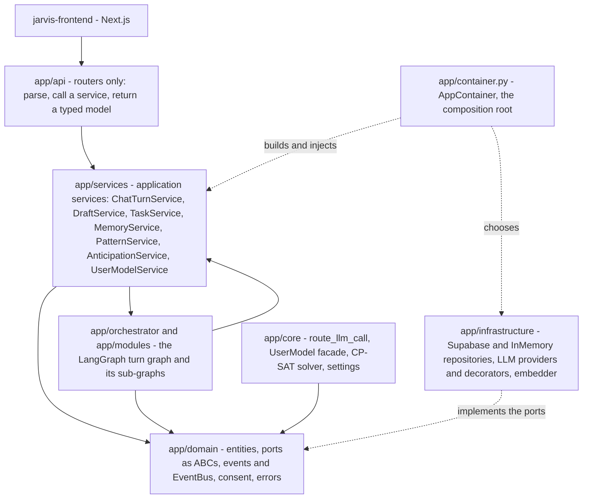
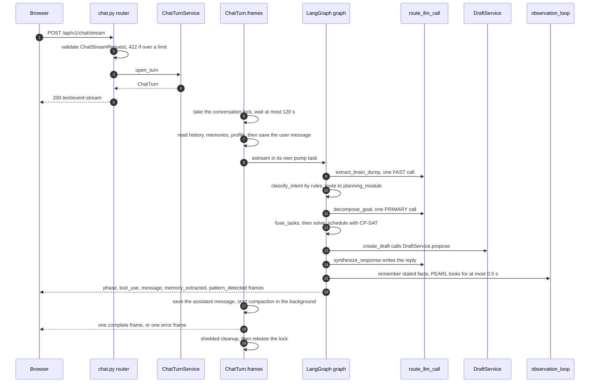
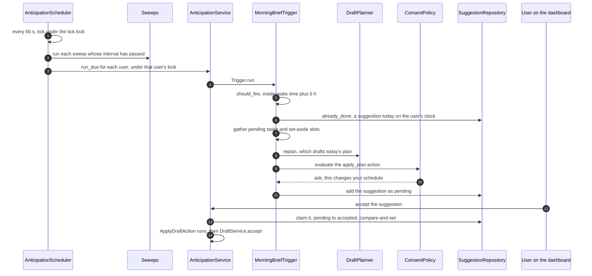
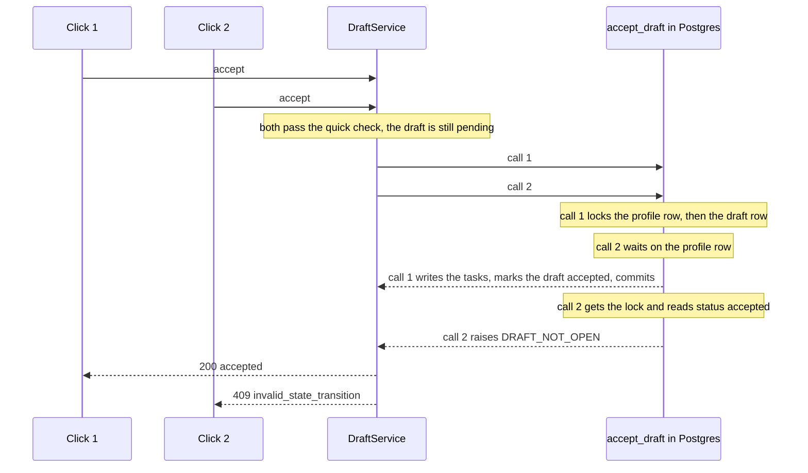

# 00 — Team study guide: the Jarvis design, and why it is built this way

This guide is for a teammate who has never opened this codebase. After reading it you should be able to explain the system design in the viva, and say **why** each decision was made, what was rejected, and what it costs. It is the teaching layer. The ten numbered documents (`01-requirements.md` to `10-demo-and-contributions.md`) are the formal versions, with every `path:line` citation. When this guide and the code disagree, the code is right.

Everything here was checked against the code on branch `main` (commit `cc8d170`). File paths and test names are real; open them.

---

## How to use this guide

**Reading order and time** (about 4 hours in total; you can stop after any part):

| Part | Sections | Time | What you get |
|---|---|---|---|
| 1. The picture | 1, 2, 3, 4 | 45 min | What Jarvis does, the layers, and how one chat turn and one background tick flow |
| 2. The reasons | 5 | 90 min | Every important decision: the problem, the choice, the rejected option, the cost, the file, the test |
| 3. The rubric | 6, 7, 8, 9 | 45 min | The ten criteria, the patterns, SOLID, and what is not built |
| 4. Practice | 10, 11 | 45 min | About 36 viva questions with short answers, and the glossary |

**Tips.**
- Keep the code open next to this guide. When a section names a file, open it and find the class.
- Run the offline tests once. They never touch the network: `.venv/bin/python -m pytest tests/ -q` (about 91 seconds; at `670e2d5` the result is `2361 passed, 2 xfailed, 2 deselected`).
- Section 11 defines every term. When a word is new, look it up there.
- Do not claim anything listed in section 9 as working.

**Numbers to quote** (measured at `cc8d170`):
- Tests: **2361 passed, 2 xfailed, 2 deselected**, in 94 test files. Older documents and commits said 1833 and 1974; those were earlier commits. After the documents work (D32): **2361 passed, 2 xfailed, 2 deselected**, in 94 test files.
- The chat router `app/api/v1/endpoints/chat.py` is **56 lines**.
- PEARL reads the last **28 days** (`FOCUS_WINDOW_DAYS`).
- The API has **43 paths and 49 operations** (42 and 48 at `cc8d170`; the documents work added `GET /documents/{source_id}/file`); there are **20 migration files**.
- The formal documents cite `path:line` at commit `d3e9132`. Four later commits (`102fc8b`, `975b0c6`, `0e40e5f`, `cc8d170`) fixed problems found by clicking through the app; the documents note each change where it alters a claim, and this guide covers them in D25, D29, D30 and D31. The documents work (D32: kept files, linking by meaning) moved lines in the files it touched, and the citations into those files were moved with them.

---

## 1. Jarvis in one page

Jarvis is a **personal intelligence for one person**. It builds a model of that person: when they focus, what they avoid, how they react when work slips. It uses that model to have things ready before the person asks. **It is not a calendar and not a planner.** The scheduler is one tool it uses (a "muscle"). The user model and the observation loop are the "brain".

**One story.** Meera is a student. She has used Jarvis for three weeks.

1. **A morning brief, ready before she asks.** At 07:40 she opens the dashboard. A card says "Today is ready". Nobody asked for it. At her wake time, a background clock (`AnticipationScheduler`, which ticks every 60 seconds) ran the `MorningBriefTrigger`. The trigger drafted today's plan, found new slots for two tasks she set aside yesterday, and put the card's words together from facts (the words themselves need no model call). Because the plan changes her schedule, the card says "This changes your schedule, so I'm asking first." She clicks **Accept**. The plan is written in one database transaction. If she clicks twice, the second click gets a 409 and nothing is written twice.

2. **A brain dump becomes a draft, saved only on accept.** In chat she types: "I have a data structures exam on Friday. Plan my revision: graphs, dynamic programming and trees." Jarvis extracts the goal, splits it into tasks of 25 minutes or less, and a constraint solver (CP-SAT) places them around her rules. The result is a **draft**. Nothing reaches her task list yet. She types "looks good". Only then are the tasks written.

3. **Jarvis notices a pattern.** Over three weeks Meera set aside most tasks planned at 9 AM. Each time she pressed Skip, or a slot passed with no outcome, one row was added to an append-only history (`task_events`). Jarvis's pattern detector (PEARL) found that at 9 AM there were 3 or more outcomes and at least 70% were set aside. It offered: "You've set aside n of the last m tasks around 9 AM. Want me to keep that hour clear?" She accepts. A rule is stored, linked to the pattern, and a new draft that keeps 9 AM free is proposed for her to accept.

4. **She forgets a memory, and it stays forgotten.** She once told Jarvis "I'm a night owl and do my best work after 9 pm". Jarvis remembered it ("you said"). Later she opens the You page and clicks **Forget**. The words are erased. Next week, in a new chat, she says the same sentence. Jarvis recognises it and stores nothing. Forget sticks.

Every part of this story maps to a use case in `01-requirements.md` (UC6, UC1 and UC2, UC7, UC5) and to a step of the live check `scripts/live_e2e.py`.

---

## 2. The big picture

Jarvis is **one FastAPI process** built in layers. The rule is simple: **dependencies point inward, toward the domain.** Only one place, the composition root, chooses concrete classes.

**What each layer may and may not import** (enforced by `tests/test_layering.py`, which parses every import with Python's `ast` module):

| Layer | May import | May not import | Test |
|---|---|---|---|
| `app/domain` | the standard library, `pydantic` | anything else in `app/` | `test_domain__imports_nothing_from_outer_layers` |
| `app/infrastructure` | domain | `app.api`, `app.orchestrator` | `test_infrastructure__imports_nothing_from_api_or_orchestrator` |
| `app/services`, `orchestrator`, `modules`, `core`, `api` | domain ports, each other as the design allows | `app.infrastructure` (one documented exception: `core/model_router.py`, which drives the LLM chain) | `test_layering__services_orchestrator_modules_core_api__do_not_import_infrastructure` |
| everything below `app/api` | — | `app.api` (shared request/response models live in `app/schemas/`) | `test_layering__nothing_below_the_api__imports_the_api` |
| `app/services` | — | the `supabase` driver | `test_layering__services__do_not_import_the_supabase_driver` |
| any file but `app/container.py` | — | building a repository | `test_layering__only_container_builds_repositories` |

One honest note: no test forbids `services → orchestrator`. `ChatTurnService` drives the graph, so the application layer depends on the orchestrator by design. That is a convention, not a checked rule (`02-architecture.md` §2).

**The composition root.** `AppContainer.build` (`app/container.py`) runs once, from the FastAPI lifespan in `app/main.py`. It picks the repository family (Supabase, or in-memory if Supabase is unreachable), creates the `EventBus` and subscribes listeners, builds the LLM chain, and constructs every service with its collaborators and its settings record. The container lives on `app.state`. A chat turn carries it in its state under `container`. Nothing looks it up from a global registry.

**A map of the code** (the files you will open most):

| Path | What is there |
|---|---|
| `app/main.py` | The lifespan: Supabase client, checkpointer, local model detection, `AppContainer.build`, the anticipation scheduler |
| `app/container.py` | `AppContainer`, the composition root |
| `app/api/v1/endpoints/` | 14 routers; `chat.py` is the one chat endpoint |
| `app/api/error_handlers.py`, `sse.py`, `deps.py`, `request_limits.py` | The error envelope, the closing SSE response, `CurrentUser`, the 413 body limit |
| `app/schemas/chat_stream.py` | Every SSE frame model, `SseEncoder`, `ChatStreamRequest`, `ChatCompletePayload` |
| `app/services/chat_turn/` | One chat turn: `service.py`, `context.py`, `reply.py`, `frames.py` |
| `app/services/draft_service.py`, `draft_actions.py`, `task_service.py` | Drafts and the atomic accept; task outcomes and the slot sweep |
| `app/services/memory/` | `memory_service.py`, `conversation_memory.py`, `patterns.py` (PEARL), `stated_rules.py` |
| `app/services/anticipation/` | `scheduler.py`, `service.py`, `triggers.py`, `actions.py`, `user_locks.py` |
| `app/services/planning/` | `scheduling.py` (`run_schedule`), `local_time.py`, `services.py` (`PlanningServices`) |
| `app/services/energy.py`, `user_model_service.py` | The focus profile; the You page facade |
| `app/orchestrator/` | `graph.py` (the turn graph), `routing.py`, `checkpoint.py`, `hooks.py` |
| `app/modules/` | `planning_graph.py` (the planning sub-graph), `planning_replan.py` (the `DraftPlanner` implementation) |
| `app/core/` | `model_router.py` (`route_llm_call`), `observation.py`, `or_tools/solver.py`, `settings.py`, `config.py` |
| `app/domain/` | `entities.py`, `ports.py`, `events.py`, `anticipation.py`, `errors.py`, `anti_guilt.py` |
| `app/infrastructure/` | `persistence/` (both repository families), `llm/` (adapters, decorators, chain, factory), `embedding.py` |
| `supabase/migrations/` | 19 SQL files, the schema's source of truth (including `accept_draft` and `match_memories`) |
| `tests/` | `fakes.py`, `behaviour/` (the real turn over a fake database and a scripted model), `golden/sse/` |
| `scripts/` | `live_e2e.py` (the live check), `seed_demo_user.py` (demo history) |

---

## 3. The life of one chat turn

A turn starts when the browser posts to `POST /api/v1/chat/stream`, the **only** chat endpoint. The reply comes back as SSE (server-sent events): a stream of small typed frames over one HTTP response.

1. **Parse.** The router `app/api/v1/endpoints/chat.py` validates `ChatStreamRequest` (`app/schemas/chat_stream.py`): message at most 8,000 characters, file at most 10 MB, `model_mode` and `media_type` from fixed lists. A bad request is a 422 error before any work starts. The router does nothing else.
2. **Open.** `ChatTurnService.open_turn` (`app/services/chat_turn/service.py`) sets the per-request cloud flag and the usage attribution (so every model call is billed to this user), opens the chat session, and builds the turn's initial state, which carries the container.
3. **Lock.** `ChatTurn.frames` takes the conversation's lock (`thread_lock` in `app/services/turn_locks.py`), keyed by `user_id:session_id`. A second tab's turn on the same conversation waits, at most 120 seconds.
4. **Read.** Under the lock it reads the conversation window, the memories, the profile and the recall note (`read_conversation`, `app/services/chat_turn/context.py`), then saves the user's message.
5. **Run the graph.** The LangGraph graph (`build_jarvis_graph`, `app/orchestrator/graph.py`) runs in its own task. Its nodes: `load_context` → `extract_brain_dump` (one FAST model call) → `classify_intent` (rules, no model) → a module, chosen by the `INTENT_TO_MODULE` table in `app/orchestrator/routing.py`. If a draft is already under review, `negotiation_precheck` replaces extraction, so "looks good" never pays for a model call. Before the first node, a resumed conversation checks its draft's real status, so a plan accepted from its card does not leave the thread "in review" (D30).
6. **Plan.** For a planning intent, the planning sub-graph (`app/modules/planning_graph.py`) runs its steps: `validate_goal`, `fetch_constraints`, `translate_habits` (a PRIMARY call when there are free-text habits), `decompose_goal` (a PRIMARY call), `fuse_tasks` (merge with pending tasks), `solve_schedule` (CP-SAT through `run_schedule`), `create_draft` (`DraftService.propose`). **No row is written to `user_tasks`.**
7. **Reply.** `synthesize_response` writes the reply in Jarvis's voice.
8. **Learn inside the turn.** `observation_loop` (`app/core/observation.py`) remembers the facts the user stated (taken from the same extraction call, so no extra model call), lets PEARL look at the outcome history for at most 0.5 seconds, and emits `memory_extracted` and `pattern_detected` frames. These arrive **before** `complete`.
9. **Finish.** The assistant message is saved. Conversation compaction starts in the background (not awaited). The `complete` frame (`ChatCompletePayload`) is validated, then sent. If anything failed, exactly one `error` frame is sent instead.
10. **Clean up.** In a shielded `finally`, the graph task is cancelled if still running, and the lock is released only after it has stopped. A closed browser tab therefore frees the lock at once.

The full version, with every alternative path, is `06-sequence-and-activity.md` S1 and A1.

---

## 4. The life of one anticipation tick

Anticipation means Jarvis makes the first move. The actor is a **Clock**, not the user.

1. **Tick.** `AnticipationScheduler` (`app/services/anticipation/scheduler.py`) is an asyncio loop started by the lifespan. Every 60 seconds it calls `tick(now)`, under a tick lock so two ticks never overlap.
2. **Sweeps first.** Each sweep runs if its interval has passed: `SlotPassedSweep` every minute (a pending task whose slot ended more than 30 minutes ago becomes `missed`), `SessionSummarySweep` every 5 minutes, `MemoryDecaySweep` and `CheckpointRetentionSweep` every 24 hours. One sweep's failure is logged by type and never stops the others.
3. **Then triggers, per user.** For each user, `AnticipationService.run_due` (`app/services/anticipation/service.py`) runs under that user's lock. It skips a trigger that already settled the user's local day, or one that is backing off after a failure (1, 2, 4 … at most 30 minutes).
4. **The template.** Each trigger runs `Trigger.run` (`app/domain/anticipation.py`), a fixed sequence: `should_fire` (for the brief: inside wake time to wake time + 6 hours, on the user's clock) → `already_done` (a suggestion already exists today) → `gather` → `build_suggestion` → consent → store.
5. **Draft through a port.** `MorningBriefTrigger` plans through the `DraftPlanner` port. Its implementation, `PlanningGraphReplanner` (`app/modules/planning_replan.py`), drives the same planning sub-graph a chat turn uses.
6. **Consent.** `ConsentPolicy.evaluate` decides allow, ask or deny. Applying a plan is a schedule change, so it asks.
7. **Store.** Denied: nothing stored. Ask, or allowed read-only information: stored as a `pending` suggestion. Allowed change: stored already claimed and executed at once.
8. **Accept later.** When the user clicks Accept, `AnticipationService.accept` first claims the suggestion (`pending → accepted` by compare-and-set), then rebuilds the action from its stored payload (`ActionFactory`) and runs it. `ApplyDraftAction` then calls `DraftService.accept`, the same atomic accept as chat.

The other trigger, `PatternRuleTrigger`, also runs from an event: when PEARL publishes `PatternDetected` for a detector that may propose rules, `AnticipationListener` runs it for that user at once. Detail: `06-sequence-and-activity.md` S6, S7, A3.

**Six things to try before you read on** (all read-only, no server needed):
1. Open `app/container.py`. Find the one `if` that picks the Supabase or the in-memory repository family.
2. Open `app/domain/anticipation.py`. In `Trigger.run`, find the line where consent is evaluated, and the line where a denied action returns without storing anything.
3. Open `supabase/migrations/20261115000007_user_tasks_not_before.sql`. Find the two row locks and their order.
4. Read `ConsentPolicy.default` in the same domain file. Say in your own words what each of the four rules decides.
5. Run `.venv/bin/python -m pytest tests/test_layering.py tests/test_design_conformance.py -q`. These two files are the proof that the code matches the design.
6. Run `.venv/bin/python -m pytest "tests/test_draft_service.py::test_accept__concurrent_double_click__exactly_one_succeeds" -q`, then read the test.

---

## 5. Decisions and why

Each decision uses the same shape: **The problem → What we chose → What we rejected, and why → What it costs us → Where to see it → The test that pins it.** "ADR-n" refers to the decision log in `docs/superpowers/specs/2026-11-14-capstone-lld-and-anticipation-design.md` §15. Where no reason was recorded, the text says **"our reading"**.

### D1. Layers with ports and adapters
- **The problem.** Before the capstone, endpoints built Supabase queries inline, there were nine places that created a Supabase client, services imported from endpoint files, and two "god files" (`chat.py` at 1,618 lines, `control_policy.py` at 1,939). Nothing could be tested without the network, and no class diagram could match the code (spec §2).
- **What we chose.** Four layers plus a composition root. A **port** is an abstract class in `app/domain/ports.py` (for example `TaskRepository`, `LLMProvider`). An **adapter** is a class in `app/infrastructure/` that implements it (for example `SupabaseTaskRepository`, `ClaudeProvider`). Services depend only on ports.
- **What we rejected, and why.** Services calling Supabase or LiteLLM directly: library error types leak upward, tests need the network, and a vendor change touches every caller (`05-design-patterns.md` §11.5).
- **What it costs us.** More files and one more level of indirection. A few leftovers remain, each on a tested allow-list: 6 files with raw table calls, and `core/model_router.py` importing infrastructure.
- **Where to see it.** `app/domain/ports.py`, `app/infrastructure/`, `app/container.py`.
- **The test that pins it.** `tests/test_layering.py::test_domain__imports_nothing_from_outer_layers`, `::test_layering__allow_lists__are_exactly_the_documented_leftovers` (the allow-lists can only shrink).

### D2. Ports are ABCs, not Protocols (ADR-2)
- **The problem.** The class diagram draws `<<interface>>` and "implements" arrows. They must be true in the code.
- **What we chose.** Every port is an `abc.ABC`. An adapter subclasses it. A class that forgets a method cannot be created.
- **What we rejected, and why.** `typing.Protocol`: structural typing, so nothing in the code says a class implements the port, and an incomplete class passes until a call fails.
- **What it costs us.** Adapters must subclass explicitly. One small exception exists: the `Redactor` port inside `app/infrastructure/llm/decorators.py` is a Protocol.
- **Where to see it.** `app/domain/ports.py` (19 ABCs).
- **The test that pins it.** `tests/test_domain.py::test_ports__instantiated_directly__raise_type_error`; `tests/test_design_conformance.py` checks that every `<<interface>>` in doc 03 is an ABC and every arrow a real subclass.

### D3. Repository pattern: two families, one contract suite
- **The problem.** Services must store tasks, drafts, events, rules, memories and more without knowing Supabase exists, and tests must run offline. Some old queries forgot the `user_id` filter (an IDOR bug, see D27).
- **What we chose.** One repository port per aggregate (12 in all, plus `DocumentFileStore` for uploaded files, D32). Every per-user method takes `user_id` first. Two families implement every port: `Supabase*Repository` (`app/infrastructure/persistence/supabase_repos.py`) and `InMemory*Repository` (`in_memory.py`). `RepositoryFactory.supabase` / `.in_memory` build a whole family at once, so families are never mixed. **The same contract tests run against both families.**
- **What we rejected, and why.** Active Record (`task.save()`): the entity would import the driver and break the domain rule. A generic `Repository[T]` with `get/add/update`: it would offer writes the domain forbids (tasks only change status; drafts need an atomic accept; task events are append-only). Local Postgres for tests (ADR-4): no Docker on the build machine.
- **What it costs us.** The Supabase family is tested offline against `FakeSupabase` (`tests/fakes.py`), not a real database; only `scripts/live_e2e.py` touches the real one. Chat sessions and calendar rows have no repository yet.
- **Where to see it.** `app/domain/ports.py`, `app/infrastructure/persistence/`.
- **The test that pins it.** `tests/test_repository_contracts.py::test_factory__both_families__implement_every_port`; the fixture runs each contract test once per family (`params=["in_memory", "supabase_fake"]`).

### D4. One composition root, and no global lookups
- **The problem.** Concrete classes depend on the environment (Supabase or not, which models are configured). If services chose them, every service would import infrastructure. The old code also had a global registry (`app/core/runtime.py`) that hid dependencies.
- **What we chose.** `AppContainer.build` is the only place that chooses concrete classes. It hands each service its collaborators through the constructor, and each service its own frozen settings record (`Settings.from_config`, `app/core/settings.py`). A turn receives the container in its state; the planning sub-graph receives a smaller record, `PlanningServices`.
- **What we rejected, and why.** A service locator or global registry (hides dependencies; tests must patch globals); a DI framework (a 250-line hand-written root is easier to read and explain).
- **What it costs us.** Three process-wide objects remain: the installed LLM chain (`get_chain`), the hook registry (`get_hooks`) and the module registry. Inside a turn, the whole container rides in the state, so a node can reach any service.
- **Where to see it.** `app/container.py`, `app/main.py` (the lifespan).
- **The test that pins it.** `tests/test_injection.py::test_runtime_registry__gone_and_imported_nowhere`, `::test_container_built_services__import_no_config_module`; `tests/test_container.py::test_container__no_supabase__uses_in_memory_family`.

### D5. Draft first, then an atomic accept
- **The problem.** The audit found two real bugs: accepting a draft twice duplicated every task, and accept was "delete pending tasks, then insert new ones" in two calls, so a failure between them could lose tasks (spec §2). Also, a plan the user never agreed to should not change their task list.
- **What we chose.** Planning always ends in a **draft** (`DraftService.propose`). Accepting is the **only** way a plan reaches `user_tasks`. Chat ("looks good") and REST (`POST /api/v1/drafts/{id}/accept`) both go through `app/services/draft_actions.py` to `DraftService.accept`, which makes **one** call to the Postgres function `accept_draft()`. Inside one transaction it locks the user's profile row, then the draft row; checks the draft is still `pending` or `modified` and not expired; deletes the pending tasks (and missed tasks the plan re-slots); inserts the new rows; marks the draft accepted; and marks the user's other open drafts `superseded`.
- **What we rejected, and why.** Writing tasks during planning (no user control). A multi-call accept in Python (the duplicate and lost-task bugs). An advisory lock on a hashed key (it can collide across users; doc 09 §4.1).
- **What it costs us.** Logic in SQL is harder to unit-test; offline tests use a fake that mirrors the function, and the real function runs only in the live check. The lock order (user, then draft) must be kept, or two accepts could deadlock.
- **How a double click plays out.** The quick check in Python passes for both clicks; the row locks inside Postgres decide:

- **Where to see it.** `supabase/migrations/20261115000007_user_tasks_not_before.sql`, `app/services/draft_service.py`, `app/services/draft_actions.py`.
- **The test that pins it.** `tests/test_draft_service.py::test_accept__concurrent_double_click__exactly_one_succeeds`; `tests/test_migrations.py::test_migrations__accept_draft__locks_the_user_before_the_draft`; `tests/behaviour/test_chat_turns.py::test_chat__brain_dump__proposes_a_draft_and_writes_no_tasks`.

### D6. A draft version, and 409 `stale_version`
- **The problem.** The user reads a draft, it is edited (another tab, a chat edit), then the user clicks Accept on what they saw. The status alone cannot see this: an edit keeps the draft open.
- **What we chose.** `DraftSchedule.version` (`app/domain/entities.py`) is the first 16 hex characters of a SHA-256 of the draft's tasks and schedule, **computed, not stored**. `GET /drafts/{id}` returns it; the chat `complete` frame carries it as `draft_version`. An accept that sends a stale `expected_version` gets 409 `stale_version` with the latest draft in `details.draft`, and nothing is written (`check_version` in `draft_service.py`).
- **What we rejected, and why.** A version column checked inside `accept_draft()` (ADR-23): it needed a migration the restructure did not allow.
- **What it costs us.** A small window: the check runs in the service just before the SQL call, so an edit landing between them is not caught. An accept sent without `expected_version` is not checked.
- **Where to see it.** `app/domain/entities.py` (`version`), `app/services/draft_service.py` (`check_version`).
- **The test that pins it.** `tests/test_drafts_one_path.py::test_rest_accept__edited_after_the_read__409_with_the_latest_and_nothing_written`.

### D7. Append-only `task_events` instead of trusting a status column (ADR-11)
- **The problem.** The old signals disagreed: Skip wrote `pacing_pushed`, `missed` meant "deadline passed", and the pattern code counted `status == "skipped"`, which nothing wrote. Worse, re-slotting a task overwrote its status, which erased the evidence learning needs.
- **What we chose.** `user_tasks.status` holds only the **current** state. Every outcome is one new row in `task_events`: `scheduled`, `completed`, `skipped`, `missed`, `rescheduled`, `deadline_missed`. PEARL, the focus profile and the streak read events, never status. "Missed" is **inferred**, never asked: the slot sweep writes it. All outcomes go through `TaskService` (`complete`, `skip`, `sweep_passed_slots`).
- **What we rejected, and why.** Status-only history: re-slotting would erase what was learned.
- **What it costs us.** Two records to keep consistent. If the event write fails after the status moved, `TaskService` sets the status back and re-raises, so a retry records it once. The `scheduled`/`rescheduled` events after an accept are best effort. Bringing a missed task back records no event (it is not an outcome).
- **Where to see it.** `app/services/task_service.py`; table spec in `08-database-schema.md` §3.4.
- **The test that pins it.** `tests/test_task_service.py::test_complete__double_click__second_returns_none_and_one_event`, `::test_sweep__slot_ended_31_min_ago__missed_event_and_status`, `::test_complete__event_write_fails__status_restored_and_error_raised`.

### D8. One model entry point: `route_llm_call`
- **The problem.** Model calls were scattered. Each caller would have to remember the PII gate, retries, timeouts and usage metering. With Gemini down, the old direct paths blocked the demo (Plan 1 ruling, `02-architecture.md` §7).
- **What we chose.** `route_llm_call` (`app/core/model_router.py`) is the only way to call a model. It maps the task to a role (`MODEL_ROUTING`: PRIMARY, FAST or CLOUD) and runs the provider chain. `LLMProviderFactory.build` returns `FallbackChainProvider([local, claude, gemini])`. Each cloud provider is wrapped, outermost first: `RedactingProvider` (the PII gate) → `RetryingProvider` → `MeteredProvider` → `TimeoutProvider` → adapter. The local one is wrapped only in `MeteredProvider` → `TimeoutProvider` (no redaction: nothing leaves the machine; no retry: a dead LM Studio should hand over at once). An `LLMError` moves to the next provider; any other exception is a bug and propagates, so a code error never quietly ships the prompt to the cloud. `MeteredProvider` publishes `LLMCallCompleted`; the `UsageLedger` writes `llm_usage_events`. Structured output: pass `response_schema=`; it cannot be combined with `stream=True`.
- **What we rejected, and why.** Callers reaching LiteLLM directly (skips the gate and the ledger); if/else on a provider name inside the router (every new provider edits the router).
- **What it costs us.** The chain is installed process-wide (`get_chain`), and `route_llm_call` depends on the concrete chain type, not the port (see the L row in section 8).
- **Where to see it.** `app/core/model_router.py`, `app/infrastructure/llm/factory.py`, `decorators.py`, `chain.py`.
- **The test that pins it.** `tests/test_layering.py::test_llm_calls__outside_the_transport__go_through_route_llm_call`; `tests/test_llm_providers.py::test_factory__cloud_provider__redacted_and_metered`, `::test_chain__programming_error__propagates_and_second_not_called`.

### D9. Local model first, then Claude, then Gemini (ADR-10)
- **The problem.** Privacy says "keep it on the device". A live demo says "never fail on bad JSON".
- **What we chose.** The chain tries LM Studio's Gemma first, then Claude (`CLAUDE_MODEL`, default `claude-sonnet-5-5`, through the official Anthropic SDK), then Gemini as a last resort. Switches (`CLAUDE_PRIMARY`, `GEMINI_PRIMARY`, the model picker) send a call straight to the cloud. The lifespan turns on cloud-first when LM Studio is not reachable. Claude calls use structured outputs, so a reply fits the schema by construction.
- **What we rejected, and why.** Claude only: loses the local-first identity. Gemini as the cloud tier: weaker structured output in the live demo.
- **What it costs us.** Local PRIMARY latency against the 60-second timeout was never measured; every recorded live run used `CLAUDE_PRIMARY=true`; Gemini credits ran out during Plan 1 (doc 10, L9). The PII gate is regex only (emails, US-format phones).
- **Where to see it.** `app/infrastructure/llm/factory.py`, `claude.py`, `local.py`, `gemini.py`.
- **The test that pins it.** `tests/test_claude_provider.py::test_factory__with_anthropic_key__order_is_local_claude_gemini`; `tests/test_llm_providers.py::test_factory__local_provider__not_redacted`.

### D10. Prompt caching and a cache-stable prompt layout
- **The problem.** Each chat turn re-sends the system prompt and the history. Claude bills a repeated prefix at the cheaper cache-read rate only if the prefix is **byte-identical**.
- **What we chose.** The system prompt is sent as one block marked `cache_control: {"type": "ephemeral"}` and contains nothing that changes (no user, time or memory). The history holds only user and assistant turns and grows by appending. Everything volatile (recall, "since we last spoke", the time) is folded into the **last** user message by `fold_system_notes` (`app/infrastructure/llm/messages.py`), shared by all three adapters. Recall breaks ties by id, so the same memories give the same bytes.
- **What we rejected, and why.** Putting per-turn context in the system prompt: it would break the cache, and Gemma's chat template rejects a system turn in the middle of a conversation (module docstring of `messages.py`).
- **What it costs us.** The layout is a rule everyone must keep. Prompts shorter than the model's minimum cacheable length do not cache (doc 10, Q30). A live run recorded 1,398 cached tokens on a second reply (doc 01, NFR-3).
- **Where to see it.** `app/infrastructure/llm/messages.py`, `app/infrastructure/llm/claude.py`.
- **The test that pins it.** `tests/test_prompt_layout.py::test_two_turns__system_block_and_message_prefix_identical_up_to_the_note`; `tests/test_claude_provider.py::test_claude__system_prompt__sent_as_cached_block`.

### D11. One chat endpoint, typed SSE frames, and a golden test (ADR-9)
- **The problem.** There were two chat architectures (v1 and v2) side by side, a 1,618-line `chat.py` with a 445-line handler, frames built as plain dicts, seven error shapes, and learning events sent after the stream closed (spec §2).
- **What we chose.** `POST /api/v1/chat/stream` is the single entry point; v1 was deleted. The router only routes; the turn lives in `app/services/chat_turn/`. Every frame is a Pydantic model in `app/schemas/chat_stream.py` (10 types: `phase`, `step`, `thinking`, `message`, `tool_use`, `memory_extracted`, `pattern_detected`, `consent_request`, `complete`, `error`), written only by `SseEncoder.frame` as `event: <name>`, `data: <json>`, blank line. `ChatCompletePayload` forbids unknown keys and is validated before sending. A golden test replays 11 scripted turns through the real route and compares the raw bytes with files in `tests/golden/sse/`, "so a refactor of how frames are built cannot change a key, its order, a value's JSON spelling or the framing" (its docstring).
- **What we rejected, and why.** Keeping v1 alongside (an examiner would find two architectures); parallel planning endpoints.
- **What it costs us.** A deliberate wire change means re-recording (`JARVIS_WRITE_SSE_GOLDEN=1`) and reviewing the diff. `PhaseFrame` allows extra keys; a progress entry that does not fit its model is logged and sent as it came, so a frame is never dropped.
- **Where to see it.** `app/api/v1/endpoints/chat.py`, `app/schemas/chat_stream.py`, `app/services/chat_turn/service.py`.
- **The test that pins it.** `tests/test_sse_golden.py`; `tests/test_sse_contract.py::test_chat_turn__every_frame_emitted__parses_into_its_model`; `tests/test_chat_turn.py::test_chat_router__routing_and_parsing_only` (the router stays at most 80 lines).

### D12. One error envelope and the `JarvisError` hierarchy
- **The problem.** Seven error shapes, 176 `except Exception` blocks, and `str(exc)` leaking internals to the client (spec §2).
- **What we chose.** Errors are subclasses of `JarvisError` (`app/domain/errors.py`). Each carries a stable `code` and an HTTP status: `ValidationError` 422, `NotFoundError` 404, `ConflictError` 409 (with `InvalidStateTransition`, `StaleVersionError`, `DraftOutdatedError`), `ScheduleInfeasibleError` 422, and infrastructure errors at 503 (`PersistenceError`, `EmbeddingUnavailableError`, `DocumentReadTimeoutError`, `LLMError` and its four children). Global handlers (`app/api/error_handlers.py`) render every error as `{"error": {"code", "message", "details", "request_id"}}`. The stream sends the same model as its `error` frame. No endpoint raises `HTTPException`. An unhandled exception becomes 500 `internal_error` with a fixed message; the cause is logged with the request id. A model that fails validation is never a 502: REST answers 503, chat gives an honest degraded reply.
- **What we rejected, and why.** A `ConsentRequiredError` (ADR-24): nothing raised it, and consent is data (a pending suggestion, or a `consent_request` frame), not an error.
- **What it costs us.** Some broad catches remain as deliberate degradation points; each logs the type and shows a fixed message (doc 09 §6).
- **Where to see it.** `app/domain/errors.py`, `app/api/error_handlers.py`, `app/schemas/errors.py`.
- **The test that pins it.** `tests/test_api_contract.py::test_endpoints__raise_no_http_exception`; `tests/test_errors.py::test_error_envelope__unhandled_exception__hides_internals`; `tests/test_error_text_leaks.py`.

### D13. The memory lifecycle: states, tombstones, decay, and "forget sticks"
- **The problem.** A memory system that only adds would store a fact twice, keep stale facts forever, and bring back a fact the user asked it to forget.
- **What we chose.** A memory has a status: `active`, `faded`, `dismissed`, `forgotten`, with legal moves in `MEMORY_TRANSITIONS` (`app/domain/entities.py`). `MemoryService.remember` (`app/services/memory/memory_service.py`), in order: suppress the fact if it is close (cosine similarity ≥ 0.85) to anything the user forgot or dismissed; supersede a memory it contradicts; reinforce a close memory of the same type; otherwise create it with provenance "said". **Forget makes a tombstone:** status `forgotten`, words erased, but the embedding and pattern key kept, so the same fact said again is recognised and not stored. Forgetting a memory also deletes the rule linked to it (`StatedRules`). **Decay:** strength falls by a factor of e every `stability` weeks (`Memory.strength_at`); a daily `MemoryDecaySweep` stores the decayed value and marks memories below 0.1 `faded` (constraints excepted); a faded memory comes back when mentioned. Every write that could bring a memory back is a compare-and-set on its status, so a forget that lands mid-write still wins.
- **What we rejected, and why.** Deleting the row on forget (our reading, from the docstring): without the embedding, Jarvis could not recognise the fact when it is said again.
- **What it costs us.** The user's own words stay in `chat_messages`; a forget does not rewrite them. Model-written summaries are filtered to drop sentences close to let-go facts.
- **Where to see it.** `app/services/memory/memory_service.py`, `app/services/memory/stated_rules.py`.
- **The test that pins it.** `tests/test_memory_service.py::test_remember__after_forget__suppressed_and_nothing_written`, `::test_forget__lands_between_a_read_and_its_write__memory_stays_forgotten`; `tests/behaviour/test_learning.py::test_forgotten_rule__said_again_alone__nothing_stored_and_no_failure_claimed`.

### D14. Vector recall in Postgres (pgvector), within a token budget
- **The problem.** The model should be told the memories that matter for this message, never all of them, and never one the user let go of.
- **What we chose.** Memories live in `user_memories` with an `embedding vector(384)` column (the local `MiniLMEmbedder`, all-MiniLM-L6-v2). The SQL function `match_memories()` filters by user, status and type and orders by cosine distance, in one query. `MemoryService.recall` builds a **budget**: an always-on profile (constraints, preferences, goals at least 0.6 sure) within 200 tokens, then the relevant memories: the message and each of its clauses (up to 3) are looked up, a memory counts from similarity 0.3, or from 0.2 when it shares a content word with the message, and up to 12 are ranked by similarity × (0.5 + 0.5 × strength now) × confidence, within 300 tokens.
- **What we rejected, and why.** A ChromaDB archive for memories (ADR-14): a second store that would have to stay in step with every forget and dismiss. ChromaDB is still used, but only for document chunks.
- **What it costs us.** No approximate-nearest-neighbour index: a user's tens or hundreds of memories are scanned exactly behind the `user_id` filter (doc 08 §3.8). If the embedder is down, recall gives the profile only, and nothing new is learned that turn.
- **Where to see it.** `app/services/memory/memory_service.py` (`recall`), `supabase/migrations/20261115000002_memory_lifecycle_and_vectors.sql`.
- **The test that pins it.** `tests/test_recall.py::test_recall__hundred_memories__never_over_500_tokens`, `::test_recall__embedder_down__profile_only_and_logged`.

### D15. Conversation compaction and session summaries
- **The problem.** A long conversation would grow the prompt without limit. A new conversation should still know what happened in the last one.
- **What we chose.** The model sees a window: the newest messages (at most 24, each cut to 1,500 characters) after the conversation's `summary_through` marker. Once more than 16 messages are past the marker, one FAST call folds all but the newest 8 into a summary (`ConversationMemoryService.compact_in_background`, started after the turn, never awaited). A conversation idle for 30 minutes is summarised by `SessionSummarySweep`. A new session gets a "since we last spoke" note. The config comment records one more reason: between compactions the window only grows, so the prefix sent to the model changes only when a summary moves it, which keeps the prompt cache useful (D10).
- **What we rejected, and why.** Not recorded. Our reading: sending the full history costs tokens and time on every turn; summarising on every turn would cost a model call per turn.
- **What it costs us.** One model call per compaction; a summary is model-written, so a filter drops sentences that repeat a forgotten fact or blame the user. `set_summary` is a compare-and-set, so a slower writer never replaces a summary that reaches further.
- **Where to see it.** `app/services/memory/conversation_memory.py`, constants in `app/core/config.py`.
- **The test that pins it.** `tests/test_conversation_memory.py::test_compact_in_background__twice_at_once__one_call_tracked_until_shutdown`, `::test_compact__new_summary_repeats_a_forgotten_fact__stored_without_it`; `tests/behaviour/test_short_term_memory.py::test_short_term__new_session__model_told_since_we_last_spoke`.

### D16. PEARL pattern detectors as strategies
- **The problem.** There are several ways to read the outcome history, and more will come. Each has its own threshold, its own words for the user, and its own effect on planning.
- **What we chose.** `PatternDetector` is an abstract class (`app/services/memory/patterns.py`). Four strategies: `SkipTimeWindowDetector` (an hour with 3+ outcomes, 70%+ set aside), `PeakHourDetector` (the best hour, 80%+ done), `DeadlineCrunchDetector`, `RepeatedSkipDetector`. They read only `task_events` from the last 28 days, one outcome per slot. A found pattern is remembered as an "inferred" memory with a stable key such as `skip_time_window:9`; confidence is capped at 0.9 because an inference is never certain. The composition root is the only place that chooses the detectors (`default_pattern_detectors`). A detector with `proposes_rule = True` is offered as a rule by `PatternRuleTrigger` with no edit to the trigger. PEARL runs after every outcome (`PatternObserver`, in the background) and inside each turn (capped at 0.5 s).
- **What we rejected, and why.** Thresholds in a config table: a table cannot hold each detector's words and planning behaviour (`05-design-patterns.md` §3.5).
- **What it costs us.** Patterns need weeks of data, which is why the demo uses seeded history with live inference (ADR-5). Only the skip-window detector proposes rules today.
- **Where to see it.** `app/services/memory/patterns.py`, `app/container.py` (`default_pattern_detectors`).
- **The test that pins it.** `tests/test_patterns.py::test_detector__new_strategy__brings_its_own_insight_and_planning_use`; `tests/test_anticipation_design.py::test_pattern_rule__new_detector_that_proposes_rules__offered_without_a_trigger_edit`.

### D17. An in-process anticipation scheduler with a Trigger template (ADR-3)
- **The problem.** Jarvis must act without being asked, on the user's clock, without ever skipping consent.
- **What we chose.** An asyncio loop in the same process, started by the lifespan, ticking every 60 seconds: sweeps first, then each user's triggers. `POST /api/v1/anticipation/run` runs a trigger on demand (it skips the day memo but keeps the lock, the once-a-day check and a 10-second cooldown, so repeated clicks cannot each spend a model call). Every trigger follows the **Template Method** `Trigger.run`: subclasses supply `should_fire`, `gather` and `build_suggestion`; the order (consent before storage, claim before execution) lives in one method that subclasses never override.
- **What we rejected, and why.** APScheduler or Celery: more moving parts for nothing needed at this scale. Strategy functions composed into one generic trigger: the same power, but the invariants would no longer be visible in one place.
- **What it costs us.** The scheduler, the day memo and the per-user locks live in process memory. With two server processes, two morning briefs could be made; there is no database unique constraint on (user, trigger, local day). Only two triggers exist.
- **Where to see it.** `app/services/anticipation/scheduler.py`, `service.py`, `triggers.py`; `app/domain/anticipation.py`.
- **The test that pins it.** `tests/test_trigger_template.py::test_trigger_run__already_done__gather_never_called`; `tests/test_anticipation_api.py::test_anticipation_api__run_a_newly_registered_trigger__no_api_edit_needed`.

### D18. The `ConsentPolicy` chain (ADR-6, ADR-13, ADR-16)
- **The problem.** Anticipation without loss of control. Jarvis must explain each decision in words.
- **What we chose.** A **Chain of Responsibility** in the domain (`app/domain/anticipation.py`): `RepeatDismissalRule` (deny: "You dismissed this before") → `RiskCheckRule` (allow read-only information) → `StatedRuleCoverageRule` (deny when the user already said to keep those hours free, quoting their words) → `ModePolicyRule` (always decides, by the user's autonomy mode). The first rule with an opinion wins. The constructor refuses a chain whose last link is not `ModePolicyRule`. Each decision carries a typed reason (`ConsentReasonKind`). A denied proposal is never stored.
- **What we rejected, and why.** A `ConsentService` (ADR-13): the rules are pure decisions with no I/O, so a service would only pass calls through. A fully autonomous Jarvis (ADR-6): surprising and unsafe. Aggregating all rules and taking the strictest: for consent the order is the policy (a dismissal outranks "read-only is fine").
- **What it costs us.** Both built schedule-changing actions are `schedule_change` risk, and no built action is `low_risk`, so even the `auto_low_risk` mode asks for every change today.
- **Where to see it.** `app/domain/anticipation.py` (`ConsentPolicy.default`).
- **The test that pins it.** `tests/test_consent.py::test_consent__dismissal_outranks_read_only__deny`, `::test_consent_policy__last_rule_not_mode__value_error`.

### D19. The suggestion state machine, and claim-then-execute accept
- **The problem.** A suggestion may be accepted hours later, after a restart, by a double click. Its action must run exactly once.
- **What we chose.** A suggestion stores its action as data (a payload), not as code. Its lifecycle is a transition table (`SUGGESTION_TRANSITIONS`). Accept **claims first**: `pending → accepted` by compare-and-set, then rebuilds the action with `ActionFactory` and runs it. A second click finds it no longer pending: 409. If the action fails or the client leaves, the claim is released back to `pending` under `asyncio.shield`, so the cancellation cannot cancel the release. A stale brief is refreshed at accept (ADR-18).
- **What we rejected, and why.** Storing free text and asking a model again on accept: not deterministic, and consent would be about text instead of what will run. Executing at once when the trigger fires: removes consent.
- **What it costs us.** It is "Command-like": no undo and no command queue.
- **Where to see it.** `app/services/anticipation/service.py` (`accept`), `app/services/anticipation/actions.py`.
- **The test that pins it.** `tests/test_anticipation_service.py::test_accept__double_click__second_409_and_action_executed_once`, `::test_accept__cancelled_while_the_action_runs__back_to_pending`.

### D20. A constraint solver (OR-Tools CP-SAT) places the tasks
- **The problem.** A language model asked to schedule makes overlaps and ignores constraints. A wrong slot is a broken promise to the user.
- **What we chose.** CP-SAT (`JarvisScheduler`, `app/core/or_tools/solver.py`), reached only through `run_schedule` (`app/services/planning/scheduling.py`). It returns a schedule that meets **every hard constraint**, or reports that none exists.
  - **Hard blocks** (sleep, meetings, the user's rules, the part of today already past): no task may overlap them (`add_no_overlap`). With no sleep habit, a default block from midnight to 08:00 is added.
  - **Soft blocks** (`minimal_work` windows): only short, easy tasks may overlap (default at most 15 minutes and difficulty 0.4).
  - Dependencies keep order; an adaptive daily cap limits deep work per day.
  - **Objective:** shorter plan length plus a TMT priority term (urgent, valuable tasks start earlier).
  - **The energy term** (ADR-12, ADR-21): only when the focus profile is **learned** (at least 10 outcomes in 28 days), and `JARVIS_ENERGY_OBJECTIVE` is on (default on). Weight 900 × difficulty × a penalty of round(10 × (1 − focus score)) at the task's local hour. Zero for a task due within 24 hours, so urgency always wins. Hard blocks are never broken by it.
  - **The idle stop:** the search is capped at 10 seconds and stops 1.0 second after the last improvement.
  - Nothing fits: `ScheduleInfeasibleError`; the planning step widens the horizon 3 → 5 → 7 → 14 → 30 days, then answers "This is a scope problem, not a you problem", never an error.
- **What we rejected, and why.** The model scheduling directly (overlaps). The energy term as a hard constraint (too brittle) or only in the brief (hollow) (ADR-12). A weight near 2,000 (easy tasks drift into the peak too, ADR-21).
- **What it costs us.** A stopped search is "feasible", not proven optimal (under heavy load it stopped short in 3 of 20 solves, each by at most 0.03%: config comment). TMT priorities tie for deadlines more than about 16 hours away (a strict xfail).
- **Where to see it.** `app/core/or_tools/solver.py`, `app/services/planning/scheduling.py`, `app/modules/planning_graph.py` (`HORIZON_RETRY_SEQUENCE`).
- **The test that pins it.** `tests/test_scheduler.py::test_energy_term__hard_blocks_never_violated`, `::test_energy_term__task_due_today__tmt_order_kept`, `::test_energy_term__flag_off__identical_to_no_profile`; `tests/behaviour/test_psychology.py::test_biology__no_sleep_habit__nothing_between_midnight_and_8am`.

### D21. The user's clock: 08:00 day start, 22:00 evening cutoff
- **The problem.** "Never before 11 AM" must mean 11 AM where the user lives. A plan made late at night must not start at 3 AM.
- **What we chose.** All time math goes through `app/services/planning/local_time.py`. The zone is `UserProfile.timezone`, else `JARVIS_DEFAULT_TIMEZONE` (default Asia/Kolkata). **Minute 0 of every plan is 08:00 local** (`DAY_START_HOUR`). Before 08:00 the logical day is still yesterday, whose night block covers the rest of the night. **From 22:00** (`EVENING_CUTOFF_HOUR`) it is already tomorrow, so a plan made at 22:30 starts at 08:00 the next day. "Once a day" means once per local calendar day. A streak is not broken until the local day ends.
- **What we rejected, and why.** Anchoring the plan at 08:00 UTC (Plan 1 ruling): "never before 11 AM" would be wrong for every user outside UTC.
- **What it costs us.** Daylight saving is not handled across a transition (India has none). A late-evening demo shows tomorrow's times.
- **Where to see it.** `app/services/planning/local_time.py` (`logical_day_start`, `user_zone`).
- **The test that pins it.** `tests/behaviour/test_local_day.py::test_local_day__plan_late_in_the_evening__nothing_that_night__starts_at_eight_next_day`, `::test_local_day__never_before_11_am__holds_in_local_time_on_every_day`.

### D22. One turn at a time per conversation
- **The problem.** Two tabs on one conversation would start from the same checkpoint, and the later turn would overwrite what the first wrote.
- **What we chose.** One `asyncio.Lock` per `user_id:session_id` (`thread_lock`), held for the whole turn. History and checkpoint are read under it. A queued turn waits at most 120 seconds, then gets a `conflict` error frame. The cleanup is shielded from cancellation, and the stream response closes its generator at once (`ClosingStreamingResponse`, `app/api/sse.py`), so a closed tab frees the lock immediately.
- **What we rejected, and why.** Not recorded beyond the problem. Our reading: rejecting the second turn at once would lose a message the user meant to send.
- **What it costs us.** The lock is in process memory (one server process only).
- **Where to see it.** `app/services/turn_locks.py`, `app/services/chat_turn/service.py`.
- **The test that pins it.** `tests/test_turn_locks.py::test_chat_stream__two_tabs_one_session__turns_run_in_order`, `::test_chat_stream__client_disconnects_mid_turn__lock_released_once_the_run_unwound`.

### D23. Never two heavy local model calls at once
- **The problem.** The heavy local model fits in the laptop's 24 GB unified memory once. Two calls at the same time run out of memory or block LM Studio. Since the scheduler exists, a background trigger can plan while a chat turn plans.
- **What we chose.** A process-wide lock around every PRIMARY-role call **that may run on the local model**. Cloud calls and FAST calls never wait. Inside one hold, a second concurrent PRIMARY call raises instead of deadlocking. A PRIMARY task cannot stream. Structurally, the planning graph's `decompose_goal` step fires once (an AND-join).
- **What we rejected, and why.** Locking every PRIMARY call, cloud included (Plan 2 ruling): the lock protects local memory only; cloud calls can run together.
- **What it costs us.** Heavy local work is serialised; a planning step takes the lock before its own timeout starts, so the timeout counts work, not waiting.
- **Where to see it.** `app/core/model_router.py` (`_one_primary_call`, `hold_primary_model`).
- **The test that pins it.** `tests/test_model_router.py::test_route_llm_call__two_primary_calls__never_overlap`, `::test_route_llm_call__primary_call_nested_in_a_running_one__refused_never_deadlocks`, `::test_route_llm_call__cloud_first_primary_calls__never_wait_on_the_lock`.

### D24. Compare-and-set writes and single-flight background work
- **The problem.** Read-modify-write races: the slot sweep marks a task missed while the user clicks Complete; two page loads run PEARL twice; a forget lands between a read and a write.
- **What we chose.** **Compare-and-set (CAS):** every status write that can race is "update … where status is one I expect". The allowed "from" states come from the same transition tables. A lost race raises `StaleVersionError`; the sweep swallows it ("the next pass decides"). **Single-flight:** `PerUserSingleFlight` (`app/services/background.py`) runs one PEARL run per user at a time, and outcomes that arrive meanwhile ask for exactly one more run; `PatternService.look` shares one running look per user.
- **What we rejected, and why.** A `version` column on every table (doc 05 §6.5): every legal move already changes the status, so the status is enough, and a version column would need a migration on every table.
- **What it costs us.** The single-flight bookkeeping is process-local; the database guards (CAS, unique keys) keep results correct even if work is duplicated.
- **Where to see it.** `app/services/task_service.py` (`_move`), `app/infrastructure/persistence/supabase_repos.py` (`update_status`), `app/services/background.py`.
- **The test that pins it.** `tests/test_task_service.py::test_sweep__race_with_completion__stale_version_swallowed_one_event`; `tests/test_you_api.py::test_you_api__three_loads_at_once__all_200_same_content_and_one_look`; `tests/test_anticipation_design.py::test_single_flight__requests_during_a_run__one_more_run_per_user`.

### D25. The Supabase client: pooled HTTP/1.1 and one safe retry
- **The problem.** supabase-py's default speaks HTTP/2 over one shared connection. Repository calls run on worker threads (`asyncio.to_thread`), and concurrent threads on one HTTP/2 connection broke it: one failed read failed every request in flight, which looked like an outage (503). Later, clicking through the app showed a second false outage: the server closes an idle kept-alive connection just as the client reuses it.
- **What we chose.** `build_supabase_client` (`app/db/supabase_py.py`) uses HTTP/1.1 with a pool (one kept-alive connection per concurrent query, at most 32). `ConnectRetryTransport` retries **once**, after a short random pause, but **only** when the request provably did no work on the server: the connection could not be made (`ConnectError`, `ConnectTimeout`: the request was never sent), or a kept-alive connection was dropped (`RemoteProtocolError`) **on a read** (`GET`/`HEAD`), because sending a read twice changes nothing. A dropped connection on a write, a read timeout or an HTTP error is raised as it came.
- **What we rejected, and why.** Keeping HTTP/2 (the false outages above); retrying any failure (a write the server already received could apply twice).
- **What it costs us.** More connections and TLS handshakes than one shared HTTP/2 connection. A write that loses its connection still answers 503, and the user retries.
- **Where to see it.** `app/db/supabase_py.py`.
- **The test that pins it.** `tests/test_supabase_client.py::test_connect_retry__first_connect_fails__retried_once_after_a_short_jittered_pause`, `::test_connect_retry__kept_alive_connection_dropped_on_a_read__retried_once`, `::test_connect_retry__request_may_have_been_sent__never_retried`.

### D26. Request limits and input validation at the boundary
- **The problem.** Raw request strings must not reach a model or a query. A huge message costs model money; a huge upload costs memory.
- **What we chose.** Pydantic models with bounds at the API edge. `ChatStreamRequest`: message at most 8,000 characters, file at most 10 MB decoded, `media_type` one of `pdf`, `image`, `png`, `jpeg`, `model_mode` one of `auto`, `cloud`, `gemini`, `4b`. Anything else is a 422 before any work starts, and the input is not echoed back. A body larger than any valid request (about 14 MB) is refused with 413 before it is read (`BodyLimitMiddleware`, `app/api/request_limits.py`). Model output is always parsed through a Pydantic schema; it is never `eval`-ed.
- **What we rejected, and why.** Not recorded beyond the security rules (`.claude/rules/security.md`). Our reading: checking inside services would let an oversized request start a turn and spend a model call first.
- **What it costs us.** Some older fields still have no length bound, for example `DraftRejectRequest.reason` and `UpdateSessionRequest.title` (doc 09 §7).
- **Where to see it.** `app/schemas/chat_stream.py`, `app/schemas/upload.py`, `app/api/request_limits.py`.
- **The test that pins it.** `tests/test_chat_turn.py::test_chat_stream__request_over_a_limit__422_envelope_and_no_turn`; `tests/test_api_contract.py::test_upload_routes__content_length_over_the_cap__413_envelope_before_the_body_is_read`.

### D27. Data isolation by `user_id`
- **The problem.** The audit found an IDOR (insecure direct object reference): the pending-calendar approve and list routes acted on an id without checking whose it was (spec §2).
- **What we chose.** Every repository method takes `user_id` and filters by it. Another user's row reads as **not found (404, never 403)**, because a 403 would confirm the row exists. `accept_draft` forces the caller's id onto every row it writes. Checkpoint threads are `user_id:session_id`. Row-level security (RLS) is on for every table, but the backend uses the service-role key, which bypasses RLS, so the `user_id` filter is the real guard. Identity comes only from the `CurrentUser` dependency (`app/api/deps.py`).
- **What we rejected, and why.** Relying on RLS alone (the service role bypasses it).
- **What it costs us.** There is no real authentication: `CurrentUser` reads `user_id` from the query string. It is the seam a JWT would replace. Some routes still take `user_id` from the body or a plain query parameter (doc 07 §2.2).
- **Where to see it.** `app/domain/ports.py`, `app/infrastructure/persistence/supabase_repos.py`, `app/api/deps.py`.
- **The test that pins it.** `tests/test_data_isolation.py`; `tests/behaviour/test_chat_turns.py::test_chat__two_users__neither_sees_nor_accepts_the_others_draft`; `tests/test_migrations.py::test_migrations__every_user_table__has_rls_enabled`.

### D28. The anti-guilt tone is a design rule, not a style choice
- **The problem.** Jarvis is for people under cognitive overload. Blame makes them stop using it. The spec lists guilt language as an anti-goal: a failure even if everything "works".
- **What we chose.** One list of blame phrases (`BLAME_PHRASES`, `app/domain/anti_guilt.py`: "failed", "you missed", "lazy", "should have" and others), used both by the tests and by production code that vets model-written text. A passed slot is "set aside" and "found a new slot". An impossible plan is "a scope problem, not a you problem". The morning brief's text is built from facts with no model call (ADR-17), and says "your strongest hour" only when the learned profile really peaks there (score ≥ 0.7).
- **What we rejected, and why.** A model-written brief (ADR-17): words that could blame, at a model cost.
- **What it costs us.** Deterministic text is less varied (our reading).
- **Where to see it.** `app/domain/anti_guilt.py`, `app/services/anticipation/triggers.py`.
- **The test that pins it.** `tests/behaviour/test_psychology.py::test_anti_guilt__skipping_tasks__every_reply_is_blame_free`; `tests/test_patterns.py::test_copy__every_detector__speaks_to_the_user_plainly_and_without_blame`; `tests/test_triggers.py::test_brief__copy__no_blame_phrases_and_peak_claim_only_when_learned`.

### D29. Reading an uploaded document never blocks the server
- **The problem.** Docling (the PDF and image reader) is synchronous and can take tens of seconds on its first use, while its models load. It ran inside the request, on the event loop, so every other request waited; once, a parse that never returned froze the whole server (commit `975b0c6`).
- **What we chose.** Async code reads documents only through `read_document` and `read_document_with_provenance` (`app/utils/docling_helper.py`). They run Docling on a worker thread (`asyncio.to_thread`), one document at a time (a lock, because the reader's models are loaded once and are not built for two parses at once), for at most `DOCUMENT_READ_TIMEOUT_S` = 120 s. Past that, `DocumentReadTimeoutError` answers 503 `document_read_timeout`: "That document took too long to read. Try again, or a smaller file."
- **What we rejected, and why.** Leaving the parse on the event loop (the freeze above). No other alternative is recorded. What the choice buys in practice: the server keeps answering while a document is read, and a stuck parse costs one request, not the whole server.
- **What it costs us.** Uploads wait for each other. A Python thread cannot be stopped, so a parse that never returns keeps running on its worker thread after the request has answered at 120 s, and the lock is free again, so the next upload may run beside it. In a chat upload the knowledge module's step limit (60 s) ends the turn's wait first.
- **Where to see it.** `app/utils/docling_helper.py`; callers in `app/api/v1/endpoints/ingestion.py` and `app/services/extraction/orchestrator.py`.
- **The test that pins it.** `tests/test_document_reading.py::test_read_document__parse_takes_a_while__the_loop_keeps_serving`, `::test_read_document__parse_never_returns__times_out_as_a_503`, `::test_read_document__two_uploads_at_once__parsed_one_at_a_time`.

### D30. A resumed conversation trusts the draft's status, not its checkpoint
- **The problem.** The chat card's Accept and Discard buttons call REST (`POST /drafts/{id}/accept`), which never passes through the conversation. The conversation's checkpoint still said "a draft is under review", so the next message, even "thanks" or a question, took the negotiation shortcut and planned again (found in hands-on testing, commit `102fc8b`).
- **What we chose.** Before the graph runs, `ChatTurn._close_review_of_a_closed_draft` (`app/services/chat_turn/service.py`) reads the draft's real status through `DraftService.get`. Still open: nothing changes. Accepted: the thread moves to the accepted phase, so a second "looks good", or a "scrap it", is answered "already locked in" and writes nothing. Discarded, expired or gone: the review ends. If the database cannot be read, the checkpoint is left as it was.
- **What we rejected, and why.** Trusting the checkpoint (the bug above). The method's docstring records the rule: "The draft's own status is the truth." No other alternative is recorded. What the choice buys in practice: however a draft was closed (its card, another tab, a newer plan superseding it), the conversation finds out on its next turn.
- **What it costs us.** One extra database read on each resumed turn that was mid-review.
- **Where to see it.** `app/services/chat_turn/service.py`; the accepted-phase rule in `_classify_intent` (`app/orchestrator/graph.py`).
- **The test that pins it.** `tests/behaviour/test_chat_turns.py::test_chat__plan_accepted_from_its_card__next_message_is_a_conversation_not_a_replan`, `::test_chat__plan_discarded_from_its_card__next_message_is_a_conversation_not_a_replan`, `::test_chat__scrap_it_after_accepting_in_the_review_ui__never_claims_a_discard`.

### D31. A question is answered, not planned or ingested
- **The problem.** Hands-on testing found three replies that did the wrong thing (commits `0e40e5f`, `cc8d170`): "What should I do first today?" was extracted as a planning goal and produced a new draft with invented tasks; "According to my uploaded notes, what…?" was sent to ingestion and answered "Standing by"; and the reply about a new plan copied "six tasks" from an example in its prompt.
- **What we chose.** Three small rules. (1) The extraction prompt says a goal needs new work or an explicit request to plan; a question about work already planned is not a goal (`app/services/planning/brain_dump_prompt.py`). (2) A text-only message is ingested as material only from `PASTED_MATERIAL_MIN_CHARS` = 400 characters; a shorter one goes on through the other intent rules, so a question about the user's notes reaches the conversation path, which answers from the stored document chunks (`_classify_intent`, `app/orchestrator/graph.py`). (3) The reply about a drafted plan is given its real facts (`tasks_in_draft`, `new_tasks`, `new_work`, `already_on_the_plate_and_given_a_slot`, from `_drafted_plan_facts` in `app/services/analytical/voice_of_jarvis.py`), and the prompt's example no longer contains a count.
- **What we rejected, and why.** Not recorded. What the choice buys in practice: no extra model call, since rules (1) and (3) change prompt text the turn already sends and rule (2) is a length check.
- **What it costs us.** Rule (1) is prompt wording, so it guides the model rather than guarantees the result. Rule (2) is a heuristic: notes shorter than 400 characters pasted as text are treated as a message, not kept.
- **Where to see it.** The three files above.
- **The test that pins it.** `tests/behaviour/test_chat_turns.py::test_chat__question_that_mentions_my_notes_with_no_file__answered_not_ingested`, `::test_chat__long_notes_pasted_as_text__still_read_as_material_to_keep`; `tests/test_voice_plan_facts.py::test_voice_parts__plan_drafted__carries_real_counts_and_names_the_new_work`, `::test_voice_prompt__examples_carry_no_task_count_to_copy`. Rule (1) has no test of its own (it changes prompt text only).

### D32. Keeping uploaded files, and linking documents to tasks by meaning
- **The problem.** The Documents page could not open an upload: only its chunks and a row were kept, because the pipeline's S3 upload needed `boto3`, which was never installed, and it failed without a word. And a document was linked to a task only at upload, only to tasks that already existed, by embedding all its topics joined into one string against each task title at 0.65; measured on the real sentence model, that blend never reached 0.65 for a single true match (best 0.528 of 20), so almost nothing was ever linked, and a plan made after the upload was never linked at all.
- **What we chose.** (1) A `DocumentFileStore` port (`save`, `read`, `delete`, `stored_ids`) with a Supabase Storage adapter (`app/infrastructure/persistence/supabase_storage.py`) and an in-memory one, built by `RepositoryFactory` like the repositories, under the same contract suite; the records and links got a `DocumentRepository` the same way. The file goes in one private bucket, `jarvis-documents`, created on first use with the upload limit (10 MB), at a key computed from the document itself: `{user_id}/{source_id}`. Keeping the file is best effort and logged. `DocumentService` (`app/services/documents/service.py`) is the one place that knows a document's record, links, file and chunks, so the documents routes are routing only. (2) `DocumentLinker` (`app/services/documents/linker.py`) compares each topic, and the subject in the file name, with a task's title on its own, and links when the best one reaches 0.52 (`DOCUMENT_LINK_SIMILARITY`): the middle of the measured gap between the strongest unrelated pair but one (0.476) and the weakest true pair but one (0.557), on 192 document/task pairs. It runs both ways: a new document against the user's pending tasks, and the tasks an accepted plan wrote against the user's documents, by `DocumentLinkListener` on `DraftAccepted`.
- **What we rejected, and why.** *Supabase Storage over S3:* the project already holds the Supabase URL and service key and installs the client, so there is no new dependency, account or secret; and Supabase is already the store the rest of Jarvis depends on. *A deterministic key over a stored one:* a new `storage_key` column needs a migration and we have no DDL access; `{user_id}/{source_id}` needs no column, puts a user's files in one folder so the Documents page asks the store once for all of them, and can never drift from the row. *Linking after the accept, not inside it:* `accept_draft()` is one SQL transaction; an embedding call inside it would hold it open and could fail it, and a link is never worth losing the user's plan. So the link runs after the commit, through the event the accept already publishes, and a failure is logged. *A higher threshold:* the one wrong link scores 0.610 ("Data structures: binary trees" against "Decision trees"); a cut above it would also drop four true links that 0.52 keeps (0.557 to 0.609).
- **What it costs us.** Two stores to keep in step (a row and a file); the order is record first, then file, then links, and a file with no record is never written. Files uploaded before this change were never kept (`has_file: false`). The listener works inline, so an accept answers after one embedding call when the user has documents. At 0.52 the calibration set still has one miss ("Train a small neural net in PyTorch", 0.478) and one wrong link. The workspace builder still reads `task_materials` itself for a task's chunks (it stays on the allow-list).
- **Where to see it.** `app/domain/ports.py` (`DocumentRepository`, `DocumentFileStore`); `app/infrastructure/persistence/supabase_storage.py`; `app/services/documents/`; `app/container.py` (the listener's subscription); `app/core/config.py` (`DOCUMENT_BUCKET`, `DOCUMENT_LINK_SIMILARITY` with its measurements).
- **The test that pins it.** `tests/test_repository_contracts.py::test_document_files__save_read_delete__round_trip_with_its_content_type` (both families); `tests/test_documents.py::test_file_route__kept__raw_bytes_inline_with_its_type`, `::test_process_ingestion__file_store_down__ingestion_still_succeeds_and_logs`; `tests/test_document_linking.py::test_real_model__ml_syllabus__linked_to_the_ml_tasks_only`, `::test_real_model__academic_transcript__linked_to_nothing`, `::test_accept__linking_fails__accept_stands_and_a_warning_names_the_error`.

### D33. Jarvis checks in on the rules it learned (spaced repetition)
- **The problem.** The Habits page read `GET /habits/tracker/due` and could rate a review with SM-2, but nothing ever created a tracker (`HabitTrackerRepository` could only read and review), so the page was empty for every user, the demo user included.
- **What we chose.** A tracker follows one rule (`HabitTracker.constraint_id`), and a review is a check-in: "Still how you work?", rated 0–5. That is infer → confirm → adapt applied to the rules themselves: a rule that keeps holding is asked about less and less often (SM-2: 1 day, 6 days, then the interval times the easiness), and an answer under 3 brings it back the next day. `RuleCheckIns` (`app/services/analytical/rule_check_ins.py`) owns it. Every way a rule is stored starts its check-ins (`store_behavioral_constraint` for chat and ingestion, `AdoptRuleAction` for a rule adopted from a pattern), best effort so a rule is never lost for its tracker; `StatedRules` ends them just before any rule is deleted. A rule with no tracker yet (every rule from before this change) gets one when the list is read. A tracker counts from when its rule was learned, held as its `last_done_at` with no rating: the first check-in is the day after a rule is said, and a week-old rule is due at once, so the page is never empty by construction. `GET /habits/tracker/due` answers every rule, split into due and not due yet, each with the rule's words, who said it, when it was learned, the last check-in and the next one's day on the user's clock.
- **What we rejected, and why.** *A unique key on `(user_id, constraint_id)`:* we have no DDL access, so the repository reads before it inserts, and a per-user lock in `RuleCheckIns` keeps two page loads (React's strict mode loads twice) from starting two; the list reads one tracker per rule whatever the table holds. *Leaning on the foreign key:* `habit_trackers.constraint_id` is `ON DELETE SET NULL`, so deleting a rule would leave its tracker with no rule; the tracker is deleted first, in the service. *Due at once for a new rule:* asking "still true?" the moment a rule is said is noise; due the day after matches SM-2's first interval. *A repository decorator that adds a tracker on every rule insert:* it would hide a write to a second table inside a repository; the calls are explicit in the services that store and delete rules.
- **What it costs us.** Reading the list may write (the trackers it starts), once per rule. A race between two server processes could still leave a second tracker for a rule (listed once; deleting the rule deletes both). A rule past its validity window keeps its tracker, unlisted.
- **Where to see it.** `app/services/analytical/rule_check_ins.py`; `app/domain/ports.py` (`HabitTrackerRepository.add_for_constraint`, `delete_for_constraint`); `app/services/memory/stated_rules.py` (`_delete`); `app/schemas/habits.py`; `jarvis-frontend/app/(app)/habits/page.tsx`; `scripts/seed_demo_user.py` (`_RULES`).
- **The test that pins it.** `tests/behaviour/test_rule_check_ins.py::test_rule_taught_in_chat__checked_on_the_next_day_spaced_out_and_gone_with_the_rule`; `tests/test_rule_check_ins.py::test_check_ins__two_reads_at_once__one_tracker_per_rule`, `::test_check_ins__rule_without_a_tracker__started_on_read_counting_from_when_learned`, `::test_check_ins__memory_of_a_rule_forgotten__the_rule_and_its_tracker_go`; `tests/test_repository_contracts.py::test_trackers__add_for_constraint__one_per_user_and_rule_counting_from_started_at` (both families); `tests/test_seed_demo_user.py::test_seed__habits_page__two_rules_due_for_a_check_in_and_one_not_yet`.

### D34. A workspace composed for the task
- **The problem.** Every task got the same workspace: a quiz when any document text was near, otherwise LeetCode links. "Write the README" was given a quiz built from an unrelated marks transcript, labelled "From your syllabus". A first fix, one fixed recipe per kind of task, was still a table: the same five workspaces for every task of a kind.
- **What we chose.** The model composes the workspace. One PRIMARY call (`compose_workspace`, `app/services/analytical/workspace/composer.py`) is told the task (title, completion criteria, planned minutes, deadline, goal), what Jarvis remembers about the user (`MemoryService.recall` on the task's title) and the material found for the task. It returns a `WorkspaceComposition`, parsed through Pydantic: the kind of work, an **approach** (how to spend this session), one to three **blocks** chosen from a vocabulary (questions, flashcards, outline, checklist, steps, key points, worked example, note) with their content, whether the material is really about the task, and at most one web search it thinks is worth making. Code then does what code is good at: it turns blocks into assets (a questions block with 3 to 5 answered items becomes a structured quiz), runs the one search, and keeps the guards (LeetCode and Codeforces links only for programming practice; a block is credited to the user's documents only when material was given and found relevant). Material comes from the task's linked documents first; the unlinked fallback has a stricter bar (similarity ≥ 0.45).
- **The fallback (Strategy).** When the model cannot answer, returns nothing showable, or `JARVIS_WORKSPACE_COMPOSER=false`, the workspace is built from the fixed recipe of the task's kind: `classify_task` (`task_kind.py`, a word table, no model call) picks one of five `WorkspaceRecipe`s (`recipes.py`). That path is deterministic and is what most offline tests exercise.
- **What we rejected, and why.** *Only the fixed recipes:* predictable, but every writing task looked the same and nothing used what Jarvis knows about the user. *Letting the model write free markdown for the whole page:* nothing to validate, no hidden answers, no guard on links or sources. *Letting the model run several searches:* each search costs about 18,000 input tokens.
- **What it costs us.** A first open takes 10 to 25 seconds (one model call, then at most one search); after that the workspace is cached for 24 hours. The content is the model's, so it can be wrong; answers sit behind "Show answer" and blocks say when they are not from the user's documents. A carried-over task that was re-planned can lose its completion criteria (`planning_graph.fuse_tasks`).
- **Where to see it.** `app/services/analytical/workspace/composer.py`; `app/schemas/workspace.py` (`WorkspaceComposition`, `WorkspaceBlock`); `app/services/analytical/workspace_builder.py` (`build_task_workspace`, `_composed_workspace`); the fallback in `task_kind.py` and `workspace/recipes.py`; the page `jarvis-frontend/app/(app)/workspace/[taskId]/page.tsx` and `components/app/QuizCard.tsx`.
- **The test that pins it.** `tests/test_workspace_composer.py` (composed blocks, the search guard, the memory in the prompt, the three fallbacks); `tests/test_workspace_recipes.py` and `tests/test_task_kind.py` (the fallback path); `tests/test_workspace_materials.py`; `tests/test_workspace_quiz.py`.

### D35. Memory that is found, corrected and kept
- **The problem.** Live tests on 2026-11-16 found three defects. A two-part question ("when is my gym, and what about Thursdays?") missed the second memory. Correcting a rule ("gym moved to 7 AM") replaced the memory but left the old rule beside the new one. A stated preference faded out of recall in about 16 days.
- **What we chose.** Recall looks up the whole message and each clause (`_query_parts`, at most 3), and accepts a weaker match (0.2) when the memory shares a content word with the message. When a memory supersedes another, `StatedRules.replace_for_superseded` deletes the rules that rested on the old memory, and the new rule takes the cleaned words of the memory. A new memory starts with a stability that fits what it is (`initial_stability`: a stated constraint 16 weeks, a stated fact 8, an inferred fact 2), and a memory that is recalled for a reply is strengthened at most once a day (`note_used`).
- **What we rejected, and why.** *A model call to rewrite the question for recall:* recall must stay one embedding batch with no model call, and deterministic for the cached prompt prefix. *Strengthening on every recall:* everything asked about often would become permanent within a day.
- **What it costs us.** Recall makes one similarity read per clause (up to four). Memories stored before the change keep their old stability until they are confirmed or said again.
- **Where to see it.** `app/services/memory/memory_service.py` (`recall`, `initial_stability`, `note_used`); `app/services/memory/stated_rules.py`; `app/core/observation.py` (`rule_text`, `_replace_corrected_rules`); the chat's "Remembered … Undo" line, `jarvis-frontend/components/app/RememberedLine.tsx`.
- **The test that pins it.** `tests/behaviour/test_memory_loop.py` (six scenarios); `tests/behaviour/test_rule_correction.py`; the live check `scripts/memory_check.py`.

---

## 6. The ten criteria, one by one

**C1. Requirements.**
- *Looking for:* functional and non-functional requirements, actors, use cases, and a link from each requirement to the code.
- *How Jarvis meets it:* 37 functional requirements (FR-1 to FR-37) and 16 non-functional ones (NFR-1 to NFR-16). Six actors, including the **Clock**, the actor that makes Jarvis proactive. Eight use cases with main, alternate and exception flows. Every row names the code and the test or live step that proves it.
- *Best example:* FR-8, "a second accept answers 409 and writes nothing": traced to `DraftSchedule.transition`, the SQL status check, three tests, and live steps 3 and 4.
- *Detail:* `01-requirements.md`.

**C2. Class diagram.**
- *Looking for:* correct classes, interfaces, multiplicities, and the right relationship kinds (inheritance, realization, composition, aggregation, association).
- *How Jarvis meets it:* an overview plus one diagram per subsystem (domain, persistence, LLM, chat and orchestration, anticipation, memory). Each relationship kind has a written rule. Example: `AppContainer *-- EventBus` is composition (created for it, lives with it); `PlanningServices o-- DraftService` is aggregation (injected and shared).
- *Best example:* run `tests/test_design_conformance.py`. It parses every Mermaid class diagram in doc 03 and checks each class, interface, arrow, method and attribute against the real code.
- *Detail:* `03-class-diagrams.md`.

**C3. OOP.**
- *Looking for:* encapsulation, abstraction, inheritance and polymorphism used for a reason.
- *How Jarvis meets it:* encapsulation (`DraftSchedule.transition` is the only way to change a draft's status); abstraction (17 ABC ports); inheritance (the `JarvisError` tree; the decorator base class); polymorphism (the provider chain calls `complete` on any `LLMProvider`; the consent chain calls `evaluate` on any `ConsentRule`).
- *Best example:* `FallbackChainProvider.complete` in `app/infrastructure/llm/chain.py`: one loop, any provider.
- *Detail:* `04-oop-and-solid.md` §1–4.

**C4. SOLID.**
- *Looking for:* each principle with a real example, and honesty about gaps.
- *How Jarvis meets it:* see section 8 of this guide. Each principle has a test that would fail if it were broken.
- *Best example:* DIP: `MorningBriefTrigger` depends on the `DraftPlanner` port; the container injects `PlanningGraphReplanner`.
- *Detail:* `04-oop-and-solid.md` §5–9.

**C5. Design patterns.**
- *Looking for:* patterns that solve a real problem, not decoration; where they are; why not an alternative.
- *How Jarvis meets it:* eleven patterns, each with problem, location, alternative rejected and test (section 7 here).
- *Best example:* the LLM chain combines three: Strategy (providers), Decorator (redact, retry, meter, timeout), Chain of Responsibility (fall over in order).
- *Detail:* `05-design-patterns.md`.

**C6. Sequence and activity diagrams.**
- *Looking for:* diagrams of the important flows that match the code, including failure paths.
- *How Jarvis meets it:* sequence diagrams S1 to S8 (S2 has two parts: the double click and the late accept), three activity diagrams (the turn graph, the planning sub-graph, the trigger lifecycle) and four state machines.
- *Best example:* S2a, the concurrent double click on Accept, with the database row locks deciding.
- *Detail:* `06-sequence-and-activity.md`.

**C7. API design.**
- *Looking for:* consistent resource paths, typed requests and responses, status codes, errors, idempotency.
- *How Jarvis meets it:* 43 paths and 49 operations; every JSON route has a typed `response_model`; one error envelope for every 4xx and 5xx; state changes are `POST` to a verb (`/drafts/{id}/accept`) because each is a move in a state machine; an idempotency table; the SSE frame catalogue.
- *Best example:* `POST /api/v1/drafts/{id}/accept`: 200, 409 `invalid_state_transition`, 409 `stale_version`, 409 `draft_outdated`, 422 `schedule_infeasible`, 503.
- *Detail:* `07-api-design.md`.

**C8. DB schema.**
- *Looking for:* an ER diagram, keys, constraints, normalisation, and a mapping from classes to tables.
- *How Jarvis meets it:* tables with primary and foreign keys, CHECK constraints, RLS on every table, `UNIQUE (user_id, task_id)`, two SQL functions (`accept_draft`, `match_memories`), 19 migrations as the source of truth, a class → table map, and a list of deliberate departures from 3NF (JSON columns, repeated `user_id`).
- *Best example:* `task_events` (append-only history) next to `user_tasks` (current state only), and why.
- *Detail:* `08-database-schema.md`.

**C9. Error handling, edge cases, concurrency.**
- *Looking for:* a typed error model, what the user sees in each failure, and race conditions handled.
- *How Jarvis meets it:* the `JarvisError` hierarchy, one envelope, a failure table (models, database, solver, drafts, tasks, memories, streaming), and concurrency in depth (atomic accept, CAS, turn lock, PRIMARY lock, single-flight).
- *Best example:* two accepts at the same moment: exactly one wins; the other gets 409; tasks are written once.
- *Detail:* `09-error-handling.md`.

**C10. A working implementation that matches the design.**
- *Looking for:* it runs end to end, and the code is what the diagrams say.
- *How Jarvis meets it:* 2361 offline tests at `fe74172` (real CP-SAT, real services, both repository families, a scripted model); an 18-step live check against real Supabase and real models; the layering test and the design-conformance test turn "matches the design" into a check.
- *Best example:* the demo's terminal step (doc 10, minute 8:45): the concurrent-accept test, the SQL lock-order test, `test_layering.py` and `test_design_conformance.py`, all passing.
- *Detail:* `10-demo-and-contributions.md`.

---

## 7. Design patterns cheat sheet

| Pattern | Where | Why it was the right tool there |
|---|---|---|
| Repository | 11 ports in `app/domain/ports.py`; `Supabase*` and `InMemory*` families | Services store data without knowing the database; tests run offline; one contract suite proves both families behave the same |
| Abstract Factory | `RepositoryFactory.supabase` / `.in_memory` | Builds a whole family at once, so a Supabase task repository is never mixed with an in-memory draft repository |
| Factory | `LLMProviderFactory.build`; `ActionFactory.from_payload` | Construction depends on the environment (which keys exist); a stored suggestion's action is rebuilt from data on accept |
| Strategy | `LLMProvider`, `PatternDetector`, `EnergyEstimator`, `AutonomyPolicy`, `RetryPolicy`, `TextEmbedder` | Swappable algorithms chosen at startup or by the user's setting; new ones are added without editing callers |
| Decorator | `RedactingProvider`, `RetryingProvider`, `MeteredProvider`, `TimeoutProvider` | One concern each, stacked per location (cloud gets redaction and retry; local does not); no subclass explosion |
| Chain of Responsibility | `FallbackChainProvider`; `ConsentPolicy`; `ActionHooks` | Ordered handlers where one decides: the next model on failure; the first consent rule with an opinion |
| State (transition tables) | `DRAFT_TRANSITIONS`, `SUGGESTION_TRANSITIONS`, `MEMORY_TRANSITIONS` (`entities.py`); task moves in `task_service.py` | Illegal moves (accept twice, confirm a forgotten memory) raise 409; the same table gives each CAS guard. Tables, not one class per state, because the states have no behaviour beyond legality |
| Observer | `EventBus` with `UsageLedger`, `PatternObserver`, `AnticipationListener` | The task click does not know about learning; a slow or failing listener never breaks the emitter |
| Template Method | `Trigger.run` | Every trigger keeps the same order and can never skip consent |
| Facade | `UserModelService.snapshot`; `UserModel`; `ChatTurnService` | One call for the You page over six subsystems; one call from the chat router |
| Adapter | Local, Claude and Gemini providers; Supabase repositories; `MiniLMEmbedder`; `PreCloudLLMRedactor` | Third-party shapes and errors are translated at the edge, so the ports never change to fit a library |
| Command-like | `ProactiveAction` (`ApplyDraftAction`, `AdoptRuleAction`, `ShareInsightAction`) | A proposal is decided now, stored as data, and executed once later, only with consent |
| Null Object | `NullEventBus` | Code built without a container (tests, scripts) publishes to nobody without `if bus is None` checks |
| Composition root | `AppContainer.build` | One place chooses every concrete class; everything else receives its collaborators |

Not built, so never claim them: the `CognitiveModule` registry, `Step`/`StepExecutor`, `TriggerFactory`, the order-independent hook aggregation, a general Unit of Work (`05-design-patterns.md` §13).

---

## 8. SOLID with one real example each

| Principle | In one sentence | Real example | Where it falls short (honest) |
|---|---|---|---|
| **S** Single responsibility | Each class has one reason to change. | The chat router only routes (56 lines); `SseEncoder.frame` is the one place a frame is written; each LLM decorator adds one concern. | `ChatTurn.frames` is one long method (about 115 lines) because its `try/finally` must cover every step; `app/modules/planning_graph.py` holds every planning step in about 1,000 lines. |
| **O** Open/closed | Add behaviour by adding a class, not by editing callers. | A new `PatternDetector` with `proposes_rule = True` is offered as a rule with no trigger edit; a new cloud provider goes in through `extra_cloud` in `LLMProviderFactory.build`. | Adding a chat module still means editing `INTENT_TO_MODULE` (`app/orchestrator/routing.py`) and the graph's edge map. The planned `CognitiveModule` registry was dropped. |
| **L** Liskov substitution | Any implementation of a port can replace another. | Both repository families pass the same contract suite; `NullEventBus` honours `publish` by doing nothing. | `FallbackChainProvider` widens `LLMProvider` with `skip_local` and `has_available`, so `route_llm_call` depends on the concrete chain type. |
| **I** Interface segregation | A client depends only on what it uses. | The planning sub-graph gets `PlanningServices`, a 7-field record, not the container; `Sweep`, `TextEmbedder`, `EnergyEstimator` have one abstract method each. | **The clearest gap:** the turn state `JarvisState` has 44 keys and carries the whole container, so inside a turn any node can reach any service (a service locator in practice). `TaskRepository` mixes reads and writes. |
| **D** Dependency inversion | Policy depends on abstractions; one root wires concretes. | `TaskService` takes `TaskRepository`, `TaskEventRepository` and the bus in its constructor; `MorningBriefTrigger` takes the `DraftPlanner` port. | 6 files still make raw table calls; `get_chain`, `get_hooks` and the module registry are still process-wide lookups. |

Tests that would fail if a principle broke: `tests/test_chat_turn.py::test_chat_router__routing_and_parsing_only` (S), `tests/test_patterns.py::test_detector__new_strategy__brings_its_own_insight_and_planning_use` (O), `tests/test_repository_contracts.py` (L), `tests/test_layering.py::test_layering__only_container_builds_repositories` (D).

---

## 9. What is NOT built, and known limits

State these plainly. Never present them as working.

**Not built**
- Triggers **PreTaskPrep** and **DeadlineRisk**. Only `MorningBriefTrigger` and `PatternRuleTrigger` exist. The brief preps no workspace.
- **Ask-back** (a `clarify_gate` and the `clarify_request` frame).
- The **`CognitiveModule` registry** with derived routing; routing is the hand-written `INTENT_TO_MODULE` table.
- **Research summarise**: it returns "Found N results…" with no model call; `link_to_tasks` returns nothing. The knowledge module's nodes are thin.
- **Hooks**: 7 handlers are registered, but only `PreCloudLLM` and `PreModuleExecution` are ever called. Aggregation is "first DENY or ASK wins", not deny > ask > allow.
- **Repositories** for chat sessions and messages and pending-calendar rows (among the 6 raw-table leftovers).
- **Real authentication**: `CurrentUser` reads `user_id` from the query string.
- **DKT, RL, SARIMAX**: stubs in `app/models/`; they need real usage data first.
- No `TelemetryListener`; `DeadlineMissed` is published but nothing in production listens (`DraftAccepted` has one listener, `DocumentLinkListener`, D32).

**Known limits**
1. **One process.** Turn locks, the PRIMARY lock, per-user anticipation locks, the day memo, single-flight runs, the document-read lock, the web-search cooldown and the scheduler loop live in memory. A second worker could interleave turns, make a second brief, or run two heavy model calls. Data-corrupting cases are still guarded in the database (the accept transaction, CAS, unique keys).
2. **The version check has a window** (D6).
3. **The PII gate is regex only**: emails and US-format phone numbers. Names and addresses are not caught.
4. **Two strict xfails**: TMT priorities tie for deadlines more than about 16 hours away; a task the model leaves without an if-then plan gets none.
5. A failed decomposition can still produce a plan from the user's pending tasks.
6. `validate_goal` rejects goals shorter than 5 characters ("DSA") and asks for clarification.
7. **Workspace links need a web search that answers.** The task workspace's web links, and its practice links when the task has no document chunks, come from Claude's web search tool (the same key as chat), with Gemini's grounded search as the fallback. Only links the search returned are shown. When neither answers, the workspace shows the task, its criteria, the user's documents and a notice, and waits 5 minutes before trying again.
8. Rearranging a draft does not re-solve it (`needs_resolve: true` is returned).
9. `auto_low_risk` mode changes nothing on its own today: no built action is `low_risk` (D18).
10. The Supabase family is tested offline against a fake; only the live script uses the real database. A hands-on browser pass was never done (headless renders and API reads only).
11. Daylight-saving transitions are not handled in multi-day plans.
12. Some request fields have no length bound (D26).
13. **The workspace still makes one blocking read.** `workspace_builder.build_task_workspace` reads the learning style with a synchronous Supabase call (the `user_preferences` leftover); the task and its documents go through repositories since 2026-11-16. Hands-on testing measured about 1.5 s per workspace, during which other requests wait.
15. **A kept file is best effort** (D32). A document uploaded while the file store could not be reached, and every document uploaded before files were kept, has no file to open (`has_file: false`). Linking by meaning is a measured threshold: on the 192 calibration pairs it missed one true link and made one wrong one.
14. **A slow upload in chat ends at the step's limit**: 60 s for the knowledge step, before the reader's own 120 s (D29).
16. **One check-in tracker per rule is enforced in code, not by the database** (D33). The repository reads before it inserts and a per-user lock serialises it within one server process; two processes racing could leave a second tracker, which is listed once.

Sources: `docs/PROJECT_STATUS.md` §4 and §10, `.claude/CLAUDE.md` "Not built", `10-demo-and-contributions.md` §5.

---

## 10. Viva practice

Short model answers. Learn the idea, not the words. Open the file named if you need more.

### C1. Requirements
1. **Who are the actors, and why is the Clock one?** User, Clock, Local LLM, Cloud LLM, Solver, Database. The Clock (`AnticipationScheduler`) starts use cases with no user request: the morning brief and the slot sweep. Without it Jarvis could never make the first move.
2. **Why is "missed" inferred and not asked?** The core principle is "infer → confirm → adapt", never "did you complete this?". The slot sweep marks a pending task missed 30 minutes after its slot ended with no outcome, and the user can still say "I actually did that" (complete a missed task).
3. **Name a non-functional requirement and its proof.** NFR-5: nothing reaches a cloud model unredacted. `RedactingProvider` wraps every cloud provider; `tests/test_llm_providers.py::test_redactor__hook_denies_or_asks__fails_closed_and_nothing_is_sent`.

### C2. Class diagram
4. **How do you know the diagram matches the code?** `tests/test_design_conformance.py` parses every Mermaid class diagram in doc 03 and checks each class, interface, arrow, method and attribute against the real classes. A line it cannot parse also fails.
5. **Composition or aggregation: give one of each.** `AppContainer *-- EventBus`: created for the container and lives with it. `PlanningServices o-- DraftService`: injected and shared with others.

### C3. OOP
6. **Where is inheritance used for a real reason?** The `JarvisError` tree (each class carries a code and HTTP status; handlers catch the base), the LLM decorator base class, and every port (an adapter subclasses an ABC).
7. **Show encapsulation.** `DraftSchedule.transition` checks the move against `DRAFT_TRANSITIONS` and raises `InvalidStateTransition` (409) on an illegal one. Nothing else changes a draft's status.

### C4. SOLID
8. **Show the open/closed principle.** Add a `PatternDetector` subclass with `proposes_rule = True` and one line in `default_pattern_detectors`; `PatternRuleTrigger` offers it with no edit (`tests/test_anticipation_design.py::test_pattern_rule__new_detector_that_proposes_rules__offered_without_a_trigger_edit`).
9. **Where does SOLID fall short?** Interface segregation: `JarvisState` has 44 keys and carries the whole container. Also 6 raw-table leftovers, and adding a module edits the routing table.

### C5. Design patterns
10. **Why Decorator for the model providers and not subclasses?** Four concerns (redact, retry, meter, timeout), three providers, and the local one needs a different subset. Subclasses would multiply; decorators stack per location.
11. **Why Observer, and not let `TaskService` call PEARL?** A Complete click should not wait for learning or fail because of it. The bus hands the event to listeners; a failing listener is logged and the click returns at once.
12. **Why the State pattern as tables, not one class per state?** The states have no behaviour except which moves are legal. A table is shorter, and the same table gives each compare-and-set guard.
13. **Why Template Method for triggers?** So no trigger can skip a step: consent always runs before storage, and a claim always comes before execution. The order lives in `Trigger.run`, which subclasses never override.

### C6. Sequence and activity
14. **Walk through a planning chat turn.** Section 3: router validates → `open_turn` → conversation lock → read context → graph (extract, classify, plan, solve, draft) → reply → observation loop sends learning frames → save → one `complete` frame → shielded cleanup.
15. **What does the observation loop do, and when?** Inside the turn, before `complete`: remembers stated facts from the same extraction call (no extra model call), lets PEARL look for at most 0.5 s, and sends `memory_extracted` and `pattern_detected` frames.

### C7. API design
16. **Why SSE and not WebSockets?** Our reading (no reason is recorded): a turn is one request followed by a one-way stream of frames, which is exactly what SSE over a normal `POST` gives. It needs no second protocol, the turn's lock and cancellation follow the HTTP request's life, and errors before the stream starts use the same JSON envelope. WebSockets would add two-way messaging Jarvis does not need, plus its own connection handling.
17. **Why only one chat endpoint?** Two architectures were the biggest design debt (ADR-9). One endpoint means one turn path, one frame catalogue and one place to test.
18. **Why is accept a `POST /drafts/{id}/accept`, not a `PATCH` of the status?** Accept is a move in a state machine with rules (atomic write, supersede other drafts), not a field update. Each move is a verb sub-resource.
19. **Why 404 and not 403 for another user's row?** A 403 would confirm the row exists. Another user's data must look exactly like missing data.

### C8. Database
20. **Why not just store a status column?** The status is only the current state. Re-slotting a missed task changes it, which would erase the evidence PEARL learns from. The append-only `task_events` table keeps every outcome (ADR-11).
21. **Why pgvector in Postgres, not a separate vector database, for memories?** Forget and dismiss must stick. In Postgres, one query filters by user, status and type and orders by similarity. A separate store would need to stay in step with every forget (ADR-14). ChromaDB is still used for document chunks.
22. **Why is the draft version not a column?** A column would need a migration the restructure did not allow. A hash of the tasks and schedule, computed on read, catches the realistic race (ADR-23).
23. **Why JSON columns in `draft_schedules`?** A draft is a proposal reviewed and replaced as a whole. It becomes real rows only on accept.

### C9. Errors, edge cases, concurrency
24. **What happens if two accepts arrive together?** Both pass the quick check in Python. In Postgres, the first call locks the user's profile row, then the draft row; the second waits. The first commits. The second then reads `accepted` and raises `DRAFT_NOT_OPEN`, which becomes `InvalidStateTransition`, a 409. Tasks are written once.
25. **Why lock the profile row before the draft row?** The function also updates the user's other drafts, so locking the draft first could let two accepts deadlock. A row lock cannot collide across users the way a hashed advisory lock can.
26. **What happens when the model returns bad JSON?** Claude uses structured outputs, so its replies fit the schema by construction. A local reply is fence-stripped and validated by Pydantic; a failure is `LLMOutputParseError`, never retried (it would fail again), and the chain moves to the next provider. If every provider fails: REST answers 503, chat gives an honest degraded reply, never raw model output.
27. **What happens when the network drops?** It depends where. *Database:* a connection that cannot be made is retried once, and so is a read whose kept-alive connection the server dropped; a write is never retried. Otherwise the route answers 503 `persistence_unavailable`, never an empty list. *Model:* a timeout is retried with backoff (cloud only), then the chain falls over to the next provider; a stream that already sent a token is not restarted. *Browser:* the shielded cleanup cancels the graph and frees the turn lock at once; the user's message is saved, the assistant's is not.
28. **Why not let the language model write to the database directly?** Model output is never trusted: it is parsed through a Pydantic schema and never executed. Plans go through the CP-SAT solver (which guarantees no overlaps), then into a draft the user must accept. Only `DraftService.accept` writes `user_tasks`.
29. **What is process-local, and what breaks with two workers?** Turn locks, the PRIMARY lock, the anticipation locks and day memo, single-flight runs and the scheduler loop. Two workers could interleave turns, make two briefs, or run two heavy model calls. Data stays correct because the accept transaction, CAS writes and unique keys are in the database.
30. **What happens when an uploaded document takes forever to read?** The server keeps answering: the reader (Docling) runs on a worker thread, one document at a time. After 120 s the REST ingestion routes answer 503 `document_read_timeout`. Before commit `975b0c6` the parse ran on the event loop, and one stuck parse froze the whole server (D29).

### C10. Working implementation
31. **Why not microservices?** Our reading, based on the spec's non-goals (no cloud deployment, no multi-user scale) and ADR-3: Jarvis serves one person from one process, next to a local model on the same laptop. Splitting it would add network calls, deployment and distributed failure modes for no gain. The atomic accept relies on one database transaction; across services it would need a distributed transaction.
32. **Why CP-SAT and not let the model schedule?** A model makes overlaps and ignores constraints. CP-SAT returns a schedule that meets every hard constraint, or proves none exists; it is capped at 10 s and keeps the best schedule found.
33. **Why the local model first?** Privacy: the prompt never leaves the machine. Claude is the cloud tier for schema-valid structured output in the demo; Gemini is the last resort (ADR-10).
34. **Is the demo data fake?** The history is seeded, the inference is live. `scripts/seed_demo_user.py` writes three weeks of history through the real services under a simulated clock; patterns, the focus profile and the brief are computed live. A test checks that every seeded row has a shape the live app writes.
35. **How do you prove it works end to end?** 2361 offline tests at `fe74172` (real services, real CP-SAT, both repository families, a scripted model, network blocked), plus `scripts/live_e2e.py`: 18 steps against real Supabase and real models, as a throwaway user whose rows are deleted at the end.
36. **If you had another week?** From the build ledgers: repositories for sessions and calendar rows; a `local_day` unique index for the once-a-day brief; the version passed into `accept_draft`; real authentication; a real PII gateway.

---

## 11. Glossary

| Term | Meaning |
|---|---|
| ABC | Abstract base class (`abc.ABC`). A class with abstract methods; it cannot be created until a subclass implements them. Jarvis's ports are ABCs. |
| Adapter | A class that implements a port by translating calls to a library (for example `ClaudeProvider` over the Anthropic SDK). |
| ADR | Architecture decision record: one row of the spec's decision log, with the decision, the reason and the rejected alternative. |
| Anti-guilt | The rule that Jarvis never blames: work not done was "set aside"; an impossible plan is a scope problem. |
| Atomic | All of it happens or none of it does. `accept_draft()` is atomic because it runs in one transaction. |
| Autonomy mode | The user's setting for how far Jarvis may act alone: `suggest_only`, `ask_first`, `auto_low_risk`. |
| CAS (compare-and-set) | A write that succeeds only if the value is still what you read ("update where status = pending"). A lost race changes nothing and raises `StaleVersionError`. |
| Chain of Responsibility | A pattern where handlers are tried in order until one decides. |
| Checkpoint | LangGraph's saved state of a conversation, in a local SQLite file, one thread per `user_id:session_id`. |
| ChromaDB | A vector database. Jarvis uses it only for document chunks, not memories. |
| Claude | Anthropic's model; Jarvis's cloud tier (`CLAUDE_MODEL`, default `claude-sonnet-5-5`). |
| Composition root | The one place that builds all concrete objects and connects them: `AppContainer.build`. |
| Consent policy | The chain of rules that decides allow, ask or deny for a proactive action (`ConsentPolicy`). |
| Contract test | A test written against a port and run against every implementation, to show they behave the same. |
| Cosine similarity | How close two embeddings point, from −1 to 1. Jarvis treats ≥ 0.85 as "the same fact". |
| CP-SAT | Google OR-Tools' constraint solver. Given variables, constraints and an objective, it finds a valid assignment or proves none exists. |
| CurrentUser | The FastAPI dependency that gives the caller's `user_id`; the seam where real auth will go. |
| Decorator | A pattern where a wrapper object adds one behaviour around another object with the same interface. |
| Dependency injection | Passing an object its collaborators (usually through the constructor) instead of letting it find or build them. |
| Draft | A proposed plan (`DraftSchedule`). Nothing reaches the task list until it is accepted. |
| Docling | The library that reads PDFs and images into text. Run on a worker thread, one document at a time (D29). |
| Embedding | A list of numbers (here 384) that represents the meaning of a text, made by the local MiniLM model. |
| Energy term | The solver objective part that leans hard tasks toward the user's learned high-focus hours. |
| Envelope | The one JSON error shape: `{"error": {"code", "message", "details", "request_id"}}`. |
| Event bus | The Observer subject (`EventBus`) that delivers domain events, such as `TaskCompleted`, to listeners. |
| Facade | One simple interface over several subsystems (for example `UserModelService.snapshot`). |
| FAST / PRIMARY / CLOUD | Model roles. FAST: short classification and synthesis on the small local model. PRIMARY: heavy structured generation on the big local model, one at a time. CLOUD: tasks that never run locally (web search). |
| Focus profile | A 24-hour score of how likely the user is to finish work at each local hour, learned from outcomes (`HistoryEnergyEstimator`). "Learned" from 10 outcomes in 28 days; before that it is a "prior". |
| Frame | One SSE message: an `event:` line, a `data:` line of JSON, and a blank line. |
| Gemma | Google's open model, run locally in LM Studio. |
| Golden test | A test that compares output byte for byte with a recorded file (`tests/golden/sse/`). |
| Hard block / soft block | A hard block is time no task may use (sleep, a rule). A soft block (`minimal_work`) allows only short, easy tasks. |
| Horizon | How far ahead a plan may go, in minutes from 08:00 local. Widened 3 → 5 → 7 → 14 → 30 days when nothing fits. |
| Idempotent | Doing it twice has the same effect as once. Complete is idempotent: a second click records no second event. |
| Idle stop | The solver stops 1.0 s after its last improvement, inside the 10 s cap. |
| IDOR | Insecure direct object reference: acting on an id without checking whose it is. |
| INFEASIBLE | The solver's answer when no schedule meets the constraints; Jarvis raises `ScheduleInfeasibleError`. |
| LangGraph | A library for running a graph of steps (nodes) with shared state; it runs each chat turn. |
| LM Studio | The local app that serves Gemma on the laptop at `127.0.0.1:1234`. |
| Logical day | The day a plan belongs to: before 08:00 it is still yesterday; from 22:00 it is tomorrow. |
| Makespan | How long the whole plan takes, from minute 0 to the end of the last task. |
| Observation loop | The graph node that learns inside each turn (memories, PEARL) before the `complete` frame. |
| PEARL | The name of Jarvis's pattern detection over the outcome history (the code does not expand the name). Four detectors. |
| pgvector | A Postgres extension that stores vectors and finds the nearest ones by distance. |
| PII | Personally identifiable information (emails, phone numbers). Redacted before any cloud send. |
| Port | An interface the inner layers depend on, defined in the domain as an ABC (for example `MemoryRepository`). |
| Prompt cache | The provider re-uses an identical prompt prefix and bills it at a lower rate. |
| Provenance | Where a memory came from: "said" (the user's words) or "inferred" (noticed from behaviour). |
| Recall budget | The fixed token limit for what the model is told about the user per message: 200 profile + 300 relevant. |
| Repository | An object that stores and loads one kind of entity, hiding the database. |
| RLS | Row-level security in Postgres. On for every table; bypassed by the service-role key the backend uses. |
| Single-flight | At most one run of a job per user at a time; extra requests join or ask for one more run. |
| SM-2 | A spaced-repetition algorithm; it spaces Jarvis's check-ins on each rule (D33). |
| SSE | Server-sent events: the server streams many messages over one HTTP response. |
| Strategy | A pattern where interchangeable algorithms share one interface. |
| Suggestion | A stored proactive proposal, with a status (`pending`, `accepted`, `auto_applied`, `dismissed`, `expired`). |
| Supabase | Hosted Postgres with a REST layer (PostgREST); Jarvis's database. |
| Sweep | A periodic job over every user (slot passed, memory decay, session summary, checkpoint retention). |
| Template Method | A pattern where a base class fixes the order of steps and subclasses fill in some steps. |
| TMT | Temporal Motivation Theory: motivation = (expectancy × value) / (1 + impulsiveness × delay). Used to rank task priority in the solver. |
| Tombstone | A deleted record kept as a marker. A forgotten memory keeps its embedding but loses its words. |
| Transaction | A group of database writes that commit together or not at all. |
| Trigger | A proactive job (`MorningBriefTrigger`, `PatternRuleTrigger`) that follows `Trigger.run`. |
| Version (draft) | A 16-hex fingerprint of a draft's tasks and schedule, used to refuse a stale accept with 409 `stale_version`. |
| WOOP / if-then plan | A planning method: "if obstacle X happens, I will do Y". Each planned task carries one. |
