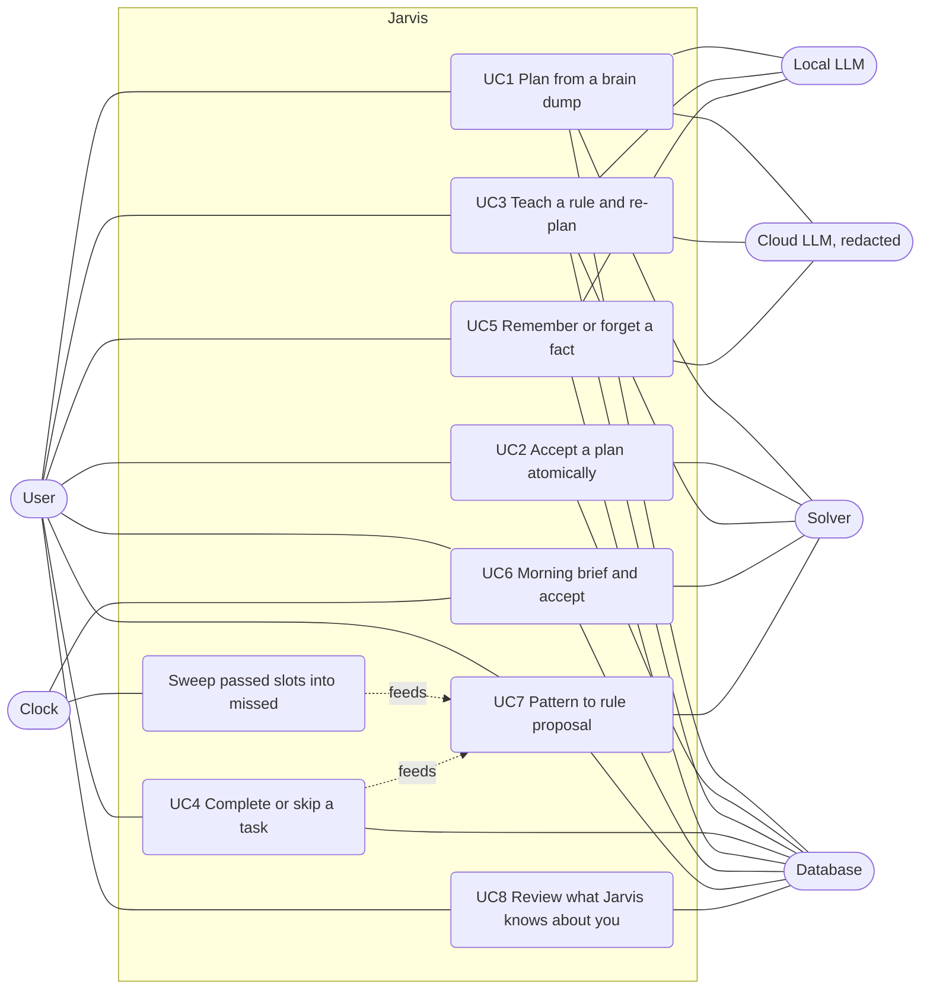

# 01 — Requirements

Jarvis is a personal intelligence for one person. It keeps their work ready before they ask: it turns a brain dump into a plan they can review, learns from what actually happened to their tasks (the outcome history), remembers what they tell it and forgets on request, and makes the first move (a morning brief, an offer to turn a habit into a rule) only within a consent policy the user controls. It runs local-first on an on-device model, with a cloud tier (Claude Sonnet, then Gemini as a last resort) that only ever receives redacted text. This document lists what the system must do (functional requirements), how well it must do it (non-functional requirements), who and what it interacts with (actors), and the eight core use cases in detail. Every requirement is traced to the endpoint or service that implements it and to the test or live-check step that proves it. File references are `path:line` at commit `d3e9132`, now part of `main`.

**Owner: ______**

---

## 1. Scope and terms

| Term | Meaning in this document |
|---|---|
| Brain dump | Free text the user types (goals, deadlines, habits, facts about themselves) |
| Draft | A proposed plan (`DraftSchedule`, `app/domain/entities.py:333`). Nothing reaches the user's tasks until a draft is accepted |
| Task outcome | One append-only `task_events` row: completed, skipped, missed (slot passed), deadline_missed, scheduled, rescheduled (`app/domain/entities.py:31-37`) |
| Rule | A behavioural constraint the planner must respect (`BehavioralConstraint`, `app/domain/entities.py:386`) |
| Memory | Something Jarvis knows about the user, with provenance "said" or "inferred" (`Memory`, `app/domain/entities.py:482`) |
| Pattern | A recurring behaviour a detector finds in the outcome history (`Pattern`, `app/domain/entities.py:562`) |
| Suggestion | A proactive proposal, held until the user accepts or dismisses it (`Suggestion`, `app/domain/entities.py:649`) |
| User's clock | The user's IANA timezone (profile, else `DEFAULT_TIMEZONE` = Asia/Kolkata, `app/core/config.py:178`). Minute 0 of a plan is 08:00 on that clock |

All API routes are mounted under `/api/v1` (`app/main.py:214`); only `GET /` and `GET /health` sit at the root (`app/main.py:226-232`). Caller identity is a required `user_id` (the `CurrentUser` seam, `app/api/deps.py:16-28`); there is no real authentication yet (spec non-goal).

---

## 2. Actors

| Actor | Kind | What it is in the code | Interacts through |
|---|---|---|---|
| **User** | Primary, human | The person Jarvis plans for | Chat stream `POST /api/v1/chat/stream` (`app/api/v1/endpoints/chat.py:22-56`), REST routes for drafts, tasks, memories, suggestions, You page |
| **Clock** | Primary, time | `AnticipationScheduler`, an in-process asyncio loop that ticks every `ANTICIPATION_TICK_SECONDS` = 60 s, handed to it by the composition root as `AnticipationSettings.tick_seconds` (`app/services/anticipation/scheduler.py:25-127`, `app/core/config.py:190`, `app/core/settings.py:124-128`), started in the lifespan (`app/main.py:153-169`). Each tick runs the due sweeps (slot sweep every minute, memory decay daily, session summaries every 5 minutes, checkpoint retention daily) and then each user's triggers | `AnticipationService.run_due` (`app/services/anticipation/service.py:233`) |
| **Local LLM** | Secondary, system | Gemma in LM Studio, adapted by `LocalLMStudioProvider` (`app/infrastructure/llm/local.py:16`). Tried first unless a cloud-first switch is on | `route_llm_call` (`app/core/model_router.py:347`) → provider chain |
| **Cloud LLM** | Secondary, system | `ClaudeProvider` (`app/infrastructure/llm/claude.py:82`, model `CLAUDE_MODEL`, default `claude-sonnet-5-5`, `app/core/config.py:51`), then `GeminiProvider` (`app/infrastructure/llm/gemini.py:15`). Every cloud provider is wrapped in `RedactingProvider` (`app/infrastructure/llm/factory.py:21-27`) | Same chain, after the local provider |
| **Solver** | Secondary, system | OR-Tools CP-SAT `JarvisScheduler` (`app/core/or_tools/solver.py`), reached through `run_schedule` (`app/services/planning/scheduling.py:174`) | Planning module `solve_schedule` (`app/modules/planning_graph.py:627`) |
| **Database** | Secondary, system | Supabase Postgres (with pgvector for memories) behind the repository ports (`app/domain/ports.py`), apart from the 6 files listed in `_RAW_TABLE_CALLS_ALLOWED` (`tests/test_layering.py:451-462`: chat sessions and messages, pending calendar updates, the workspace cache and its task and task-material reads, and the learning-style read); uploaded files in Supabase Storage behind `DocumentFileStore`; LangGraph checkpoints in a local SQLite file | Repositories built by `RepositoryFactory` (`app/infrastructure/persistence/factory.py:80`) |

---

## 3. Use-case diagram



Notes on the diagram:
- UC2 touches the Solver only on a late accept (some slots already passed), when the draft is re-solved from now (`app/services/draft_actions.py:95-99`).
- UC6 and UC7 draft through the `DraftPlanner` port; a re-plan may make one habit-translation model call, so they can also reach an LLM (`app/modules/planning_replan.py:1-8`, `:41-77`). The brief's own words are built from facts, with no model call (`app/services/anticipation/triggers.py:3-6`).
- UC8 makes no model call (`app/api/v1/endpoints/you.py:113-118`, "asks no model").

---

## 4. Functional requirements

Each row is testable. FR-34 to FR-36 came with the restructure, and FR-37 and NFR-16 with the fixes up to `cc8d170`; each sits in the section it belongs to. "Live" refers to a step of `scripts/live_e2e.py`, which drives the real server against real Supabase and the real model chain (steps listed at `scripts/live_e2e.py:7-29`; last full run at `d3e9132`: all steps passed with no traceback in the server log, per `.superpowers/sdd/2026-11-14-capstone-plan-3-finish-the-restructure/progress.md`).

### 4.1 Planning (UC1)

| ID | Requirement | Implemented by | Proved by |
|---|---|---|---|
| FR-1 | A brain dump that states a goal produces a draft plan; nothing is written to the user's tasks | `POST /api/v1/chat/stream` (`chat.py:22-56`) → `ChatTurnService` (`app/services/chat_turn/service.py:240`) → planning module → `create_draft` (`app/modules/planning_graph.py:721`) | `tests/behaviour/test_chat_turns.py::test_chat__brain_dump__proposes_a_draft_and_writes_no_tasks`; Live 1 |
| FR-2 | Every proposed task is 25 minutes or less and carries an if-then plan (WOOP) | Planning module, `TaskChunk` | `tests/behaviour/test_psychology.py::test_pomodoro__every_proposed_task__is_25_minutes_or_less`, `::test_woop__every_planned_task__keeps_its_if_then_plan_into_the_task_list` |
| FR-3 | The schedule never overlaps a hard block, keeps dependencies in order, and with no sleep habit keeps 00:00–08:00 free | `run_schedule` (`app/services/planning/scheduling.py:174`), `JarvisScheduler` | `tests/test_scheduler.py::test_hard_block_and_single_task`; `tests/behaviour/test_psychology.py::test_biology__no_sleep_habit__nothing_between_midnight_and_8am` |
| FR-4 | When the work does not fit, the horizon widens 3 → 5 → 7 → 14 → 30 days; past 30 days the user gets a scope message with no blame, never an error | The solver reports no room as `ScheduleInfeasibleError` (`scheduling.py:327`), which `solve_schedule` turns into the ladder (`planning_graph.py:698`); `HORIZON_RETRY_SEQUENCE`, `handle_infeasible` (`planning_graph.py:779-797`) | `tests/behaviour/test_psychology.py::test_anti_guilt__plan_no_horizon_can_hold__reply_is_the_scope_message_verbatim` |
| FR-5 | Plans run on the user's clock: minute 0 is 08:00 local; before 08:00 the logical day is yesterday; from 22:00 a new plan starts at 08:00 the next day | `logical_day_start` (`app/services/planning/local_time.py:77-95`) | `tests/behaviour/test_local_day.py::test_local_day__plan_at_half_past_one_ist__yesterdays_day_and_nothing_before_eight`, `::test_local_day__plan_late_in_the_evening__nothing_that_night__starts_at_eight_next_day` |
| FR-6 | The user can read a draft with each task's local start and end time | `GET /drafts/{id}` (`app/api/v1/endpoints/drafts.py:57-85`) | `tests/test_draft_endpoints.py::test_get_draft__solved_draft__schedule_slots_with_local_times` |

### 4.2 Accepting and rejecting a plan (UC2)

| ID | Requirement | Implemented by | Proved by |
|---|---|---|---|
| FR-7 | Accepting writes the draft's tasks and marks the draft accepted in one transaction; the user's other open drafts become superseded | `POST /drafts/{id}/accept` (`drafts.py:88-136`) or "looks good" in chat → `accept_on_time` (`app/services/draft_actions.py:61-99`) → `DraftService.accept` (`app/services/draft_service.py:185-226`) → SQL `accept_draft` (`supabase/migrations/20261115000007_user_tasks_not_before.sql:19-109`) | `tests/test_repository_contracts.py::test_drafts__accept_atomic__writes_rows_and_marks_accepted`, `::test_drafts__accept_atomic__two_open_drafts__the_other_is_superseded`; Live 2 |
| FR-8 | A second accept (double click, or REST then chat) answers 409 and writes nothing | `DraftSchedule.transition` (`entities.py:370-383`) and the SQL status check (`supabase/migrations/20261115000007_user_tasks_not_before.sql:66-68`) | `tests/test_draft_endpoints.py::test_accept_endpoint__second_call__409_envelope`; `tests/test_repository_contracts.py::test_drafts__accept_atomic__concurrent_calls__exactly_one_succeeds`; `tests/behaviour/test_chat_turns.py::test_chat__looks_good_sent_twice__second_one_writes_and_proposes_nothing`; Live 3, Live 4 |
| FR-9 | A late accept never writes a slot that has passed: some passed → re-solved from now and accepted (`moved`); all passed → 409 `draft_outdated`; no room left → 422 `schedule_infeasible` and the draft stays open | `accept_on_time` (`app/services/draft_actions.py:86-99`), `DraftOutdatedError` (`app/domain/errors.py:59-62`), `ScheduleInfeasibleError` (`app/domain/errors.py:65-67`) | `tests/test_accept_on_time.py::test_rest_accept__three_hours_late__moved_from_now_and_nothing_swept`, `::test_rest_accept__the_rest_no_longer_fits__422_and_the_draft_stays_open`; `tests/test_draft_service.py::test_accept__every_slot_already_started__draft_outdated_and_nothing_written` |
| FR-10 | Rejecting a draft stores the reason and remembers it as feedback the user said; nothing is written to tasks | `POST /drafts/{id}/reject` (`drafts.py:139-168`) | `tests/test_draft_endpoints.py::test_reject__reason__remembered_as_feedback_the_user_said`, `::test_reject__never_persists_tasks` |
| FR-34 | `GET /drafts/{id}` returns the draft's `version` (a fingerprint of its tasks and schedule). An accept that sends `expected_version` and finds the draft changed since that read answers 409 `stale_version`, carries the latest draft in `details.draft`, and writes nothing; an accept without it behaves as before | `DraftSchedule.version` (`entities.py:359-368`), `check_version` (`draft_service.py:62-71`), accept route (`drafts.py:114-119`) | `tests/test_drafts_one_path.py::test_rest_accept__edited_after_the_read__409_with_the_latest_and_nothing_written`, `::test_accept__stale_expected_version__stale_version_and_nothing_written`, `::test_rest_accept__no_expected_version__accepted_as_today` |
| FR-37 | A plan accepted or discarded from its card (REST) ends the review in its conversation: the next message there is answered as a conversation, nothing is planned again and no task changes; a second "looks good" or a "scrap it" after an accept is answered "already locked in" | `ChatTurn._close_review_of_a_closed_draft` (`app/services/chat_turn/service.py`) reads the draft's real status before the graph runs; `_classify_intent` (`app/orchestrator/graph.py`) | `tests/behaviour/test_chat_turns.py::test_chat__plan_accepted_from_its_card__next_message_is_a_conversation_not_a_replan`, `::test_chat__plan_discarded_from_its_card__next_message_is_a_conversation_not_a_replan`, `::test_chat__scrap_it_after_accepting_in_the_review_ui__never_claims_a_discard` |

### 4.3 Rules (UC3)

| ID | Requirement | Implemented by | Proved by |
|---|---|---|---|
| FR-11 | A rule stated in chat ("never before 11 AM") is stored and every later plan respects it on the user's clock | `store_constraint` node (`app/orchestrator/graph.py:492`), constraint bridge, solver hard block | `tests/behaviour/test_learning.py::test_bridge__rule_the_user_stated__moves_every_day_of_the_next_plan_out_of_it`; `tests/behaviour/test_local_day.py::test_local_day__never_before_11_am__holds_in_local_time_on_every_day`; Live 5, Live 6 |
| FR-12 | A rule and the memory of stating it are let go of together: forgetting the memory deletes the rule, deleting the rule forgets the memory | `StatedRules` (`app/services/memory/stated_rules.py:62`) | `tests/test_stated_rules.py::test_forget_memory__linked_rule__rule_deleted_and_memory_tombstoned`, `::test_delete_rule__linked_memory__memory_forgotten_and_the_same_rule_said_twice_gone`; Live 8 |

### 4.4 Task outcomes (UC4)

| ID | Requirement | Implemented by | Proved by |
|---|---|---|---|
| FR-13 | Completing a task records exactly one `completed` event; a repeat click records nothing | `POST /tasks/{id}/complete` (`app/api/v1/endpoints/tasks.py:101-129`) → `TaskService.complete` (`app/services/task_service.py:109-126`) | `tests/test_task_service.py::test_complete__double_click__second_returns_none_and_one_event`; Live 14 |
| FR-14 | Skipping records one `skipped` event with the optional reason, and the reply has no blame | `POST /tasks/{id}/skip` (`tasks.py:132-186`) → `TaskService.skip` (`task_service.py:128-140`) | `tests/test_task_service.py::test_skip__pending__skipped_event_with_reason_and_task_skipped_published`; `tests/behaviour/test_psychology.py::test_anti_guilt__skipping_tasks__every_reply_is_blame_free` |
| FR-15 | "Missed" is inferred, never asked: a pending task whose slot ended more than 30 minutes ago with no outcome becomes missed | `TaskService.sweep_passed_slots` (`task_service.py:170-217`), `SLOT_GRACE_MINUTES` = 30 (`config.py:183`), run every minute by `SlotPassedSweep` (`task_service.py:310-340`) | `tests/test_task_service.py::test_sweep__slot_ended_31_min_ago__missed_event_and_status`, `::test_sweep__slot_ended_29_min_ago__untouched` |
| FR-16 | A missed or skipped task can still be completed ("I actually did that") | `_COMPLETE` move (`task_service.py:74-79`) | `tests/test_task_service.py::test_complete__missed_task__allowed_and_status_completed` |
| FR-17 | A task's status changes only through its outcomes (complete, skip, the slot sweep) and draft acceptance: no route edits or deletes a task, so `PATCH /tasks/{id}`, `DELETE /tasks/{id}` and `DELETE /tasks/` answer 404 / 405 and change nothing | The tasks router declares only complete, skip and the list (`tasks.py:101-210`) | `tests/test_tasks_one_path.py::test_task_routes__patch_and_deletes__gone_405_or_404` |

### 4.5 Memory (UC5)

| ID | Requirement | Implemented by | Proved by |
|---|---|---|---|
| FR-18 | A fact the user states is remembered with provenance "said"; said again it is reinforced, not stored twice; a contradiction supersedes the old fact | `MemoryService.remember` (`app/services/memory/memory_service.py:197-272`), called from the observation loop (`app/core/observation.py:247`) | `tests/test_memory_service.py::test_remember__same_fact_again__reinforced_not_duplicated_and_confirmed`, `::test_remember__contradiction__old_superseded_new_active`; Live 7, Live 10a |
| FR-19 | Forgetting erases the words at once; the same fact said again later is recognised and not stored, and a rule said again after its memory was forgotten is not stored as a rule again | `DELETE /memories/{id}` (`app/api/v1/endpoints/memories.py:146-161`), `MemoryService.forget` (`memory_service.py:304-320`), suppression (`memory_service.py:221-229`); `MemoryService.drop_let_go` (`memory_service.py:451-461`), checked by `store_constraint` before it stores (`app/orchestrator/graph.py:469-489`) | `tests/test_memory_service.py::test_remember__after_forget__suppressed_and_nothing_written`; `tests/test_memories_api.py::test_memories_api__forget_then_list__gone`; `tests/behaviour/test_learning.py::test_forgotten_rule__said_again_alone__nothing_stored_and_no_failure_claimed`; Live 8, Live 10b |
| FR-20 | The user can confirm, dismiss or edit a memory; a dismissed or forgotten memory cannot be confirmed or edited (409) | `memories.py:128-190`, `MemoryService.confirm/dismiss/edit` | `tests/test_memories_api.py::test_memories_api__confirm_after_dismiss__409_envelope`; `tests/test_memory_service.py::test_confirm_or_edit__dismissed_or_forgotten__conflict_and_unchanged` |
| FR-21 | What the model is told about the user per message stays within a fixed token budget, however many memories exist | `MemoryService.recall` (`memory_service.py:373`) | `tests/test_recall.py::test_recall__hundred_memories__never_over_500_tokens` |
| FR-22 | A new conversation is told what happened since the last one ("Since we last spoke") | `ConversationMemoryService` (`app/services/memory/conversation_memory.py:184`) | `tests/behaviour/test_short_term_memory.py::test_short_term__new_session__model_told_since_we_last_spoke`; Live 11 |

### 4.6 Anticipation (UC6, UC7)

| ID | Requirement | Implemented by | Proved by |
|---|---|---|---|
| FR-23 | From the user's wake time, for 6 hours on their clock, once per local day, Jarvis drafts today's plan (pending tasks plus slots that passed since yesterday, re-slotted) with at most one "I noticed" line, and asks before changing anything | `MorningBriefTrigger` (`app/services/anticipation/triggers.py:90-224`), `MORNING_BRIEF_WINDOW_HOURS` (`config.py:196`) | `tests/test_triggers.py::test_brief__after_wake__pending_suggestion_with_draft_and_ask_reason`, `::test_brief__second_run_same_local_day__already_done`, `::test_brief__utc_midnight_crossing__fires_once_per_local_day`; Live 12 |
| FR-24 | Accepting the brief puts its plan in place exactly once (refreshed first if a slot began or a task was finished meanwhile); a second accept is 409 | `AnticipationService.accept` (`app/services/anticipation/service.py:300-355`), `ApplyDraftAction` (`app/services/anticipation/actions.py:34-93`) | `tests/test_anticipation_service.py::test_accept__double_click__second_409_and_action_executed_once`; `tests/test_triggers.py::test_brief__task_done_before_accept__plan_refreshed_and_accepted`; Live 13 |
| FR-25 | When an hour has 3 or more outcomes and at least 70% of them were set aside, Jarvis offers to keep that hour clear; accepting stores the rule and drafts a plan that keeps it | `SkipTimeWindowDetector` (`app/services/memory/patterns.py:187-226`), `PatternRuleTrigger` (`triggers.py:303-389`), `AdoptRuleAction` (`actions.py:103-238`) | `tests/behaviour/test_anticipation.py::test_anticipation__three_skips_at_nine__rule_suggested_accepted_and_next_plan_keeps_nine_free` |
| FR-26 | Every proactive action passes the consent chain: a dismissed proposal is never made again; read-only information is allowed; an hour the user already said to keep free is denied quoting their words; otherwise the autonomy mode decides | `ConsentPolicy.default` (`app/domain/anticipation.py:236-241`) | `tests/test_consent.py` (13 test functions, e.g. `::test_consent__blocked_hours_inside_stated_block__deny_rule_match`) |
| FR-27 | The user (or a demo) can run any registered trigger now; an unknown trigger name is 422 | `POST /anticipation/run` (`app/api/v1/endpoints/anticipation.py:210-234`) | `tests/test_anticipation_api.py::test_anticipation_api__run_unknown_trigger__422_envelope`, `::test_anticipation_api__run_a_newly_registered_trigger__no_api_edit_needed` |
| FR-28 | The user sets autonomy mode, wake time and timezone; an unknown timezone is 422 and changes nothing | `PATCH /you/settings` (`app/api/v1/endpoints/you.py:133-151`), `UserModelService.update_settings` (`app/services/user_model_service.py:240-266`) | `tests/test_you_api.py::test_you_api__bad_timezone__422_envelope`; `tests/test_user_model_service.py::test_update_settings__autonomy_and_wake_time__persisted` |

### 4.7 Understanding and review (UC8)

| ID | Requirement | Implemented by | Proved by |
|---|---|---|---|
| FR-29 | One read shows what Jarvis knows: profile, patterns with their evidence, rules, memories with provenance and freshness, the focus profile, and a 30-day privacy receipt | `GET /you` (`you.py:109-130`), `UserModelService.snapshot` (`user_model_service.py:192-238`) | `tests/test_user_model_service.py::test_snapshot__history__patterns_with_evidence_and_memory_ids`; `tests/test_you_api.py::test_you_api__get__matches_response_model`; Live 11b |
| FR-30 | The focus profile is learned from the outcome history (28 days, smoothed toward a prior, "learned" from 10 outcomes) | `HistoryEnergyEstimator` (`app/services/energy.py:67-134`), constants `config.py:211-213` | `tests/test_energy.py::test_history_estimator__evening_done_morning_skipped__learned_and_evening_higher`, `::test_history_estimator__sparse_hour__pulled_toward_prior` |
| FR-31 | A learned focus profile leans hard tasks toward the user's peak hours; it ranks below deadline priority, never breaks a hard block, and a flag turns it off | `solver_focus` (`energy.py:137-154`), `ENERGY_OBJECTIVE_*` (`config.py:204-210`) | `tests/test_scheduler.py::test_energy_term__hard_blocks_never_violated`, `::test_energy_term__task_due_today__tmt_order_kept`, `::test_energy_term__flag_off__identical_to_no_profile` |
| FR-32 | Every model call is recorded (where it ran, tokens, redactions) for the privacy receipt | `MeteredProvider` (`app/infrastructure/llm/decorators.py:251-325`) → `UsageLedger` (`app/services/usage_ledger.py:33`) | `tests/test_container.py::test_container__route_llm_call__usage_recorded_for_the_attributed_user`; Live 9 |
| FR-36 | `GET /you` returns `streak_days`: consecutive days on the user's clock with a completed task. A streak is not broken until the local day ends: with nothing done yet today it counts back from yesterday. The coach uses the same count | `compute_streak_from_events`, `streak_as_of` (`app/services/analytical/mastery_tracker.py:230-259`), `YouResponse.streak_days` (`you.py:70-77`) | `tests/test_you_api.py::test_you_api__streak_days__the_coachs_streak_on_the_users_days`; `tests/test_local_day_fixes.py::test_streak__nothing_yet_today__counts_back_from_yesterday`, `::test_streak__ist_00_30__yesterdays_evening_keeps_it_and_the_new_day_starts_on_ist` |

### 4.8 Cross-cutting

| ID | Requirement | Implemented by | Proved by |
|---|---|---|---|
| FR-33 | No user can read or change another user's drafts, tasks, memories or suggestions; such ids answer 404 | Every repository method takes `user_id` first (`app/domain/ports.py:1-5`) | `tests/test_draft_endpoints.py::test_accept_wrong_user`; `tests/test_memories_api.py::test_memories_api__other_users_memory__404`; `tests/test_anticipation_service.py::test_accept__other_users_suggestion__404`; `tests/behaviour/test_chat_turns.py::test_chat__two_users__neither_sees_nor_accepts_the_others_draft` |
| FR-35 | A chat request is bounded before any work starts: a message over 8,000 characters, a file that decodes to more than 10 MB, a `media_type` other than pdf / image / png / jpeg, or a `model_mode` other than auto / cloud / gemini / 4b is a 422 envelope, the input is not echoed back, and no turn runs. A body larger than any valid request (about 14 MB) is refused 413 `payload_too_large` before it is read | `MAX_CHAT_PROMPT_CHARS`, `MAX_CHAT_UPLOAD_BYTES` (`config.py:278-279`); `ChatStreamRequest` (`app/schemas/chat_stream.py:44-87`); `within_upload_limit` (`app/schemas/upload.py:13-27`); `BodyLimitMiddleware` (`app/api/request_limits.py:21-33, 38-96`) | `tests/test_chat_turn.py::test_chat_stream__request_over_a_limit__422_envelope_and_no_turn`, `::test_chat_stream_request__at_the_limits__accepted`; `tests/test_api_contract.py::test_chat_stream__unknown_model_mode__422_envelope`, `::test_chat_stream__unknown_media_type__422_envelope`, `::test_upload_routes__content_length_over_the_cap__413_envelope_before_the_body_is_read` |

---

## 5. Non-functional requirements

Only numbers that exist in the code, the tests or the build ledgers are given.

| ID | Quality | Requirement | Evidence (code) | Measured / proved |
|---|---|---|---|---|
| NFR-1 | Latency: solving | A solve is bounded by a wall-clock cap and stops early once it stops improving | `SOLVER_MAX_TIME_SECONDS` = 10 (`config.py:223`); `SOLVER_IDLE_STOP_SECONDS` = 1.0 (`config.py:232-234`); solve off the event loop with `asyncio.to_thread` (`planning_graph.py:688-697`) | Plan 2 ledger, Task 3: at a 0.75 s idle stop, 8 tasks over 48 h solved in about 1.0–1.35 s and 12 tasks over 72 h in 0.8–1.8 s, against the 10 s cap; the idle stop was then raised to 1.0 s, which the config notes costs about 0.25 s more per solve. Test: `tests/test_scheduler.py::test_solve__idle_stop_on__feasible_plan_within_the_cap_and_blocks_hold` |
| NFR-2 | Latency: models | No model call can hang: 60 s per completion, 120 s between streamed tokens; a module step is capped at 30 s | `LLM_TIMEOUT_SECONDS`, `LLM_STREAM_TIMEOUT_SECONDS` (`config.py:59-60`); `TimeoutProvider` (`decorators.py:181-209`); `timeout_ms` default (`app/core/module_framework.py:30`) | `tests/test_llm_providers.py::test_timeout__hung_complete__raises_llm_timeout`, `::test_timeout__hung_stream__raises_llm_timeout` |
| NFR-3 | Cost | The stable system prompt is sent as a cached block so a repeat is billed at the cache-read rate | `cache_control` (`app/infrastructure/llm/claude.py:176-179`) | Live 11a observed `cache_read_tokens=1398` on the second reply of a conversation (plan 2 ledger). Tests: `tests/test_claude_provider.py::test_claude__system_prompt__sent_as_cached_block`; `tests/test_prompt_layout.py::test_two_turns__system_block_and_message_prefix_identical_up_to_the_note` |
| NFR-4 | Privacy: local-first | The on-device model is tried first; cloud providers come after it | Chain order local → Claude → Gemini (`app/infrastructure/llm/factory.py:40-56`) | `tests/test_claude_provider.py::test_factory__with_anthropic_key__order_is_local_claude_gemini` |
| NFR-5 | Privacy: redaction | Nothing reaches a cloud model unredacted: the prompt, the system prompt and every history message pass the PII gate; if the gate denies or asks, nothing is sent | `RedactingProvider._redacted` (`decorators.py:99-120`); `PreCloudLLMRedactor` fails closed (`app/core/model_router.py:83-89`); the gate itself is regex-only, email and phone (`app/orchestrator/hooks.py:59-60`) | `tests/test_llm_providers.py::test_redacting__email_in_history_and_system_prompt__redacted`, `::test_redactor__hook_denies_or_asks__fails_closed_and_nothing_is_sent`, `::test_route_llm_call__local_fails__cloud_receives_redacted_prompt_system_and_history` |
| NFR-6 | Privacy: receipt | The user can see how many calls ran on the device, how many went to the cloud, and how many details were redacted | `PrivacyReceipt` (`user_model_service.py:128-139`) | `tests/test_user_model_service.py::test_snapshot__receipt__last_30_days_and_says_so`; Live 9, Live 11b |
| NFR-7 | Reliability: outages | A database outage is a 503 with the error envelope, never an empty list and never a 404 (the session reads included); a connection that cannot be made, or a kept-alive connection dropped under a read, is retried once before it counts; a write is never retried | `PersistenceError` (`app/domain/errors.py:74-76`); `require_supabase` (`app/api/deps.py:31-37`); `_SupabaseRepository._run` (`app/infrastructure/persistence/supabase_repos.py:173-180`); `ConnectRetryTransport` (`app/db/supabase_py.py:31-66`) | `tests/test_you_api.py::test_you_api__store_down__503_envelope`; `tests/test_api_contract.py::test_sessions_read__database_unreachable__503_envelope_never_an_empty_list`; `tests/test_supabase_client.py::test_connect_retry__first_connect_fails__retried_once_after_a_short_jittered_pause`, `::test_connect_retry__kept_alive_connection_dropped_on_a_read__retried_once`; `tests/test_memories_api.py::test_memories_api__no_database__503_on_every_route_never_empty_or_404`; `tests/test_anticipation_api.py::test_anticipation_api__database_unavailable__503_on_every_route` |
| NFR-8 | Reliability: no leaks | No exception text reaches a client; unhandled errors are logged with a request id and answered with a fixed message | `_handle_unhandled` (`app/api/error_handlers.py:184-194`); the stream's error frame (`app/services/chat_turn/service.py:212-223`, built by `error_frame`, `app/services/chat_turn/frames.py:36-39`) | `tests/test_errors.py::test_error_envelope__unhandled_exception__hides_internals`; `tests/test_error_text_leaks.py` (18 test functions) |
| NFR-9 | Reliability: tests | The whole suite runs offline (a socket guard fails any non-localhost connect) | `tests/conftest.py` | `2340 passed, 2 xfailed, 2 deselected` at `670e2d5`; the 2 xfails are `strict=True` known gaps (`tests/behaviour/test_psychology.py:119`, `:249`) |
| NFR-10 | Honesty | Jarvis never claims something that did not happen: a write that did not land is reported as not saved; no background re-plan is claimed; the reply names the model that actually answered | `replan_triggered` always False (`tasks.py:74-76`); "didn't commit" reply (`app/orchestrator/graph.py:642-653`); `ServedModels` (`decorators.py:216-236`) | `tests/test_draft_endpoints.py::test_accept__persist_failure__does_not_report_accepted`; `tests/behaviour/test_chat_turns.py::test_chat__claude_answers__reply_names_claude_not_gemini` |
| NFR-11 | Honesty: anti-guilt copy | Unfinished work is never a failing. User-facing text never contains a blame phrase; a passed slot is "set aside" and "found a new slot"; an impossible plan is "a scope problem, not a you problem" | `BLAME_PHRASES` (`app/domain/anti_guilt.py:11-21`); evidence labels (`patterns.py:61-66`, `user_model_service.py:50-56`); scope message (`planning_graph.py:790-797`) | `tests/test_patterns.py::test_copy__every_detector__speaks_to_the_user_plainly_and_without_blame`; `tests/test_triggers.py::test_brief__copy__no_blame_phrases_and_peak_claim_only_when_learned`; `tests/behaviour/test_psychology.py` (14 `test_anti_guilt__*` functions) |
| NFR-12 | Honesty: no faked intelligence | Every pattern, focus score and insight shown is computed live from the outcome history; the demo history is seeded, the inference is not | Patterns read only `task_events` (`patterns.py:3-5`); "learned" only from 10 outcomes (`energy.py:117-121`); peak-hour claim only when the learned score says so (`triggers.py:293-300`) | `tests/test_energy.py::test_history_estimator__no_events__prior_and_source_prior`; `tests/test_triggers.py::test_brief__copy__no_blame_phrases_and_peak_claim_only_when_learned` |
| NFR-13 | Security / isolation | Every query is scoped to the caller's `user_id`; row-level security is enabled on every user table | Ports contract (`ports.py:1-5`); migrations | `tests/test_data_isolation.py`; `tests/test_migrations.py::test_migrations__every_user_table__has_rls_enabled` |
| NFR-14 | Maintainability | The domain imports no outer layer; nothing below the API imports the API; only the composition root constructs repositories; collaborators are passed in, never looked up from a process-wide registry; every model call goes through `route_llm_call`; a raw `.table(...)` call outside the repositories is allowed only in 6 listed files, each with its reason | `tests/test_layering.py`, `_RAW_TABLE_CALLS_ALLOWED` (`tests/test_layering.py:451-462`); `tests/test_injection.py` | `tests/test_layering.py::test_domain__imports_nothing_from_outer_layers`, `::test_layering__nothing_below_the_api__imports_the_api`, `::test_layering__only_container_builds_repositories`, `::test_llm_calls__outside_the_transport__go_through_route_llm_call`, `::test_layering__no_raw_table_calls_outside_the_allow_list`; `tests/test_injection.py::test_runtime_registry__gone_and_imported_nowhere` |
| NFR-15 | Accessibility basics (frontend) | Live updates are announced, errors are announced, motion respects the user's setting, icon buttons are labelled | `jarvis-frontend` at `4fa06ef`: `role="status" aria-live="polite"` on the "While you were away" panel (`components/app/WhileYouWereAway.tsx:267`); `role="alert"` on errors (`components/app/ErrorState.tsx:29,47`, `components/app/you/AutonomySettings.tsx:150`); `prefers-reduced-motion` (`app/globals.css:88`); 44 `aria-label` attributes under `app/` and `components/` | No automated accessibility audit has been run; this row records what is in the markup, not a WCAG conformance claim |
| NFR-16 | Responsiveness under uploads | Reading an uploaded document never stops other requests: Docling runs on a worker thread, one document at a time, for at most 120 s (then 503 `document_read_timeout`) | `read_document`, `read_document_with_provenance`, `DOCUMENT_READ_TIMEOUT_S` (`app/utils/docling_helper.py`); `DocumentReadTimeoutError` (`app/domain/errors.py`) | `tests/test_document_reading.py::test_read_document__parse_takes_a_while__the_loop_keeps_serving`, `::test_read_document__parse_never_returns__times_out_as_a_503`, `::test_read_document__two_uploads_at_once__parsed_one_at_a_time`. Before `975b0c6` the parse ran on the event loop, and one parse that never returned froze the server |

---

## 6. Use-case specifications

### UC1 — Plan from a brain dump

| | |
|---|---|
| Actors | User (primary); Local LLM, Cloud LLM, Solver, Database |
| Trigger | The user sends a message that states a goal, e.g. "I have a data structures exam on Friday. Plan my revision." |
| Preconditions | The server is running; the user has a `user_id`. A model is reachable (local or cloud). |
| Main flow | 1. Client posts to `POST /api/v1/chat/stream`; the router only parses the request and opens the turn with `ChatTurnService.open_turn` (`chat.py:43-56`). 2. The turn takes the conversation's turn lock, then loads history and memories under it (`app/services/chat_turn/service.py:135-136`). 3. The brain dump is extracted (one FAST-role model call) and the intent is classified by rules. 4. The planning module validates the goal, reads constraints, translates free-text habits (PRIMARY-role call, under the PRIMARY lock when local), decomposes the goal into tasks of 25 minutes or less, and fuses them with pending tasks. 5. The solver schedules them on the user's clock from 08:00 local (`run_schedule`, off the event loop, `planning_graph.py:688-697`). 6. A draft is stored as PENDING; `user_tasks` is untouched. 7. Jarvis replies over SSE (`phase`, `message`, ..., `complete` with the `draft_id`). |
| Alternate flows | A1. The solver finds no room (`ScheduleInfeasibleError`): the horizon widens 3 → 5 → 7 → 14 → 30 days (`planning_graph.py:698`, `:779-789`). A2. The user's habits could not be read (model down): the plan says so and offers a redo (`tests/behaviour/test_anticipation.py::test_plan__habits_could_not_be_read__the_reply_says_so_and_offers_a_redo`). A3. A greeting or emotional message skips extraction and costs one model call (`tests/behaviour/test_chat_turns.py::test_chat__greeting__skips_extraction_and_costs_one_model_call`). |
| Exceptions | E0. The message is over 8,000 characters or the file over 10 MB: 422 envelope before the turn starts (FR-35). E1. Nothing fits even in 30 days: the reply is the scope message "This is a scope problem, not a you problem" (`planning_graph.py:790-797`); no draft. E2. The solve outlasts its step timeout: no plan is claimed and no draft is made (`tests/behaviour/test_chat_turns.py::test_chat__solve_outlasts_its_step_timeout__no_plan_claimed_and_no_draft`). E3. Every model provider fails: the module replies with a fixed, honest line and the stream still ends with `complete` (`app/modules/conversation.py:194-198`). E4. A second turn on the same conversation waits; past 120 s it gets a conflict frame (`app/services/turn_locks.py:23-62`). |
| Postconditions | Success: one open draft for the user; no task rows changed. Failure: no draft, no task rows changed. |

### UC2 — Accept a plan atomically

| | |
|---|---|
| Actors | User; Database; Solver (late accept only) |
| Trigger | The user clicks Accept (`POST /drafts/{id}/accept`) or says "looks good" in chat |
| Preconditions | The user owns an open draft (PENDING or MODIFIED) that has not expired |
| Main flow | 1. The endpoint hands the draft id to `accept_on_time`, which reads the draft for this user (404 otherwise, `draft_actions.py:86`). 2. It checks the draft can move to ACCEPTED (fails fast if closed), that it is still the version the client read when `expected_version` is sent, and whether any slot has begun (`draft_actions.py:87-94`). 3. `DraftService.accept` repeats the state and version checks, builds the task rows and calls `DraftRepository.accept_atomic` (`draft_service.py:198-213`). 4. The SQL function `accept_draft` locks the user's profile row, then the draft row; re-checks status and expiry; deletes the user's pending tasks (and missed tasks the plan re-slots); inserts the new rows; marks the draft accepted; supersedes the user's other open drafts — one transaction (`supabase/migrations/20261115000007_user_tasks_not_before.sql:54-108`). 5. A SCHEDULED or RESCHEDULED event is recorded for each slotted task (best effort, `draft_service.py:264-297`) and `DraftAccepted` is published (`draft_service.py:217-225`). 6. The response is `{"status": "accepted", "draft_id": ..., "task_count": n, "moved": false}` (`drafts.py:130-136`). |
| Alternate flows | A1. Some slots have already begun: the draft's own tasks are re-solved from now under every rule, the new times are stored on the draft, then it is accepted with `moved: true` (`draft_actions.py:95-99`). A2. Chat accept: the negotiation pre-check routes "looks good" to the same `accept_draft_on_time` (`graph.py:617`). |
| Exceptions | E1. Already accepted / rejected / superseded / expired: 409 `invalid_state_transition`, nothing written. E2. Two accepts at once: exactly one succeeds; the other gets 409 (the SQL row locks serialise them). E3. Every slot has begun: 409 `draft_outdated`, nothing written (`draft_service.py:207-209`). E4. Late and the rest no longer fits: 422 `schedule_infeasible`, draft stays open (`draft_actions.py:95-97`). E5. A task id collides with one of the user's finished tasks: 409 `conflict` "That plan clashes with tasks you already have" (`app/infrastructure/persistence/_mapping.py:147-155`). E6. Database down: 503, "The draft is still open; try again" (`drafts.py:123-129`). E7. The draft changed since the client read it (`expected_version` sent and stale): 409 `stale_version` with the latest draft under `details.draft`, nothing written (`drafts.py:114-119`, `draft_service.py:62-71`). |
| Postconditions | Success: the draft is ACCEPTED, the user's pending tasks equal the draft's rows, other open drafts are SUPERSEDED. Failure: nothing changed. |

### UC3 — Teach a rule and re-plan

| | |
|---|---|
| Actors | User; Local LLM / Cloud LLM; Solver; Database |
| Trigger | The user states a rule, e.g. "From now on never schedule any study before 11 AM" |
| Preconditions | A model can extract the rule from the message |
| Main flow | 1. The brain dump carries the rule as an inline habit; intent BEHAVIORAL_CONSTRAINT. 2. `store_constraint` saves each habit as a rule through the turn's `ConstraintRepository`, deterministically, and confirms it in words; a habit whose memory the user forgot or dismissed is not stored again (`graph.py:450-547`). 3. The observation loop remembers the statement as a "said" memory and links the rule to it (`app/core/observation.py:247-268`). 4. The user asks for a plan again. 5. Planning reads the rule (and constraint memories no rule covers) and the solver treats the rule's window as a hard block on the user's clock. 6. The new draft has nothing in 08:00–11:00 local on any day. |
| Alternate flows | A1. The rule cannot be pinned down: Jarvis asks for it as one habit, e.g. "no study before 11am" (`graph.py:503-510`). A2. The user later forgets the memory or deletes the rule: both go, and the morning is free again in the next plan (`tests/test_stated_rules.py::test_replan__after_forgetting_the_memory__morning_free_again`). |
| Exceptions | E1. The rule cannot be saved (database write refused): Jarvis says it couldn't save it and suggests trying again (`graph.py:531-538`); nothing is claimed. E2. Habits cannot be read during the re-plan: the plan says so (see UC1 A2). |
| Postconditions | The rule is stored and linked to its memory; every later plan respects it until the user lets it go. |

### UC4 — Complete or skip a task

| | |
|---|---|
| Actors | User; Database; Clock (missed inference) |
| Trigger | The user clicks Complete (`POST /tasks/{id}/complete`) or Skip (`POST /tasks/{id}/skip`) |
| Preconditions | The task exists for this user; the database is reachable |
| Main flow | 1. `TaskService` reads the task. 2. It moves the status with a compare-and-set on the status it read (`task_service.py:225-250`). 3. It appends one outcome event (`completed` with quality and actual minutes in its metadata, or `skipped` with the reason) (`task_service.py:252-293`). 4. It publishes `TaskCompleted` or `TaskSkipped`; `PatternObserver` runs PEARL in the background (`patterns.py:697-724`); the request does not wait. 5. The reply is plain and blame-free ("Life happened — ... is off the list for now", `tasks.py:170-179`). |
| Alternate flows | A1. Missed by inference: the Clock's slot sweep marks a pending task missed 30 minutes after its slot ended, with a `missed` event (`task_service.py:170-217`). A2. "I actually did that": a missed or skipped task may still be completed (`task_service.py:74-79`). |
| Exceptions | E1. Double click: the second call finds the task already completed and records nothing (200, same answer). E2. Skip of a task already done: "already done, so nothing changed" (`tasks.py:156-164`). E3. Unknown task: 404. E4. Database down: 503, never 404 (`tasks.py:95-97`, `:116`, `:150`). E5. The event write fails after the status moved: the status is set back and the error raised, so a retry records it (`task_service.py:287-291`). |
| Postconditions | Exactly one outcome event per real outcome; the task's status is its current state; learning sees the new evidence on its next run. |

### UC5 — Remember or forget a fact

| | |
|---|---|
| Actors | User; Local LLM / Cloud LLM (extraction); Database |
| Trigger | The user states a fact ("I'm a night owl and do my best work after 9 pm"), or opens the memory panel and forgets one |
| Preconditions | The text embedder is available for remembering (forgetting does not need it) |
| Main flow (remember) | 1. The turn's brain dump carries the fact as a memory. 2. `MemoryService.remember` embeds it, then in order: suppresses it if close to anything the user forgot or dismissed; supersedes a memory it contradicts; reinforces a close memory of the same type; otherwise creates it with provenance "said" and the source session (`memory_service.py:197-272`). 3. A `memory_extracted` frame reaches the client before `complete` (Live 10a). |
| Main flow (forget) | 1. `DELETE /memories/{id}`. 2. `StatedRules.forget_memory` forgets the memory and deletes any rule linked to it (`memories.py:158-161`). 3. The memory's words are erased; the row stays as a tombstone with its embedding and pattern key (`memory_service.py:304-320`). |
| Alternate flows | A1. Dismiss instead of forget: hidden for good, words kept (`memory_service.py:286-302`). A2. Confirm: confidence at least 0.9 (`memory_service.py:274-284`). |
| Exceptions | E1. The forgotten fact is said again: suppressed, nothing written (Live 10b). A forgotten rule said again is not stored as a rule either (`graph.py:469-489`). E2. Embedder unavailable: nothing is learned this turn and the turn goes on (`observation.py:256-258`); editing a memory answers 503 (`tests/test_memories_api.py::test_memories_api__embedder_unavailable_on_edit__503_envelope`). E3. Another user's memory: 404. E4. Confirm or edit after dismiss/forget: 409. |
| Postconditions | Remember: one active memory per fact. Forget: the words are gone from every list and from what the model is told; the fact is never stored again automatically. |

### UC6 — Morning brief and accept

| | |
|---|---|
| Actors | Clock (primary); User; Solver; Database |
| Trigger | A scheduler tick inside the user's brief window (wake time to wake time + 6 h, their clock), or `POST /anticipation/run {"trigger": "morning_brief"}` |
| Preconditions | The user has a profile (created with defaults if absent: wake 07:00, Asia/Kolkata, ask_first; `entities.py:229-242`) |
| Main flow | 1. `AnticipationService.run_due` takes the user's lock (`service.py:244`). 2. `Trigger.run` (template): due? → already made today? → gather → build → consent → store (`app/domain/anticipation.py:353-421`). 3. Gather: pending tasks, set-aside slots since yesterday, the first pattern worth telling (`triggers.py:127-136`). 4. Build: `DraftPlanner.replan` drafts the pending tasks plus re-slots (`triggers.py:146-148`); the body is built from facts ("6 tasks are planned for today; the hardest ... is at 20:15", "3 from yesterday found a new slot", "I noticed ..."). 5. Consent: an `apply_plan` action is a schedule change, so under `ask_first` it asks (`app/domain/anticipation.py:187-189`). 6. Stored as a PENDING suggestion that expires at the end of the local day. 7. The user accepts: `AnticipationService.accept` claims it (PENDING → ACCEPTED, compare-and-set), runs `ApplyDraftAction`, which accepts the draft atomically (UC2). |
| Alternate flows | A1. Nothing to plan but a pattern to tell: a read-only "Something I noticed" suggestion (allowed by the risk check). A2. A slot began or a task was finished before the accept: the plan is redrafted from now and that plan is accepted, saying so (`actions.py:80-93`). A3. Autonomy `auto_low_risk`: still asks, because applying a plan is a schedule change (`app/domain/anticipation.py:192-196`). |
| Exceptions | E1. Nothing fits today: an "About today" note instead of a plan (`triggers.py:149-162`). E2. Habits cannot be read: the run fails, nothing is settled, and the tick retries after 1, 2, 4 ... up to 30 minutes (`service.py:273-285`). E3. Accept twice: second is 409, action ran once. E4. A newer plan was accepted first: 409, suggestion marked expired (`service.py:333-341`). |
| Postconditions | At most one brief per user per local day; on accept, today's plan is in place exactly once. |

### UC7 — Pattern to rule proposal

| | |
|---|---|
| Actors | User; Clock (via the slot sweep); Database; Solver |
| Trigger | A task outcome (or a missed slot from the sweep) publishes an event; PEARL finds a skip window and publishes `PatternDetected` |
| Preconditions | At least 3 outcomes at one local hour, at least 70% set aside, in the last 28 days (`patterns.py:68-69`, `FOCUS_WINDOW_DAYS`, `config.py:211`) |
| Main flow | 1. `PatternObserver` runs `PatternService.observe` in the background (`patterns.py:710-724`). 2. The pattern is remembered as an "inferred" memory with a stable key such as `skip_time_window:9` (`patterns.py:638-660`). 3. `AnticipationListener` runs `PatternRuleTrigger` for that user (`triggers.py:401-436`). 4. The trigger picks the first qualifying window not yet proposed (`triggers.py:334-360`) and drafts "You've set aside n of the last m tasks around 9 AM. Want me to keep that hour clear?". 5. Consent: `adopt_rule` is a schedule change → ask. 6. The user accepts: the pattern's memory is confirmed, a rule blocking that hour is stored once, and a new draft that keeps it is proposed (`actions.py:160-204`). |
| Alternate flows | A1. The user dismisses the proposal: its key is never proposed again (`RepeatDismissalRule`, `app/domain/anticipation.py:123-133`). A2. The user already said a rule covering that hour: denied, quoting their words (`app/domain/anticipation.py:149-164`). |
| Exceptions | E1. The user dismissed or forgot the pattern after it was proposed: accept is 409 "You told me this pattern doesn't fit", no rule stored (`actions.py:171-178`). E2. Habits cannot be read for the redraft: the rule is saved and the message says the redraft waits (`actions.py:187-194`). E3. Nothing fits: the rule still holds for later plans (`actions.py:185-196`). |
| Postconditions | On accept: one rule linked to the pattern's memory; letting go of either lets go of both (`tests/test_stated_rules.py::test_pattern_let_go__its_adopted_rule_goes_too`). |

### UC8 — Review "what Jarvis knows about you"

| | |
|---|---|
| Actors | User; Database |
| Trigger | The user opens the You page (`GET /api/v1/you`) |
| Preconditions | The database is reachable |
| Main flow | 1. `UserModelService.snapshot` reads the profile and the last 60 days of outcomes once; PEARL and the focus profile use the last 28 of those days, the streak all 60 (`user_model_service.py:204-213`). 2. In parallel: PEARL's idempotent look (single-flight per user), active rules, memories in use, the focus profile, and the 30-day receipt (`user_model_service.py:216-222`). 3. The page shows each pattern with up to five evidence lines in the user's words ("set aside", "done"), each rule with "said" or "inferred", each memory with freshness, and the completion streak (`streak_days`, FR-36). 4. From the page the user can confirm, dismiss or forget items (UC5) and change settings (FR-28). |
| Alternate flows | A1. A remembered pattern with no recent evidence is listed among memories so it stays visible (`user_model_service.py:230-234`). |
| Exceptions | E1. Database down: 503 envelope, never an empty page (`tests/test_you_api.py::test_you_api__store_down__503_envelope`). E2. Several loads at once: all 200 with the same content and one PEARL look (`tests/test_you_api.py::test_you_api__three_loads_at_once__all_200_same_content_and_one_look`). |
| Postconditions | No state changes except PEARL remembering a newly seen pattern; no model call is made. |

---

## 7. Differences from the original design

| Spec (`docs/superpowers/specs/2026-11-14-capstone-lld-and-anticipation-design.md`) | What is built |
|---|---|
| §7 lists four triggers: MorningBrief, PatternRule, PreTaskPrep, DeadlineRisk | Two are built: `MorningBriefTrigger` and `PatternRuleTrigger` (`app/container.py:208-216`). PreTaskPrep and DeadlineRisk were P1 and are not built |
| §8.3 ask-back tier 1 (`clarify_request`) | Not traced in this document; no FR depends on it |
| §10 boundary validation: an upper bound on `file_base64`, `max_length` on every request model | The chat request is bounded (FR-35; `app/schemas/chat_stream.py:44-87`), and so are the newer models (skip reason, memory edit, timezone, trigger name). Not every older request field has a `max_length`: for example `DraftRejectRequest.reason` has none (`app/schemas/draft.py:166`); the reason is cut to 2,000 characters when it is remembered (`drafts.py:158`) |
| §7 sequence: the brief calls a `PlanningService` | It calls the `DraftPlanner` port (`app/domain/ports.py:699-721`), implemented by `PlanningGraphReplanner` (`app/modules/planning_replan.py:34`) |
| §9.2 the focus term applies to every plan | It applies only once the profile is "learned" (10+ outcomes); a prior never steers the solver (`energy.py:137-154`) |
| §5 ChromaDB archive for memories | Memories are searched by meaning with pgvector in Postgres (`user_memories.embedding`, 384 dimensions; `app/infrastructure/embedding.py:13`) |

The restructure closed one earlier difference: §8.5 retired the v1 chat routes, and `POST /api/v1/chat/stream` is the one turn route in the schema (`app/api/v1/endpoints/chat.py:22-42`; `tests/test_routes.py::test_v1__retired_modules__not_importable`).

---

## How to verify this document

From `Jarvis-Engine/` on branch `main`:

```bash
# Whole suite, offline (expect at 670e2d5: 2340 passed, 2 xfailed, 2 deselected)
.venv/bin/python -m pytest tests/ -q

# The tests named in the FR table, by area
.venv/bin/python -m pytest tests/behaviour/ -q                       # UC1-UC8 end to end, scripted model
.venv/bin/python -m pytest tests/test_repository_contracts.py -q     # FR-7, FR-8, FR-33
.venv/bin/python -m pytest tests/test_draft_endpoints.py tests/test_accept_on_time.py tests/test_drafts_one_path.py -q   # FR-6..FR-10, FR-34
.venv/bin/python -m pytest tests/test_task_service.py tests/test_task_lifecycle.py tests/test_tasks_one_path.py -q   # FR-13..FR-17
.venv/bin/python -m pytest tests/test_memory_service.py tests/test_memories_api.py tests/test_recall.py -q  # FR-18..FR-21
.venv/bin/python -m pytest tests/test_triggers.py tests/test_consent.py tests/test_anticipation_service.py tests/test_anticipation_api.py -q  # FR-23..FR-27
.venv/bin/python -m pytest tests/test_you_api.py tests/test_user_model_service.py tests/test_energy.py tests/test_local_day_fixes.py -q   # FR-28..FR-31, FR-36
.venv/bin/python -m pytest tests/test_chat_turn.py tests/test_api_contract.py -q        # FR-35
.venv/bin/python -m pytest tests/test_llm_providers.py tests/test_claude_provider.py -q    # NFR-2..NFR-5
.venv/bin/python -m pytest tests/test_document_reading.py tests/behaviour/test_chat_turns.py -q   # NFR-16, FR-37

# Live check against a running backend with real Supabase and models (costs model calls)
.venv/bin/python scripts/live_e2e.py --base-url http://localhost:8000
```

To check a `path:line` reference, open the file at commit `d3e9132` (`git show d3e9132:<path> | sed -n '<from>,<to>p'`).
