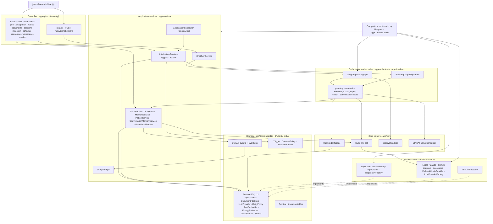
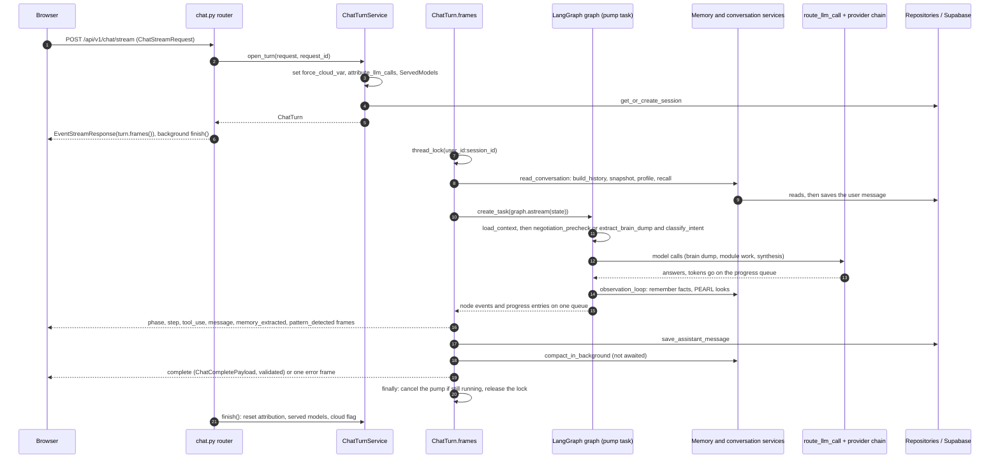
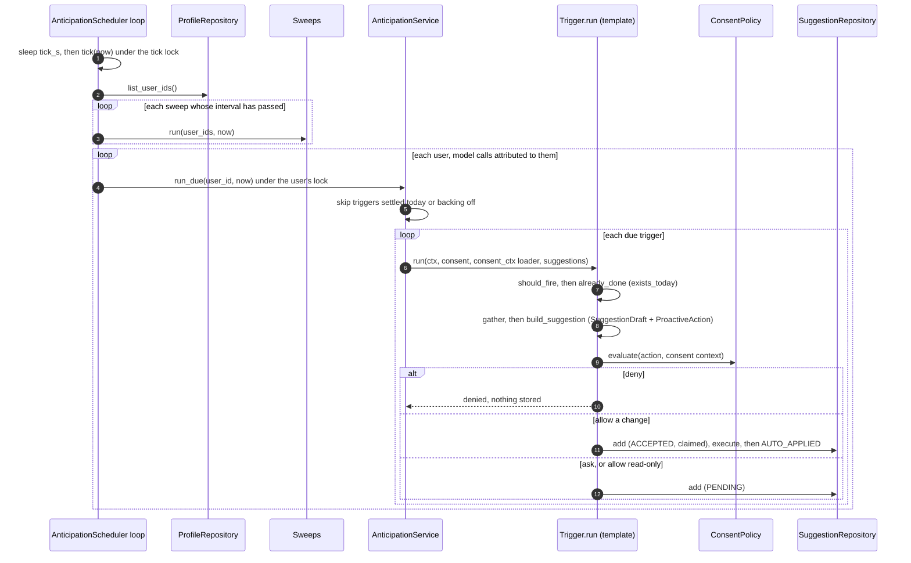
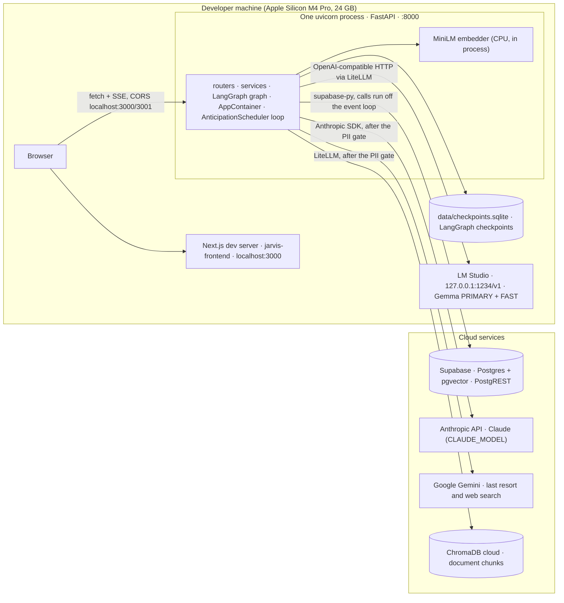

# 02 — Architecture (HLD)

This document is the high-level design of the Jarvis backend at commit `d3e9132`, now part of `main`. Jarvis is a personal intelligence: it learns from what actually happened (task outcomes, not self-reports), remembers and forgets on request, and makes the first move with the user's consent. It is one FastAPI process built as layers with ports and adapters: routers call application services; services depend on domain ports (abstract base classes); infrastructure implements the ports; a single composition root (`AppContainer`) picks every concrete class. A LangGraph graph runs each chat turn, OR-Tools CP-SAT solves schedules, Supabase Postgres with pgvector stores the data, and language models are reached local-first (LM Studio) with a Claude cloud tier behind a PII gate. The sections below give the layers and the dependency rule exactly as `tests/test_layering.py` enforces it, a component diagram, the runtime view of a chat turn and of the background scheduler, the deployment view, the language-model routing design, and the key decisions with the alternatives that were rejected.

**Owner: Murali**

---

## Contents

1. [Layers](#1-layers)
2. [The dependency rule, as the tests enforce it](#2-the-dependency-rule-as-the-tests-enforce-it)
3. [Component view](#3-component-view)
4. [Runtime view](#4-runtime-view)
5. [Deployment view](#5-deployment-view)
6. [Language-model routing](#6-language-model-routing)
7. [Key architectural decisions](#7-key-architectural-decisions)
8. [Where the spec and the code differ](#8-where-the-spec-and-the-code-differ)
9. [How to verify this document](#9-how-to-verify-this-document)

---

## 1. Layers

| Layer | Package | What lives there | Depends on |
|---|---|---|---|
| Controller | `app/api/` | Thin routers: parse, call a service, return a typed model. `CurrentUser` (`app/api/deps.py:15-28`) is the identity seam; `app/api/error_handlers.py` renders every `JarvisError` as one envelope | services, schemas, domain |
| Application services | `app/services/` | `ChatTurnService`, `DraftService`, `TaskService`, `MemoryService`, `PatternService`, `ConversationMemoryService`, `AnticipationService`, `AnticipationScheduler`, `UserModelService`, `UsageLedger`, the planning helpers (`run_schedule`, `app/services/planning/scheduling.py:174`) | domain ports and events; the orchestrator (the chat turn drives the graph) |
| Orchestrator and modules | `app/orchestrator/`, `app/modules/` | The LangGraph turn graph (`build_jarvis_graph`, `app/orchestrator/graph.py:762`), its state, routing, checkpointer and hooks; the planning, research and knowledge sub-graphs, and `PlanningGraphReplanner` (the `DraftPlanner` port) | services, domain, core |
| Core helpers | `app/core/` | `route_llm_call` (`model_router.py:347`), `UserModel` facade, the module framework, the observation loop, settings and config, the CP-SAT `JarvisScheduler` (`app/core/or_tools/solver.py:54`) | domain; `model_router.py` alone may import infrastructure (section 2) |
| Domain | `app/domain/` | Entities and transition tables (`entities.py`), ports (`ports.py`), events and `EventBus` (`events.py`), anticipation (`Trigger`, `ConsentPolicy`, `ProactiveAction`; `anticipation.py`), the error hierarchy (`errors.py`) | the standard library and Pydantic only |
| Infrastructure | `app/infrastructure/` | `persistence/`: the Supabase and in-memory repository families and `RepositoryFactory`; `llm/`: the local, Claude and Gemini adapters, the decorators, the fallback chain and `LLMProviderFactory`; `embedding.py`: `MiniLMEmbedder` | domain |
| Composition root | `app/container.py`, `app/main.py` (lifespan) | `AppContainer.build` (`container.py:109-265`) chooses the repository family, creates the event bus and subscribes its listeners, builds and installs the LLM chain, and wires every service; the lifespan (`main.py:44-182`) opens the checkpointer, compiles the graph, builds the container and starts the scheduler | everything |
| Shared schemas | `app/schemas/` | Request, response and SSE frame models shared by the API and the services (`chat_stream.py`) | domain |

The class-level view of every layer is in `03-class-diagrams.md`.

---

## 2. The dependency rule, as the tests enforce it

The rule, in one sentence: **dependencies point inward, toward the domain; only the composition root names a concrete infrastructure class.** `tests/test_layering.py` checks it by parsing every import and call in `app/` with `ast`. Each check, what it asserts, and its allow-list exactly as it stands at `d3e9132`:

| Test (`tests/test_layering.py`) | What it asserts | Allow-list |
|---|---|---|
| `test_domain__imports_nothing_from_outer_layers` (`:74`) | Every file under `app/domain/` imports only the standard library, `pydantic`, `pydantic_core` and `app.domain` itself; every spelling counts (`import app.core`, `from app import core`, a relative climb) | `_DOMAIN_ALLOWED_THIRD_PARTY = ("pydantic", "pydantic_core")` (`:12`) |
| `test_infrastructure__imports_nothing_from_api_or_orchestrator` (`:128`) | `app/infrastructure/` never imports `app.api` or `app.orchestrator` | none (`_INFRASTRUCTURE_FORBIDDEN`, `:27`) |
| `test_layering__services_orchestrator_modules_core_api__do_not_import_infrastructure` (`:187`) | `services`, `orchestrator`, `modules`, `core` and `api` take concrete classes from the container, never by importing `app.infrastructure`. A stale allow-list entry also fails | one entry: `"core/model_router.py"` — "route_llm_call drives the provider chain the container installs (set_chain, current_chain) and its transport helpers" (`:146-151`) |
| `test_layering__nothing_below_the_api__imports_the_api` (`:206`) | `services`, `domain`, `infrastructure`, `modules`, `orchestrator`, `core`, `utils`, `schemas` never import `app.api` | `_API_IMPORTS_ALLOWED = {}` (`:200`) |
| `test_layering__services__do_not_import_the_supabase_driver` (`:219`) | No service imports `supabase` | `_SUPABASE_DRIVER_ALLOWED = {}` (`:216`) |
| `test_layering__only_container_builds_repositories` (`:298`) | No file outside `app/container.py` and the persistence package mentions `RepositoryFactory` or constructs a `Supabase*Repository` / `InMemory*Repository` | `container.py` only |
| `test_layering__plan_2_and_plan_3_code__is_on_no_allow_list` (`:248`) | The code written in Plan 2 (`services/anticipation/`, `services/memory/`, `domain/anticipation.py`, `infrastructure/embedding.py`, `infrastructure/llm/messages.py`, `services/user_model_service.py`) and Plan 3 (`services/chat_turn/`, `services/planning/scheduling.py` and `services.py`, `core/settings.py`, `api/sse.py`, `api/request_limits.py`, `schemas/chat_stream.py`, `errors.py` and `schedule.py`) appears on no allow-list, and every guarded path exists | — |
| `test_llm_calls__outside_the_transport__go_through_route_llm_call` (`:408`) | Nothing outside the LiteLLM transport and `app/infrastructure/llm/` calls `hybrid_route_query`, `gemini_primary_route` or `local_primary_route` directly (which would skip the chain, the PII gate and the ledger) | `_LEGACY_LLM_CALLS_ALLOWED = {}` (`:354`) |
| `test_web_search__only_the_shared_search_helper__calls_it` (`:415`) | Only one function calls Gemini web search | `("services/analytical/workspace_builder.py", "_search_web")` — "the shared search helper: PII gate first, metered, WebSearchUnavailableError" (`:362-366`) |
| `test_layering__no_raw_table_calls_outside_the_allow_list` (`:493`) | No `.table(` call in `api`, `services`, `core`, `modules`, `orchestrator` except the documented leftovers | the 6 entries below |
| `test_layering__allow_lists__are_exactly_the_documented_leftovers` (`:514`) | Every allow-list above is exactly the set written here: it can only shrink | — |

The six raw-table leftovers (`tests/test_layering.py:451-462`), each with the reason the test records:

| File | Reason in the allow-list |
|---|---|
| `services/analytical/workspace_builder.py` | `task_workspaces` cache (decision 10). Its task and document reads go through `TaskRepository` and `DocumentRepository` since 2026-11-16 |
| `services/user_preferences.py` | `learning_style` read (decision 10) |
| `services/chat_history.py` | Plan 3 cut (Task 6): no repository yet for `chat_sessions` / `chat_messages` |
| `api/v1/endpoints/sessions.py` | Plan 3 cut: `chat_sessions` |
| `api/v1/endpoints/ingestion.py` | Plan 3 cut: `pending_calendar_updates` |
| `services/extraction/orchestrator.py` | Plan 3 cut: `pending_calendar_updates` |

Documents and their task links left the list when they gained a repository (`DocumentRepository`, with `DocumentFileStore` for the uploaded files): the documents routes go through `DocumentService`, and the linking through `DocumentLinker`.

`tests/test_injection.py` adds two related rules: the old runtime registry (`app.core.runtime`, `set_container`, `get_db`, ...) is gone and imported nowhere (`test_runtime_registry__gone_and_imported_nowhere`, `:65`), and the services the container builds read their settings from the composition root, never from `app.core.config` (`test_container_built_services__import_no_config_module`, `:676`).

**What the rule does not enforce.** No test forbids `services → orchestrator` or `services → modules`: `ChatTurnService` imports the checkpointer and state (`app/services/chat_turn/service.py:25-26`), `chat_turn/context.py` imports `is_trivial_input` from the graph (`:10`), and `chat_turn/reply.py` imports `app.modules.conversation` (`:15`). This matches the spec's HLD, where the application layer drives the orchestrator (spec §5, `APP --> ORCH`), but it is a convention, not a checked rule. `app/core/model_router.py` imports `app.orchestrator.hooks` (`:36`), and `UserModel.get_estimated_energy` imports `app.services.energy` inside the method (`app/core/user_model.py:113-119`).

---

## 3. Component view



Reading the diagram: solid arrows are calls; dotted arrows are "implements". The only arrows into infrastructure come from the composition root and from `route_llm_call` (the one allow-listed import, section 2). The anticipation service reaches the planning sub-graph through the `DraftPlanner` port, whose implementation `PlanningGraphReplanner` lives in `app/modules/planning_replan.py:34`: the service layer depends on the abstraction, the module layer implements it.

---

## 4. Runtime view

### 4.1 One chat turn, from request to the `complete` frame



| Step | What happens | Where |
|---|---|---|
| Parse | The router validates `ChatStreamRequest` (message ≤ 8,000 characters, file ≤ 10 MB, `model_mode` one of four values) and does nothing else | `app/api/v1/endpoints/chat.py:22-55`, `app/schemas/chat_stream.py:49`, `app/core/config.py:278-279` |
| Open | `open_turn` runs in the handler's context, so the stream and every task it starts inherit the cloud flag and the usage attribution; it builds the `UserModel` facade over the planning ports and the turn's initial state, which carries the container under `container` | `app/services/chat_turn/service.py:259-303` |
| Lock | One turn at a time per conversation: a second tab's turn queues on `thread_lock` and gives up with `ConflictError` after `TURN_LOCK_WAIT_SECONDS` = 120 | `service.py:133-135`, `app/services/turn_locks.py:22-70` |
| Read | History, memory snapshot and profile are read under the lock, then the user's message is saved and the context note (recall, "since we last spoke") is built | `service.py:99-110`, `app/services/chat_turn/context.py:105` |
| Run | The graph runs in its own task and puts node events on the same queue as progress and token events, so frames keep their true order. Before the first node, a resumed conversation whose checkpoint says a draft is under review reads that draft's real status: a plan accepted or discarded from its card (REST) ends the review, so the next message is not planned again (added after `d3e9132`) | `service.py:112-121`, `139-162`; `ChatTurn._close_review_of_a_closed_draft` |
| Graph | `load_context → negotiation_precheck` (a draft is under review) or `extract_brain_dump → classify_intent → module`; modules go to `synthesize_response`; everything ends in `observation_loop`; draft actions and stored rules skip synthesis | `app/orchestrator/graph.py:762-838` |
| Learn | The observation loop remembers the turn's facts, runs PEARL's look under a 0.5 s cap, and emits `memory_extracted` / `pattern_detected` frames before `complete` | `app/core/observation.py:437-503` |
| Finish | The reply is saved; compaction starts in the background; the `complete` payload is validated against `ChatCompletePayload` before it is sent. A `JarvisError` becomes an error frame with its own message; anything else is logged with the request id and sent as `internal_error` | `service.py:184-226` |
| Clean up | Shielded from cancellation: a client disconnect cancels the pump task and waits for it before the lock is released; the response's background task resets the context variables | `service.py:224-237`, `72-77` |

Planning never writes the user's tasks. It ends in a draft (`DraftService.propose`); tasks are written only when the user accepts, by `DraftService.accept` → `DraftRepository.accept_atomic` → the `accept_draft()` SQL function, one transaction (`app/services/draft_service.py:185-226`, `app/domain/ports.py:216-227`).

### 4.2 The background tick: sweeps, then triggers

The lifespan builds one `AnticipationScheduler` and starts it unless `JARVIS_ANTICIPATION=false` (`app/main.py:150-169`). Every `ANTICIPATION_TICK_SECONDS` = 60 seconds (`app/core/config.py:190`), the first a full tick after startup:



| Point | Detail | Where |
|---|---|---|
| Sweeps first | `slot_passed` (1 min: a pending task whose slot passed becomes `missed`), `session_summary` (5 min), `memory_decay` (24 h), `checkpoint_retention` (24 h). Each sweep is owned by the subsystem whose data it maintains | `app/services/anticipation/scheduler.py:71-81`, `app/container.py:235-239`, `app/main.py:148` |
| Failure isolation | A sweep's, a trigger's or a user's failure is logged by exception type (never its text) and the tick carries on; a failing trigger backs off (1 minute, doubling, at most 30) | `scheduler.py:49-97`, `app/services/anticipation/service.py:233-285` |
| No overlap | Ticks hold `_tick_lock`; one user's trigger runs hold that user's `UserLocks` entry | `scheduler.py:46`, `57`, `service.py:180` |
| Once a day | `Trigger.already_done` asks `SuggestionRepository.exists_today` on the user's clock; the service also remembers a settled day | `app/domain/anticipation.py:423-427`, `service.py:182-183` |
| Consent | Read-only information is allowed; a schedule change always asks unless the user chose `auto_low_risk` and the action is low-risk; a dismissed proposal is never made again | `anticipation.py:236-241` |
| Manual run | `POST /api/v1/anticipation/run` forces one trigger: it skips the day memory but keeps the user lock, the `exists_today` check and a 10-second cooldown | `service.py:197-231` |

### 4.3 Background observers

Domain events decouple who records an outcome from who learns from it (`app/domain/events.py:81-112`). A listener's failure is logged and never reaches the publisher.

| Event | Listener | What it does in the background | Where |
|---|---|---|---|
| `LLMCallCompleted` (every metered model call) | `UsageLedger` | Writes `llm_usage_events` in a background task, at most `MAX_IN_FLIGHT_WRITES` = 8 at once (more are counted as dropped) | `app/services/usage_ledger.py:29-63`, `app/container.py:143` |
| `TaskCompleted`, `TaskSkipped`, `TaskMissed` | `PatternObserver` | Runs PEARL for that user: one run in flight per user, and one more if outcomes arrived meanwhile (`PerUserSingleFlight`) | `app/services/memory/patterns.py:697-724`, `container.py:158-160` |
| `PatternDetected` | `AnticipationListener` | If the detector says the pattern may become a rule, runs the `pattern_rule` trigger for that user (a forced run) | `app/services/anticipation/triggers.py:401-436`, `container.py:217-218` |
| (after each turn) | `ConversationMemoryService.compact_in_background` | Summarises older messages once the window is too long; tracked, never awaited by the turn | `app/services/chat_turn/service.py:205-207` |

Shutdown order (`app/main.py:174-182`): stop the scheduler (a tick may still be recording model calls), then `AppContainer.shutdown` (PEARL runs, pattern proposals and compactions get a short grace, then are cancelled; `container.py:267-273`), then let the usage ledger drain for up to 2 seconds, then close the checkpointer.

---

## 5. Deployment view



| Node | Configuration | Where |
|---|---|---|
| FastAPI process | `uvicorn app.main:app --port 8000`; CORS allows `localhost:3000` / `3001` only | `app/main.py:185-214` |
| Supabase | `SUPABASE_URL`, service key; the backend uses the service-role key, so every repository query filters by `user_id`. Unreachable at startup, the container falls back to the in-memory family and logs that nothing is persisted | `app/core/config.py:19`, `app/container.py:131-139` |
| LangGraph checkpoints | SQLite file, one thread per `user_id:session_id`; transient keys (container, user model, queues, file content) are scrubbed before saving; pruned daily to the newest 20 per thread | `config.py:164-167`, `app/orchestrator/checkpoint.py:60-73`, `271-299` |
| LM Studio | `LOCAL_LLM_URL`, default `http://127.0.0.1:1234/v1`; the lifespan detects the loaded Gemma models and turns on `GEMINI_PRIMARY` (cloud-first) when none answers | `config.py:24`, `app/main.py:85-108` |
| Claude | `CLAUDE_MODEL`, default `claude-sonnet-5-5`; only in the chain when an Anthropic credential is configured | `config.py:51`, `app/infrastructure/llm/factory.py:52-53` |
| Gemini | `GEMINI_MODEL`; last provider in the chain and the only web-search provider | `config.py:41`, `factory.py:54` |

### 5.1 Process-local state, and why it is acceptable here

Some state lives only in the memory of the one process. None of it is the source of truth for user data; each item either serialises work, avoids repeating work, or caches.

| State | Where | What it protects or saves |
|---|---|---|
| Per-conversation turn locks | `app/services/turn_locks.py:37` | Two tabs on one conversation never run a turn at the same time |
| The PRIMARY-model lock | `app/core/model_router.py:212-234` | One heavy local model call at a time (24 GB unified memory) |
| Per-user anticipation locks, the settled-day memo, the manual-run cooldown, trigger backoff | `app/services/anticipation/service.py:180-187` | One trigger run per user at a time; no repeated runs within a day |
| Scheduler sweep timestamps | `app/services/anticipation/scheduler.py:44` | Each sweep runs once per interval |
| PEARL single-flight and pending learning moments | `app/services/background.py:18-30`, `app/services/memory/patterns.py:424-426` | One PEARL run per user; up to 10 moments held for the user's next turn |
| Conversation compaction bookkeeping | `app/services/memory/conversation_memory.py:211-228` | One summary write per conversation; retry backoff |
| Usage ledger writes in flight | `app/services/usage_ledger.py:41-47` | Bounded background writes |
| The document-read lock (added after `d3e9132`) | `_read_lock`, `app/utils/docling_helper.py` | One Docling parse at a time, on a worker thread, at most 120 s |
| The web-search cooldown (added after `d3e9132`) | `web_search_cooldown`, `app/services/analytical/workspace_builder.py` | After a failed web search, no workspace waits on it again for 5 minutes |
| Process-wide singletons: hooks, installed LLM chain, module registry, shared Anthropic client, habit translation cache | `app/orchestrator/hooks.py:142`, `app/infrastructure/llm/factory.py:59`, `app/modules/__init__.py:9`, `app/infrastructure/llm/claude.py:60`, `app/services/analytical/habit_translator.py:19` | Built once, read by every request |
| Per-request context variables: cloud flag, usage attribution, served models | `app/core/model_router.py:39-51`, `app/infrastructure/llm/decorators.py:239-248` | Concurrent requests do not see each other's settings |

**Why this is acceptable.** Jarvis is a personal intelligence served by one process to one person, or a handful during a demo; the deployment above has exactly one uvicorn worker and one event loop. The invariants that matter for correctness are held by Postgres, not by these structures: a draft is accepted in one SQL transaction under a row lock, so a second accept finds it closed (`ports.py:216-227`); suggestion and memory status changes are compare-and-set writes (`ports.py:362-380`, `488-506`); `exists_today` reads the stored suggestions; `(user_id, task_id)` is unique. If the process restarts, the in-memory structures are rebuilt empty and the worst outcome is repeated work (a trigger re-evaluated, a summary retried), never lost or duplicated user data. **What would have to change for more than one process:** the turn locks and the PRIMARY lock would need to move to Postgres advisory locks or a shared lock service, the scheduler would need a single leader (or each tick would need a database claim per user), and the singletons would need to be built per worker (they already are, since each worker runs its own lifespan).

---

## 6. Language-model routing

Every model call goes through one function, `route_llm_call` (`app/core/model_router.py:347-415`); a guard test forbids calling the transport directly (section 2).

### 6.1 Roles

Each task maps to a role (`MODEL_ROUTING`, `model_router.py:180-199`); the role picks the model at call time. Unknown tasks are `FAST`.

| Role | Tasks | Local model | Claude effort |
|---|---|---|---|
| `PRIMARY` | `socratic_chunker`, `habit_translation`, `document_understanding`, `research_summarization`, `practice_generation`, `workspace_outline`, `workspace_composition`, `calendar_parsing` | The detected heavy Gemma (`GEMMA_PRIMARY_MODEL`) | medium, `max_tokens` 8000 |
| `FAST` | `intent_classification`, `brain_dump_extraction`, `memory_extraction`, `voice_of_jarvis`, `voice_of_jarvis_synthesis`, `goal_validation`, `task_edit_parsing`, `action_item_extraction`, `session_summary` | The detected small Gemma (`GEMMA_FAST_MODEL`) | low, `max_tokens` 2048 structured / 4096 text |
| `CLOUD` | `web_search`, `real_time_research` | never local | medium |

Effort and token ceilings: `CLAUDE_EFFORT_BY_ROLE` (`app/core/config.py:54`), `app/infrastructure/llm/claude.py:56-58`, `182-188`.

### 6.2 Local first, and when the local model is skipped

`_skips_local` (`model_router.py:250-258`) sends a call straight to the cloud providers when the role is `CLOUD`, the caller passed `force_cloud=True`, the per-request `force_cloud_var` is set (the frontend's model picker chose a cloud mode; `app/services/chat_turn/service.py:263-269`), or `GEMINI_PRIMARY` / `CLAUDE_PRIMARY` is on (the lifespan sets `GEMINI_PRIMARY` when LM Studio is unreachable; `app/main.py:90-102`). A `PRIMARY` call that may run locally holds a process-wide lock for the whole call, so two heavy local calls never run together (`model_router.py:202-344`); a cloud call never takes it (Plan 2 ruling: the lock protects local memory only).

### 6.3 The provider chain and its decorators

`LLMProviderFactory.build` (`app/infrastructure/llm/factory.py:33-56`) returns `FallbackChainProvider([local, claude?, gemini])`. The chain tries each provider that reports itself available, in order; an `LLMError` (timeout, unavailable, parse error, refusal) falls over to the next provider; any other exception is a bug and propagates at once (`app/infrastructure/llm/chain.py:35-115`). A stream falls over only before its first token, so a reply never restarts mid-sentence (`chain.py:99-115`).

Each provider is wrapped by decorators, one concern each (`app/infrastructure/llm/decorators.py`):

| Provider | Wrapping, outermost first | Why this order |
|---|---|---|
| Cloud (Claude, Gemini) | `RedactingProvider → RetryingProvider → MeteredProvider → TimeoutProvider → adapter` | Redaction happens once before any attempt; each retry gets its own timeout; every attempt that answers (or was billed) is metered; metering sits outside the timeout so a slow ledger write can never turn an answer into a timeout and a second paid attempt |
| Local (LM Studio) | `MeteredProvider → TimeoutProvider → adapter` | No redaction (the prompt never leaves the machine) and no retry (a dead LM Studio should hand over to the cloud at once) |

Retries use `ExponentialBackoff` (base 0.5 s, cap 8 s, jitter 25 %, at most 3 attempts) and retry only timeouts and unavailability; a parse error or refusal would fail the same way again (`app/infrastructure/llm/retry.py:9-32`). A provider that switched itself off (Claude after a rejected credential, `claude.py:201-208`) is not retried. Timeouts: `LLM_TIMEOUT_SECONDS` = 60 per call, `LLM_STREAM_TIMEOUT_SECONDS` = 120 per token gap for streams (`config.py:59-60`, `decorators.py:181-213`).

### 6.4 The redaction gate (L8)

`RedactingProvider` runs a `Redactor` over the prompt, the system prompt and every string `content` in the conversation history, and builds a new request (the caller's is never changed) (`decorators.py:79-129`). The production redactor is `PreCloudLLMRedactor`, which runs the `PreCloudLLM` hook (`app/core/model_router.py:71-94`): today a regex for email addresses and US-format phone numbers (`app/orchestrator/hooks.py:59-87`). It fails closed: a hook that answers DENY or ASK raises `LLMUnavailableError`, so nothing is sent to that provider. The count of redacted spans travels on the request (`RedactedLLMRequest.pii_redactions`) into the usage ledger.

### 6.5 Metering

`MeteredProvider` times every call and publishes `LLMCallCompleted` on the container's `EventBus`; the `UsageLedger` records it in `llm_usage_events` (`decorators.py:251-325`, `app/services/usage_ledger.py:33-110`). A call that failed is still published if the transport reported tokens for it, because those were billed. The same decorator records which provider and model answered each call (`ServedModels`), so the `complete` frame credits the reply to the model that actually wrote it (`app/services/chat_turn/service.py:79-85`). Web search is Gemini-only and outside the chain, so `metered_web_search` meters it by hand, and refuses a search it has no bus to meter on (`model_router.py:106-157`). The You page reads the totals as a privacy receipt (`UsageLedger.receipt`, `usage_ledger.py:89-103`).

### 6.6 Prompt-cache layout

Claude bills a repeated prompt prefix at the cache-read rate only if it is byte-identical. The layout keeps it so:

| Part | Content | Stability |
|---|---|---|
| System block | The task's system prompt, sent as one block with `cache_control: {"type": "ephemeral"}` | Constant per task: no user, time or memory in it (`claude.py:165-180`) |
| Earlier turns | The conversation history, user and assistant turns only | Append-only from turn to turn |
| Final user turn | The turn's volatile context note (recall, "since we last spoke", the time) folded in front of the user's message by `fold_system_notes` | Changes every turn, and comes last |

`fold_system_notes` (`app/infrastructure/llm/messages.py:12-32`) is shared by all three adapters, so the local model, Claude and Gemini see the same conversation. Pinned by `tests/test_prompt_layout.py` (for example `test_two_turns__system_block_and_message_prefix_identical_up_to_the_note`, `:148`) and `tests/test_claude_provider.py::test_claude__system_prompt__sent_as_cached_block` (`:265`).

Claude calls also opt into Anthropic's server-side refusal fallback (`fallbacks: "default"`, `claude.py:172-173`); structured requests use the API's structured outputs, so a reply is schema-valid by construction (`claude.py:125-145`).

---

## 7. Key architectural decisions

Sources: the spec's decision log (`docs/superpowers/specs/2026-11-14-capstone-lld-and-anticipation-design.md` §15, "ADR-n") and the rulings recorded in the plan ledgers (`.superpowers/sdd/2026-11-14-capstone-plan-{1,2,3}-*/progress.md`).

| Decision | Why | Alternative rejected |
|---|---|---|
| Layers with ports and adapters, and one composition root (`AppContainer`) that picks every concrete class (spec §5) | Services can be tested over in-memory repositories and a scripted model; the class diagram's arrows are true in code; `test_layering.py` keeps it so | Services building their own Supabase clients: nine `create_client` sites before the restructure (spec §6.4) |
| Ports are `abc.ABC`s, not `typing.Protocol`s (ADR-2) | `<<interface>>` and "implements" are literally true and enforced at instantiation; easier to defend in a viva | Protocols: structural, so the diagram's arrows would not be real |
| One chat endpoint, `POST /api/v1/chat/stream`; v1 retired (ADR-9) | An examiner finds one architecture; Plan 3's first task removed 7,574 backend lines, and over Plan 3 `chat.py` went from 1,900 lines to 61 | Keeping the deprecated v1 path alongside |
| A plan is a draft until the user accepts; accepting is the only write to `user_tasks`, one call to the `accept_draft()` SQL function that also supersedes the user's other open drafts (Plan 1 rulings) | Atomic: a second accept is a 409, never duplicated tasks; closes the two-drafts race | Writing tasks during planning; a multi-call accept in Python |
| Append-only `task_events` for outcome history; `user_tasks.status` is current state only (ADR-11) | Re-slotting a task keeps the evidence PEARL learns from; a natural event stream for observers | Status-only history: re-slotting erases what was learned |
| In-process asyncio `AnticipationScheduler` plus a manual run endpoint (ADR-3); the manual run skips the day memo but keeps the lock, `exists_today` and a 10 s cooldown (Plan 2 ruling) | No new dependency; deterministic demo trigger; Template Method + Strategy that is easy to explain | APScheduler or Celery: more moving parts for nothing needed at this scale |
| Consent defaults: read-only information is shown, schedule changes ask (ADR-6) | Anticipation without loss of control; matches the anti-guilt stance | Fully autonomous changes |
| Local model first, Claude as the cloud tier, Gemini last (ADR-10; Plan 1 user decision: `claude-sonnet-5-5`) | Schema-valid structured output removes the bad-JSON failure class in a live demo; local-first keeps the privacy story | Claude only (loses local-first); Gemini as the cloud tier (weaker structured output) |
| Every model call through `route_llm_call` (Plan 1 ruling, Task 13) | One place for routing, the PII gate, retries and metering; with Gemini down it was demo-blocking | Callers reaching LiteLLM directly (skips the gate and the ledger) |
| The PRIMARY lock applies to local-model calls only (Plan 2 ruling) | It protects local RAM; cloud calls can run concurrently | Locking every PRIMARY call, cloud included |
| Stay on Supabase cloud; the in-memory family for tests and for running when Supabase is down (ADR-4) | Least change; the in-memory family demonstrates LSP and DIP | Local Postgres: no Docker on this machine, and supabase-py speaks PostgREST |
| The learned focus profile is a soft solver objective, below TMT and hard rules, behind a flag (ADR-12; Plan 2 ruling to retune its weight) | "Understands you" changes the actual schedule; the flag and tests guard the core loop | A hard constraint (too brittle); brief-only (hollow) |
| The plan's day is anchored to the user's timezone (Plan 1 ruling) | "Never before 11 AM" must mean 11 AM local | 08:00 UTC |
| Drop the `CognitiveModule` registry and the sessions / documents / calendar repositories from Plan 3 (Tasks 9 and 6) | Examiner-visible value was in v1 removal, the thin router, one persistence path and the typed API; time was short | Doing all of Plan 3: the cost was eight raw-table leftovers (six since documents gained their repository) and a hand-written routing table, both disclosed |
| Adopt Claude Code's ideas (consent chain with typed reasons, retry with backoff, usage ledger), never its code (ADR-8) | Defensible patterns without an integrity or IP risk | Porting its TypeScript |

---

## 8. Where the spec and the code differ

The code wins; these are the differences an examiner reading the spec would notice.

| Spec says | Code has |
|---|---|
| `ConsentService` in the services layer (§5) | `ConsentPolicy`, a domain class (`app/domain/anticipation.py:218`), held by `AnticipationService` |
| `CognitiveModule`, `Step`, `StepExecutor`, `FunctionStep` (§6.2) | `ModuleDefinition`, `ModuleStep`, `ConditionalEdge`, `ModuleRegistry` (`app/core/module_framework.py`); the intent-to-module table is still hand-written (`app/orchestrator/routing.py:12-28`). Dropped by Plan 3 ruling |
| `TriggerFactory`, `PreTaskPrepTrigger`, `DeadlineRiskTrigger`, `TelemetryListener` (§6.2-6.3) | Not built. Two triggers exist (`MorningBriefTrigger`, `PatternRuleTrigger`); `DeadlineMissed` has no production listener (`DraftAccepted` has `DocumentLinkListener`) |
| `LLMProvider` has `complete`, `stream`, `structured` (§6.2) | `complete(req)` returns a schema instance when `req.response_schema` is set; there is no separate `structured` |
| Hooks aggregate deny > ask > allow regardless of order (§6.3) | `ActionHooks.execute` returns the first DENY or ASK it meets (`app/orchestrator/hooks.py:41-56`) |
| `JarvisScheduler` and `ChromaArchive` in infrastructure (§5) | `JarvisScheduler` is in `app/core/or_tools/solver.py:54`; there is no `ChromaArchive` class (`app/utils/chroma_client.py` holds the client) |
| Small role ports such as `TaskReader` / `TaskWriter` (§6.4) | One `TaskRepository` with reads and the status writes (`app/domain/ports.py:64-128`) |
| "1 Goal composes 1..* Task" (§6.1) | `Task.goal_id` names the goal; no `Goal` object holds tasks |

---

## 9. How to verify this document

From `Jarvis-Engine/` on branch `main`:

```bash
# The dependency rule and its allow-lists (section 2)
.venv/bin/python -m pytest tests/test_layering.py tests/test_injection.py -q

# The composition root, the chain it installs, and its listeners (sections 3, 4.3)
.venv/bin/python -m pytest tests/test_container.py tests/test_llm_providers.py -q

# A chat turn end to end over a fake database and a scripted model (section 4.1)
.venv/bin/python -m pytest tests/test_chat_turn.py tests/test_turn_locks.py tests/test_sse_golden.py -q

# The scheduler tick and the trigger template (section 4.2)
.venv/bin/python -m pytest tests/test_anticipation_scheduler.py tests/test_trigger_template.py tests/test_consent.py -q

# Prompt-cache layout and the Claude adapter (section 6)
.venv/bin/python -m pytest tests/test_prompt_layout.py tests/test_claude_provider.py tests/test_model_router.py -q

# The class diagrams this document refers to
.venv/bin/python -m pytest tests/test_design_conformance.py -q

# Spot-check the allow-lists and the chain recipe
sed -n '138,153p;432,454p' tests/test_layering.py
sed -n '33,56p' app/infrastructure/llm/factory.py
```
