# 03 — Class diagrams

This document is the low-level design of the Jarvis backend drawn as UML class diagrams, at commit `e76bff9`, now part of `main`. There is one overview diagram and fourteen subsystem diagrams: the domain (planning entities, learning entities, events, errors), persistence (the ports and the two repository families), the language-model chain, the chat turn and the orchestrator, anticipation (triggers and consent), and memory and learning. Every class named in a diagram is a real class at the module given in the class index (section 9), and `tests/test_design_conformance.py` parses every diagram in this file and checks it against the code: each class imports, each `<<interface>>` is an `abc.ABC` with abstract methods, each inheritance or realization arrow is a real `issubclass`, each listed method exists with the listed parameter names, each enumeration lists exactly its members, and each whole/part or association arrow names a real attribute. A diagram that lies fails the build.

**Owner: ______**

---

## Contents

1. [How to read these diagrams](#1-how-to-read-these-diagrams)
2. [Overview](#2-overview)
3. [Domain](#3-domain)
4. [Persistence](#4-persistence)
5. [Language models](#5-language-models)
6. [Chat turn and orchestration](#6-chat-turn-and-orchestration)
7. [Anticipation](#7-anticipation)
8. [Memory and learning](#8-memory-and-learning)
9. [Class index](#9-class-index)
10. [What the diagrams leave out](#10-what-the-diagrams-leave-out)
11. [How to verify this document](#11-how-to-verify-this-document)

---

## 1. How to read these diagrams

### 1.1 Members

| Notation | Meaning |
|---|---|
| `+name` / `-name` | Public / private. Private means the Python name starts with `_`. |
| `+Type name` | An attribute: a Pydantic field, a dataclass field, a class attribute, a property, or an attribute set in `__init__`. |
| `+method(a, b) Ret` | A method with its parameter names in code order. `self` and `cls` are left out, and so is the keyword-only marker `*`. Every required positional parameter is listed (the test enforces this); optional ones may be left out. |
| `...)*` at the end | Abstract method (`@abstractmethod`). The test checks it is abstract in the code. |
| `...)$` at the end | Static method or class method. |
| `list~Task~` | A generic, `list[Task]`. Mermaid cannot draw a generic with a comma in it, so `dict[str, X]` is drawn `dict` and `tuple[int, int]` is drawn `tuple`. |
| `X \| None` | Optional, exactly as written in the code. `Literal[...]` types are drawn as `str`. |
| async | Most service and repository methods are `async def`; Mermaid has no notation for it. |

A field whose type is another class in the same diagram is drawn as an arrow labelled with the field name, not as an attribute. A class drawn with no members appears in full in another diagram.

### 1.2 Stereotypes

| Stereotype | Meaning in this code | What the test checks |
|---|---|---|
| `<<interface>>` | An `abc.ABC` whose public methods are all abstract (a port) | `abc.ABC` subclass with abstract methods; if members are drawn, every abstract method is drawn |
| `<<abstract>>` | An `abc.ABC` with some concrete behaviour (a Template Method or Decorator base) | `inspect.isabstract` |
| `<<enumeration>>` | A Python `Enum` | The listed members equal the real members, in order |
| `<<protocol>>` | A `typing.Protocol`: structural, so nothing subclasses it | It is a `Protocol` |
| `<<entity>>`, `<<value object>>`, `<<dataclass>>`, `<<TypedDict>>`, `<<external>>` | Descriptive only. Entities have an identity (`id`); value objects do not; external classes come from LangGraph | Existence only |

### 1.3 Relationship kinds, and the rule used to choose between them

| Arrow | Kind | Rule used here | Checked by the test |
|---|---|---|---|
| `A <\|-- B` | Inheritance | `B` extends a class that has behaviour of its own (a concrete class or an `<<abstract>>` base) | `issubclass(B, A)` |
| `A <\|.. B` | Realization | `B` implements an `<<interface>>` | `issubclass(B, A)`, and `A` is abstract |
| `A *-- B` | Composition | `B` is created for `A`, held only by `A`, and lives as long as `A` | The label is an attribute of `A` |
| `A o-- B` | Aggregation | `A` holds `B`, but `B` is shared with others or outlives `A` (a collaborator injected through the constructor) | The label is an attribute of `A` |
| `A --> B` | Association | `A` keeps a lasting reference that is not whole/part: an id that names another entity, or a back-reference | The label is an attribute of `A` |
| `A ..> B` | Dependency | `A` uses `B` for one call: a parameter, a return value, or an object it creates and hands away | Both classes exist |

Multiplicities are written on the arrow ends (`"1"`, `"0..1"`, `"*"`, `"1..*"`). Where none is written, it is one to one.

---

## 2. Overview

The composition root `AppContainer` (`app/container.py:81`) builds every long-lived collaborator once, in `AppContainer.build` (`app/container.py:109-265`). Services receive ports and the event bus through their constructors; nothing below the container picks a concrete class. The overview shows names only; each class appears with its members in a later diagram.

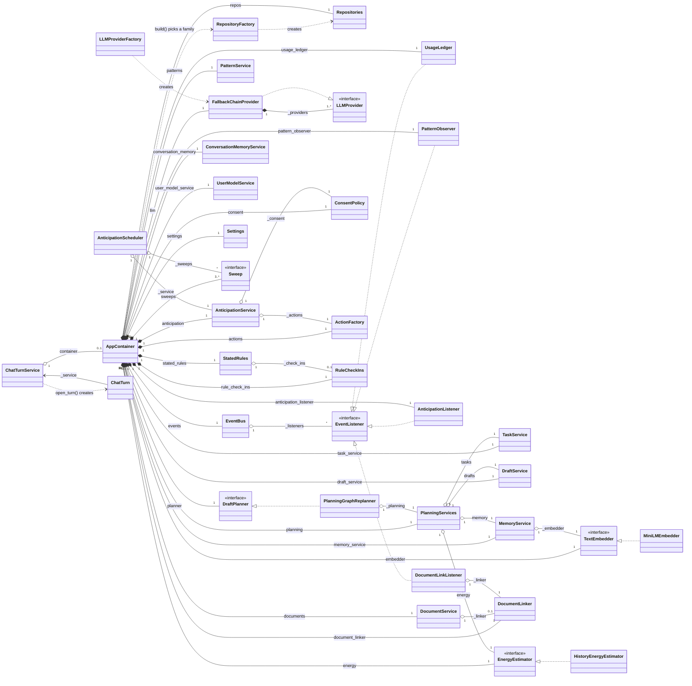

| Relationship | Kind | Why this kind | Where |
|---|---|---|---|
| `AppContainer *--` every field (`repos`, `events`, `llm`, the services, `consent`, `actions`, `settings`) | Composition | `build` creates each one, the container is the only object that holds the set, and they live exactly as long as the container (the lifespan builds one at startup and shuts it down at exit) | `app/container.py:131-265`, `app/main.py:119`, `app/main.py:179` |
| `AppContainer *-- "3..*" Sweep : sweeps` | Composition | `build` creates three sweeps; the lifespan appends a fourth (`CheckpointRetentionSweep`) to the same list | `app/container.py:235-239`, `app/main.py:148` |
| `AppContainer *-- TextEmbedder`, `*-- EnergyEstimator`, `*-- DraftPlanner` | Composition, to the port | The container holds the port type, so its fields depend on abstractions; the realization arrows show which concrete class `build` chose | `app/container.py:90-98`, `152`, `162`, `197` |
| `MemoryService o-- TextEmbedder`, `PlanningServices o--` its services, `AnticipationService o-- ConsentPolicy` / `ActionFactory` | Aggregation | Injected through the constructor and shared: the same `MemoryService` is held by `PlanningServices`, `ConversationMemoryService`, `UserModelService`, `StatedRules` and two actions | `app/container.py:153`, `188-196`, `204-207` |
| `EventBus o-- "*" EventListener` | Aggregation | The bus keeps references to listeners it did not create; a listener (the usage ledger) is also a container field | `app/domain/events.py:88-93`, `app/container.py:143` |
| `FallbackChainProvider *-- "1..*" LLMProvider` | Composition | The factory builds each wrapped provider for this chain only; the chain keeps them in a private tuple | `app/infrastructure/llm/factory.py:51-56`, `chain.py:44-45` |
| `StatedRules o-- "0..1" RuleCheckIns` | Aggregation | The container's one `RuleCheckIns` is handed to `StatedRules` (to end a rule's check-ins before deleting it) and to the action factory (to start them for an adopted rule); `None` in tests that build `StatedRules` alone | `app/container.py`, `app/services/memory/stated_rules.py` (`_delete`) |
| `AnticipationScheduler o-- AnticipationService`, `o-- Sweep` | Aggregation | The lifespan hands it the container's service and sweep list; the container outlives the scheduler's loop | `app/main.py:155-160`, `scheduler.py:38-41` |
| `ChatTurnService o-- "0..1" AppContainer` | Aggregation | One service object per request (`for_app`), all sharing the one container; `None` when the lifespan built none | `app/services/chat_turn/service.py:243-258` |
| `ChatTurn --> ChatTurnService` | Association | A back-reference the turn uses to reach the graph and container | `app/services/chat_turn/service.py:59` |
| `... ..> ... : creates` | Dependency | The factory method returns the object and keeps no reference | `persistence/factory.py:83-125`, `llm/factory.py:33-56` |

---

## 3. Domain

`app/domain/` imports only the standard library, Pydantic and itself (`tests/test_layering.py:74`). Entities are Pydantic models with validated fields; state changes go through transition tables (section 3.3).

### 3.1 Planning entities

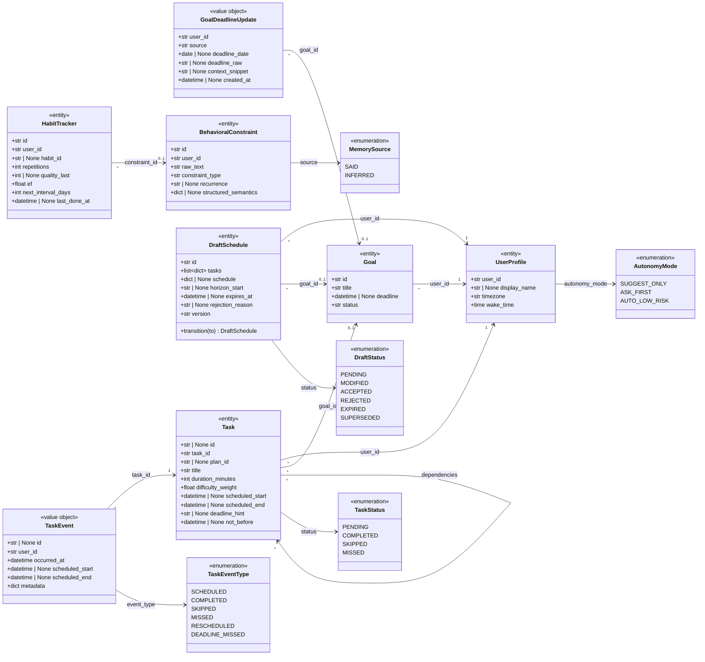

| Relationship | Kind | Why this kind | Where |
|---|---|---|---|
| `Task --> Goal : goal_id`, `DraftSchedule --> Goal`, `GoalDeadlineUpdate --> Goal`, `HabitTracker --> BehavioralConstraint` | Association, by id | The entity holds the other's identifier, never the object; the database enforces it as a foreign key (`docs/capstone/08-database-schema.md`) | `app/domain/entities.py:286`, `338`, `261`, `418` |
| `Task "*" --> "*" Task : dependencies` | Association, by id | `dependencies` lists the `task_id`s that must finish first | `entities.py:300-302` |
| `TaskEvent --> Task : task_id` | Association, by id | An append-only record about one task | `entities.py:319` |
| `X --> UserProfile : user_id` | Association, by id | Every entity is owned by one user; drawn for three of them, the rest are the same | `entities.py:232`, `249`, `279`, `337` |
| `--> <<enumeration>>` | Association | The field's type is the enumeration | `entities.py:236`, `299`, `320`, `348`, `399` |

Two differences from the spec (§6.1): the spec draws "1 Goal composes 1..* Task"; in the code a `Task` names its goal by `goal_id` and no `Goal` object holds tasks, so it is drawn as an association. `DraftSchedule.tasks` is `list[dict]` (the planner's serialised chunks), not `list[Task]`: tasks become `Task` rows only when a draft is accepted (`DraftRepository.accept_atomic`, `app/domain/ports.py:216-227`).

### 3.2 Learning, anticipation and conversation entities

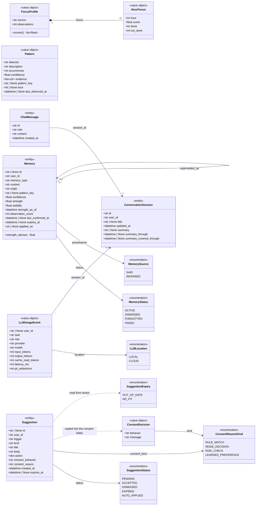

| Relationship | Kind | Why this kind | Where |
|---|---|---|---|
| `FocusProfile *-- "24" HourFocus : hours` | Composition | The hour entries are value objects made for one profile; the validator requires exactly 24, index equal to hour | `entities.py:617-628` |
| `Memory --> Memory : superseded_by` | Association, by id | A replaced memory names the memory that replaced it | `entities.py:535-537` |
| `Suggestion ..> ConsentDecision` | Dependency | `Trigger.run` copies the decision into three fields (`consent_behavior`, `consent_reason`, `consent_kind`); the suggestion keeps no `ConsentDecision` object | `app/domain/anticipation.py:400-402` |
| `Suggestion ..> SuggestionExpiry` | Dependency | Why a suggestion expired is kept inside its `action` JSON under `EXPIRY_KEY`, read by `made_that_day` | `entities.py:66-67`, `204-212` |
| `ChatMessage --> ConversationSession`, `LLMUsageEvent --> ConversationSession` | Association, by id | Each names its session | `entities.py:717`, `728-730` |

A remembered `Pattern` and its `Memory` share a `pattern_key` (`entities.py:505-508`, `572-578`); they are separate objects, so no arrow is drawn.

### 3.3 State transition tables

Each lifecycle is a table in the domain (the State pattern, as data). A move not in the table raises `InvalidStateTransition` (HTTP 409).

**Draft** (`DRAFT_TRANSITIONS`, `app/domain/entities.py:176-183`; checked by `DraftSchedule.transition`, `entities.py:370-383`, and again under the row lock by `accept_atomic`):

| From | May become |
|---|---|
| `PENDING`, `MODIFIED` (the open states, `OPEN_DRAFT_STATUSES`, `entities.py:162`) | `MODIFIED`, `ACCEPTED`, `REJECTED`, `EXPIRED`, `SUPERSEDED` |
| `ACCEPTED`, `REJECTED`, `EXPIRED`, `SUPERSEDED` | nothing (terminal) — this is what refuses a second accept |

**Suggestion** (`SUGGESTION_TRANSITIONS`, `entities.py:190-201`; checked by `check_suggestion_move`, `entities.py:215-226`, used by `move_suggestion`, `app/domain/anticipation.py:291-311`):

| From | May become |
|---|---|
| `PENDING` | `ACCEPTED`, `DISMISSED`, `EXPIRED` |
| `ACCEPTED` (claimed: its action is running or ran) | `PENDING` (the action did not finish), `EXPIRED`, `AUTO_APPLIED` |
| `DISMISSED`, `EXPIRED`, `AUTO_APPLIED` | nothing |

**Memory** (`MEMORY_TRANSITIONS`, `entities.py:123-132`; checked by `check_memory_move`, `entities.py:141-154`; `memory_moves_to`, `entities.py:135-138`, gives the compare-and-set guard for a write):

| From | May become |
|---|---|
| `ACTIVE` | `ACTIVE`, `FADED`, `DISMISSED`, `FORGOTTEN` |
| `FADED` | `ACTIVE`, `DISMISSED`, `FORGOTTEN` |
| `DISMISSED` | `FORGOTTEN` |
| `FORGOTTEN` | nothing — nothing automatic brings back what the user let go of |

**Task outcome moves** (`_Move` records in the service, `app/services/task_service.py:65-84`; plus `TaskRepository.bring_back`, `app/domain/ports.py:120-128`):

| Move | From | To | Event recorded |
|---|---|---|---|
| complete | `PENDING`, `MISSED`, `SKIPPED` | `COMPLETED` | `completed` |
| skip | `PENDING` | `SKIPPED` | `skipped` |
| deadline passed | `PENDING` | `MISSED` | `deadline_missed` |
| slot passed (sweep) | `PENDING` | `MISSED` | `missed` |
| bring back | `MISSED` | `PENDING` | none |

### 3.4 Domain events and the event bus (Observer)

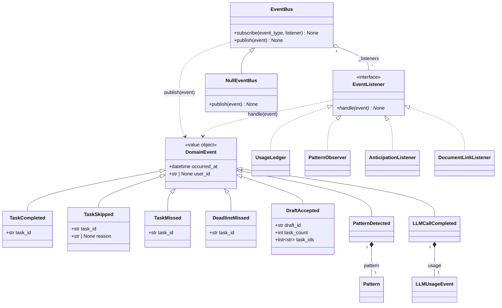

| Relationship | Kind | Why this kind | Where |
|---|---|---|---|
| `DomainEvent <\|-- ...` | Inheritance | Each event extends the concrete base and adds its own fields | `app/domain/events.py:19-70` |
| `PatternDetected *-- Pattern`, `LLMCallCompleted *-- LLMUsageEvent` | Composition | The value object is part of the event and travels with it | `events.py:64`, `70` |
| `EventBus o-- "*" EventListener` | Aggregation | Listeners are subscribed from outside and are shared (the container also holds them) | `events.py:88-93` |
| `EventBus <\|-- NullEventBus` | Inheritance | Null Object: overrides `publish` to drop the event | `events.py:115-119` |
| `EventListener <\|.. UsageLedger` etc. | Realization | Each implements `handle` | `app/services/usage_ledger.py:33`, `app/services/memory/patterns.py:697`, `app/services/anticipation/triggers.py:401`, `app/services/documents/linker.py:169` |

Subscriptions made by the container: `LLMCallCompleted → UsageLedger` (`app/container.py:143`), `TaskCompleted`, `TaskSkipped`, `TaskMissed → PatternObserver` (`container.py:159-160`), `PatternDetected → AnticipationListener` (`container.py:218`), `DraftAccepted → DocumentLinkListener` (`container.py:181`; it links the accepted tasks to the user's documents, after the commit). `DeadlineMissed` is published but has no production listener.

### 3.5 Error hierarchy

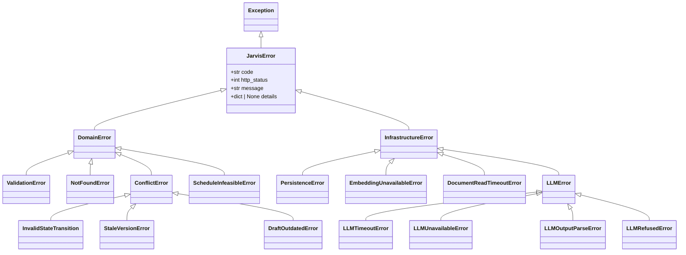

Every arrow is inheritance: each subclass overrides the class attributes `code` and `http_status` (`app/domain/errors.py`; `DocumentReadTimeoutError` was added after `e76bff9`), and `app/api/error_handlers.py` turns any `JarvisError` into the one error envelope (see `09-error-handling.md`).

| Class | `code` | HTTP |
|---|---|---|
| `JarvisError` | `internal_error` | 500 |
| `ValidationError` | `validation_error` | 422 |
| `NotFoundError` | `not_found` | 404 |
| `ConflictError` / `InvalidStateTransition` / `StaleVersionError` / `DraftOutdatedError` | `conflict` / `invalid_state_transition` / `stale_version` / `draft_outdated` | 409 |
| `ScheduleInfeasibleError` | `schedule_infeasible` | 422 |
| `PersistenceError` / `EmbeddingUnavailableError` / `DocumentReadTimeoutError` | `persistence_unavailable` / `embedding_unavailable` / `document_read_timeout` | 503 |
| `LLMError` / `LLMTimeoutError` / `LLMUnavailableError` / `LLMOutputParseError` / `LLMRefusedError` | `llm_error` / `llm_timeout` / `llm_unavailable` / `llm_output_parse` / `llm_refused` | 503 |

---

## 4. Persistence

### 4.1 The repository ports

Thirteen `abc.ABC` ports (`app/domain/ports.py:64-676`): twelve repositories and the store for uploaded files. Every per-user method takes `user_id` first and sees only that user's rows; the two documented exceptions are `ProfileRepository.list_user_ids` and `UsageRepository.record` (`ports.py:3-6`). `Repositories` is the record of one family; `RepositoryFactory` builds a whole family at once (Abstract Factory).

```mermaid
classDiagram
    direction LR
    class TaskRepository {
        <<interface>>
        +list_pending(user_id) list~Task~*
        +list_for_user(user_id, statuses) list~Task~*
        +list_by_status(user_id, statuses) list~Task~*
        +get(user_id, task_id) Task | None*
        +list_scheduled_between(user_id, start, end) list~Task~*
        +update_status(user_id, task_id, status, expected, expected_start) Task*
        +bring_back(user_id, task_id) Task*
    }
    class TaskEventRepository {
        <<interface>>
        +append(user_id, event) TaskEvent*
        +append_many(user_id, events) list~TaskEvent~*
        +list_for_user(user_id, since, types, task_ids) list~TaskEvent~*
    }
    class DraftRepository {
        <<interface>>
        +create(user_id, tasks, horizon_start, goal_id, schedule) DraftSchedule*
        +get(user_id, draft_id) DraftSchedule | None*
        +get_open(user_id) DraftSchedule | None*
        +replace_tasks(user_id, draft_id, tasks) DraftSchedule*
        +replace_schedule(user_id, draft_id, schedule) DraftSchedule*
        +set_status(user_id, draft_id, to, reason) DraftSchedule*
        +accept_atomic(user_id, draft_id, rows) int*
    }
    class ConstraintRepository {
        <<interface>>
        +list_active(user_id) list~BehavioralConstraint~*
        +add(user_id, c) BehavioralConstraint*
        +delete(user_id, constraint_id) bool*
        +set_semantics(user_id, constraint_id, structured_semantics) BehavioralConstraint | None*
    }
    class GoalRepository {
        <<interface>>
        +get(user_id, goal_id) Goal | None*
        +latest_context(user_id, goal_id) str | None*
        +add_deadline_update(user_id, update) None*
    }
    class HabitTrackerRepository {
        <<interface>>
        +get(user_id, tracker_id) HabitTracker | None*
        +list_for_user(user_id) list~HabitTracker~*
        +record_review(user_id, tracker_id, repetitions, ef, next_interval_days, quality, done_at) HabitTracker*
        +add_for_constraint(user_id, constraint_id, started_at) HabitTracker*
        +delete_for_constraint(user_id, constraint_id) int*
    }
    class ProfileRepository {
        <<interface>>
        +get_or_create(user_id) UserProfile*
        +update(user_id, fields) UserProfile*
        +list_user_ids() list~str~*
    }
    class SuggestionRepository {
        <<interface>>
        +add(user_id, s) Suggestion*
        +list(user_id, status, limit) list~Suggestion~*
        +dedupe_keys(user_id, status, limit) list~str~*
        +get(user_id, suggestion_id) Suggestion | None*
        +set_status(user_id, suggestion_id, to, expected, consent, expired_because) Suggestion*
        +exists_today(user_id, trigger, day, tz) bool*
    }
    class MemoryRepository {
        <<interface>>
        +add(user_id, m, embedding) Memory*
        +get(user_id, memory_id) Memory | None*
        +list(user_id, statuses, types, newest_first, limit) list~Memory~*
        +list_ids(user_id, statuses, limit) list~str~*
        +find_by_pattern_key(user_id, pattern_key) Memory | None*
        +find_by_pattern_keys(user_id, pattern_keys) list~Memory~*
        +nearest(user_id, embedding, statuses, types, limit, min_similarity) list~MemoryMatch~*
        +update(user_id, memory_id, only_if_status, fields) Memory*
    }
    class ConversationRepository {
        <<interface>>
        +get_session(user_id, session_id) ConversationSession | None*
        +previous_session(user_id, before_session_id) ConversationSession | None*
        +messages(user_id, session_id, after, limit, oldest_first) list~ChatMessage~*
        +set_summary(user_id, session_id, summary, through, written_at, covered_through) bool*
        +recent_sessions(user_id, since) list~ConversationSession~*
    }
    class UsageRepository {
        <<interface>>
        +record(event) None*
        +summary(user_id, since) dict*
    }
    class DocumentRepository {
        <<interface>>
        +save(user_id, document) IngestedDocument*
        +get(user_id, source_id) IngestedDocument | None*
        +list_for_user(user_id) list~IngestedDocument~*
        +delete(user_id, source_id) bool*
        +link(user_id, links) None*
        +links_for_documents(user_id, source_ids) list~TaskMaterialLink~*
        +links_for_task(user_id, task_id) list~TaskMaterialLink~*
    }
    class DocumentFileStore {
        <<interface>>
        +save(user_id, source_id, file) None*
        +read(user_id, source_id) StoredFile | None*
        +delete(user_id, source_id) bool*
        +stored_ids(user_id) frozenset~str~*
    }
    class MemoryMatch {
        <<value object>>
        +float similarity
    }
    class Memory
    class Repositories {
        <<dataclass>>
    }
    class RepositoryFactory {
        +supabase(client)$ Repositories
        +in_memory(store)$ Repositories
    }

    RepositoryFactory ..> Repositories : creates
    Repositories "1" o-- "1" TaskRepository : tasks
    Repositories "1" o-- "1" TaskEventRepository : task_events
    Repositories "1" o-- "1" DraftRepository : drafts
    Repositories "1" o-- "1" ConstraintRepository : constraints
    Repositories "1" o-- "1" GoalRepository : goals
    Repositories "1" o-- "1" HabitTrackerRepository : habit_trackers
    Repositories "1" o-- "1" ProfileRepository : profiles
    Repositories "1" o-- "1" SuggestionRepository : suggestions
    Repositories "1" o-- "1" MemoryRepository : memories
    Repositories "1" o-- "1" ConversationRepository : conversations
    Repositories "1" o-- "1" UsageRepository : usage
    Repositories "1" o-- "1" DocumentRepository : documents
    Repositories "1" o-- "1" DocumentFileStore : document_files
    MemoryRepository ..> MemoryMatch : nearest() returns
    MemoryMatch "1" *-- "1" Memory : memory
```

| Relationship | Kind | Why this kind | Where |
|---|---|---|---|
| `Repositories o-- <port>` (13) | Aggregation | The record is frozen and holds one repository per port, but the container hands each repository on to the services, which keep it after the record is no longer consulted | `app/infrastructure/persistence/factory.py:61-75`, `app/container.py:149-257` |
| `RepositoryFactory ..> Repositories` | Dependency | Each static method returns a new record and keeps nothing | `factory.py:72-104` |
| `MemoryMatch *-- Memory` | Composition | A search result wraps the memory it found | `app/domain/ports.py:396-402` |

### 4.2 The Supabase family

Each Supabase repository inherits shared plumbing from `_SupabaseRepository` (one table, calls run off the event loop with `asyncio.to_thread`, failures translated to `PersistenceError`; `supabase_repos.py:165-180`) and realizes one port. This is the only place that calls `.table(` for these thirteen tables (`SupabaseDocumentRepository` keeps two: `ingested_documents` and `task_materials`). The uploaded files are not in a table: `SupabaseDocumentFileStore` (section 4.4) keeps them in Supabase Storage.

```mermaid
classDiagram
    direction LR
    class _SupabaseRepository {
        -Any _client
        +str table
        -_run(build, table) list~dict~
    }
    class TaskRepository {
        <<interface>>
    }
    class TaskEventRepository {
        <<interface>>
    }
    class DraftRepository {
        <<interface>>
    }
    class ConstraintRepository {
        <<interface>>
    }
    class GoalRepository {
        <<interface>>
    }
    class HabitTrackerRepository {
        <<interface>>
    }
    class ProfileRepository {
        <<interface>>
    }
    class SuggestionRepository {
        <<interface>>
    }
    class MemoryRepository {
        <<interface>>
    }
    class ConversationRepository {
        <<interface>>
    }
    class UsageRepository {
        <<interface>>
    }
    class DocumentRepository {
        <<interface>>
    }
    class SupabaseTaskRepository
    class SupabaseTaskEventRepository
    class SupabaseDraftRepository
    class SupabaseConstraintRepository
    class SupabaseGoalRepository
    class SupabaseHabitTrackerRepository
    class SupabaseProfileRepository
    class SupabaseSuggestionRepository
    class SupabaseMemoryRepository
    class SupabaseConversationRepository
    class SupabaseUsageRepository
    class SupabaseDocumentRepository

    _SupabaseRepository <|-- SupabaseTaskRepository
    _SupabaseRepository <|-- SupabaseTaskEventRepository
    _SupabaseRepository <|-- SupabaseDraftRepository
    _SupabaseRepository <|-- SupabaseConstraintRepository
    _SupabaseRepository <|-- SupabaseGoalRepository
    _SupabaseRepository <|-- SupabaseHabitTrackerRepository
    _SupabaseRepository <|-- SupabaseProfileRepository
    _SupabaseRepository <|-- SupabaseSuggestionRepository
    _SupabaseRepository <|-- SupabaseMemoryRepository
    _SupabaseRepository <|-- SupabaseConversationRepository
    _SupabaseRepository <|-- SupabaseUsageRepository
    _SupabaseRepository <|-- SupabaseDocumentRepository
    TaskRepository <|.. SupabaseTaskRepository
    TaskEventRepository <|.. SupabaseTaskEventRepository
    DraftRepository <|.. SupabaseDraftRepository
    ConstraintRepository <|.. SupabaseConstraintRepository
    GoalRepository <|.. SupabaseGoalRepository
    HabitTrackerRepository <|.. SupabaseHabitTrackerRepository
    ProfileRepository <|.. SupabaseProfileRepository
    SuggestionRepository <|.. SupabaseSuggestionRepository
    MemoryRepository <|.. SupabaseMemoryRepository
    ConversationRepository <|.. SupabaseConversationRepository
    UsageRepository <|.. SupabaseUsageRepository
    DocumentRepository <|.. SupabaseDocumentRepository
```

| Relationship | Kind | Why this kind | Where |
|---|---|---|---|
| `_SupabaseRepository <\|-- Supabase*Repository` (12) | Inheritance | Implementation reuse: `_run` and the client field | `supabase_repos.py:183`, `282`, `326`, `462`, `508`, `547`, `622`, `669`, `705`, `811`, `984`, `1015` |
| `<port> <\|.. Supabase*Repository` (12) | Realization | Each class lists its port as its second base (`class SupabaseTaskRepository(_SupabaseRepository, TaskRepository)`) | same lines |

Each concrete class sets `table` to its Postgres table (`user_tasks`, `task_events`, `draft_schedules`, `behavioral_constraints`, `goals`, `habit_trackers`, `user_profiles`, `proactive_suggestions`, `user_memories`, `llm_usage_events`, `chat_sessions`, and `ingested_documents` with `task_materials` beside it; `supabase_repos.py:184-1019`). `SupabaseDraftRepository.accept_atomic` calls the `accept_draft()` SQL function, so the task write and the draft's status change are one transaction.

### 4.3 The in-memory family

The in-memory family is used when Supabase is unreachable at startup and in tests. All twelve repositories, and the in-memory file store, share one `InMemoryStore` (the stand-in for the database), whose `asyncio.Lock` serialises draft status changes as the row lock does in Postgres (`in_memory.py:132-133`). `tests/test_repository_contracts.py` runs one contract suite against both families.

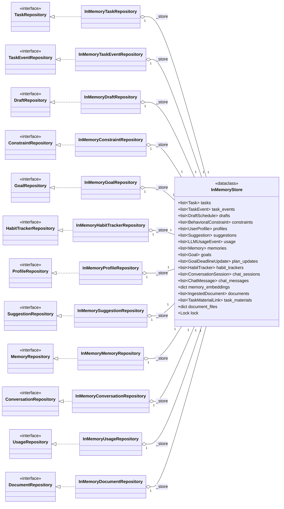

| Relationship | Kind | Why this kind | Where |
|---|---|---|---|
| `<port> <\|.. InMemory*Repository` (12) | Realization | Each class subclasses its port directly | `app/infrastructure/persistence/in_memory.py:135-802`, `897` |
| `InMemory*Repository o-- InMemoryStore : _store` (12) | Aggregation | One store is shared by the whole family, exactly as one database is shared by the Supabase family; it outlives any one repository (a test can pass its own) | `factory.py:89-104`, `in_memory.py:136-137` |

### 4.4 Documents: the uploaded files, and the services over them

A document is kept in three places: its record and task links (`DocumentRepository`), its uploaded file (`DocumentFileStore`), and its text as chunks in ChromaDB. `DocumentService` is the one class that knows all three; `DocumentLinker` decides by meaning which documents belong with which tasks, and `DocumentLinkListener` runs it for the tasks an accept wrote. The file store's two adapters are built by `RepositoryFactory` with the repositories (`documents` and `document_files` on `Repositories`, section 4.1).

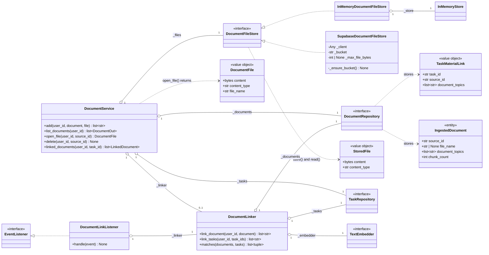

| Relationship | Kind | Why this kind | Where |
|---|---|---|---|
| `DocumentFileStore <\|.. SupabaseDocumentFileStore`, `<\|.. InMemoryDocumentFileStore` | Realization | The Supabase adapter keeps each file in one private Storage bucket at `{user_id}/{source_id}` (created on first use by `_ensure_bucket`, calls run off the event loop); the in-memory one keeps it in the shared store | `app/infrastructure/persistence/supabase_storage.py:47`, `in_memory.py:986` |
| `DocumentService o--` the two document ports, `TaskRepository`, `DocumentLinker` | Aggregation | Injected by the container; the same repositories are shared with the rest of the family, and the same linker with the listener | `app/services/documents/service.py:44`, `app/container.py` |
| `DocumentLinker o-- TextEmbedder` | Aggregation | The container's embedder, the one memories use; each topic and the file name's subject are compared with a task title, linked at cosine 0.52 | `app/services/documents/linker.py:71` |
| `EventListener <\|.. DocumentLinkListener`, `o-- DocumentLinker` | Realization, aggregation | Subscribed to `DraftAccepted`: runs after the atomic accept has committed, and logs a failure instead of raising it into the accept | `app/services/documents/linker.py:169`, `app/container.py:181` |
| `DocumentService ..> DocumentFile` | Dependency | `open_file` returns the bytes, their content type and a safe name to offer them under, and keeps nothing | `app/services/documents/service.py:36` |

---

## 5. Language models

Every model call goes through `route_llm_call` (`app/core/model_router.py:347`), which builds an `LLMRequest` and hands it to the process-wide `FallbackChainProvider`. The chain is Strategy (interchangeable providers), Chain of Responsibility (try each until one answers), and Decorator (one concern per wrapper). `LLMProviderFactory.build` assembles it: cloud providers are wrapped `Redacting → Retrying → Metered → Timeout → adapter`; the local provider `Metered → Timeout → adapter` (`app/infrastructure/llm/factory.py:33-56`).

```mermaid
classDiagram
    direction TB
    class LLMProvider {
        <<interface>>
        +str name
        +LLMLocation location
        +is_available() bool*
        +complete(req) str | BaseModel*
        +stream(req) AsyncIterator~tuple~*
    }
    class LLMRequest {
        <<value object>>
        +str task
        +str role
        +str prompt
        +str system_prompt
        +list~dict~ | None conversation_history
        +type | None response_schema
        +float timeout_s
        +str | None user_id
        +str | None session_id
    }
    class RedactedLLMRequest {
        <<value object>>
        +int pii_redactions
    }
    class FallbackChainProvider {
        +str name
        +is_available() bool
        +has_available(location) bool
        +complete(req, skip_local) str | BaseModel
        +stream(req, skip_local) AsyncIterator~tuple~
    }
    class _ProviderDecorator {
        <<abstract>>
        +str name
        +LLMLocation location
        +is_available() bool
    }
    class RedactingProvider {
        +complete(req) str | BaseModel
        +stream(req) AsyncIterator~tuple~
    }
    class RetryingProvider {
        +complete(req) str | BaseModel
        +stream(req) AsyncIterator~tuple~
    }
    class TimeoutProvider {
        +complete(req) str | BaseModel
        +stream(req) AsyncIterator~tuple~
    }
    class MeteredProvider {
        -Callable _model_for_role
        +complete(req) str | BaseModel
        +stream(req) AsyncIterator~tuple~
    }
    class LocalLMStudioProvider {
        +str name
        +LLMLocation location
        -ModuleType _cfg
        +model_for_role(role) str
        +is_available() bool
        +complete(req) str | BaseModel
        +stream(req) AsyncIterator~tuple~
    }
    class ClaudeProvider {
        +str name
        +LLMLocation location
        -ModuleType _cfg
        -bool _disabled
        +model_for_role(role) str
        +is_available() bool
        +complete(req) str | BaseModel
        +stream(req) AsyncIterator~tuple~
    }
    class GeminiProvider {
        +str name
        +LLMLocation location
        -ModuleType _cfg
        +model_for_role(role) str
        +is_available() bool
        +complete(req) str | BaseModel
        +stream(req) AsyncIterator~tuple~
    }
    class RetryPolicy {
        <<interface>>
        +should_retry(error, attempt) bool*
        +delay(attempt) float*
    }
    class ExponentialBackoff {
        -float _base
        -float _cap
        -float _jitter
        -int _max_attempts
        +should_retry(error, attempt) bool
        +delay(attempt) float
    }
    class NoRetry {
        +should_retry(error, attempt) bool
        +delay(attempt) float
    }
    class LLMProviderFactory {
        +build(cfg, redactor, bus, extra_cloud)$ FallbackChainProvider
    }
    class Redactor {
        <<protocol>>
        +redact(text) tuple
    }
    class PreCloudLLMRedactor {
        +redact(text) tuple
    }
    class ActionHooks {
        +register(event, handler) None
        +execute(event, context) HookResult
    }
    class EventBus
    class ServedModels {
        +list answers
        +record(task, provider, model) None
        +last_model_for(tasks) str | None
    }
    class TokenTally {
        <<dataclass>>
        +int input_tokens
        +int output_tokens
        +int cache_read_tokens
    }
    class ModelRole {
        <<enumeration>>
        PRIMARY
        FAST
        CLOUD
    }
    class LLMLocation {
        <<enumeration>>
        LOCAL
        CLOUD
    }

    LLMProvider <|.. FallbackChainProvider
    LLMProvider <|.. _ProviderDecorator
    LLMProvider <|.. LocalLMStudioProvider
    LLMProvider <|.. ClaudeProvider
    LLMProvider <|.. GeminiProvider
    _ProviderDecorator <|-- RedactingProvider
    _ProviderDecorator <|-- RetryingProvider
    _ProviderDecorator <|-- TimeoutProvider
    _ProviderDecorator <|-- MeteredProvider
    FallbackChainProvider "1" *-- "1..*" LLMProvider : _providers
    _ProviderDecorator "1" *-- "1" LLMProvider : _inner
    RedactingProvider "*" o-- "1" Redactor : _redactor
    RetryingProvider "1" *-- "1" RetryPolicy : _policy
    MeteredProvider "*" o-- "1" EventBus : _bus
    RetryPolicy <|.. ExponentialBackoff
    RetryPolicy <|.. NoRetry
    LLMRequest <|-- RedactedLLMRequest
    LLMProvider ..> LLMRequest : complete(req)
    RedactingProvider ..> RedactedLLMRequest : builds
    MeteredProvider ..> TokenTally : collects tokens into
    MeteredProvider ..> ServedModels : records the answering model
    PreCloudLLMRedactor "1" o-- "1" ActionHooks : _hooks
    LLMProviderFactory ..> FallbackChainProvider : creates
    LLMProviderFactory ..> RedactingProvider : wraps cloud
    LLMProviderFactory ..> MeteredProvider : wraps every provider
    LLMProvider --> LLMLocation : location
    LLMRequest ..> ModelRole : role is a ModelRole value
```

| Relationship | Kind | Why this kind | Where |
|---|---|---|---|
| `LLMProvider <\|.. adapters and chain` | Realization | Each implements `is_available`, `complete`, `stream` | `local.py:16`, `claude.py:82`, `gemini.py:15`, `chain.py:35` |
| `LLMProvider <\|.. _ProviderDecorator <\|-- four decorators` | Realization, then inheritance | The decorator base delegates `name`, `location`, `is_available` to the wrapped provider; each subclass adds one concern | `decorators.py:28-43`, `79`, `132`, `181`, `251` |
| `_ProviderDecorator *-- LLMProvider : _inner` | Composition | `_wrap_cloud` builds each wrapper around a provider it just made; nothing else holds the inner object | `factory.py:21-27`, `decorators.py:31-32` |
| `FallbackChainProvider *-- "1..*" LLMProvider` | Composition | The chain is the only holder of its wrapped providers, as a private tuple | `chain.py:44-45` |
| `RedactingProvider "*" o-- "1" Redactor` | Aggregation | One `PreCloudLLMRedactor` is shared by every cloud wrapper in the chain | `factory.py:27`, `54-55` |
| `RetryingProvider *-- RetryPolicy` | Composition | A new `ExponentialBackoff()` is made for each wrapper | `factory.py:27` |
| `MeteredProvider "*" o-- "1" EventBus` | Aggregation | Every metered wrapper publishes on the container's one bus | `factory.py:26`, `50`, `decorators.py:262-268` |
| `PreCloudLLMRedactor o-- ActionHooks` | Aggregation | The process-wide hooks object, shared by other callers | `model_router.py:79-80`, `hooks.py:145-150` |
| `Redactor` (protocol) | — | `PreCloudLLMRedactor` satisfies it structurally; because a `typing.Protocol` is not subclassed, no realization arrow can be drawn honestly | `decorators.py:46-53`, `model_router.py:71` |
| `MeteredProvider ..> ServedModels`, `..> TokenTally` | Dependency | Reached through context variables for the duration of one call, never stored | `decorators.py:242-248`, `284-287` |

Routing in one table (`app/core/model_router.py:174-199`, `241-249`, `338-406`):

| Step | What happens |
|---|---|
| Task → role | `MODEL_ROUTING` maps each task to `PRIMARY`, `FAST` or `CLOUD`; unknown tasks are `FAST` |
| Skip the local model? | Yes when the role is `CLOUD`, `force_cloud=True`, the per-request `force_cloud_var` is set, or `GEMINI_PRIMARY` / `CLAUDE_PRIMARY` is on |
| One heavy local call at a time | A `PRIMARY` call that may run locally holds a process-wide lock for the whole call (`_one_primary_call`) |
| Chain | `[local, claude (if a credential is set), gemini]`, each available provider tried in order; any `LLMError` falls over to the next, any other exception propagates |

---

## 6. Chat turn and orchestration

### 6.1 The chat turn

`POST /api/v1/chat/stream` (`app/api/v1/endpoints/chat.py:22-55`) only parses the request and opens a turn. `ChatTurnService.open_turn` sets the turn's context (cloud flag, usage attribution, session) in the handler's context; `ChatTurn.frames` runs the LangGraph graph under a per-conversation lock and writes every frame through `SseEncoder`.

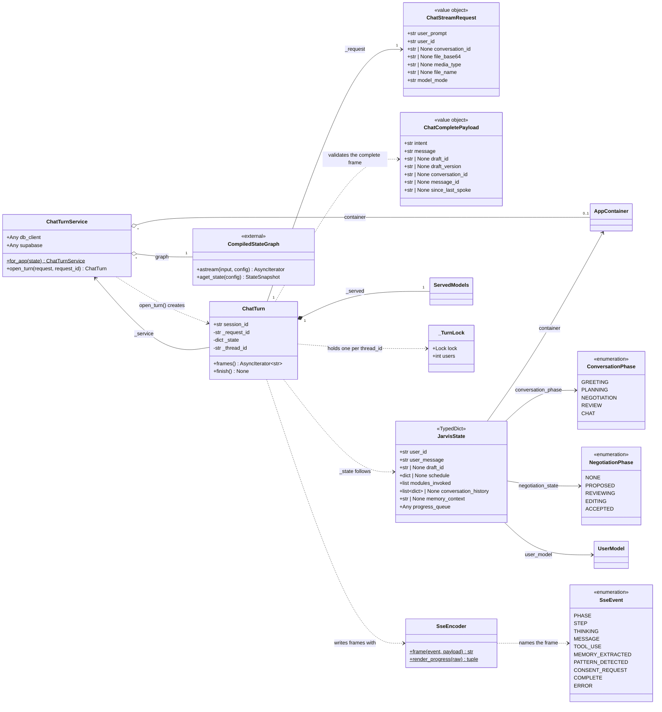

| Relationship | Kind | Why this kind | Where |
|---|---|---|---|
| `ChatTurnService "*" o-- CompiledStateGraph : graph` | Aggregation | The graph is compiled once in the lifespan and shared by every request's service object | `app/main.py:82`, `service.py:248`, `254-257` |
| `ChatTurnService "*" o-- "0..1" AppContainer` | Aggregation | Shared container, possibly absent | `service.py:249-251` |
| `ChatTurn *-- ServedModels : _served` | Composition | Made in `open_turn` for this turn only; the reply is credited to the model it records | `service.py:291-303` |
| `ChatTurn --> ChatStreamRequest`, `--> ChatTurnService` | Association | References kept for the turn's life, not owned | `service.py:59-60` |
| `ChatTurn ..> JarvisState` | Dependency | `_state` is a plain `dict` built by `initial_state` in the shape of the `JarvisState` TypedDict | `service.py:61`, `app/services/chat_turn/context.py:31` |
| `ChatTurn ..> _TurnLock` | Dependency | `thread_lock(thread_id)` takes the conversation's lock from a module-level registry for the turn | `service.py:135`, `app/services/turn_locks.py:37-70` |
| `JarvisState --> UserModel`, `--> AppContainer` | Association | Transient keys, set fresh each turn and scrubbed before checkpointing | `app/orchestrator/state.py:43`, `93`, `app/orchestrator/checkpoint.py:60-90` |

`JarvisState` has 44 keys (`app/orchestrator/state.py:31-118`); the diagram shows the ones the turn reads most.

### 6.2 The orchestrator, modules and checkpoints

`build_jarvis_graph` (`app/orchestrator/graph.py:762-838`) is a function, so it is not a class here; it compiles a `StateGraph(JarvisState)` into the `CompiledStateGraph` above. Three cognitive modules are `ModuleDefinition` objects (`planning_module`, `research_agent`, `knowledge_module`; `app/modules/__init__.py:12-20`), each compiled to a sub-graph by `ModuleRegistry`; coach and conversation are plain node functions (`graph.py:777-778`).

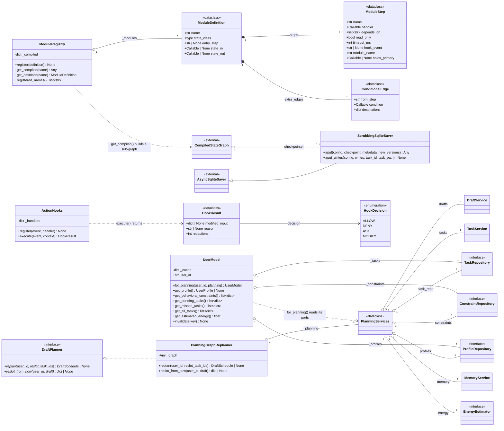

| Relationship | Kind | Why this kind | Where |
|---|---|---|---|
| `ModuleRegistry o-- "*" ModuleDefinition` | Aggregation | Definitions are module-level objects created in their own modules and registered; they exist without the registry | `app/core/module_framework.py:330-354`, `app/modules/planning_graph.py:951` |
| `ModuleDefinition *-- ModuleStep`, `*-- ConditionalEdge` | Composition | Steps are written inline in the definition and belong to it; `register` even stamps `module_name` onto each | `module_framework.py:50-58`, `337-341`, `planning_graph.py:969-1006` |
| `CompiledStateGraph o-- ScrubbingSqliteSaver : checkpointer` | Aggregation | The saver is opened by the lifespan and passed in when the graph is compiled; the lifespan closes it | `app/main.py:78-82`, `181` |
| `AsyncSqliteSaver <\|-- ScrubbingSqliteSaver` | Inheritance | Overrides `aput` / `aput_writes` to drop transient per-turn objects before they are serialised | `app/orchestrator/checkpoint.py:92-163` |
| `UserModel o--` three ports | Aggregation | The facade reads through ports the container built, and caches each read for one turn | `app/core/user_model.py:26-50` |
| `PlanningServices o--` seven collaborators | Aggregation | A frozen record of exactly what the planning sub-graph needs (Interface Segregation), sharing the container's objects | `app/services/planning/services.py:16-31` |
| `PlanningGraphReplanner o-- PlanningServices` | Aggregation | Injected through its constructor | `app/modules/planning_replan.py:37-39` |

---

## 7. Anticipation

### 7.1 Triggers, the service, the scheduler and the sweeps

`Trigger.run` is a Template Method (`app/domain/anticipation.py:353-421`): the order is fixed (timing, once a day, gather, draft, consent, store, auto-apply) and subclasses supply the steps. `AnticipationScheduler` is the Clock actor: one in-process asyncio loop that runs every due `Sweep`, then every user's due triggers.

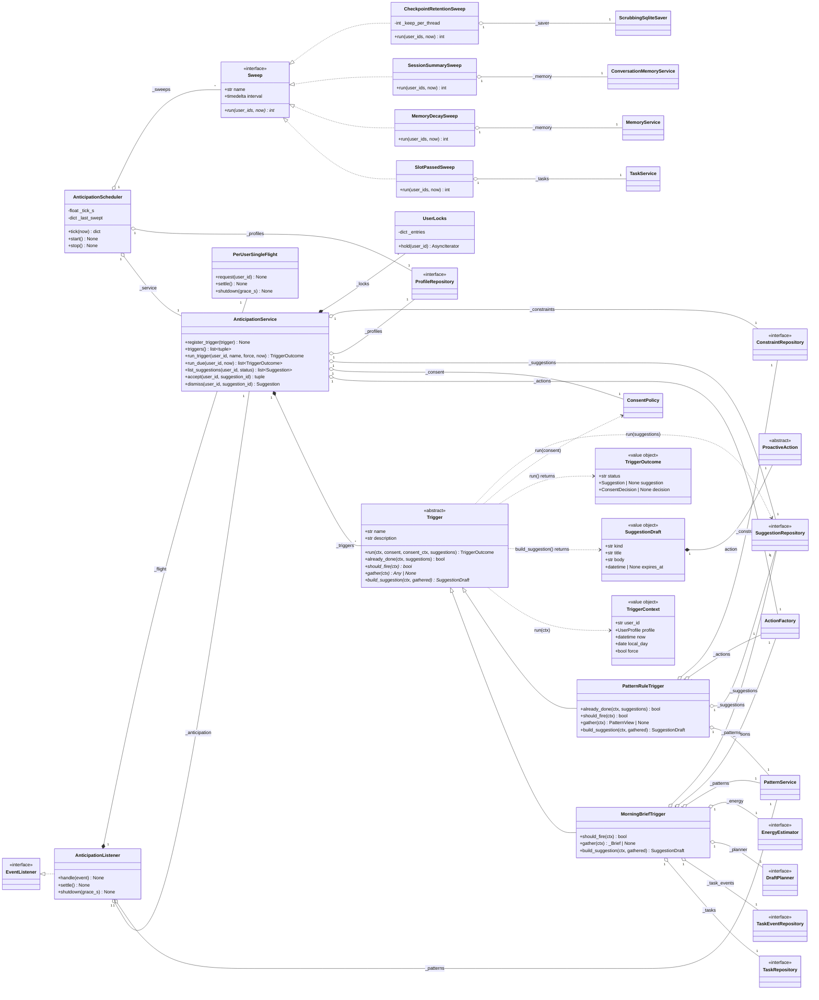

| Relationship | Kind | Why this kind | Where |
|---|---|---|---|
| `Trigger <\|-- MorningBriefTrigger`, `PatternRuleTrigger` | Inheritance | `Trigger` has concrete `run` and `already_done`; subclasses fill in the abstract steps (`PatternRuleTrigger` also overrides `already_done` to say "never", since each pattern is proposed once) | `anticipation.py:342-439`, `triggers.py:90`, `303`, `327-329` |
| `Trigger ..>` context, draft, outcome, `ConsentPolicy`, `SuggestionRepository` | Dependency | All arrive as parameters of `run` or are returned by it; a trigger stores none of them | `anticipation.py:353-421` |
| `SuggestionDraft *-- ProactiveAction : action` | Composition | `build_suggestion` creates the action for this draft; it is serialised into the stored suggestion (`to_payload`) and rebuilt on accept | `anticipation.py:259-270`, `398` |
| Triggers `o--` ports, `PatternService`, `ActionFactory` | Aggregation | Constructor-injected, shared with the service and container | `triggers.py:99-118`, `315-325` |
| `AnticipationService *-- "*" Trigger : _triggers` | Composition | The container creates each trigger only to register it; the service is its only holder | `app/container.py:208-216`, `service.py:189-191` |
| `AnticipationService *-- UserLocks : _locks` | Composition | Created in its constructor; serialises one user's trigger runs | `service.py:180` |
| `StatedRules o-- "0..1" RuleCheckIns` | Aggregation | The container's one `RuleCheckIns` is handed to `StatedRules` (to end a rule's check-ins before deleting it) and to the action factory (to start them for an adopted rule); `None` in tests that build `StatedRules` alone | `app/container.py`, `app/services/memory/stated_rules.py` (`_delete`) |
| `AnticipationScheduler o-- AnticipationService`, `o-- Sweep` | Aggregation | Handed in by the lifespan; the container owns them | `app/main.py:155-160` |
| `AnticipationListener *-- PerUserSingleFlight : _flight` | Composition | Created in its constructor; one background run per user | `triggers.py:412-415` |
| `Sweep <\|.. four sweeps` | Realization | Each owns the data it maintains: tasks, memories, conversation summaries, the checkpoint file | `task_service.py:310`, `memory_service.py:609`, `conversation_memory.py:602`, `checkpoint.py:271` |
| Sweeps `o--` their service | Aggregation | The sweep calls the subsystem's service, which the container owns | `task_service.py:316-317`, `memory_service.py:615-616`, `conversation_memory.py:608-609`, `checkpoint.py:281-285` |

Sweep intervals: `slot_passed` 1 minute, `session_summary` 5 minutes, `memory_decay` 24 hours, `checkpoint_retention` 24 hours. The scheduler ticks every `ANTICIPATION_TICK_SECONDS` = 60 (`app/core/config.py:190`).

### 7.2 The consent chain and proactive actions

`ConsentPolicy` is a Chain of Responsibility (`anticipation.py:218-241`): the first rule that returns a decision wins, and the last link, `ModePolicyRule`, always decides by the user's autonomy mode through an `AutonomyPolicy` Strategy. A `ProactiveAction` is a Command: stored as data inside a suggestion, rebuilt by `ActionFactory` when the user accepts.

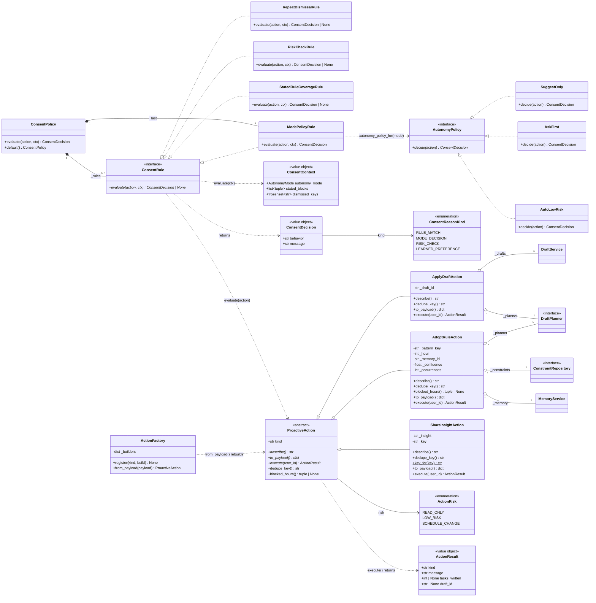

| Relationship | Kind | Why this kind | Where |
|---|---|---|---|
| `ConsentPolicy *-- ConsentRule : _rules`, `*-- ModePolicyRule : _last` | Composition | `ConsentPolicy.default()` creates the four rules for this policy; the constructor refuses a chain whose last link is not a `ModePolicyRule` | `anticipation.py:221-241` |
| `ConsentRule <\|.. four rules` | Realization | Each implements `evaluate`, returning a decision or `None` to pass on | `anticipation.py:115-164`, `211-215` |
| `ModePolicyRule ..> AutonomyPolicy` | Dependency | `autonomy_policy_for(mode)` builds a fresh policy object per decision | `anticipation.py:199-215` |
| `AutonomyPolicy <\|.. SuggestOnly`, `AskFirst`, `AutoLowRisk` | Realization | Strategy chosen by `UserProfile.autonomy_mode` | `anticipation.py:167-208` |
| `ProactiveAction <\|-- three actions` | Inheritance | The base has concrete `dedupe_key` and `blocked_hours`; subclasses implement the abstract steps | `anticipation.py:58-89`, `app/services/anticipation/actions.py:34`, `103`, `241` |
| Actions `o--` services and ports | Aggregation | The factory's builders close over the container's shared objects and pass them into every rebuilt action | `actions.py:290-320` |
| `ActionFactory ..> ProactiveAction` | Dependency | `from_payload` builds and returns an action; the factory keeps only builder functions | `app/services/anticipation/service.py:84-102` |

The default order is: repeat dismissal (deny, `LEARNED_PREFERENCE`), read-only (allow, `RISK_CHECK`), already stated by the user (deny, `RULE_MATCH`), then the mode (allow or ask, `MODE_DECISION`) (`anticipation.py:236-241`).

---

## 8. Memory and learning

### 8.1 Memory and conversation memory

`MemoryService` remembers, reinforces, supersedes, fades and lets go of what Jarvis knows; it searches by meaning through the `TextEmbedder` port. `ConversationMemoryService` keeps the conversation window and its running summaries, and writes "since we last spoke".

```mermaid
classDiagram
    direction LR
    class MemoryService {
        +remember(user_id, candidate, provenance, origin, source_session_id, source_message_id) RememberOutcome
        +confirm(user_id, memory_id) Memory
        +dismiss(user_id, memory_id) Memory
        +forget(user_id, memory_id) None
        +edit(user_id, memory_id, content, memory_type) Memory
        +list_active(user_id, types, now) list~Memory~
        +snapshot(user_id) MemorySnapshot
        +recall(user_id, query, trivial, now, snapshot) Recall
        +drop_suppressed(user_id, texts, min_similarity, let_go_ids) list~str~
        +fade_stale(user_id, now) int
    }
    class MemoryCandidate {
        <<value object>>
        +str memory_type
        +str content
        +float confidence
        +str | None contradicts
        +datetime | None expires_at
    }
    class RememberOutcome {
        <<value object>>
        +str action
        +Memory | None memory
    }
    class MemorySnapshot {
        <<dataclass>>
        +tuple memories
        +frozenset~str~ let_go_ids
        +float retention_floor
        +in_use(now, types) list~Memory~
    }
    class Recall {
        <<value object>>
        +list~Memory~ profile
        +list~Memory~ relevant
        +int tokens
    }
    class MemoryRepository {
        <<interface>>
    }
    class TextEmbedder {
        <<interface>>
        +int dimensions
        +embed(texts) list~list~float~~*
    }
    class MiniLMEmbedder {
        +int dimensions
        +embed(texts) list~list~float~~
    }
    class ConversationMemoryService {
        +build_history(user_id, session_id, let_go_ids) HistoryWindow
        +compact_if_needed(user_id, session_id) bool
        +summarize_session(user_id, session_id) bool
        +compact_in_background(user_id, session_id) None
        +summarize_idle(user_id, now) int
        +since_last_spoke(user_id, session_id, zone, known_empty, snapshot) str | None
        +settle() None
        +shutdown(grace_s) None
    }
    class HistoryWindow {
        <<value object>>
        +list~dict~ history
        +bool summarized
        +int message_count
        +str | None earlier
    }
    class SinceLastSpoke {
        +line(user_id, session_id, zone, known_empty, snapshot) str | None
    }
    class SummaryFilter {
        +clean(user_id, summary, let_go_ids) CleanSummary | None
    }
    class UserLocks
    class StatedRules {
        +link(user_id, rule_id, memory_id) bool
        +forget_memory(user_id, memory_id) list~str~
        +dismiss_memory(user_id, memory_id) tuple
        +delete_rule(user_id, rule_id) bool
    }
    class ConversationRepository {
        <<interface>>
    }
    class TaskEventRepository {
        <<interface>>
    }
    class SuggestionRepository {
        <<interface>>
    }
    class ConstraintRepository {
        <<interface>>
    }

    MemoryService "1" o-- "1" MemoryRepository : _memories
    MemoryService "*" o-- "1" TextEmbedder : _embedder
    TextEmbedder <|.. MiniLMEmbedder
    MemoryService ..> MemoryCandidate : remember(candidate)
    MemoryService ..> RememberOutcome : remember() returns
    MemoryService ..> MemorySnapshot : snapshot() returns
    MemoryService ..> Recall : recall() returns
    ConversationMemoryService "1" o-- "1" ConversationRepository : _conversations
    ConversationMemoryService "1" *-- "1" SummaryFilter : _filter
    ConversationMemoryService "1" *-- "1" SinceLastSpoke : _since
    ConversationMemoryService "1" *-- "1" UserLocks : _locks
    ConversationMemoryService ..> HistoryWindow : build_history() returns
    SinceLastSpoke "1" o-- "1" ConversationRepository : _conversations
    SinceLastSpoke "1" o-- "1" TaskEventRepository : _events
    SinceLastSpoke "1" o-- "1" SummaryFilter : _summaries
    SinceLastSpoke "1" o-- "0..1" MemoryService : _memory
    SinceLastSpoke "1" o-- "0..1" SuggestionRepository : _suggestions
    SummaryFilter "1" o-- "0..1" MemoryService : _memory
    StatedRules "1" o-- "1" ConstraintRepository : _rules
    StatedRules "1" o-- "1" MemoryService : _memory
```

| Relationship | Kind | Why this kind | Where |
|---|---|---|---|
| `MemoryService o-- MemoryRepository`, `o-- TextEmbedder` | Aggregation | Injected; the embedder is also a container field, warmed up at startup | `memory_service.py:182-195`, `app/main.py:126-129` |
| `TextEmbedder <\|.. MiniLMEmbedder` | Realization (Adapter) | Wraps the local all-MiniLM-L6-v2 model behind the port; 384 dimensions, the width of `user_memories.embedding` | `app/infrastructure/embedding.py:10-32` |
| `MemoryService ..>` candidate, outcome, snapshot, recall | Dependency | Parameter and return types, never stored | `memory_service.py:197-207`, `359-381` |
| `ConversationMemoryService *-- SummaryFilter`, `*-- SinceLastSpoke`, `*-- UserLocks` | Composition | All three are created in its constructor and live with it | `app/services/memory/conversation_memory.py:208-214` |
| `SinceLastSpoke o-- SummaryFilter : _summaries` | Aggregation | It receives the filter its owner created, which the owner also uses | `conversation_memory.py:208-212`, `since_last_spoke.py:60-75` |
| `SinceLastSpoke o-- "0..1" MemoryService`, `o-- "0..1" SuggestionRepository` | Aggregation, optional | Without them it only checks for blame and counts nothing | `since_last_spoke.py:67-75` |
| `StatedRules o-- ConstraintRepository`, `o-- MemoryService` | Aggregation | Keeps a stated rule and the memory of stating it together: letting go of one lets go of both | `stated_rules.py:62-67`, `app/container.py:256-257` |

### 8.2 PEARL patterns, the focus profile and energy

PEARL is the pattern learner: `PatternService` reads the outcome history through four `PatternDetector` strategies, remembers what it finds as memories, and publishes `PatternDetected`. `PatternObserver` runs it in the background after every task outcome. The focus profile comes from an `EnergyEstimator` strategy: the learned one is smoothed toward the heuristic prior.

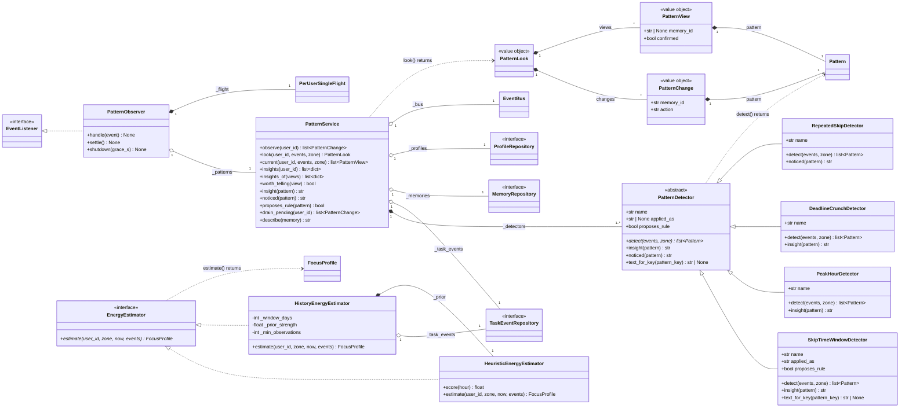

| Relationship | Kind | Why this kind | Where |
|---|---|---|---|
| `PatternService *-- "1..*" PatternDetector` | Composition | `default_pattern_detectors()` creates the four detectors for this service only; it copies them into its own list and indexes them by name | `app/container.py:70-77`, `154-157`, `patterns.py:419-420` |
| `PatternDetector <\|-- four detectors` | Inheritance | The base is abstract (one abstract method, `detect`) with concrete default `insight`, `noticed`, `text_for_key`; a detector owns its key, words and planning use | `patterns.py:148-185`, `187`, `229`, `275`, `315` |
| `PatternService o--` ports and `EventBus` | Aggregation | Injected; shared with other services | `patterns.py:402-418` |
| `PatternLook *-- PatternChange`, `*-- PatternView`; views and changes `*-- Pattern` | Composition | Value objects assembled for one look and returned together | `patterns.py:354-397` |
| `PatternObserver *-- PerUserSingleFlight` | Composition | Created in its constructor: at most one PEARL run per user in flight | `patterns.py:706-708` |
| `EnergyEstimator <\|.. HeuristicEnergyEstimator`, `HistoryEnergyEstimator` | Realization | Two interchangeable strategies; the container uses the learned one | `app/services/energy.py:31`, `67`, `app/container.py:162-168` |
| `HistoryEnergyEstimator *-- HeuristicEnergyEstimator : _prior` | Composition | The container creates the heuristic only to be this estimator's prior | `container.py:162-168`, `energy.py:70-83` |

---

## 9. Class index

Every class drawn above, and the module it is imported from. The conformance test reads this table: a class in a diagram that is missing here, or a row here that no diagram uses, fails the test.

| Class | Module |
|---|---|
| `AppContainer` | `app.container` |
| `IngestedDocument` | `app.domain.entities` |
| `TaskMaterialLink` | `app.domain.entities` |
| `StoredFile` | `app.domain.entities` |
| `DocumentRepository` | `app.domain.ports` |
| `DocumentFileStore` | `app.domain.ports` |
| `SupabaseDocumentRepository` | `app.infrastructure.persistence.supabase_repos` |
| `InMemoryDocumentRepository` | `app.infrastructure.persistence.in_memory` |
| `SupabaseDocumentFileStore` | `app.infrastructure.persistence.supabase_storage` |
| `InMemoryDocumentFileStore` | `app.infrastructure.persistence.in_memory` |
| `DocumentService` | `app.services.documents.service` |
| `DocumentFile` | `app.services.documents.service` |
| `DocumentLinker` | `app.services.documents.linker` |
| `DocumentLinkListener` | `app.services.documents.linker` |
| `Settings` | `app.core.settings` |
| `Exception` | `builtins` |
| `UserProfile` | `app.domain.entities` |
| `Goal` | `app.domain.entities` |
| `GoalDeadlineUpdate` | `app.domain.entities` |
| `Task` | `app.domain.entities` |
| `TaskEvent` | `app.domain.entities` |
| `DraftSchedule` | `app.domain.entities` |
| `BehavioralConstraint` | `app.domain.entities` |
| `HabitTracker` | `app.domain.entities` |
| `Memory` | `app.domain.entities` |
| `Pattern` | `app.domain.entities` |
| `HourFocus` | `app.domain.entities` |
| `FocusProfile` | `app.domain.entities` |
| `ConsentDecision` | `app.domain.entities` |
| `Suggestion` | `app.domain.entities` |
| `ConversationSession` | `app.domain.entities` |
| `ChatMessage` | `app.domain.entities` |
| `LLMUsageEvent` | `app.domain.entities` |
| `TaskStatus` | `app.domain.entities` |
| `TaskEventType` | `app.domain.entities` |
| `DraftStatus` | `app.domain.entities` |
| `AutonomyMode` | `app.domain.entities` |
| `MemorySource` | `app.domain.entities` |
| `MemoryStatus` | `app.domain.entities` |
| `SuggestionStatus` | `app.domain.entities` |
| `SuggestionExpiry` | `app.domain.entities` |
| `ConsentReasonKind` | `app.domain.entities` |
| `LLMLocation` | `app.domain.entities` |
| `DomainEvent` | `app.domain.events` |
| `TaskCompleted` | `app.domain.events` |
| `TaskSkipped` | `app.domain.events` |
| `TaskMissed` | `app.domain.events` |
| `DeadlineMissed` | `app.domain.events` |
| `DraftAccepted` | `app.domain.events` |
| `PatternDetected` | `app.domain.events` |
| `LLMCallCompleted` | `app.domain.events` |
| `EventListener` | `app.domain.events` |
| `EventBus` | `app.domain.events` |
| `NullEventBus` | `app.domain.events` |
| `JarvisError` | `app.domain.errors` |
| `DomainError` | `app.domain.errors` |
| `ValidationError` | `app.domain.errors` |
| `NotFoundError` | `app.domain.errors` |
| `ConflictError` | `app.domain.errors` |
| `InvalidStateTransition` | `app.domain.errors` |
| `StaleVersionError` | `app.domain.errors` |
| `DraftOutdatedError` | `app.domain.errors` |
| `ScheduleInfeasibleError` | `app.domain.errors` |
| `InfrastructureError` | `app.domain.errors` |
| `PersistenceError` | `app.domain.errors` |
| `EmbeddingUnavailableError` | `app.domain.errors` |
| `DocumentReadTimeoutError` | `app.domain.errors` |
| `LLMError` | `app.domain.errors` |
| `LLMTimeoutError` | `app.domain.errors` |
| `LLMUnavailableError` | `app.domain.errors` |
| `LLMOutputParseError` | `app.domain.errors` |
| `LLMRefusedError` | `app.domain.errors` |
| `TaskRepository` | `app.domain.ports` |
| `TaskEventRepository` | `app.domain.ports` |
| `DraftRepository` | `app.domain.ports` |
| `ConstraintRepository` | `app.domain.ports` |
| `GoalRepository` | `app.domain.ports` |
| `HabitTrackerRepository` | `app.domain.ports` |
| `ProfileRepository` | `app.domain.ports` |
| `SuggestionRepository` | `app.domain.ports` |
| `MemoryRepository` | `app.domain.ports` |
| `ConversationRepository` | `app.domain.ports` |
| `UsageRepository` | `app.domain.ports` |
| `MemoryMatch` | `app.domain.ports` |
| `Sweep` | `app.domain.ports` |
| `DraftPlanner` | `app.domain.ports` |
| `EnergyEstimator` | `app.domain.ports` |
| `TextEmbedder` | `app.domain.ports` |
| `LLMRequest` | `app.domain.ports` |
| `LLMProvider` | `app.domain.ports` |
| `RetryPolicy` | `app.domain.ports` |
| `ProactiveAction` | `app.domain.anticipation` |
| `ActionRisk` | `app.domain.anticipation` |
| `ActionResult` | `app.domain.anticipation` |
| `ConsentContext` | `app.domain.anticipation` |
| `ConsentRule` | `app.domain.anticipation` |
| `RepeatDismissalRule` | `app.domain.anticipation` |
| `RiskCheckRule` | `app.domain.anticipation` |
| `StatedRuleCoverageRule` | `app.domain.anticipation` |
| `ModePolicyRule` | `app.domain.anticipation` |
| `AutonomyPolicy` | `app.domain.anticipation` |
| `SuggestOnly` | `app.domain.anticipation` |
| `AskFirst` | `app.domain.anticipation` |
| `AutoLowRisk` | `app.domain.anticipation` |
| `ConsentPolicy` | `app.domain.anticipation` |
| `TriggerContext` | `app.domain.anticipation` |
| `SuggestionDraft` | `app.domain.anticipation` |
| `TriggerOutcome` | `app.domain.anticipation` |
| `Trigger` | `app.domain.anticipation` |
| `Repositories` | `app.infrastructure.persistence.factory` |
| `RepositoryFactory` | `app.infrastructure.persistence.factory` |
| `_SupabaseRepository` | `app.infrastructure.persistence.supabase_repos` |
| `SupabaseTaskRepository` | `app.infrastructure.persistence.supabase_repos` |
| `SupabaseTaskEventRepository` | `app.infrastructure.persistence.supabase_repos` |
| `SupabaseDraftRepository` | `app.infrastructure.persistence.supabase_repos` |
| `SupabaseConstraintRepository` | `app.infrastructure.persistence.supabase_repos` |
| `SupabaseGoalRepository` | `app.infrastructure.persistence.supabase_repos` |
| `SupabaseHabitTrackerRepository` | `app.infrastructure.persistence.supabase_repos` |
| `SupabaseProfileRepository` | `app.infrastructure.persistence.supabase_repos` |
| `SupabaseSuggestionRepository` | `app.infrastructure.persistence.supabase_repos` |
| `SupabaseMemoryRepository` | `app.infrastructure.persistence.supabase_repos` |
| `SupabaseConversationRepository` | `app.infrastructure.persistence.supabase_repos` |
| `SupabaseUsageRepository` | `app.infrastructure.persistence.supabase_repos` |
| `InMemoryStore` | `app.infrastructure.persistence.in_memory` |
| `InMemoryTaskRepository` | `app.infrastructure.persistence.in_memory` |
| `InMemoryTaskEventRepository` | `app.infrastructure.persistence.in_memory` |
| `InMemoryDraftRepository` | `app.infrastructure.persistence.in_memory` |
| `InMemoryConstraintRepository` | `app.infrastructure.persistence.in_memory` |
| `InMemoryGoalRepository` | `app.infrastructure.persistence.in_memory` |
| `InMemoryHabitTrackerRepository` | `app.infrastructure.persistence.in_memory` |
| `InMemoryProfileRepository` | `app.infrastructure.persistence.in_memory` |
| `InMemorySuggestionRepository` | `app.infrastructure.persistence.in_memory` |
| `InMemoryMemoryRepository` | `app.infrastructure.persistence.in_memory` |
| `InMemoryConversationRepository` | `app.infrastructure.persistence.in_memory` |
| `InMemoryUsageRepository` | `app.infrastructure.persistence.in_memory` |
| `FallbackChainProvider` | `app.infrastructure.llm.chain` |
| `_ProviderDecorator` | `app.infrastructure.llm.decorators` |
| `RedactingProvider` | `app.infrastructure.llm.decorators` |
| `RetryingProvider` | `app.infrastructure.llm.decorators` |
| `TimeoutProvider` | `app.infrastructure.llm.decorators` |
| `MeteredProvider` | `app.infrastructure.llm.decorators` |
| `RedactedLLMRequest` | `app.infrastructure.llm.decorators` |
| `Redactor` | `app.infrastructure.llm.decorators` |
| `ServedModels` | `app.infrastructure.llm.decorators` |
| `LLMProviderFactory` | `app.infrastructure.llm.factory` |
| `LocalLMStudioProvider` | `app.infrastructure.llm.local` |
| `ClaudeProvider` | `app.infrastructure.llm.claude` |
| `GeminiProvider` | `app.infrastructure.llm.gemini` |
| `ExponentialBackoff` | `app.infrastructure.llm.retry` |
| `NoRetry` | `app.infrastructure.llm.retry` |
| `TokenTally` | `app.infrastructure.llm.transport` |
| `MiniLMEmbedder` | `app.infrastructure.embedding` |
| `PreCloudLLMRedactor` | `app.core.model_router` |
| `ModelRole` | `app.core.model_router` |
| `UserModel` | `app.core.user_model` |
| `ModuleRegistry` | `app.core.module_framework` |
| `ModuleDefinition` | `app.core.module_framework` |
| `ModuleStep` | `app.core.module_framework` |
| `ConditionalEdge` | `app.core.module_framework` |
| `ActionHooks` | `app.orchestrator.hooks` |
| `HookResult` | `app.orchestrator.hooks` |
| `HookDecision` | `app.orchestrator.hooks` |
| `ScrubbingSqliteSaver` | `app.orchestrator.checkpoint` |
| `CheckpointRetentionSweep` | `app.orchestrator.checkpoint` |
| `JarvisState` | `app.orchestrator.state` |
| `ConversationPhase` | `app.orchestrator.state` |
| `NegotiationPhase` | `app.orchestrator.state` |
| `CompiledStateGraph` | `langgraph.graph.state` |
| `AsyncSqliteSaver` | `langgraph.checkpoint.sqlite.aio` |
| `ChatStreamRequest` | `app.schemas.chat_stream` |
| `ChatCompletePayload` | `app.schemas.chat_stream` |
| `SseEncoder` | `app.schemas.chat_stream` |
| `SseEvent` | `app.schemas.chat_stream` |
| `ChatTurnService` | `app.services.chat_turn.service` |
| `ChatTurn` | `app.services.chat_turn.service` |
| `_TurnLock` | `app.services.turn_locks` |
| `DraftService` | `app.services.draft_service` |
| `TaskService` | `app.services.task_service` |
| `SlotPassedSweep` | `app.services.task_service` |
| `UsageLedger` | `app.services.usage_ledger` |
| `UserModelService` | `app.services.user_model_service` |
| `PlanningServices` | `app.services.planning.services` |
| `PlanningGraphReplanner` | `app.modules.planning_replan` |
| `HeuristicEnergyEstimator` | `app.services.energy` |
| `HistoryEnergyEstimator` | `app.services.energy` |
| `PerUserSingleFlight` | `app.services.background` |
| `ActionFactory` | `app.services.anticipation.service` |
| `AnticipationService` | `app.services.anticipation.service` |
| `AnticipationScheduler` | `app.services.anticipation.scheduler` |
| `MorningBriefTrigger` | `app.services.anticipation.triggers` |
| `PatternRuleTrigger` | `app.services.anticipation.triggers` |
| `AnticipationListener` | `app.services.anticipation.triggers` |
| `ApplyDraftAction` | `app.services.anticipation.actions` |
| `AdoptRuleAction` | `app.services.anticipation.actions` |
| `ShareInsightAction` | `app.services.anticipation.actions` |
| `UserLocks` | `app.services.anticipation.user_locks` |
| `MemoryService` | `app.services.memory.memory_service` |
| `MemoryCandidate` | `app.services.memory.memory_service` |
| `RememberOutcome` | `app.services.memory.memory_service` |
| `MemorySnapshot` | `app.services.memory.memory_service` |
| `MemoryDecaySweep` | `app.services.memory.memory_service` |
| `Recall` | `app.services.memory.context` |
| `PatternService` | `app.services.memory.patterns` |
| `PatternDetector` | `app.services.memory.patterns` |
| `SkipTimeWindowDetector` | `app.services.memory.patterns` |
| `PeakHourDetector` | `app.services.memory.patterns` |
| `DeadlineCrunchDetector` | `app.services.memory.patterns` |
| `RepeatedSkipDetector` | `app.services.memory.patterns` |
| `PatternView` | `app.services.memory.patterns` |
| `PatternChange` | `app.services.memory.patterns` |
| `PatternLook` | `app.services.memory.patterns` |
| `PatternObserver` | `app.services.memory.patterns` |
| `ConversationMemoryService` | `app.services.memory.conversation_memory` |
| `HistoryWindow` | `app.services.memory.conversation_memory` |
| `SessionSummarySweep` | `app.services.memory.conversation_memory` |
| `SinceLastSpoke` | `app.services.memory.since_last_spoke` |
| `SummaryFilter` | `app.services.memory.summary_text` |
| `StatedRules` | `app.services.memory.stated_rules` |
| `RuleCheckIns` | `app.services.analytical.rule_check_ins` |

---

## 10. What the diagrams leave out

These are the places where the code cannot be drawn faithfully as a class diagram, or where a diagram chose to show less. They are listed so no one mistakes an omission for a claim.

| What | Why it is not drawn, or drawn differently |
|---|---|
| `route_llm_call`, `build_jarvis_graph`, `thread_lock`, `accept_draft_on_time`, `run_observation_loop`, `run_schedule` and the graph's node functions | Functions, not classes. `02-architecture.md` places them in the runtime view. |
| The three cognitive modules (`planning_module`, `research_agent`, `knowledge_module`) | They are `ModuleDefinition` instances, not classes (section 6.2). |
| `PreCloudLLMRedactor` realizing `Redactor` | `Redactor` is a `typing.Protocol`; the match is structural, so a realization arrow would not be a true `issubclass`. |
| Process-wide singletons: the hook pipeline (`get_hooks()`, `app/orchestrator/hooks.py:142-150`), the installed LLM chain (`set_chain` / `get_chain`, `app/infrastructure/llm/factory.py:59-79`, `app/core/model_router.py:160-171`), the module registry (`app/modules/__init__.py:9`), the turn-lock registry (`app/services/turn_locks.py:37`) | Module-level state, not fields of any object, so no arrow can show them. `02-architecture.md` lists them as process-local state. |
| `Settings`' six nested records (`TaskSettings`, `MemorySettings`, `ConversationSettings`, `FocusSettings`, `AnticipationSettings`, `DocumentSettings`, `app/core/settings.py:13-78`) | Plain frozen dataclasses of configuration values, built once by `Settings.from_config`; drawing them adds nothing to the design. All 24 `AppContainer` fields are drawn in the overview. |
| Private helpers (`_Move`, `_Backoff`, `_Settled`, `_Brief`, `_Entry`, `_PrimaryHold`), API request/response models, frame models (`PhaseFrame`, `StepFrame`, ...), and the analytical services (`workspace_builder`, `voice_of_jarvis`, the OR-Tools `JarvisScheduler`) | Out of scope for the LLD diagrams; `07-api-design.md` covers the API models and the frame catalogue. |
| Types | `Literal[...]` is drawn as `str`; generics with a comma (`dict[str, X]`, `tuple[int, int]`) are drawn without parameters, because Mermaid cannot render them. |

---

## 11. How to verify this document

From `Jarvis-Engine/` on branch `main`:

```bash
# The diagrams against the code: classes, interfaces, arrows, methods, enums, attributes
.venv/bin/python -m pytest tests/test_design_conformance.py -q

# The layering rules the overview relies on
.venv/bin/python -m pytest tests/test_layering.py -q

# Every diagram renders (Mermaid CLI; writes one SVG per diagram next to the output file)
npx -y @mermaid-js/mermaid-cli -i docs/capstone/03-class-diagrams.md -o /tmp/03-rendered.md

# Spot-check any class against the index, e.g.
grep -n "^class FallbackChainProvider" app/infrastructure/llm/chain.py
sed -n '33,56p' app/infrastructure/llm/factory.py
```
