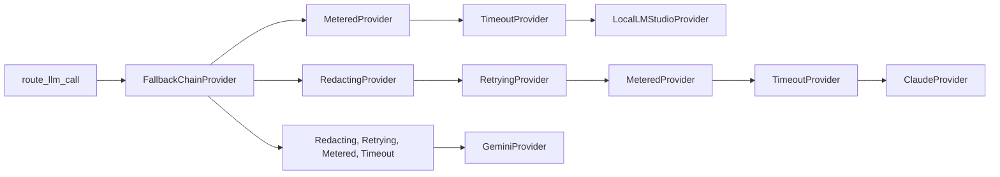
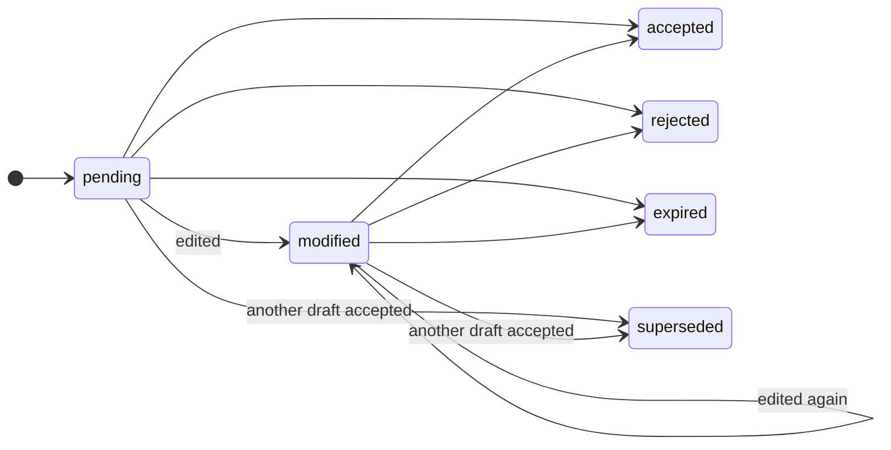
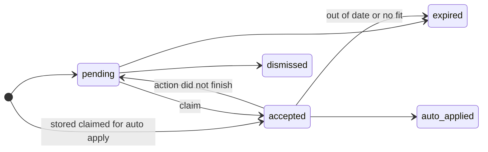
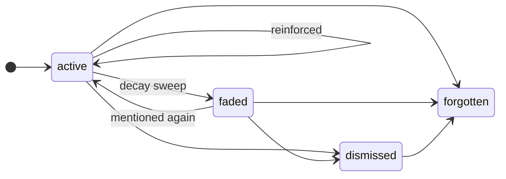
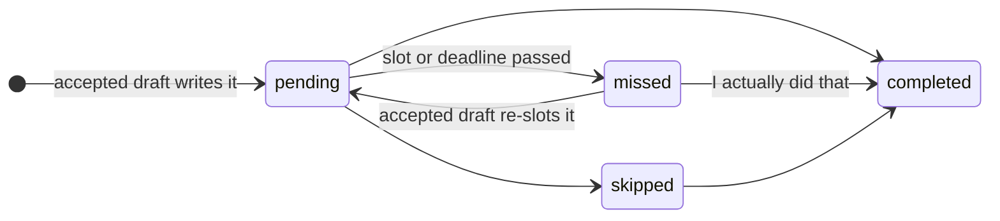

# 05 — Design patterns

This document lists every design pattern that is actually present in the Jarvis backend at branch `capstone-lld`, commit `5c6ffd3`, and only those. For each one it gives the problem it solves, where it lives (`path:line`), a short excerpt copied from the code, how a new variant is added without editing existing classes, the alternative that was rejected and why, and the test that pins the behaviour. Where a pattern is only partly applied, the section says so and says where the gap is. The patterns cluster around three subsystems: persistence (Repository, Abstract Factory, Adapter), the language-model chain (Strategy, Decorator, Chain of Responsibility, Factory, Adapter), and anticipation (Template Method, Chain of Responsibility, Strategy, Command, State, Observer). The composition root `AppContainer` is the one place where the concrete classes are chosen.

**Owner: ______**

---

## 1. Patterns at a glance

| # | Pattern | Main location | Status | Pinned by |
|---|---|---|---|---|
| 2 | Repository, two families under one contract suite | `app/domain/ports.py:54-511`; `app/infrastructure/persistence/{in_memory,supabase_repos}.py` | Applied; two older endpoints still query Supabase directly (see 2.7) | `tests/test_repository_contracts.py` (89 test functions, 201 runs over both families) |
| 3 | Strategy | LLM providers, pattern detectors, embedders, energy estimators, retry policies, autonomy policies | Applied; some strategies have one production implementation (see 3.5) | `tests/test_llm_providers.py`, `tests/test_patterns.py`, `tests/test_recall.py`, `tests/test_consent.py` |
| 4 | Decorator | `RedactingProvider`, `RetryingProvider`, `MeteredProvider`, `TimeoutProvider` (`app/infrastructure/llm/decorators.py`) | Applied | `tests/test_llm_providers.py` |
| 5 | Chain of Responsibility | Provider fallback chain (`app/infrastructure/llm/chain.py:35`); consent chain (`app/domain/anticipation.py:218`); hook pipeline (`app/orchestrator/hooks.py:32`) | Applied; the hook pipeline is first-match, not deny-over-ask aggregation (see 5.6) | `tests/test_llm_providers.py::test_chain__*`, `tests/test_consent.py` |
| 6 | State (transition tables) | Draft, suggestion and memory tables in `app/domain/entities.py`; task moves in `app/services/task_service.py:65-84` | Applied; the task table lives in the service, not the domain (see 6.6) | `tests/test_domain.py`, `tests/test_anticipation_design.py`, `tests/test_task_service.py` |
| 7 | Observer | `EventBus` (`app/domain/events.py:78`) with `UsageLedger`, `PatternObserver`, `AnticipationListener` | Applied; two published events have no production listener (see 7.6) | `tests/test_domain.py::test_event_bus__*`, `tests/test_container.py` |
| 8 | Template Method | `Trigger.run` (`app/domain/anticipation.py:353-421`) | Applied | `tests/test_trigger_template.py` (13 tests) |
| 9 | Factory / composition root | `AppContainer.build` (`app/container.py:99-210`), `RepositoryFactory`, `LLMProviderFactory`, `ActionFactory` | Applied; a few global look-ups of the container remain (see 9.6) | `tests/test_container.py`, `tests/test_layering.py::test_layering__only_container_builds_repositories` |
| 10 | Facade | `UserModelService.snapshot` (`app/services/user_model_service.py:182-223`) | Applied for the You page; the older `UserModel` facade is still reached through (see 10.6) | `tests/test_user_model_service.py`, `tests/test_you_api.py` |
| 11 | Adapter | Provider adapters, Supabase repositories, `MiniLMEmbedder`, `PreCloudLLMRedactor` | Applied | `tests/test_llm_providers.py::test_local__*`, `tests/test_claude_provider.py`, `tests/test_embedding.py` |
| 12 | Command-like `ProactiveAction` | `app/domain/anticipation.py:58-89`; `app/services/anticipation/actions.py` | Applied (stored, rebuilt, executed once; no undo) | `tests/test_anticipation_service.py`, `tests/test_trigger_template.py` |

Every port is an `abc.ABC` (decision ADR-2 in the spec), so "implements" in the class diagram is a real subclass and an incomplete implementation fails at construction: `tests/test_domain.py::test_ports__instantiated_directly__raise_type_error`.

The language-model chain, as `LLMProviderFactory.build` assembles it (`app/infrastructure/llm/factory.py:34-56`):



The chain tries the three branches top to bottom (local first). Each branch is an adapter wrapped in decorators; the chain itself is a provider too, so callers see one `LLMProvider`.

---

## 2. Repository (two families, one contract suite)

### 2.1 Problem
Services must store tasks, drafts, events, rules, memories, suggestions, profiles and usage without knowing Supabase exists, and tests must run offline. Before the capstone, endpoints built Supabase queries inline, and some forgot the `user_id` filter (the IDOR found in the audit).

### 2.2 Pattern
One abstract repository per aggregate (the port), with every per-user method taking `user_id` first (`app/domain/ports.py:1-5`). Two concrete families implement every port: in-memory (`app/infrastructure/persistence/in_memory.py`) and Supabase (`app/infrastructure/persistence/supabase_repos.py`). The same contract tests run against both, which is how substitutability (Liskov) is shown rather than claimed.

### 2.3 Where
- Ports: `TaskRepository` (`ports.py:54-97`), `TaskEventRepository` (`ports.py:100-134`), `DraftRepository` (`ports.py:137-196`), `ConstraintRepository` (`ports.py:199`), `ProfileRepository` (`ports.py:225`), `SuggestionRepository` (`ports.py:241-304`), `MemoryRepository` (`ports.py:316-417`), `ConversationRepository` (`ports.py:420`), `UsageRepository` (`ports.py:497-511`).
- One family at a time: `Repositories` and `RepositoryFactory` (`app/infrastructure/persistence/factory.py:46-93`).
- Contract suite fixture, parametrised over both families (`tests/test_repository_contracts.py:70-74`):

```python
@pytest.fixture(params=["in_memory", "supabase_fake"])
def repos(request, memory_store, fake_client) -> Repositories:
    if request.param == "in_memory":
        return RepositoryFactory.in_memory(memory_store)
    return RepositoryFactory.supabase(fake_client)
```

### 2.4 Adding a variant
A third family (say, plain Postgres through asyncpg) is a new module with one class per port plus a `RepositoryFactory.postgres(...)` method; add its name to the fixture's `params` and the whole contract suite runs against it. No service changes, because services receive ports from `AppContainer` (`app/container.py:119-123`).

### 2.5 Alternative rejected
- **Active Record (`task.save()`)**: puts storage on the domain entity and makes the entity import the driver, which breaks the dependency rule the layering test enforces (`tests/test_layering.py::test_domain__imports_nothing_from_outer_layers`).
- **A generic `Repository[T]` with `get/add/update`**: the operations differ per aggregate. Tasks only change status (`ports.py:57-58`: "It writes only a task's status"); drafts need an atomic accept (`ports.py:184-196`); task events are append-only. A generic interface would offer writes the domain must forbid.
- **Local Postgres for tests** (ADR-4): no Docker on the build machine, and supabase-py speaks PostgREST.

### 2.6 Pinned by
`tests/test_repository_contracts.py::test_factory__both_families__implement_every_port`; the 89 contract test functions (201 runs) in that file, for example `::test_drafts__accept_atomic__concurrent_calls__exactly_one_succeeds` and `::test_repos__entity_for_other_user__raises_validation_and_writes_nothing`; `tests/test_layering.py::test_layering__only_container_builds_repositories`.

### 2.7 Honest notes
- The Supabase family is tested against `FakeSupabase` (`tests/fakes.py`), a stand-in that mirrors PostgREST and the `accept_draft` SQL function, not against a live database. The live database is exercised by `scripts/live_e2e.py`.
- Two persistence paths remain: the draft endpoints load a draft through the older `DraftStore` (`app/api/v1/endpoints/drafts.py:55-66`), and `PATCH /tasks/{id}` updates `user_tasks` with direct Supabase calls (`app/api/v1/endpoints/tasks.py:267-295`). Both still filter by `user_id`. The build ledger records moving them behind the ports as Plan 3 work.
- There is no `GoalRepository`; goals are a column on tasks and drafts.

---

## 3. Strategy

### 3.1 Problem
Several algorithms vary independently and must be swappable at runtime or in tests: which language model answers, how the outcome history is read for patterns, how text becomes a vector, how focus by hour is estimated, how retries back off, and how far Jarvis may act alone.

### 3.2 Pattern
Each family is an abstract class; the caller holds the abstraction and the composition root (or the user's setting) picks the concrete class.

### 3.3 Where

| Strategy port | Implementations | Chosen by |
|---|---|---|
| `LLMProvider` (`app/domain/ports.py:625-641`) | `LocalLMStudioProvider` (`app/infrastructure/llm/local.py:16`), `ClaudeProvider` (`app/infrastructure/llm/claude.py:82`), `GeminiProvider` (`app/infrastructure/llm/gemini.py:15`) | `LLMProviderFactory.build` (`app/infrastructure/llm/factory.py:34-56`) and each provider's `is_available()` |
| `PatternDetector` (`app/services/memory/patterns.py:148-184`) | `SkipTimeWindowDetector` (`:187`), `PeakHourDetector` (`:229`), `DeadlineCrunchDetector` (`:275`), `RepeatedSkipDetector` (`:315`) | `default_pattern_detectors()` (`app/container.py:64-71`) |
| `TextEmbedder` (`app/domain/ports.py:584-594`) | `MiniLMEmbedder` (`app/infrastructure/embedding.py:10`); test doubles `BagOfWordsEmbedder` (`tests/fakes.py:398`) and `_DownEmbedder` (`tests/test_recall.py:57`) | `AppContainer.build(embedder=...)` (`app/container.py:106, 134`) |
| `EnergyEstimator` (`app/domain/ports.py:562-578`) | `HeuristicEnergyEstimator` (`app/services/energy.py:31`), `HistoryEnergyEstimator` (`app/services/energy.py:67`) | `app/container.py:144` (the history estimator, with the heuristic as its prior) |
| `RetryPolicy` (`app/domain/ports.py:644-653`) | `ExponentialBackoff`, `NoRetry` (`app/infrastructure/llm/retry.py:9, 35`) | `_wrap_cloud` (`app/infrastructure/llm/factory.py:27`) |
| `AutonomyPolicy` (`app/domain/anticipation.py:167-172`) | `SuggestOnly`, `AskFirst`, `AutoLowRisk` (`app/domain/anticipation.py:182-196`) | The user's `autonomy_mode`, through `autonomy_policy_for` (`app/domain/anticipation.py:199-208`) |

The provider strategy's interface (`app/domain/ports.py:631-641`):

```python
    @abstractmethod
    def is_available(self) -> bool:
        """Return cheaply, without I/O, whether this provider can be tried right now."""

    @abstractmethod
    async def complete(self, req: LLMRequest) -> str | BaseModel:
        """Return the completion: an instance of req.response_schema when set, else text."""

    @abstractmethod
    def stream(self, req: LLMRequest) -> AsyncIterator[tuple[str, str]]:
        """Yield (event_type, token) pairs as they arrive; req.response_schema must be None."""
```

The detectors are chosen in exactly one place (`app/container.py:64-71`):

```python
def default_pattern_detectors() -> list[PatternDetector]:
    """The ways PEARL reads the outcome history: the one place they are chosen."""
    return [
        SkipTimeWindowDetector(),
        PeakHourDetector(),
        DeadlineCrunchDetector(),
        RepeatedSkipDetector(),
    ]
```

The embedder port (`app/domain/ports.py:584-594`):

```python
class TextEmbedder(ABC):
    """Turns text into vectors whose cosine similarity tracks meaning (Strategy)."""

    dimensions: int

    @abstractmethod
    def embed(self, texts: list[str]) -> list[list[float]]:
        """Return one ``dimensions``-long vector per text, in order.

        Synchronous CPU work: async callers run it with ``asyncio.to_thread``.
        """
```

### 3.4 Adding a variant
- **Provider**: a new `LLMProvider` subclass, passed as `extra_cloud` to `LLMProviderFactory.build` (`app/infrastructure/llm/factory.py:38`); it is wrapped for its location and placed between Claude and Gemini. No caller of `route_llm_call` changes. This is how `ClaudeProvider` was added (spec §6.2: "the live OCP demonstration").
- **Detector**: a new `PatternDetector` subclass that owns its key, words, `applied_as` and `proposes_rule`, plus one line in `default_pattern_detectors()`. If it sets `proposes_rule = True`, the pattern-rule trigger offers it without any edit (`app/services/anticipation/triggers.py:304-305`, `PatternService.proposes_rule`, `patterns.py:586-589`).
- **Autonomy mode**: a new `AutonomyPolicy` subclass plus an `AutonomyMode` value and one entry in `_POLICIES` (`app/domain/anticipation.py:199-203`).

### 3.5 Alternative rejected
- **If/else on a provider name inside `route_llm_call`**: the pre-capstone shape. Every new provider edited the router, and fallback logic hidden inside one provider (`gemini_primary_route` retried on the local model internally) swallowed the real error from the chain; the `GeminiProvider` docstring records why that was dropped (`app/infrastructure/llm/gemini.py:18-20`).
- **`typing.Protocol` for the ports** (ADR-2): structural typing would make the class diagram's "implements" arrows untrue in code and lets an incomplete class through until a call fails.
- **Detector rules as configuration (thresholds in a table)**: each detector also owns its words and how planning applies it (`patterns.py:148-160`); a table cannot hold that behaviour.

### 3.6 Pinned by
- Providers: `tests/test_llm_providers.py::test_factory__extra_cloud_provider__order_is_local_extra_cloud_gemini`; `tests/test_claude_provider.py::test_factory__with_anthropic_key__order_is_local_claude_gemini`, `::test_factory__without_anthropic_credential__claude_left_out`.
- Detectors: `tests/test_patterns.py::test_detector__new_strategy__brings_its_own_insight_and_planning_use`; `tests/test_anticipation_design.py::test_pattern_rule__new_detector_that_proposes_rules__offered_without_a_trigger_edit`; `tests/test_container.py::test_container__pearl_detectors__chosen_here_and_only_here`.
- Embedders: `tests/test_recall.py::test_recall__embedder_down__profile_only_and_logged`; `tests/test_container.py::test_container__memory_service_on_the_given_embedder__decay_sweep_listed_chain_left_alone`.
- Energy: `tests/test_energy.py::test_heuristic__matches_user_model_table_for_every_hour`, `::test_history_estimator__no_events__prior_and_source_prior`.
- Retry: `tests/test_llm_providers.py::test_retrying__no_retry_policy__single_attempt`.
- Autonomy: `tests/test_consent.py::test_autonomy_policy_for__each_mode__matching_policy`.

### 3.7 Honest notes
- `TextEmbedder` has one production implementation; the others are test doubles. `NoRetry` is used only by tests. The strategy seam is real (injected, swappable), but only one production variant exists for those two.
- `HeuristicEnergyEstimator` is used as the prior inside `HistoryEnergyEstimator`, not as an alternative chosen at runtime.

---

## 4. Decorator (LLM providers)

### 4.1 Problem
Every cloud call needs PII redaction, retries on transient errors, a hard timeout and usage metering; local calls need timeout and metering but must not be redacted (the model must see the user's own words) or retried (a dead LM Studio should hand over at once). Putting these into each adapter would duplicate them three times; subclassing would explode into combinations.

### 4.2 Pattern
Each concern is a `_ProviderDecorator` (`app/infrastructure/llm/decorators.py:28-43`) that is itself an `LLMProvider`, delegates identity and availability to the wrapped provider, and adds one behaviour around `complete` and `stream`.

### 4.3 Where
- `RedactingProvider` (`decorators.py:79-129`): redacts the prompt, the system prompt and every history message; refuses to wrap a local provider (`decorators.py:87-89`).
- `RetryingProvider` (`decorators.py:132-178`): retries as the `RetryPolicy` allows; a stream only before its first token.
- `TimeoutProvider` (`decorators.py:181-209`): `complete` bounded as a whole, `stream` bounded per token.
- `MeteredProvider` (`decorators.py:251-325`): publishes `LLMCallCompleted`, including calls that were billed but failed.
- Composition order, documented at `decorators.py:3-8` and built at `app/infrastructure/llm/factory.py:21-27`:

```python
def _wrap_cloud(provider: LLMProvider, redactor: Redactor, bus: EventBus) -> LLMProvider:
    # A provider may name its model per role for the usage ledger; else its name stands in.
    model_for_role = getattr(provider, "model_for_role", None) or (
        lambda _role, name=provider.name: name
    )
    metered = MeteredProvider(TimeoutProvider(provider), bus, model_for_role)
    return RedactingProvider(RetryingProvider(metered, ExponentialBackoff()), redactor)
```

The order is deliberate: redaction once, outside the retries; each retry gets its own timeout; metering sits outside the timeout so a slow ledger write cannot turn an answer into a timeout and a second paid attempt (`decorators.py:3-8`, `app/infrastructure/llm/factory.py:42-46`).

### 4.4 Adding a variant
A new concern (say, a per-user rate limit) is a new `_ProviderDecorator` subclass, inserted in `_wrap_cloud` or the local wrapping (`app/infrastructure/llm/factory.py:49-51`). No adapter and no caller changes.

### 4.5 Alternative rejected
- **A base-class template with hooks (`before_call`/`after_call`) in each adapter**: every adapter would have to remember to call them, and the order of concerns would be fixed by the base class rather than chosen per location.
- **Subclasses per combination (`RetryingRedactedClaude`, ...)**: three concerns times three providers, with the local branch needing a different subset.

### 4.6 Pinned by
`tests/test_llm_providers.py::test_factory__cloud_provider__redacted_and_metered`, `::test_factory__local_provider__not_redacted`, `::test_redacting__local_provider__refused`, `::test_redacting__email_in_history_and_system_prompt__redacted`, `::test_retrying__parse_error__not_retried`, `::test_retrying__stream_fails_midway__not_retried`, `::test_timeout__hung_complete__raises_llm_timeout`, `::test_metered__slow_listener__does_not_turn_an_answer_into_a_timeout`, `::test_metered__billed_call_then_error__published_and_error_raised`.

---

## 5. Chain of Responsibility

### 5.1 Problem
Two decisions are made by an ordered list of handlers where any one may decide: which language model answers (try the next on failure), and whether a proactive action may run (the first rule with an opinion wins, and the last always decides).

### 5.2 Pattern
A handler list walked in order; each handler either handles the request or passes it on.

### 5.3 Where
**Provider fallback chain** (`app/infrastructure/llm/chain.py:35-115`). An `LLMError` moves on to the next provider; any other exception is a bug and propagates at once, so a code error can never quietly ship the prompt to the cloud (`chain.py:36-39`). A stream that already sent a token is not restarted on another provider (`chain.py:110-112`). Excerpt (`chain.py:87-95`):

```python
    async def complete(self, req: LLMRequest, skip_local: bool = False) -> str | BaseModel:
        last_error: LLMError | None = None
        for provider in self._candidates(skip_local):
            try:
                return await provider.complete(req)
            except LLMError as exc:
                self._fall_over(provider, req, exc)
                last_error = exc
        raise LLMUnavailableError(_NOTHING_REACHABLE) from last_error
```

**Consent chain** (`app/domain/anticipation.py:115-241`). Links: `RepeatDismissalRule` (deny, "You dismissed this before") → `RiskCheckRule` (allow read-only) → `StatedRuleCoverageRule` (deny when the user already said to keep those hours free, quoting them) → `ModePolicyRule` (always decides, by autonomy mode). The constructor refuses a chain whose last link is not `ModePolicyRule` (`app/domain/anticipation.py:221-225`). Each decision carries a typed reason (`ConsentReasonKind`, `app/domain/entities.py:68-77`). Excerpt (`app/domain/anticipation.py:229-234`):

```python
    def evaluate(self, action: ProactiveAction, ctx: ConsentContext) -> ConsentDecision:
        for rule in self._rules:
            decision = rule.evaluate(action, ctx)
            if decision is not None:
                return decision
        return self._last.evaluate(action, ctx)
```

### 5.4 Adding a variant
- A provider: see 3.4; the chain takes any list of providers.
- A consent rule: a new `ConsentRule` subclass, placed in the list `ConsentPolicy.default()` builds (`app/domain/anticipation.py:236-241`) or in a custom `ConsentPolicy([...])`. No trigger changes, because triggers only call `consent.evaluate` (`app/domain/anticipation.py:385`).

### 5.5 Alternative rejected
- **One `decide()` with nested if/else**: every new rule would edit it, and the reason for a decision would not be typed.
- **Aggregate every rule and pick the strictest (deny > ask > allow)**: the spec proposed this for hooks. For consent, the order is itself the policy (a dismissal outranks "read-only is always fine": `tests/test_consent.py::test_consent__dismissal_outranks_read_only__deny`), so first-decisive-wins is the intended semantics there.
- **Fallback inside each provider**: rejected for the reason in 3.5.

### 5.6 Pinned by, and honest notes
- Chain: `tests/test_llm_providers.py::test_chain__timeout_on_first__second_answers`, `::test_chain__programming_error__propagates_and_second_not_called`, `::test_chain__stream_fails_midway__raises`, `::test_chain__all_fail__raises_llm_unavailable`.
- Consent: `tests/test_consent.py` (13 test functions), for example `::test_consent__blocked_hours_inside_stated_block__deny_rule_match`, `::test_consent_policy__last_rule_not_mode__value_error`.
- A third chain exists: `ActionHooks.execute` (`app/orchestrator/hooks.py:41-56`), used for the PreCloudLLM PII gate. It is **first DENY or ASK wins** in registration order, not the order-independent deny > ask > allow aggregation the spec (§6.3) asked for. Only the PreCloudLLM event is reached by the provider chain (through `PreCloudLLMRedactor`, `app/core/model_router.py:71-94`).

---

## 6. State (transition tables)

### 6.1 Problem
Drafts, suggestions, memories and tasks each have a lifecycle where some moves are illegal: a draft accepted twice, a dismissed suggestion accepted, a forgotten memory brought back by a later mention, a completed task marked missed by the sweep. These checks were scattered as `if status == ...` in endpoints.

### 6.2 Pattern
Each lifecycle is a transition table (state → allowed next states) with one checking function that raises `InvalidStateTransition` (HTTP 409). Python's enum-plus-table form is used instead of one class per state, because the states carry no behaviour of their own beyond which moves are allowed. Each table also drives the storage guard: the compare-and-set on a write uses the set of states a move may start from (concurrency, see `09-error-handling.md`).

### 6.3 Where

| Lifecycle | Table | Checker | Storage guard |
|---|---|---|---|
| Draft | `DRAFT_TRANSITIONS` (`app/domain/entities.py:172-181`) | `DraftSchedule.transition` (`entities.py:332-345`) | `SupabaseDraftRepository.set_status` CAS on the status read (`app/infrastructure/persistence/supabase_repos.py:363-388`); SQL `accept_draft` status check |
| Suggestion | `SUGGESTION_TRANSITIONS` (`entities.py:184-199`) | `check_suggestion_move` (`entities.py:213-224`), used by `move_suggestion` (`app/domain/anticipation.py:291-311`) | `set_status(..., expected=frm)` (`supabase_repos.py:554-594`) |
| Memory | `MEMORY_TRANSITIONS` (`entities.py:113-130`) | `check_memory_move` (`entities.py:139-152`); `memory_moves_to` gives each write's guard (`entities.py:133-136`) | `update(..., only_if_status=...)` (`supabase_repos.py:747-782`) |
| Task | `_Move` table: `_COMPLETE`, `_SKIP`, `_DEADLINE_MISS`, `_SLOT_MISS` (`app/services/task_service.py:65-84`) | `TaskService._move` (`task_service.py:207-232`) | `update_status(..., expected=..., expected_start=...)` (`supabase_repos.py:209-243`) |

Draft table (`app/domain/entities.py:174-181`); PENDING and MODIFIED are the open states, every other state is terminal, so a second accept is an illegal move:

```python
DRAFT_TRANSITIONS: dict[DraftStatus, frozenset[DraftStatus]] = {
    DraftStatus.PENDING: _OPEN_DRAFT_TARGETS,
    DraftStatus.MODIFIED: _OPEN_DRAFT_TARGETS,
    DraftStatus.ACCEPTED: frozenset(),
    DraftStatus.REJECTED: frozenset(),
    DraftStatus.EXPIRED: frozenset(),
    DraftStatus.SUPERSEDED: frozenset(),
}
```

Task moves (`app/services/task_service.py:74-84`):

```python
_COMPLETE = _Move(
    TaskStatus.COMPLETED,
    # "I actually did that": a missed or skipped task can still be completed.
    frozenset({TaskStatus.PENDING, TaskStatus.MISSED, TaskStatus.SKIPPED}),
    TaskEventType.COMPLETED,
)
_SKIP = _Move(TaskStatus.SKIPPED, frozenset({TaskStatus.PENDING}), TaskEventType.SKIPPED)
_DEADLINE_MISS = _Move(
    TaskStatus.MISSED, frozenset({TaskStatus.PENDING}), TaskEventType.DEADLINE_MISSED
)
_SLOT_MISS = _Move(TaskStatus.MISSED, frozenset({TaskStatus.PENDING}), TaskEventType.MISSED)
```

The four machines (state names are the stored values):

Draft:



Suggestion:



Memory:



Task:



The task's move back from missed to pending is not a `_Move`: it happens when an accepted draft replaces the missed row under the same task id, inside the `accept_draft` SQL function (`supabase/migrations/20261115000001_accept_draft_reslots_missed.sql:67-72`).

### 6.4 Adding a variant
A new state is an enum value plus its row in the table; every checker and every storage guard follows from the table, so no endpoint changes. For example, `memory_moves_to(MemoryStatus.DISMISSED)` is the guard of the dismiss write (`app/services/memory/memory_service.py:56`), computed from the table.

### 6.5 Alternative rejected
- **Classic GoF State (one class per state with `accept()`, `reject()` methods)**: the states have no behaviour beyond legality, so eight or so tiny classes would add indirection without adding behaviour, and the storage guard would have to be rebuilt from them.
- **A `version` column for optimistic concurrency** (the spec's other option, §10(c)): compare-and-set on the status alone is enough, because every legal move changes the status; a version column would need a migration on every table for no extra safety in these flows.

### 6.6 Pinned by, and honest notes
- `tests/test_domain.py::test_draft_transition__accepted_to_accepted__raises_invalid_state_transition`, `::test_memory_transitions__table__the_legal_moves`, `::test_memory_moves_to__the_compare_and_set_guard_for_each_target`, `::test_check_memory_move__not_in_the_table__invalid_state_transition`.
- `tests/test_anticipation_design.py::test_suggestion_transitions__table__the_legal_moves`, `::test_suggestion_move__not_in_the_table__invalid_state_transition_and_unchanged`.
- `tests/test_task_service.py::test_skip__completed_task__returns_none_no_event`, `::test_complete__missed_task__allowed_and_status_completed`.
- The task table lives in `TaskService`, not in `app/domain`, and an illegal task move returns `None` (nothing written) rather than raising, because a repeated click is not an error to the user (`task_service.py:87-92`).
- The spec's `NegotiationPhase` (chat negotiation) is not part of these tables; it remains in the orchestrator state.

---

## 7. Observer (`EventBus`)

### 7.1 Problem
When something happens (a model call finishes, a task outcome is recorded, a pattern is found), several parts must react: the usage ledger, PEARL, the pattern-rule proposal. The emitter must not know them, must not wait for them, and must not fail because of them.

### 7.2 Pattern
A subject (`EventBus`) delivers typed domain events to subscribed `EventListener`s. A subscription to a base class receives every subclass (`events.py:79-83`). A failing listener is logged and never breaks the emitter or the other listeners.

### 7.3 Where
- Events: `TaskCompleted`, `TaskSkipped`, `TaskMissed`, `DeadlineMissed`, `DraftAccepted`, `PatternDetected`, `LLMCallCompleted` (`app/domain/events.py:26-67`).
- Subject: `EventBus` (`events.py:78-109`); `NullEventBus` (`events.py:112-116`) for callers with nobody listening.
- Delivery (`events.py:101-109`):

```python
    async def publish(self, event: DomainEvent) -> None:
        """Hand ``event`` to each listener in turn; a listener's failure is logged, never raised."""
        for listener in self._listeners_for(event):
            try:
                await listener.handle(event)
            except Exception:
                logger.exception(
                    "Event listener %s failed on %s", type(listener).__name__, type(event).__name__
                )
```

Who publishes and who listens (subscriptions in `app/container.py`):

| Event | Published by | Listener (subscription) | What the listener does |
|---|---|---|---|
| `LLMCallCompleted` | `MeteredProvider._publish` (`app/infrastructure/llm/decorators.py:292`) | `UsageLedger` (`container.py:126-127`) | Writes the usage row in the background, at most 8 writes in flight (`app/services/usage_ledger.py:29, 49-59`) |
| `TaskCompleted`, `TaskSkipped`, `TaskMissed` | `TaskService._record` (`app/services/task_service.py:274`) | `PatternObserver` (`container.py:140-142`) | Runs PEARL for that user in the background, single-flight (`app/services/memory/patterns.py:694-721`) |
| `PatternDetected` | `PatternService._look_now` (`patterns.py:486-488`) | `AnticipationListener` (`container.py:171-172`) | Runs `PatternRuleTrigger` for that user when the detector proposes rules (`app/services/anticipation/triggers.py:399-434`) |
| `DraftAccepted` | `DraftService.accept` (`app/services/draft_service.py:120-127`) | none in production | — |
| `DeadlineMissed` | `TaskService.mark_deadline_missed` (`task_service.py:140-150`) | none in production | — |

So one Complete click fans out: `TaskCompleted` → PEARL looks again → if it finds a new skip window, `PatternDetected` → the rule proposal is drafted. The click returns before any of that runs.

### 7.4 Adding a variant
A new reaction is a new `EventListener` subclass and one `events.subscribe(...)` line in `AppContainer.build`. The emitter does not change.

### 7.5 Alternative rejected
- **Direct calls from the emitter** (`TaskService` calling PEARL): couples task recording to learning and makes a slow PEARL run slow the click. The audit found five hook events registered but never fired; the bus replaced them (spec §6.3).
- **A message broker (Redis, Celery)**: a single in-process server does not need one (same reasoning as ADR-3).

### 7.6 Pinned by, and honest notes
- `tests/test_domain.py::test_event_bus__failing_listener__others_still_run`, `::test_event_bus__base_type_subscription__receives_every_event_once`, `::test_null_event_bus__publish__no_error`.
- `tests/test_container.py::test_container__wires_usage_ledger_to_bus`, `::test_container__draft_service__publishes_draft_accepted_on_its_bus`; `tests/test_patterns.py::test_container__task_outcomes__each_reaches_pattern_observer`, `::test_pattern_observer__complete__returns_without_waiting_for_observe`; `tests/test_triggers.py::test_anticipation_listener__pattern_detected__suggestion_created`.
- `DraftAccepted` and `DeadlineMissed` are published but nothing in the composition root subscribes to them; tests subscribe to check they are published. The spec's `TelemetryListener` was not built.
- `publish` awaits each listener in turn. The listeners above return at once by handing work to background tasks, which is what keeps emitters fast; a listener that awaited real work would delay its emitter.

---

## 8. Template Method (`Trigger.run`)

### 8.1 Problem
Every proactive trigger must follow the same order — is it due, was it already done today, is there anything to say, draft it, ask consent, store it, run it if allowed — and must never skip consent. Letting each trigger write that sequence invites one that forgets a step.

### 8.2 Pattern
`Trigger.run` is the fixed skeleton; subclasses supply `should_fire`, `gather` and `build_suggestion` (and may override `already_done`).

### 8.3 Where
`Trigger` (`app/domain/anticipation.py:342-439`); steps are abstract at `app/domain/anticipation.py:429-439`. Subclasses: `MorningBriefTrigger` (`app/services/anticipation/triggers.py:90`), `PatternRuleTrigger` (`triggers.py:301`). Skeleton excerpt (`app/domain/anticipation.py:375-385`):

```python
        if not ctx.force and not await self.should_fire(ctx):
            return TriggerOutcome(status="not_due")
        if await self.already_done(ctx, suggestions):
            return TriggerOutcome(status="already_done")
        gathered = await self.gather(ctx)
        if gathered is None:
            return TriggerOutcome(status="nothing_to_say")
        draft = await self.build_suggestion(ctx, gathered)
        if not isinstance(consent_ctx, ConsentContext):
            consent_ctx = await consent_ctx()
        decision = consent.evaluate(draft.action, consent_ctx)
```

After this, a denied action is not stored; an allowed change is stored already claimed (ACCEPTED) and executed, and handed back to the user as PENDING if it fails or is cancelled (`app/domain/anticipation.py:386-421`).

### 8.4 Adding a variant
A new trigger (for example the spec's PreTaskPrep) is a `Trigger` subclass with `name`, `description` and the three steps, registered with `anticipation.register_trigger(...)` in `AppContainer.build` (`app/container.py:162-170`). `GET /anticipation/triggers` lists it and `POST /anticipation/run` accepts it with no API edit (`app/api/v1/endpoints/anticipation.py:195-234`).

### 8.5 Alternative rejected
- **Strategy objects composed into one generic trigger** (pass `should_fire`, `gather`, ... as functions): equivalent power, but the skeleton's invariants (consent before storage, claim before execution) would no longer be visible in one method of one class.
- **APScheduler/Celery jobs per trigger** (ADR-3): more moving parts; the skeleton would live in job glue.

### 8.6 Pinned by
`tests/test_trigger_template.py` (13 tests), for example `::test_trigger_run__already_done__gather_never_called`, `::test_trigger_run__nothing_to_say__no_suggestion_and_zero_llm_calls`, `::test_trigger_run__deny__nothing_stored_decision_returned`, `::test_trigger_run__auto_apply_fails__pending_with_ask_reason_and_raises`; `tests/test_anticipation_api.py::test_anticipation_api__run_a_newly_registered_trigger__no_api_edit_needed`.

---

## 9. Factory and the composition root

### 9.1 Problem
Concrete classes (which repository family, which providers in which wrappers, which triggers, which action kinds) depend on the environment. Callers must not choose them, or every service would import infrastructure.

### 9.2 Pattern
A composition root builds the object graph once at startup; factories build families and rebuild stored commands.

### 9.3 Where
- **Composition root**: `AppContainer.build` (`app/container.py:99-210`), called once from the FastAPI lifespan (`app/main.py:128`). It chooses the repository family (`container.py:119-123`), creates the bus and subscribes listeners, builds the LLM chain and installs it process-wide (`container.py:129-131`), and wires every service:

```python
        if supabase_client is not None:
            repos = RepositoryFactory.supabase(supabase_client)
        else:
            logger.warning("running on in-memory repositories — nothing is persisted")
            repos = RepositoryFactory.in_memory()
```

- **Abstract Factory**: `RepositoryFactory.supabase` / `.in_memory` build a whole family at once (`app/infrastructure/persistence/factory.py:61-93`), so families cannot be mixed.
- **Factory**: `LLMProviderFactory.build` (`app/infrastructure/llm/factory.py:30-56`) returns the chain with each provider wrapped for its location; Claude is left out when no credential is configured (`app/infrastructure/llm/factory.py:52-53`).
- **Factory (rebuild a stored command)**: `ActionFactory` (`app/services/anticipation/service.py:84-102`), filled by `build_action_factory` (`app/services/anticipation/actions.py:290-320`). A suggestion stores its action as a payload; on accept the action is rebuilt from it (`service.py:94-102`):

```python
    def from_payload(self, payload: dict) -> ProactiveAction:
        """The action ``payload`` describes; ValidationError for a kind with no builder."""
        kind = payload.get("kind")
        build = self._builders.get(kind) if isinstance(kind, str) else None
        if build is None:
            raise errors.ValidationError(
                "This suggestion can't be carried out.", details={"kind": kind}
            )
        return build(payload)
```

### 9.4 Adding a variant
A new action kind: a `ProactiveAction` subclass and one `factory.register(kind, builder)` call in `build_action_factory`. A new repository family or provider: see 2.4 and 3.4.

### 9.5 Alternative rejected
- **Service locator / global registry looked up from inside services**: hides dependencies and makes tests patch globals. The container passes collaborators in constructors instead.
- **A DI framework** (dependency-injector, etc.): a 200-line hand-written root is easier to read and explain.

### 9.6 Pinned by, and honest notes
- `tests/test_container.py::test_container__no_supabase__uses_in_memory_family`, `::test_container__with_fake_supabase__uses_supabase_family`, `::test_container__installs_its_chain_for_route_llm_call`; `tests/test_layering.py::test_layering__only_container_builds_repositories`; `tests/test_anticipation_service.py::test_action_factory__unknown_kind__validation_error`.
- Two process-wide look-ups remain for code with no request scope: the installed LLM chain (`set_chain`/`current_chain`, `app/infrastructure/llm/factory.py:59-79`) and `registered_container()` (used, for example, at `app/services/draft_actions.py:149` and `app/core/observation.py:209`). The build ledger lists removing the remaining `registered_container()` calls as Plan 3 work.
- The spec named a `TriggerFactory`; triggers are instead registered directly with the service in the root (`container.py:162-170`).

---

## 10. Facade (`UserModelService.snapshot`)

### 10.1 Problem
The You page needs the profile, the patterns PEARL sees (with evidence and the memory behind each), the rules, the memories in use, the focus profile and the privacy receipt. Six subsystems; the endpoint should make one call.

### 10.2 Pattern
One service method composes the subsystems, reads shared inputs once, and returns one view model (`YouView`, `app/services/user_model_service.py:141-155`).

### 10.3 Where
`UserModelService.snapshot` (`user_model_service.py:182-223`). The profile and 28 days of outcomes are read once and shared by PEARL's look and the focus estimate; the rest run concurrently (`user_model_service.py:202-208`):

```python
        look, rules, active, focus, receipt = await asyncio.gather(
            self._patterns.look(user_id, events=events, zone=zone),
            self._constraints.list_active(user_id),
            self._memory.list_active(user_id, now=now),
            self._energy.estimate(user_id, zone, now=now, events=events),
            self._usage.receipt(user_id, since=since),
        )
```

The endpoint is two lines of mapping (`app/api/v1/endpoints/you.py:112-121`).

### 10.4 Adding a variant
A new section is one more collaborator in the constructor and one more entry in the `gather`; the endpoint maps one more field.

### 10.5 Alternative rejected
- **The frontend calling six endpoints**: six round trips, six error states, and PEARL's look would race the focus read over the same history.

### 10.6 Pinned by, and honest notes
- `tests/test_user_model_service.py::test_snapshot__history__patterns_with_evidence_and_memory_ids`, `::test_snapshot__other_users_data__never_included`; `tests/test_you_api.py::test_you_api__steady_page_load__each_table_read_once`, `::test_you_api__three_loads_at_once__all_200_same_content_and_one_look`.
- The older `UserModel` facade (`app/core/user_model.py:15`) is still used by the planning graph, and some modules reach through it to its private `_db` (`app/modules/coach.py:111`, `app/modules/planning_graph.py:132`, `app/modules/knowledge_graph.py:84`, `app/orchestrator/graph.py:458`). The spec's "no more `_db` reach-throughs" is not done.

---

## 11. Adapter

### 11.1 Problem
Third-party APIs (LiteLLM, the Anthropic SDK, supabase-py, the sentence-transformer, the hook pipeline) have their own shapes and error types. The domain ports must not change to fit them.

### 11.2 Pattern
A class implements the port and translates calls and errors to and from the library.

### 11.3 Where

| Adapter | Port it implements | Adaptee | Notable translation |
|---|---|---|---|
| `LocalLMStudioProvider` (`app/infrastructure/llm/local.py:16-89`) | `LLMProvider` | `litellm_conf.hybrid_route_query` | Role → local model; system notes folded into the prompt for Gemma; errors through `translated_errors` (`app/infrastructure/llm/transport.py:90-99`) |
| `GeminiProvider` (`app/infrastructure/llm/gemini.py:15-72`) | `LLMProvider` | the same transport with `force_cloud=True` | as above |
| `ClaudeProvider` (`app/infrastructure/llm/claude.py:82-228`) | `LLMProvider` | Anthropic `AsyncAnthropic` beta messages API | Cached system block, structured outputs, refusal → `LLMRefusedError`, auth failure switches the provider off (`claude.py:189-227`) |
| `Supabase*Repository` (`app/infrastructure/persistence/supabase_repos.py`) | every repository port | supabase-py (synchronous) | Calls run on a worker thread; any transport failure becomes `PersistenceError` with the driver text chained, never repeated (`supabase_repos.py:155-162`) |
| `MiniLMEmbedder` (`app/infrastructure/embedding.py:10-32`) | `TextEmbedder` | `embed_texts` (all-MiniLM-L6-v2) | Any model failure or wrong vector length → `EmbeddingUnavailableError` |
| `PreCloudLLMRedactor` (`app/core/model_router.py:71-94`) | `Redactor` (`app/infrastructure/llm/decorators.py:46-53`) | `ActionHooks.execute("PreCloudLLM", ...)` | DENY or ASK → `LLMUnavailableError`, nothing sent (fails closed) |

The Supabase base adapter (`app/infrastructure/persistence/supabase_repos.py:155-162`):

```python
    async def _run(self, build: Callable[[Any], Any], *, table: str | None = None) -> list[dict]:
        """Execute ``build`` on ``table`` (default: this repository's) off the loop; its rows."""
        name = table or self.table
        try:
            result = await asyncio.to_thread(lambda: build(self._client.table(name)).execute())
        except Exception as exc:  # any transport or PostgREST failure
            raise errors.PersistenceError(_UNREACHABLE) from exc
        return result.data or []
```

### 11.4 Adding a variant
A new model vendor or store is a new adapter class for the existing port; nothing above the port changes (see 2.4, 3.4).

### 11.5 Alternative rejected
- **Calling LiteLLM or supabase-py from services**: the pre-capstone shape (nine `create_client` sites per the audit). Error types would leak upward and the layering test (`tests/test_layering.py::test_layering__services__do_not_import_the_supabase_driver`) would fail.
- **Claude through LiteLLM**: rejected in spec §4 in favour of the official SDK, for structured outputs, prompt caching and the server-side refusal fallback.

### 11.6 Pinned by
`tests/test_llm_providers.py::test_local__structured_request__passes_role_model_and_coerces_dict_into_schema`, `::test_local__programming_error__propagates_unchanged`, `::test_local__connection_refused__raises_llm_unavailable`; `tests/test_claude_provider.py::test_claude__auth_error__disables_provider_and_raises_unavailable`, `::test_claude__system_prompt__sent_as_cached_block`; `tests/test_embedding.py::test_minilm_embedder__model_unavailable__raises_infrastructure_error`; `tests/test_llm_providers.py::test_redactor__hook_denies_or_asks__fails_closed_and_nothing_is_sent`.

---

## 12. Command-like `ProactiveAction`

### 12.1 Problem
A proactive proposal ("put today's plan in place", "keep 9 AM clear") must be decided now, shown now, stored, and possibly executed hours later after the server restarted, exactly once, and only with consent.

### 12.2 Pattern
The action is an object with `describe()`, `to_payload()` and `execute(user_id)`; it also declares its `risk` (read-only, low-risk, schedule change), which the consent chain reads, and a `dedupe_key`, so a dismissed proposal is never made again. It is stored as data inside the suggestion and rebuilt by `ActionFactory` when the user accepts.

### 12.3 Where
`ProactiveAction` (`app/domain/anticipation.py:58-89`); `ApplyDraftAction` (`app/services/anticipation/actions.py:34-93`), `AdoptRuleAction` (`actions.py:103-238`), `ShareInsightAction` (`actions.py:241-276`). Interface excerpt (`app/domain/anticipation.py:68-78`):

```python
    @abstractmethod
    def describe(self) -> str:
        """One line saying what the action would do."""

    @abstractmethod
    def to_payload(self) -> dict:
        """The action as stored data; includes "kind" and "dedupe_key"."""

    @abstractmethod
    async def execute(self, user_id: str) -> ActionResult:
        """Do it for ``user_id`` and say what happened."""
```

Execution is claim-then-execute: the suggestion moves PENDING → ACCEPTED by compare-and-set before `execute` runs, so a double click runs it once; on any failure or cancellation it is released (`app/services/anticipation/service.py:296-351`).

### 12.4 Adding a variant
A new `ProactiveAction` subclass with `kind`, `risk` and the three methods, plus one `register` call in `build_action_factory` (`actions.py:290-320`). Consent handles it from its `risk` and `blocked_hours()` without change.

### 12.5 Alternative rejected
- **Storing a free-text instruction and re-asking a model on accept**: not deterministic, and the consent decision would be about text rather than about what will run.
- **Executing at once when the trigger fires**: removes consent; ADR-6 makes schedule changes ask.

### 12.6 Pinned by, and honest notes
`tests/test_anticipation_service.py::test_accept__double_click__second_409_and_action_executed_once`, `::test_accept__cancelled_while_the_action_runs__back_to_pending`, `::test_accept__unknown_action_kind__validation_error_and_still_pending`; `tests/test_trigger_template.py::test_trigger_run__auto_apply__claimed_while_the_action_runs`; `tests/test_consent.py::test_consent__read_only__allow_risk_check`. It is "Command-like": there is no undo and no command queue; the history of what ran is the suggestion's status and the rows the action wrote.

---

## 13. Patterns named in the spec that are not in the code

| Spec §6.3 entry | Status at `5c6ffd3` |
|---|---|
| Command `Step` with `StepExecutor.run` as a Template Method | Not built. Module steps are still `ModuleStep` handlers wrapped by `app/core/module_framework.py` |
| `CognitiveModule` registry with derived routing | Not built (no `CognitiveModule` class); routing is `INTENT_TO_MODULE` in the orchestrator |
| Builder: `MorningBriefBuilder`, `ModuleGraphBuilder` | Not built under those names; the brief's text is assembled by helper functions in `triggers.py:225-298` |
| Unit of Work | Only in the narrow sense that `accept_draft` is one database transaction; there is no general unit of work |
| Singleton | Not a class-level singleton: one `AppContainer` is built per process by the lifespan and passed by injection; the LLM chain is held in a module-level variable (9.6) |

---

## 14. Differences from the original design

| Spec | Code |
|---|---|
| `ConsentPolicy.evaluate(action)` (§7) | `ConsentPolicy.evaluate(action, ctx)` (`app/domain/anticipation.py:229`): the user's context (autonomy mode, stated blocks, dismissed keys) is passed in, read lazily only when a run reaches consent (`app/services/anticipation/service.py:453-463`) |
| Triggers call a `PlanningService` (§7 sequence) | Triggers and actions depend on the `DraftPlanner` port (`app/domain/ports.py:534-556`), implemented by `PlanningGraphReplanner` (`app/modules/planning_replan.py:31`) |
| ChromaDB archive for memories (§5) | pgvector in Postgres behind `MemoryRepository.nearest` (`app/domain/ports.py:381`) |
| Hooks aggregate deny > ask > allow regardless of order (§6.3) | `ActionHooks.execute` is first DENY or ASK wins (`app/orchestrator/hooks.py:41-56`) |
| `RepositoryFactory`, `LLMProviderFactory`, `TriggerFactory` (§6.3) | The first two exist; triggers are registered in the root; an `ActionFactory` exists that the spec did not name |
| Draft states `Pending → UnderReview → ...` (§6.3) | `pending` and `modified` are the open states (`app/domain/entities.py:20-26, 160`) |
| `EventListener`s include `TelemetryListener` (§6.2) | Not built; `DraftAccepted` and `DeadlineMissed` have no production listener |
| Energy term on every plan (§9.2) | Only when the profile is learned (`app/services/energy.py:137-154`) |

---

## How to verify this document

From `Jarvis-Engine/` on branch `capstone-lld`:

```bash
# Repository: both families pass one contract suite (expect 201 passed)
.venv/bin/python -m pytest tests/test_repository_contracts.py -q

# Strategy, Decorator, Chain of Responsibility, Adapter (LLM side)
.venv/bin/python -m pytest tests/test_llm_providers.py tests/test_claude_provider.py tests/test_embedding.py -q

# Strategy (detectors, embedders, energy), Observer, Facade
.venv/bin/python -m pytest tests/test_patterns.py tests/test_recall.py tests/test_energy.py tests/test_user_model_service.py tests/test_you_api.py -q

# State, Observer basics, ports are ABCs
.venv/bin/python -m pytest tests/test_domain.py tests/test_anticipation_design.py tests/test_task_service.py -q

# Template Method, consent chain, Command, factories, composition root
.venv/bin/python -m pytest tests/test_trigger_template.py tests/test_consent.py tests/test_anticipation_service.py tests/test_container.py tests/test_layering.py -q

# Excerpts are copied verbatim: compare any of them with the file, e.g.
sed -n '21,27p' app/infrastructure/llm/factory.py
sed -n '375,385p' app/domain/anticipation.py
```
