# 06 — Sequence and activity diagrams

This document shows, message by message, how Jarvis behaves at run time: how a brain dump becomes a proposed plan, how a plan is accepted atomically (including two clicks at once and an accept that comes after some of its times have passed), how a rule the user teaches changes the next plan, how a Complete or a Skip becomes a learning moment, how a forgotten fact stays forgotten, how the morning brief makes the first move under consent, how a noticed pattern becomes a rule, and what every language-model call goes through on its way to a provider. Each sequence diagram is followed by a numbered walk-through: the numbers match the arrows (Mermaid `autonumber`), and each row names the code (`path:line`) and the offline test or live-check step that exercises it. The activity diagrams then show the orchestrator's turn graph, the planning sub-graph and the trigger lifecycle, and the state machines show the legal status moves for drafts, tasks, suggestions and memories, drawn from the transition tables in the code. Jarvis is a personal intelligence that keeps the user's work ready before they ask; the diagrams show the parts that make that true. All references are to commit `d3e9132`, now part of `main`. Where the spec and the code differ, these diagrams follow the code.

**Owner: ______**

---

## Contents

1. [Conventions](#1-conventions)
2. [S1 — Plan from a brain dump](#s1--plan-from-a-brain-dump-uc1)
3. [S2a — Accept a draft, and the concurrent double click](#s2a--accept-a-draft-and-the-concurrent-double-click-uc2)
4. [S2b — An accept that comes late: re-solve from now](#s2b--an-accept-that-comes-late-re-solve-from-now-uc2)
5. [S3 — Teach a rule, then re-plan](#s3--teach-a-rule-then-re-plan-uc3)
6. [S4 — Complete or skip, background PEARL, learning moment on the next turn](#s4--complete-or-skip-background-pearl-learning-moment-on-the-next-turn-uc4)
7. [S5 — Forget a fact, then say it again](#s5--forget-a-fact-then-say-it-again-uc5)
8. [S6 — The morning brief](#s6--the-morning-brief-uc6)
9. [S7 — Pattern, rule proposal, accept, re-plan draft](#s7--pattern-rule-proposal-accept-re-plan-draft-uc7)
10. [S8 — The language-model call path](#s8--the-language-model-call-path)
11. [A1 — The chat turn graph](#a1--the-chat-turn-graph)
12. [A2 — The planning sub-graph](#a2--the-planning-sub-graph)
13. [A3 — The trigger lifecycle (`Trigger.run`)](#a3--the-trigger-lifecycle-triggerrun)
14. [State machines: draft, task, suggestion, memory](#state-machines)
15. [Not drawn: ask-back](#not-drawn-ask-back)
16. [Differences from the spec](#differences-from-the-spec)
17. [How to verify this document](#how-to-verify-this-document)

---

## 1. Conventions

| Item | Meaning |
|---|---|
| Participant | A class or function in the code. The alias says which; the walk-through gives its file and line. |
| `->>` / `-->>` | A call / its return. Self-arrows (`G->>G`) are steps inside one participant. |
| Numbers | Mermaid `autonumber`: arrow *n* in the diagram is row *n* in the walk-through. Notes are not numbered. |
| `alt` / `par` / `loop` | A branch / work that runs in the background at the same time / a repeated step. |
| "Pinned by" | `tests/<file>.py::<test>` runs offline (the suite blocks every non-localhost socket, `tests/conftest.py`). "Live *n*" is step *n* of `scripts/live_e2e.py`, which drives the running backend with real Supabase and the real model chain. |
| Use cases | UC1–UC8 are the use cases of `01-requirements.md` §6. |

---

## S1 — Plan from a brain dump (UC1)

The user types goals in their own words. One turn: the request takes the conversation's lock, reads the conversation and what Jarvis recalls, extracts the brain dump in one fast model call (the user's known memories folded into the prompt), plans with the planning module and the CP-SAT solver, and proposes a draft. Nothing is written to the user's tasks.

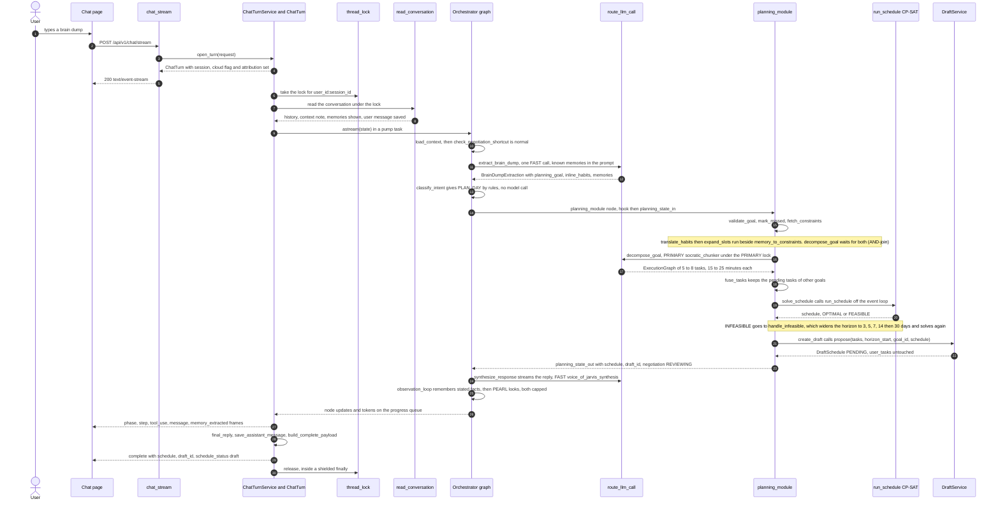

| # | What happens | Code | Pinned by |
|---|---|---|---|
| 1–2 | The chat page posts the message; the frontend's one chat path is `CHAT_STREAM_PATH`. | `jarvis-frontend/lib/api.ts:25, 437` | Live 1 |
| 3 | The handler opens the turn in its own context: the model picker's cloud flag (`CLOUD_MODEL_MODES`), the session, the `UserModel` facade over the planning ports, the initial state, and the usage attribution every model call of the turn is metered under. | `app/api/v1/endpoints/chat.py:43-51`; `app/services/chat_turn/service.py:253-303` (cloud flag `:264-269`, session `:270-272`, facade `:275-278`, state `:285-291` → `context.py:31-102`, attribution `:297-299`) | `tests/test_chat_turn.py::test_chat_turn_service__turn_state__carries_the_container`; `tests/test_turn_locks.py::test_chat_stream__graph_run__llm_calls_attributed_to_user_and_session` |
| 4–5 | The response is an `EventStreamResponse` over `turn.frames()`, with `turn.finish` as its background task (it ends the attribution and the cloud flag). | `chat.py:52-56`; `service.py:72-77` | `tests/test_chat_turn.py::test_chat_router__routing_and_parsing_only`; `tests/test_turn_locks.py::test_chat_stream__cloud_model_picked__force_cloud_ends_with_the_turn` |
| 6 | One turn at a time per conversation. The lock is keyed by the user-scoped checkpoint thread; a second turn waits, for at most `TURN_LOCK_WAIT_SECONDS` (120 s), then gets a conflict frame. | `service.py:135`; `app/services/turn_locks.py:24, 40-70` | `tests/test_turn_locks.py::test_thread_lock__same_thread__second_turn_waits_for_first`, `::test_chat_stream__two_tabs_one_session__turns_run_in_order`, `::test_chat_stream__turn_queued_past_the_wait_limit__honest_conflict_frame` |
| 7–8 | Under the lock: the memory snapshot (read once for the turn), the history window, the profile; then at once "since we last spoke", recall within token budgets, the plate (pending tasks) and saving this message. They become the context note. | `service.py:99-110`; `app/services/chat_turn/context.py:105-251` (snapshot `:147-156`, stage 1 `:172-174`, stage 2 `:225-230`, note `:231-234`) | `tests/test_turn_locks.py::test_chat_stream__queued_turn__history_includes_the_reply_it_waited_for`; `tests/behaviour/test_short_term_memory.py::test_chat__second_turn__model_sees_the_first_exchange_but_not_the_new_message_twice` |
| 9 | The graph runs in its own task; its node updates and the sub-graphs' progress share one queue, so frames leave in emission order. A brand-new thread is seeded with GREETING / no negotiation. After `d3e9132`: a resumed thread whose checkpoint says a draft is under review first reads the draft's real status, and a plan accepted or discarded from its card ends the review (`ChatTurn._close_review_of_a_closed_draft`). | `service.py:112-121, 139`; `:87-97` | `tests/test_sse_golden.py::test_sse_golden__scripted_planning_turn__bytes_unchanged` |
| 10 | `load_context` builds the facade only if the turn arrived without one; the conditional edge sends an active negotiation to `negotiation_precheck`, everything else to extraction. | `app/orchestrator/graph.py:239-263, 787-791`; `app/orchestrator/routing.py:54-58` | `tests/test_orchestrator.py::test_load_context__keeps_existing_user_model`, `::test_negotiation_shortcut_normal` |
| 11–12 | One FAST call extracts the goal, habits and memories. The user's newest active memories (at most 15) ride in the user prompt as `[m1] (type) content` handles, never in the byte-stable system prompt. A trivial message skips the call. After `d3e9132` the extraction prompt also says that a question about work already planned ("what should I do first today?") is not a goal (`app/services/planning/brain_dump_prompt.py`). | `graph.py:320-368` (memories `:344-347` → `:273-317`, call `:349-355`) | `tests/test_turn_learning.py::test_turn__non_trivial_message__no_separate_memory_extraction_call`; `tests/behaviour/test_chat_turns.py::test_chat__greeting__skips_extraction_and_costs_one_model_call` |
| 13 | Rule-based intent: a `planning_goal` is PLAN_DAY. `route_to_module` maps it to `planning_module`. | `graph.py:371-421` (`:404-405`); `graph.py:805-817`; `routing.py:12-51` | `tests/test_orchestrator.py::test_route_plan_day` |
| 14 | The module wrapper runs the `PreModuleExecution` hook, maps the turn into the sub-graph's state (with the composition root's `PlanningServices`), and invokes the compiled sub-graph. | `app/orchestrator/module_wrapper.py:18-56`; `app/modules/planning_graph.py:841-880` | `tests/test_planning_graph.py::test_planning_state_in__carries_the_planning_services_into_the_subgraph` |
| 15 | The gate runs first; an unclear goal ends with a question. `mark_missed` sets aside tasks whose deadline passed (a `deadline_missed` event each). `fetch_constraints` fixes `horizon_start` (08:00 on the user's clock), reads the stored rules and the learned focus profile once. | `planning_graph.py:426-435, 114-169, 185-233`; `app/services/energy.py:137-154` | `tests/test_planning_graph.py::test_planning_subgraph__unclear_goal__decompose_goal_never_runs`, `::test_mark_missed__overdue_tasks_marked_and_anti_guilt_set` |
| Note | Habit translation and expansion run beside the memory bridge; `decompose_goal` is an AND-join over both branches, so it runs exactly once. | `planning_graph.py:299-423, 986-992` | `tests/test_planning_graph.py::test_planning_subgraph__clear_goal__decompose_goal_runs_exactly_once` |
| 16–17 | The decomposition: a byte-constant system prompt, the user's matching documents in a context note, structured output `ExecutionGraph`. The step takes the PRIMARY lock before its timeout starts. Task ids are namespaced `{goal_id}_{run}_{task_id}`. | `planning_graph.py:440-560` (call `:505-511`, namespacing `:534-547`); `app/core/module_framework.py:89-95, 137-141`; `app/core/model_router.py:267-282` | `tests/test_planning_graph.py::test_decompose_goal__namespaces_task_ids_and_dependencies`; `tests/behaviour/test_psychology.py::test_pomodoro__every_proposed_task__is_25_minutes_or_less`; `tests/test_model_router.py::test_route_llm_call__two_primary_calls__never_overlap` |
| 18 | Multi-goal fusion: this goal's stale rows are replaced, other goals' pending tasks are carried forward with their own `goal_id`. | `planning_graph.py:563-624` | `tests/test_planning_graph.py::test_fuse_tasks__prior_plans_positional_ids__survive_the_new_decomposition` |
| 19–20 | `run_schedule` in a thread: the past of today is blocked, rule and habit slots become hard blocks, `minimal_work` slots soft blocks, TMT priorities, the adaptive daily cap, the biological night block when there is no sleep habit, and the learned-focus energy term for tasks not due within 24 h. CP-SAT is capped at `SOLVER_MAX_TIME_SECONDS` (10 s) with an idle stop. | `planning_graph.py:627-718` (`:688-697`); `app/services/planning/scheduling.py:174-351` (`:270-289, 293-315`); `app/core/or_tools/solver.py:151, 251, 330` | `tests/test_planning_graph.py::test_solve_schedule__does_not_block_the_event_loop`; `tests/behaviour/test_psychology.py::test_tmt__task_due_today__scheduled_before_one_due_in_three_days`, `::test_biology__no_sleep_habit__nothing_between_midnight_and_8am` |
| Note | INFEASIBLE walks `HORIZON_RETRY_SEQUENCE`; exhausting it ends with the anti-guilt scope message and no plan. A step timeout ends in `report_unsolved`. | `planning_graph.py:779-836, 994-1007` | `tests/test_planning_graph.py::test_handle_infeasible__walks_the_full_ladder`; `tests/behaviour/test_psychology.py::test_anti_guilt__plan_no_horizon_can_hold__reply_is_the_scope_message_verbatim` |
| 21–22 | The schedule is proposed, never committed: `DraftService.propose` stores a PENDING draft (24 h expiry) with the compact solved slot map. | `planning_graph.py:721-769`; `app/services/draft_service.py:111-123`; `app/infrastructure/persistence/_mapping.py:48, 254` | `tests/test_planning_graph.py::test_create_draft__never_persists__only_proposes`; `tests/behaviour/test_chat_turns.py::test_chat__brain_dump__proposes_a_draft_and_writes_no_tasks`; Live 1 |
| 23 | The sub-graph's result goes back on the turn, with the draft's id and version; a draft puts the thread into REVIEWING, so the next turn takes the negotiation shortcut. | `planning_graph.py:907-948`; `module_wrapper.py:50-56` | `tests/test_planning_graph.py::test_planning_state_out__exposes_draft_id_and_opens_review` |
| 24 | Voice of Jarvis streams the reply through the progress bridge (one FAST call), with the context note folded into the last user turn. After `d3e9132` it is given the drafted plan's real facts (`tasks_in_draft`, `new_tasks`, `new_work`, `already_on_the_plate_and_given_a_slot`, from `_drafted_plan_facts` in `app/services/analytical/voice_of_jarvis.py`), and the prompt's example no longer carries a task count to copy (`tests/test_voice_plan_facts.py`). | `graph.py:819-822`; `app/modules/conversation.py:202-261`; `app/services/analytical/voice_of_jarvis.py:265-312` | `tests/test_prompt_layout.py::test_synthesis_stream_fallback__gets_the_context_note_and_history` |
| 25 | Learning happens inside the graph, before `complete` (detail in S3, S4 and S5). | `graph.py:822`; `app/core/observation.py:437-503` | `tests/test_turn_learning.py::test_turn__stated_preference__memory_extracted_frame_before_complete` |
| 26–27 | The stream loop turns node updates into `phase`/`step`/`consent_request` frames and passes progress events (`tool_use`, `message` tokens, learning frames) through `SseEncoder`. | `service.py:141-164`; `app/services/chat_turn/frames.py:42-72`; `app/schemas/chat_stream.py:196-208, 345` | `tests/test_sse_contract.py::test_chat_turn__every_frame_emitted__parses_into_its_model`; `tests/test_sse_golden.py::test_sse_golden__real_planning_turn__bytes_unchanged` |
| 28 | After the graph: the `pipeline_done` step frame, the reply (already streamed, so not re-sent), the reply saved with the draft id, PEARL's insights from the same look, and the `complete` payload. | `service.py:170-201`; `app/services/chat_turn/reply.py:68-116, 159-232` | `tests/test_turn_learning.py::test_complete__payload__validated_by_its_model_fields_exactly_as_before` |
| 29 | `complete` is validated against `ChatCompletePayload` before it is sent; conversation compaction starts in the background. | `service.py:205-211` | `tests/test_turn_learning.py::test_complete__payload_model__rejects_a_frame_off_the_contract`; Live 1 |
| 30 | However the turn ends (normal, error frame, client disconnect), the pump is cancelled and awaited, then the lock is released, under `anyio.CancelScope(shield=True)`. | `service.py:212-237` | `tests/test_turn_locks.py::test_chat_stream__client_disconnects_mid_turn__lock_released_once_the_run_unwound`; `tests/test_chat_turn.py::test_chat_stream__client_gone_while_a_frame_waits_to_send__lock_released_without_gc` |

Errors: a `JarvisError` raised in the turn becomes one `error` frame in the standard envelope (`service.py:212-215`); anything else is logged with the request id and sent as `internal_error` without its text (`:216-223`). Pinned by `tests/test_sse_golden.py::test_sse_golden__jarvis_error__envelope_frame_bytes_unchanged`, `::test_sse_golden__graph_crashes__error_frame_bytes_unchanged`.

---

## S2a — Accept a draft, and the concurrent double click (UC2)

Accepting is the only write path to the user's tasks. It is one call to the Postgres function `accept_draft()`, which runs as one transaction. Two clicks that arrive together both pass the fail-fast check in Python; the database's row locks decide, and the second one gets 409.

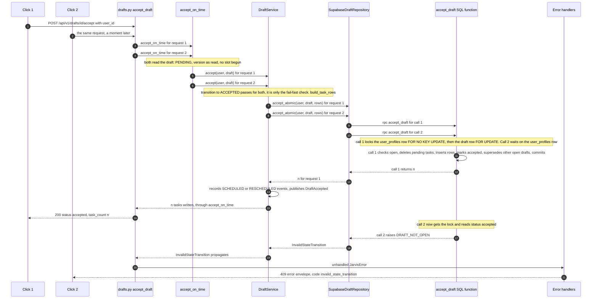

| # | What happens | Code | Pinned by |
|---|---|---|---|
| 1 | The review UI's "Lock it in" (with the version it read) or the chat card's "Accept All" (with the `complete` frame's `draft_version`) posts the accept. | `jarvis-frontend/components/app/PendingDraftBanner.tsx:121`; `jarvis-frontend/lib/hooks/useJarvisChat.ts:486`; `jarvis-frontend/lib/draftCard.ts:134`; `jarvis-frontend/lib/api.ts:674`; `app/api/v1/endpoints/drafts.py:88-113` | Live 2 |
| 2 | A second request for the same draft. The browser's single-flight guard stops a double click inside one page; a second tab or a script can still send it, which is what the database guard is for. | `jarvis-frontend/lib/hooks/useSingleFlight.ts` (used at `PendingDraftBanner.tsx:120-121`) | Live 3 |
| 3–4 | Both routes go through `accept_on_time`, the path the chat accept uses too. | `drafts.py:107-113`; `app/services/draft_actions.py:61-99` | `tests/test_drafts_one_path.py::test_rest_accept__after_a_chat_proposal__second_accept_409_and_tasks_written_once` |
| Note | Read, fail-fast transition check, optional `expected_version` check, slot starts compared with now. | `draft_actions.py:86-94`; `draft_service.py:62-71, 367-370` | `tests/test_drafts_one_path.py::test_accept__stale_expected_version__stale_version_and_nothing_written` |
| 5–6 | `DraftService.accept`: the draft must be open, schedulable and not wholly in the past. | `draft_service.py:185-212` | `tests/test_draft_service.py::test_accept__concurrent_double_click__exactly_one_succeeds` |
| 7–8 | One repository call per request. | `draft_service.py:213`; `app/infrastructure/persistence/supabase_repos.py:426-431` | `tests/test_repository_contracts.py::test_drafts__accept_atomic__concurrent_calls__exactly_one_succeeds` |
| 9–10 | Each becomes one RPC to the database function. | `supabase_repos.py:432-435` | (as above, both repository families) |
| Note | Lock order: the user's profile row first (`FOR NO KEY UPDATE`, so inserts that reference it are not blocked), then the draft row. The function also updates the user's other drafts, so draft-then-user would let two accepts deadlock. | `supabase/migrations/20261115000007_user_tasks_not_before.sql:42-62` | `tests/test_migrations.py::test_migrations__accept_draft__locks_the_user_before_the_draft` |
| 11 | Inside the transaction: `DRAFT_NOT_FOUND` / `DRAFT_NOT_OPEN` checks, delete the user's pending tasks (and missed tasks this plan re-slots under their own id), insert each row with only the allowed columns and the caller's `user_id` forced, mark the draft accepted, mark every other open draft superseded. | `…user_tasks_not_before.sql:63-108` | `tests/test_migrations.py::test_migrations__accept_draft__supersedes_the_users_other_open_drafts`, `::test_migrations__accept_draft_v2__deletes_reslotted_missed_rows`; `tests/test_repository_contracts.py::test_drafts__accept_atomic__two_open_drafts__the_other_is_superseded` |
| 12–13 | The row count comes back. | `supabase_repos.py:449-453` | `tests/test_repository_contracts.py::test_drafts__accept_atomic__writes_rows_and_marks_accepted` |
| 14 | After the commit: one `scheduled` (or `rescheduled`) task event per slotted task, best effort, then `DraftAccepted` on the event bus, whose listener links the written tasks to the user's documents (`DocumentLinkListener`, best effort, logged on failure). | `draft_service.py:214-225, 264-331` | `tests/test_triggers.py::test_brief__accept__tasks_written_and_rescheduled_events` |
| 15–16 | `200 {status: "accepted", task_count, moved}`. | `draft_actions.py:92-94`; `drafts.py:130-136` | Live 2 |
| Note | The second call was blocked on the profile row; once call 1 commits, it reads `accepted`. | `…user_tasks_not_before.sql:66-68` | — |
| 17–18 | `DRAFT_NOT_OPEN` maps to `InvalidStateTransition` (a 23505 unique violation would map to `ConflictError`, anything else to `PersistenceError` 503 with the draft left open). | `supabase_repos.py:436-448` | `tests/test_repository_contracts.py::test_drafts__accept_atomic__second_call__raises_invalid_state_transition_and_no_duplicates` |
| 19–21 | The route catches only `StaleVersionError`, `ValidationError` and `PersistenceError`; `InvalidStateTransition` reaches the global handler, which writes the envelope with status 409. | `drafts.py:114-129`; `app/api/error_handlers.py:124, 197-199`; `app/domain/errors.py:46-53` | `tests/test_draft_endpoints.py::test_accept_endpoint__second_call__409_envelope`; Live 3 |

The same guard from chat: a second "looks good" on a thread whose draft is already accepted is classified ACCEPT_DRAFT again (`graph.py:392-397`), reaches `accept_draft_on_time`, meets `InvalidStateTransition`, and `_closed_draft_reply` re-reads the draft and answers "That plan is already locked in, sir." writing nothing (`graph.py:617-619, 705-740`). Pinned by `tests/behaviour/test_chat_turns.py::test_chat__looks_good_sent_twice__second_one_writes_and_proposes_nothing`, `::test_chat__plan_already_accepted_in_the_review_ui__looks_good_says_already_locked_in`; Live 4.

A draft that changed after the client read it (an edit, a re-solve) is refused when the client sends `expected_version`: `StaleVersionError`, 409 `stale_version`, with the latest draft in `details` (`drafts.py:114-119`). Pinned by `tests/test_drafts_one_path.py::test_rest_accept__edited_after_the_read__409_with_the_latest_and_nothing_written`.

---

## S2b — An accept that comes late: re-solve from now (UC2)

A draft proposed at 08:00 and accepted at 11:00 holds slots that have already begun. Written as drafted, the slot sweep would set those tasks aside as if the user had, and PEARL would learn from evidence that never happened. So the draft's own tasks are re-solved from now first.

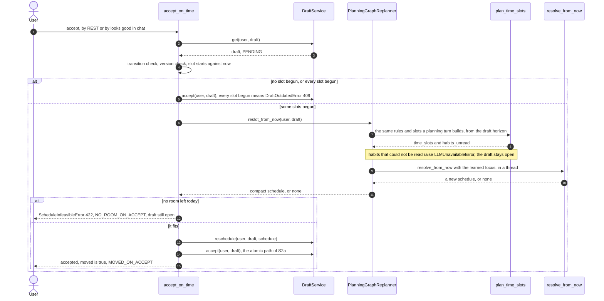

| # | What happens | Code | Pinned by |
|---|---|---|---|
| 1 | REST calls `accept_on_time` directly; chat reaches it through `accept_draft_on_time`. | `drafts.py:111-113`; `graph.py:615-617`; `draft_actions.py:61, 102-128` | `tests/test_accept_on_time.py::test_rest_accept__nothing_passed__accepted_as_drafted_and_second_accept_409` |
| 2–3 | The user's draft, or `NotFoundError` (404; another user's draft reads as absent). | `draft_actions.py:86`; `draft_service.py:125-130` | `tests/test_draft_service.py::test_accept__other_users_draft__raises_not_found_and_writes_nothing` |
| 4 | A closed draft fails fast; a stale `expected_version` is refused; each slot's start instant is `horizon_start` + its minutes. | `draft_actions.py:87-91`; `draft_service.py:367-370` | — |
| 5 | Nothing begun: accepted as drafted. Everything begun: `DraftOutdatedError` (409 `draft_outdated`; in chat "Every time in this plan has already gone by…" and the negotiation closes). | `draft_actions.py:92-94`; `draft_service.py:207-209`; `graph.py:625-630` | `tests/test_accept_on_time.py::test_chat_accept__nothing_passed__locked_in_as_drafted` |
| 6 | The `DraftPlanner` port re-solves the draft's own tasks. | `draft_actions.py:95`; `app/domain/ports.py:699-716`; `app/modules/planning_replan.py:79-117` | `tests/test_accept_on_time.py::test_rest_accept__three_hours_late__moved_from_now_and_nothing_swept` |
| 7–8 | `plan_time_slots` runs the planning module's own steps (stored rules, habit translation, expansion, the memory bridge), so a late accept keeps every rule a plan keeps. | `planning_replan.py:96-103`; `planning_graph.py:236-256` | `tests/test_accept_on_time.py::test_rest_accept__late__a_rule_kept_only_as_a_memory_still_holds`, `::test_rest_accept__late_and_habits_cannot_be_read__503_and_the_draft_stays_open` |
| 9–11 | The draft-edit re-solve on the user's clock with their learned focus, off the event loop. | `planning_replan.py:104-117`; `app/services/analytical/schedule_modifier.py:19` | — |
| 12 | No room: 422 `schedule_infeasible`; in chat the message is said and the negotiation stays open. | `draft_actions.py:96-97`; `graph.py:620-624` | `tests/test_accept_on_time.py::test_chat_accept__the_rest_no_longer_fits__not_locked_in_and_still_open` |
| 13 | The new times go on the open draft (a closed draft is refused). | `draft_actions.py:98`; `draft_service.py:228-230`; `supabase_repos.py:380-397` | — |
| 14–15 | The draft is accepted through S2a; REST answers `moved: true` with `MOVED_ON_ACCEPT`, chat says "A few of those times had already gone by, so I moved them — it's locked in now." | `draft_actions.py:99`; `drafts.py:130-136`; `graph.py:663-671` | `tests/test_accept_on_time.py::test_chat_accept__three_hours_late__moved_said_plainly_and_nothing_swept` |

---

## S3 — Teach a rule, then re-plan (UC3)

The user states a rule. It is stored as a rule and remembered as a "said" memory, the two linked so that letting go of one lets go of both. The next plan reads the rule and the solver treats it as a hard block.

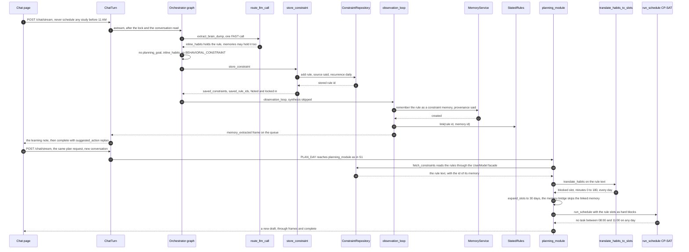

| # | What happens | Code | Pinned by |
|---|---|---|---|
| 1–2 | A normal turn (S1 steps 2–9). | `service.py:135-139` | Live 5 |
| 3–4 | The extraction prompt asks for lasting facts in `memories` and the rule phrase in `inline_habits`, never one instead of the other. | `graph.py:320-368`; `app/services/planning/brain_dump_prompt.py` | `tests/test_turn_learning.py::test_brain_dump_prompt__memories_first__never_exclusive_of_inline_habits` |
| 5 | No goal, a habit: BEHAVIORAL_CONSTRAINT, routed to `store_constraint`. | `graph.py:399-411`; `routing.py:26` | `tests/test_orchestrator.py::test_routing__behavioral_constraint__goes_to_store_constraint`, `::test_graph__store_constraint_node_is_wired` |
| 6–8 | Each habit is stored as a `BehavioralConstraint` (`source="said"`) through the container's `ConstraintRepository`; the habit-translation cache is cleared. A habit whose memory the user forgot or dismissed is dropped first (S5). Without a container nothing is stored and the turn says so. | `graph.py:450-466, 492-529`; `app/services/extraction/behavioral_store.py:23-52` | `tests/test_orchestrator.py::test_store_constraint__persists_each_habit_and_confirms`, `::test_store_constraint__storage_fails__does_not_claim_success` |
| 9 | Deterministic confirmation, no model call: "Noted and locked in, sir: “…”. Every schedule I draft from here on will respect it." | `graph.py:531-547` | Live 5 |
| 10 | `store_constraint` goes straight to the observation loop; synthesis would overwrite the confirmation. | `graph.py:826-830` | — |
| 11–12 | The rule phrase is remembered as a `constraint` memory (rule word plus time anchor) with provenance SAID and the session and message as its source; a fact said again is reinforced, not stored twice. | `app/core/observation.py:179-199, 202-269`; `app/services/memory/memory_service.py:197-272` | `tests/test_turn_learning.py::test_turn__rule_only_in_inline_habits__remembered_as_a_said_constraint`, `::test_turn__rule_said_again_as_a_habit__reinforced_not_stored_twice` |
| 13 | The rule saved this turn is linked to the memory of stating it (its id goes into the rule's `structured_semantics`). | `observation.py:268, 279-306`; `app/services/memory/stated_rules.py:69-78` | `tests/test_stated_rules.py::test_link__rule_carries_its_memory_id__other_semantics_kept` |
| 14–15 | One `memory_extracted` frame per memory learned, before `complete`; `complete` carries `saved_constraints` and `suggested_action: "replan"`. | `observation.py:309-333, 464-466`; `reply.py:201-216` | `tests/test_turn_learning.py::test_complete__saved_constraint__suggested_action_replan` |
| 16–17 | The re-plan is an ordinary planning turn. | as S1 | Live 6 |
| 18–19 | `fetch_constraints` reads every rule row through `UserModel.get_behavioral_constraints` (the facade over the `ConstraintRepository`). | `planning_graph.py:185-233`; `app/core/user_model.py:77` | `tests/test_stated_rules.py::test_replan__taught_rule__planned_from_the_rule_alone` |
| 20–21 | The rule text is translated into a semantic slot. Cached text, and each habit whose words give clock hours, are worked out in Python without a model call (`blocked_windows`: a negation blocks the hours named, "only" blocks the rest of the day, "free after 5 PM" blocks nothing); only habits it cannot read (no clock time, or days of their own) go to the PRIMARY `habit_translation` call. Minute 0 is 08:00 on the user's clock, so "before 11 AM" is minutes 0–180 and "never after 10 PM" is minutes 840–1440 (22:00 to 08:00). | `planning_graph.py:299-322`; `app/services/analytical/habit_translator.py:106-126, 135-178`; `app/services/planning/rule_windows.py:224-242` | `tests/behaviour/test_local_day.py::test_local_day__never_before_11_am__holds_in_local_time_on_every_day`, `::test_local_day__stated_rule__its_hours_stay_free_and_the_day_around_them_is_used`; `tests/test_rule_windows.py::test_blocked_windows__stated_rule__blocks_what_the_words_mean` |
| 22 | The slot is repeated out to 30 days. The memory bridge adds blocks for constraint memories and learned skip hours, but not for a memory a stored rule is linked to. | `planning_graph.py:325-423`; `stated_rules.py:57-59`; `app/services/memory/constraint_bridge.py:65` | `tests/test_stated_rules.py::test_memory_slots__constraint_memory_a_rule_covers__no_second_block` |
| 23–24 | BLOCKED slots become solver hard blocks; the energy term is soft and never beats them. | `scheduling.py:274-289` | `tests/behaviour/test_learning.py::test_bridge__rule_the_user_stated__moves_every_day_of_the_next_plan_out_of_it`, `::test_energy__learned_evening_profile__teaching_a_rule_still_moves_the_schedule`; Live 6 |
| 25 | A new PENDING draft, as S1 steps 21–29. | as S1 | Live 6, Live 7 (the rule is recalled in a new conversation) |

---

## S4 — Complete or skip, background PEARL, learning moment on the next turn (UC4)

An outcome is one append-only `task_events` row. PEARL looks at the outcome history in the background, never in the user's way, and holds what it learns for the user's next turn.

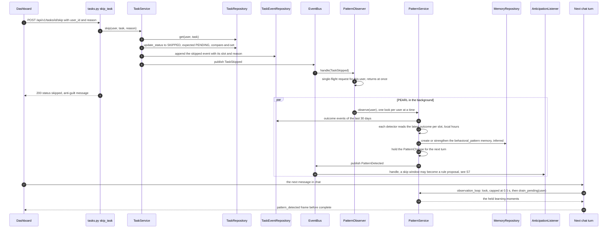

| # | What happens | Code | Pinned by |
|---|---|---|---|
| 1 | The dashboard's Skip (Complete is the same path with `quality` and `actual_duration_minutes`). | `jarvis-frontend/lib/api.ts:485, 504`; `app/api/v1/endpoints/tasks.py:132-152` (complete `:101-129`) | Live 14 |
| 2 | The route requires the database first (503, never a fake 404 on in-memory repositories). | `tasks.py:150-152`; `app/api/deps.py:31-37` | `tests/test_task_lifecycle.py::test_complete_and_skip__no_database__same_503_envelope_as_list` |
| 3 | Unknown task: `NotFoundError` (404). | `app/services/task_service.py:128-140, 219-223` | `tests/test_task_lifecycle.py::test_skip_endpoint__unknown_task__404_envelope` |
| 4 | The move table `_SKIP` allows only PENDING → SKIPPED; the write is a compare-and-set on the status, retried up to 3 times against the status that won. A repeat click writes nothing. | `task_service.py:66-84, 225-250` | `tests/test_task_service.py::test_complete__double_click__second_returns_none_and_one_event`, `::test_skip__completed_task__returns_none_no_event` |
| 5 | One event per outcome, with the slot and the reason. If the event cannot be stored the status is set back and the error raised. | `task_service.py:252-291` | `tests/test_task_service.py::test_skip__pending__skipped_event_with_reason_and_task_skipped_published`, `::test_complete__event_write_fails__status_restored_and_error_raised` |
| 6–7 | The bus hands the event to each subscribed listener; a listener's failure is logged, never raised. `TaskCompleted`, `TaskSkipped` and `TaskMissed` are subscribed to the `PatternObserver` in the composition root. | `task_service.py:292`; `app/domain/events.py:104-113`; `app/container.py:158-160` | `tests/test_patterns.py::test_container__task_outcomes__each_reaches_pattern_observer` |
| 8 | `PerUserSingleFlight`: at most one run per user in flight; outcomes arriving meanwhile ask for one more run. The Skip does not wait. | `app/services/memory/patterns.py:697-724`; `app/services/background.py:18-76` | `tests/test_patterns.py::test_pattern_observer__complete__returns_without_waiting_for_observe`, `::test_pattern_observer__burst_of_outcomes__at_most_two_observes` |
| 9 | Anti-guilt reply: "Life happened — '…' is off the list for now…"; nothing is re-placed. | `tasks.py:153-186` | `tests/behaviour/test_psychology.py::test_anti_guilt__skipping_tasks__every_reply_is_blame_free`; Live 14 |
| 10 | One look per user at a time: a second caller joins the running look under `asyncio.shield`. | `patterns.py:428-470` | `tests/test_you_api.py::test_you_api__three_loads_at_once__all_200_same_content_and_one_look` |
| 11 | A bounded read: outcome types only, the last `FOCUS_WINDOW_DAYS`. | `patterns.py:594-614` | `tests/test_patterns.py::test_observe__other_users_events__ignored` |
| 12 | Each `PatternDetector` (Strategy) reads hours on the user's clock; a slot counts once, as its latest outcome. Skip window: 3+ outcomes at an hour, 70%+ set aside. | `patterns.py:68-76, 148-230`; `task_service.py:45-62` | `tests/test_patterns.py::test_skip_window__three_of_three_at_nine__pattern_hour_9`, `::test_skip_window__missed_then_completed_same_slot__counts_once_as_done` |
| 13 | A new pattern is created as an inferred memory keyed by `pattern_key`; one with newer evidence is strengthened (compare-and-set). A pattern the user dismissed or forgot is never learned again. | `patterns.py:624-681` | `tests/test_patterns.py::test_observe__first_time__created_and_pattern_detected_published`, `::test_observe__dismissed_key__never_recreated` |
| 14 | The change is held per user (newest 10, one per pattern) until a turn drains it. | `patterns.py:516-523, 683-694` | `tests/test_patterns.py::test_drain_pending__skip_teaches_a_pattern__next_turn_still_gets_its_moment` |
| 15–16 | `PatternDetected` reaches the `AnticipationListener` (S7). | `patterns.py:489-491`; `container.py:217-218`; `app/services/anticipation/triggers.py:417-421` | `tests/test_triggers.py::test_anticipation_listener__pattern_detected__suggestion_created` |
| 17–18 | The next non-trivial turn's observation loop looks again under `PEARL_INLINE_TIMEOUT_S`, then drains every held moment, whether or not the look finished. | `observation.py:55-57, 374-421, 468-486` | `tests/test_observation.py::test_observation__slow_store_outlasts_the_cap__held_moments_told_this_turn` |
| 19–20 | One `pattern_detected` frame per moment, carrying numeric confidence and occurrences: the frontend notes every moment inline and toasts only at confidence ≥ 0.7 with 3+ occurrences. | `observation.py:357-371, 484-486` | `tests/test_turn_learning.py::test_turn__pattern_learned_from_a_skip_between_turns__moment_on_the_next_turn`; `tests/behaviour/test_learning.py::test_pearl__learning_moment__carries_confidence_and_how_often_it_was_seen` |

The slot sweep is the third source of outcomes: every minute `SlotPassedSweep` marks missed any pending task whose `scheduled_end` + 30 minutes has passed with no outcome since its slot began, publishing `TaskMissed` into the same path (`task_service.py:170-217, 310-330`; `app/core/config.py:183`). Pinned by `tests/test_task_service.py::test_sweep__slot_ended_31_min_ago__missed_event_and_status`, `::test_sweep__slot_ended_29_min_ago__untouched`, `::test_sweep__race_with_completion__stale_version_swallowed_one_event`.

---

## S5 — Forget a fact, then say it again (UC5)

Forget is permanent: the memory's words are erased at once, but the row stays as a tombstone with its embedding and pattern key, so the same fact said or noticed again is recognised and not stored. A rule linked to the memory is deleted with it, and is not stored again when it is said again.

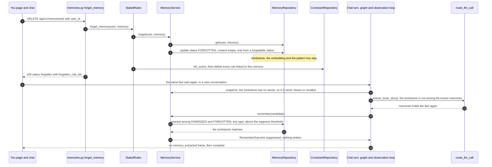

| # | What happens | Code | Pinned by |
|---|---|---|---|
| 1 | The You page's Forget takes two deliberate clicks. | `jarvis-frontend/components/app/you/MemoryList.tsx:23, 54-70, 111-139`; `jarvis-frontend/lib/api.ts:871`; `app/api/v1/endpoints/memories.py:146-161` | Live 8, Live 10b |
| 2 | Letting go of the memory lets go of the rules it states. | `memories.py:159-160`; `stated_rules.py:80-89` | `tests/test_memories_api.py::test_memories_api__forget_a_stated_rules_memory__the_rule_is_gone_too` |
| 3–4 | Another user's memory: `NotFoundError` (404), nothing deleted. | `memory_service.py:304-313, 578-586` | `tests/test_stated_rules.py::test_forget_memory__another_users_memory__not_found_and_nothing_deleted` |
| 5 | The write is a compare-and-set from the statuses `MEMORY_TRANSITIONS` lets move to FORGOTTEN, so a forget landing between a read and its write still wins. | `memory_service.py:314-320, 53-58`; `app/domain/entities.py:123-138` | `tests/test_memory_service.py::test_forget__content_blanked_and_hidden_from_list_active`, `::test_forget__lands_between_a_read_and_its_write__memory_stays_forgotten` |
| 6 | Every active rule whose `structured_semantics` names this memory is deleted. | `stated_rules.py:91-97` | `tests/test_stated_rules.py::test_forget_memory__linked_rule__rule_deleted_and_memory_tombstoned`, `::test_replan__after_forgetting_the_memory__morning_free_again` |
| 7 | `ForgetResponse(status="forgotten", forgotten_rule_ids=[…])`. | `memories.py:161` | Live 8 |
| 8–9 | The next turn's snapshot holds only memories in use; the let-go ids are kept for filtering summaries. | `context.py:147-160`; `memory_service.py:359-372` | `tests/behaviour/test_long_term_memory.py::test_memory__forget__gone_from_context_and_the_memory_panel` |
| 10–11 | The extraction shows only memories with words, so the forgotten fact is not offered back to the model. | `graph.py:273-299` | `tests/test_turn_learning.py::test_turn__forgotten_fact_said_again__no_frame_no_row` |
| 12–15 | `remember` checks the let-go memories first, of any type: a close one suppresses the candidate and nothing is written. | `observation.py:247-250`; `memory_service.py:216-229` | `tests/test_memory_service.py::test_remember__after_forget__suppressed_and_nothing_written`, `::test_remember__forgotten_goal_offered_as_another_type__still_suppressed` |
| 16 | A suppressed outcome has no frame (`memory_frame` returns None for anything but created, reinforced, superseded). | `observation.py:58-59, 321-333` | Live 10b ("said again: no frame, not listed, no active row") |

PEARL keeps the same promise for patterns: a dismissed or forgotten pattern memory is found by its key and never strengthened or recreated (`patterns.py:631-632`; pinned by `tests/test_patterns.py::test_observe__dismissed_key__never_recreated`).

**A rule said again.** A *rule* said again after its memory was forgotten is suppressed as a memory (`tests/test_turn_learning.py::test_turn__forgotten_rule_said_again_as_a_habit__no_frame_no_row`) and is not stored as a rule again. Before `store_constraint` writes the turn's habits, it drops each one `remember` would suppress (`MemoryService.drop_let_go`, `memory_service.py:451-461`, through `_not_let_go`, `graph.py:469-489`) and says nothing about it; a different rule in the same message is still stored (`graph.py:492-547`). If the check cannot run (the embedder is down while the user has let something go), no rule is stored and the reply says it could not be saved. Pinned by `tests/behaviour/test_learning.py::test_forgotten_rule__said_again_alone__nothing_stored_and_no_failure_claimed`, `::test_forgotten_rule__said_again_with_a_new_rule__only_the_new_rule_is_kept` and `tests/test_memory_service.py::test_drop_let_go__forgotten_rule__dropped_by_the_test_remember_uses`. The demo still shows forget-and-say-again with a stated fact, as Live 10b does; the rule works the same way.

---

## S6 — The morning brief (UC6)

The clock is an actor. A scheduler tick finds the user's wake time has come, the brief trigger gathers what is pending and what slipped yesterday, the replanner drafts today, the consent chain decides it must ask, and the suggestion waits on the dashboard. Accepting it checks the draft is still current first.

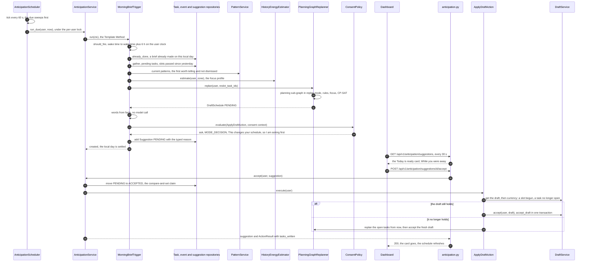

| # | What happens | Code | Pinned by |
|---|---|---|---|
| 1 | The in-process loop (started by the lifespan unless `JARVIS_ANTICIPATION=false`) runs each sweep whose interval has passed (slot passed, memory decay, session summaries, checkpoint retention), then every user's triggers. Ticks never overlap; nothing raised in a tick ends the loop. | `app/services/anticipation/scheduler.py:49-81, 99-127`; `app/main.py:150-169`; `container.py:235-239` | `tests/test_anticipation_scheduler.py::test_tick__sweep_runs_once_per_interval`, `::test_ticks__called_concurrently__never_overlap`, `::test_lifespan__disabled__scheduler_never_started` |
| 2 | Per user, with that user's model calls attributed to them. A trigger that settled the local day is not run again until the next one; a failing trigger backs off 1, 2, 4 … 30 minutes. | `scheduler.py:83-97`; `app/services/anticipation/service.py:233-285` | `tests/test_anticipation_scheduler.py::test_tick__background_llm_calls_attributed_to_user`; `tests/test_anticipation_service.py::test_run_due__trigger_keeps_failing__backs_off_1_2_4_capped_at_30_min` |
| 3 | `Trigger.run` is the fixed skeleton: timing, once a day, gather, draft, consent, storage, in that order. | `service.py:368-388`; `app/domain/anticipation.py:342-421` | `tests/test_trigger_template.py::test_trigger_run__not_due__no_storage_read` |
| 4 | Due from the profile's `wake_time` for `MORNING_BRIEF_WINDOW_HOURS` (6), on the user's clock. "Check now" on the dashboard is a forced run that skips this check. | `triggers.py:120-125`; `config.py:196` | `tests/test_triggers.py::test_brief__before_wake__not_due`, `::test_brief__utc_midnight_crossing__fires_once_per_local_day` |
| 5 | Once per local day, by the stored suggestion. | `anticipation.py:377-378, 423-427` | `tests/test_triggers.py::test_brief__second_run_same_local_day__already_done` |
| 6 | Pending tasks, plus set-aside tasks whose latest outcome is a passed slot since 00:00 yesterday (a passed deadline is not re-slotted). | `triggers.py:127-133, 209-224` | `tests/test_triggers.py::test_brief__yesterdays_slot_misses__reslot_ids_passed_and_deadline_misses_excluded` |
| 7 | The first remembered pattern seen 3+ times at 0.7+ whose note the user has not dismissed. | `triggers.py:188-207`; `patterns.py:525-579` | `tests/test_triggers.py::test_brief__insight_dismissed__never_the_noticed_line_of_a_later_brief` |
| 8 | The learned focus profile (falls back to the prior below `min_observations`). | `triggers.py:135`; `energy.py:85-123` | `tests/test_energy.py` |
| 9–11 | The `DraftPlanner` port: the same compiled planning sub-graph in replan mode (no decomposition, no deadline scan), the pending tasks plus the re-slot ids, proposed as a draft. Unreadable habits raise rather than plan without them. | `triggers.py:144-150`; `planning_replan.py:41-77` | `tests/test_planning_replan.py`; `tests/test_triggers.py::test_brief__learned_evening_peak__hard_task_in_the_peak_and_due_today_reslot_first` |
| 12 | The body is put together from facts with no model call: how many tasks land today and when the hardest starts ("— your strongest hour" only when the learned profile peaks there), how many set-aside tasks found a new slot, and the "I noticed …" line with its evidence. | `triggers.py:163-175, 231-300`; `patterns.py:175-179` | `tests/test_triggers.py::test_brief__copy__no_blame_phrases_and_peak_claim_only_when_learned`, `::test_brief__nothing_to_say__no_suggestion_and_zero_llm_calls` |
| 13–14 | The consent context is loaded only now. The chain: repeat dismissal (deny), read-only (allow), already covered by a stated rule (deny), then the autonomy mode, which always decides. Under `ask_first` a schedule change is "ask". | `anticipation.py:383-387, 115-241`; `service.py:457` | `tests/test_consent.py::test_consent__ask_first_schedule_change__ask_mode_decision`; `tests/test_trigger_template.py::test_trigger_run__consent_loaded_only_when_a_run_reaches_it` |
| 15 | Stored PENDING with `consent_behavior`, `consent_reason` and the typed `consent_kind`. An allowed change would be stored already claimed (ACCEPTED) and run at once (A3). | `anticipation.py:389-421` | `tests/test_triggers.py::test_brief__after_wake__pending_suggestion_with_draft_and_ask_reason`; `tests/test_trigger_template.py::test_trigger_run__ask__pending_with_typed_reason` |
| 16 | The day's outcome is remembered in this process; a manual run always re-evaluates (10 s cooldown). | `service.py:377-388, 197-231` | `tests/test_anticipation_service.py::test_run_trigger__tick_settled_nothing_to_say__manual_run_re_evaluates` |
| 17–18 | The dashboard polls every 30 s while visible and shows title, body and the consent reason. | `jarvis-frontend/components/app/WhileYouWereAway.tsx:72-73, 300-314`; `jarvis-frontend/lib/api.ts:972`; `app/api/v1/endpoints/anticipation.py:147-161`; `service.py:287-298` | `tests/test_anticipation_api.py::test_anticipation_api__list__pending_only_by_default`; Live 12 |
| 19–21 | Claim, then execute: a compare-and-set from PENDING to ACCEPTED before the action runs, so a double click runs the action once and the second is 409. A suggestion past `expires_at` (end of the local day) is marked expired instead. | `anticipation.py:164-180` (route); `service.py:300-330`; `anticipation.py:291-311` (domain) | `tests/test_anticipation_service.py::test_accept__double_click__second_409_and_action_executed_once`, `::test_accept__past_expires_at__expired_and_409_never_listed`; Live 13 (second accept 409) |
| 22–23 | The freshness check: `DraftService.currency` reports slots already begun and drafted tasks no longer pending or set aside. | `app/services/anticipation/actions.py:62-71`; `draft_service.py:242-262` | `tests/test_triggers.py::test_brief__task_done_before_accept__plan_refreshed_and_accepted` |
| 24 | Current: accepted through S2a. | `actions.py:72-79` | `tests/test_triggers.py::test_brief__accept__tasks_written_and_rescheduled_events`; Live 13 |
| 25 | Stale: the open tasks are drafted again from now and that draft accepted ("I refreshed the plan first — it's in place now."); nothing left, the stale draft expires. A draft replaced by a newer accepted plan is out of date: the suggestion expires, 409. | `actions.py:80-93`; `service.py:333-354` | `tests/test_triggers.py::test_brief__accepted_three_hours_late__refreshed_from_now_and_nothing_set_aside`, `::test_brief__accept_after_newer_plan_accepted__409_and_expired_tasks_unchanged` |
| 26–27 | The response carries the suggestion and the action result. | `anticipation.py:177-180` | `tests/test_anticipation_api.py::test_anticipation_api__accept_twice__409_envelope` |

---

## S7 — Pattern, rule proposal, accept, re-plan draft (UC7)

When PEARL learns a skip window, the pattern-rule trigger offers it as a standing rule. Accepting confirms the pattern, stores one rule linked to it, and drafts a plan that keeps the hour clear.

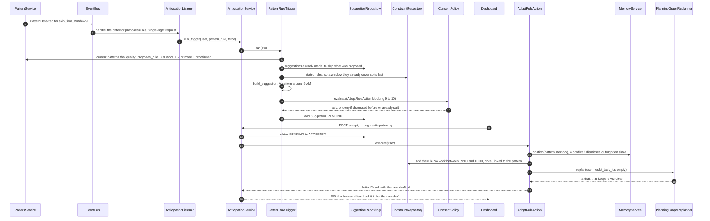

| # | What happens | Code | Pinned by |
|---|---|---|---|
| 1 | Published only when a look creates or strengthens a pattern memory (S4 steps 10–15). | `patterns.py:484-491` | `tests/test_patterns.py::test_observe__first_time__created_and_pattern_detected_published` |
| 2 | The listener asks the detector (`proposes_rule`), never names one; one proposal run per user at a time. | `triggers.py:401-421`; `patterns.py:589-592` | `tests/test_triggers.py::test_anticipation_listener__pattern_detected__suggestion_created` |
| 3 | A forced run, attributed to the user, so it re-evaluates even after the day's tick settled the trigger. | `triggers.py:431-436`; `service.py:197-231` | — |
| 4 | The same skeleton as S6. `PatternRuleTrigger.already_done` is always false: each pattern is proposed once, which `gather` decides. | `anticipation.py:353-421`; `triggers.py:303-332` | `tests/test_trigger_template.py::test_trigger_run__force__skips_should_fire_not_idempotency` |
| 5–7 | Qualifying windows; anything already proposed (pending, accepted, expired) is never proposed again; a dismissed window or one a stated rule covers comes after every fresh one. | `triggers.py:334-368` | `tests/test_triggers.py::test_pattern_rule__window_covered_by_stated_rule__later_window_proposed` |
| 8 | Title "A pattern around 9 AM", body "You've set aside N of the last M tasks around 9 AM. Want me to keep that hour clear?" with the live numbers. | `triggers.py:370-389` | `tests/test_triggers.py::test_pattern_rule__qualifying_skip_window__suggestion_with_adopt_rule` |
| 9–10 | `AdoptRuleAction.blocked_hours` is (9, 10). Dismissed before: deny, "You dismissed this before…". Inside a stated block: deny, "You already told me: …". Otherwise the mode decides (ask under `ask_first`). | `actions.py:143-147`; `anticipation.py:123-164, 211-241` | `tests/test_triggers.py::test_pattern_rule__dismissed_before__denied`, `::test_pattern_rule__user_already_said_rule__denied_rule_match` |
| 11 | Stored PENDING with its reason. | `anticipation.py:390-406` | `tests/test_consent.py::test_consent__blocked_hours_inside_stated_block__deny_rule_match` |
| 12–13 | The claim of S6 steps 19–21. | `anticipation.py:164-180`; `service.py:300-330` | `tests/test_anticipation_service.py::test_accept__pending__claims_executes_accepted` |
| 14–15 | Confirming the pattern first: a pattern dismissed or forgotten since the proposal is a `ConflictError` before anything is stored, and the suggestion expires (never back to pending). | `actions.py:160-178`; `memory_service.py:274-284`; `service.py:342-350` | `tests/test_triggers.py::test_pattern_rule__accept_after_pattern_dismissed__no_rule_stored_and_expired` |
| 16 | One rule, however often the accept runs: `source="inferred"`, the blocked semantic slot already worked out (no translation call later), the `pattern_key`, and the link to the pattern memory. | `actions.py:179-180, 206-238` | `tests/test_triggers.py::test_pattern_rule__accept__constraint_with_semantic_slot_memory_confirmed_and_draft`; `tests/test_stated_rules.py::test_adopted_rule__linked_to_the_patterns_memory` |
| 17–18 | A draft of the user's own tasks with the new rule; no draft when nothing fits, and "the redraft waits" when habits cannot be read. | `actions.py:181-204`; `planning_replan.py:41-77` | `tests/test_triggers.py::test_pattern_rule__accept_while_habits_unreadable__saved_and_says_the_redraft_waits` |
| 19–20 | "Saved. I've drafted a plan that keeps 9 AM clear — accept it when it suits you." with `draft_id`; the dashboard banner then offers "Lock it in" (S2a). | `actions.py:197-204`; `jarvis-frontend/components/app/PendingDraftBanner.tsx:121, 207` | `tests/test_triggers.py::test_pattern_rule__over_the_api__details_carry_the_numbers_and_accept_the_new_draft_id`; `tests/behaviour/test_anticipation.py::test_anticipation__three_skips_at_nine__rule_suggested_accepted_and_next_plan_keeps_nine_free` |

There is no live-script step for the rule proposal; on the seeded demo user it appears as a dashboard card (see `10-demo-and-contributions.md`). The scheduler's tick also runs `PatternRuleTrigger` (its `should_fire` is always true), so a qualifying window is offered within a tick of startup even without a new `PatternDetected` event (`service.py:233-271`; `triggers.py:331-332`).

---

## S8 — The language-model call path

Every live model call goes through `route_llm_call` and the provider chain the composition root installs. The diagram follows a structured call that falls over from the local model to Claude.

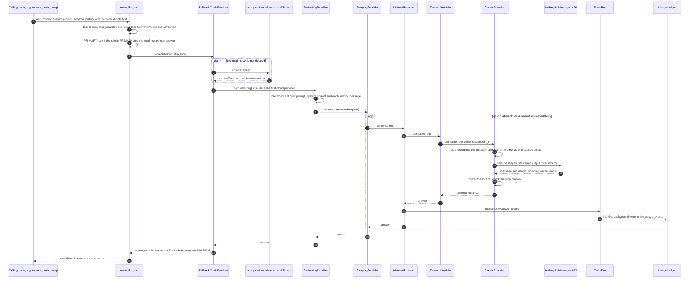

| # | What happens | Code | Pinned by |
|---|---|---|---|
| 1 | The single call site. A guard test fails if any module outside the transport calls a model another way. | `app/core/model_router.py:338-347`; caller e.g. `graph.py:349-355` | `tests/test_layering.py::test_llm_calls__outside_the_transport__go_through_route_llm_call` |
| 2 | `MODEL_ROUTING` maps the task to PRIMARY, FAST or CLOUD. The local model is skipped for a CLOUD role, `force_cloud`, the per-turn `force_cloud_var` (model picker), `GEMINI_PRIMARY` or `CLAUDE_PRIMARY`. The request carries `LLM_TIMEOUT_SECONDS` (60 s; 120 s per token for a stream) and the user and session the turn attributed. | `model_router.py:165-192, 241-249, 377-394`; `app/core/config.py:46-60` | `tests/test_model_router.py::test_routing_table_completeness` |
| 3 | One heavy local call at a time; a planning step that already holds the lock runs its call under that hold; a second PRIMARY call inside the same hold is refused, never deadlocked. Calls that skip the local model never touch the lock. | `model_router.py:195-308, 402` | `tests/test_model_router.py::test_route_llm_call__fast_call__not_blocked_by_primary`, `::test_route_llm_call__primary_call_nested_in_a_running_one__refused_never_deadlocks`, `::test_route_llm_call__cloud_first_primary_calls__never_wait_on_the_lock` |
| 4 | The chain the factory built: `[local, claude, gemini]`, Claude only with an Anthropic credential. | `model_router.py:396-403`; `app/infrastructure/llm/factory.py:21-56` | `tests/test_claude_provider.py::test_factory__with_anthropic_key__order_is_local_claude_gemini`, `::test_factory__claude_primary__local_skipped` |
| 5–6 | Local is `Metered → Timeout → LM Studio`: no redaction (the text never leaves the machine), no retry (a dead LM Studio should hand over at once). An `LLMError` (timeout, unavailable, parse) moves to the next provider; any other exception is a bug and propagates. `CLAUDE_PRIMARY` makes the local provider report itself unavailable. | `factory.py:48-51`; `app/infrastructure/llm/chain.py:66-95`; `app/infrastructure/llm/local.py:41-46` | `tests/test_llm_providers.py::test_chain__timeout_on_first__second_answers`, `::test_chain__programming_error__propagates_and_second_not_called`, `::test_local__gemini_or_claude_primary__unavailable` |
| 7–8 | Cloud providers are `Redacting → Retrying → Metered → Timeout → adapter`. The redactor is the `PreCloudLLM` hook: regex for emails and US-style phone numbers, replaced with `[EMAIL]` / `[PHONE]`, over the prompt, the system prompt and every history message, in a new request (the caller's is never changed). A hook that denies or asks stops the send (fails closed). | `factory.py:21-27`; `app/infrastructure/llm/decorators.py:79-129`; `model_router.py:71-94`; `app/orchestrator/hooks.py:59-87, 130-132` | `tests/test_llm_providers.py::test_redacting__email_in_history_and_system_prompt__redacted`, `::test_redacting__local_provider__refused`; `tests/test_model_router.py::test_route_llm_call__stream__still_runs_the_pii_gate_before_cloud` |
| 9–10 | `ExponentialBackoff`: only `LLMTimeoutError` and `LLMUnavailableError` are retried, at most 3 attempts, 0.5 s doubling to a cap of 8 s with up to 25% jitter. A stream is retried only before its first token; a provider that switched itself off is not retried. | `decorators.py:132-178`; `app/infrastructure/llm/retry.py:9-32` | `tests/test_llm_providers.py::test_retrying__transient_then_success__retries_with_backoff`, `::test_retrying__parse_error__not_retried`, `::test_retrying__stream_fails_midway__not_retried` |
| 11–12 | Metering sits outside the timeout, so a slow ledger write can never turn an answer into a timeout and a second paid attempt. The timeout bounds a whole completion, or each token of a stream. | `decorators.py:181-209, 251-306` | `tests/test_llm_providers.py::test_timeout__hung_complete__raises_llm_timeout` |
| 13 | The context note (memories, plate, "since we last spoke", time) arrives as a `system` entry at the end of the history and is folded into the front of the final user message; the system prompt goes out as one block with `cache_control: {"type": "ephemeral"}`. The system prompt and the earlier turns therefore stay a byte-identical prefix from turn to turn. Effort follows the role; every call opts into the server-side refusal fallback. | `app/infrastructure/llm/claude.py:165-180, 230-238`; `app/infrastructure/llm/messages.py:12-32`; `app/services/memory/context.py:164-225`; `config.py:54` | `tests/test_claude_provider.py::test_claude__system_prompt__sent_as_cached_block`, `::test_claude__history_system_entry__prepended_to_user_message_not_system_block`, `::test_claude__context_notes_differ__system_block_and_earlier_turns_byte_identical`, `::test_claude__every_call__opts_into_default_refusal_fallback`; `tests/test_prompt_layout.py::test_two_turns__system_block_and_message_prefix_identical_up_to_the_note` |
| 14–15 | A structured request uses the raw response first, so a billed reply that then fails its schema is still metered. The SDK never retries (`max_retries=0`); `RetryingProvider` owns retries. | `claude.py:67-71, 115-145` | `tests/test_claude_provider.py::test_claude__schema_reply_fails_validation__usage_recorded_and_parse_error` |
| 16 | Usage summed over every attempt (`usage.iterations`), cache reads reported on their own; a refusal is `LLMRefusedError`, a cut-off reply `LLMOutputParseError`; a rejected credential switches Claude off for the process. | `claude.py:189-227, 265-304` | `tests/test_claude_provider.py::test_claude__usage__reports_cache_read_tokens`, `::test_claude__refusal__usage_recorded_and_refused_without_retry`, `::test_claude__auth_error__disables_provider_and_raises_unavailable` |
| 17–18 | The schema instance comes back up. | `claude.py:138-145` | `tests/test_claude_provider.py::test_claude__schema_request__returns_schema_instance` |
| 19 | `LLMCallCompleted` with provider, the model that actually answered (the fallback model when it served), location, tokens, cache reads, latency and the redaction count; the turn's `ServedModels` records which model wrote the reply. | `decorators.py:216-292`; `claude.py:97-103` | `tests/test_llm_providers.py::test_metered__call_answers__publishes_llm_call_completed_with_location_and_latency`; `tests/test_claude_provider.py::test_claude__fallback_model_answers__usage_records_that_model` |
| 20 | The ledger writes in the background (at most 8 in flight; extras are dropped and counted), so the call never waits on storage. The privacy receipt on the You page reads it. | `app/services/usage_ledger.py:33-60, 89-110`; `container.py:142-143` | `tests/test_usage_ledger.py::test_usage_ledger__storage_hangs__handle_returns_at_once`, `::test_usage_ledger__receipt__splits_local_and_cloud`; Live 9, Live 11a (cache-read tokens on the second reply) |
| 21–24 | The answer returns through each decorator. If every provider failed: `LLMUnavailableError`, or `RuntimeError` when no cloud provider is configured at all. | `chain.py:87-95`; `model_router.py:404-407` | `tests/test_llm_providers.py::test_chain__all_fail__raises_llm_unavailable` |
| 25 | Callers never see raw provider JSON: structured calls return the schema instance. | `model_router.py:356-358` | `tests/test_model_router.py::test_route_llm_call__local_dict_fails_schema__falls_back_to_cloud` |

Gemini (`app/infrastructure/llm/gemini.py:15-72`) is the last cloud provider, wrapped exactly like Claude, and the only web-search provider (outside the chain, metered by `metered_web_search`, `model_router.py:106-148`).

---

## A1 — The chat turn graph

The orchestrator's nodes and conditional edges, as built by `build_jarvis_graph` (`app/orchestrator/graph.py:762-838`). Dashed: an edge that exists but is never taken today.

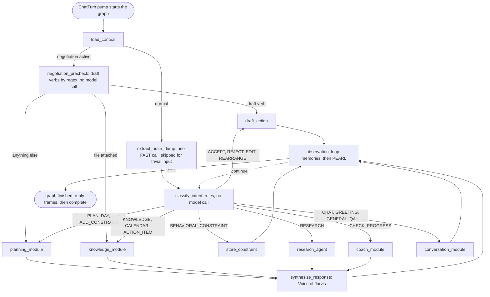

| Edge or rule | Code | Note |
|---|---|---|
| `check_negotiation_shortcut`: any negotiation state other than NONE / ACCEPTED is "active". | `routing.py:54-58` | A proposed draft sets REVIEWING (`planning_graph.py:943-946`). |
| `route_draft_action` after the pre-check: draft verbs → `draft_action`; a file → `knowledge_module`; anything else re-plans. | `routing.py:61-78`; `graph.py:424-447` | "accept" during review never pays for a model call. |
| `_classify_intent` order: file → KNOWLEDGE_INGESTION; draft verbs while reviewing; a repeated "looks good", or a "scrap it", after an accept (both answered "already locked in"); then the brain-dump fields, where text marked as knowledge is ingested only from 400 characters (`PASTED_MATERIAL_MIN_CHARS`), so a short question about the user's notes falls through to CHAT; progress keywords; else CHAT. The "scrap it" rule and the 400-character rule came after `d3e9132`. Also after `d3e9132`: before the graph runs, a resumed conversation whose draft was accepted or discarded from its card reads the draft's real status, so it is no longer "reviewing" (`ChatTurn._close_review_of_a_closed_draft`). | `graph.py:371-421` at `d3e9132`; `_classify_intent` | Draft verbs are matched end to end and negations disqualify them (`graph.py:146-208`). |
| `route_to_module` order: draft intents; `conversation_phase == NEGOTIATION` → planning; a planning error in this turn → coach; then `INTENT_TO_MODULE`. | `routing.py:37-51, 12-28` | No code writes `ConversationPhase.NEGOTIATION` and `classify_intent` runs before any module, so the second and third rules do not fire today. |
| `synthesize_response` is skipped by `conversation_module`, `draft_action` and `store_constraint`. | `graph.py:819-830` | Their replies are already final. |
| `check_needs_followup`: `continue` loops back to `classify_intent`. | `routing.py:81-84`; `graph.py:832-836` | `run_observation_loop` always returns `needs_followup: False` (`observation.py:454, 460, 494`), so the loop is never taken. |

Pinned by `tests/test_orchestrator.py::test_graph_has_expected_nodes`, `::test_precheck__draft_verb__routes_to_draft_action`, `::test_precheck__no_draft_verb__falls_through_to_planning`, `::test_routing__draft_intents_reach_the_draft_action_node`, `::test_classify__accept_without_active_negotiation__not_accept`, `::test_classify__file_upload_still_wins_over_draft_verbs`.

---

## A2 — The planning sub-graph

The steps of `planning_module` (`app/modules/planning_graph.py:951-1009`), compiled by `build_module_graph` (`app/core/module_framework.py:173`). Every step runs inside `_wrap_step`: feature flag, optional hook, `tool_use` started/done/error frames, the PRIMARY lock where declared, and a per-step timeout (`module_framework.py:98-163`).

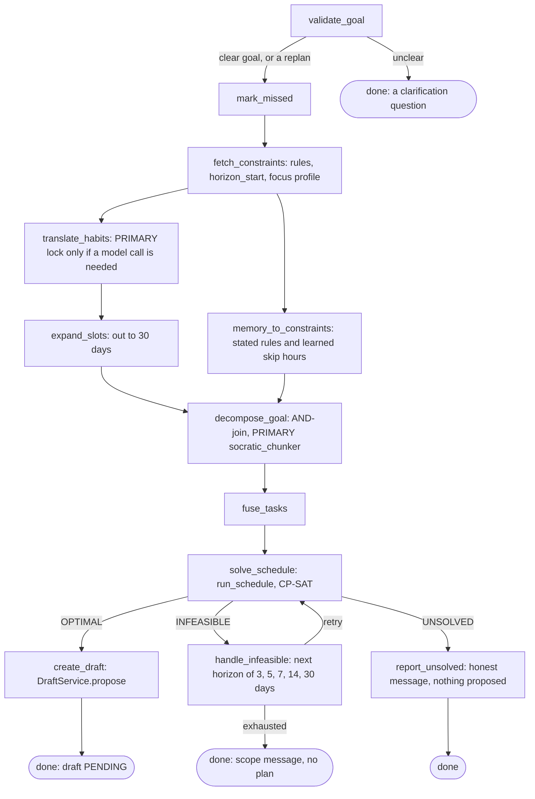

| Step | Code | Timeout and lock | Pinned by |
|---|---|---|---|
| `validate_goal` + `is_goal_clear` | `planning_graph.py:426-435, 969-970` | 30 s default | `tests/test_planning_graph.py::test_planning_subgraph__unclear_goal__decompose_goal_never_runs` |
| `mark_missed` (deadline scan; "bring them back" restores set-aside tasks; skipped in replan mode) | `:114-169` | — | `tests/behaviour/test_psychology.py::test_anti_guilt__user_asks_for_the_missed_tasks__they_come_back_into_the_next_draft` |
| `fetch_constraints` | `:185-233, 973-974` | — | `tests/test_planning_graph.py::test_planning_module__mark_missed_wired_after_gate` |
| `translate_habits` → `expand_slots` | `:299-356, 978-982` | 45 s; PRIMARY lock when `_translates_habits` | `tests/test_planning_graph.py::test_expand_slots__daily_blocked_habit__recurs_across_horizon` |
| `memory_to_constraints` (flag `ENABLE_PEARL`) | `:382-423, 983-985` | — | `tests/behaviour/test_learning.py::test_bridge__learned_avoidance__next_plan_keeps_demanding_work_out_of_that_hour` |
| `decompose_goal` (no model call in replan mode) | `:485-560, 989-992` | 60 s; PRIMARY lock unless replan | `tests/test_planning_graph.py::test_planning_subgraph__clear_goal__decompose_goal_runs_exactly_once` |
| `fuse_tasks` | `:563-624, 993` | — | `tests/test_planning_graph.py::test_planning__carried_forward_pending_tasks__keep_their_ids` |
| `solve_schedule` + `check_feasibility` | `:627-718, 824-829, 994-1000` | `SOLVE_STEP_TIMEOUT_MS` = solver cap + 15 s | `tests/test_planning_graph.py::test_solve_step_timeout__outlives_the_solver_cap`, `::test_check_feasibility__solve_ended_without_a_schedule__routes_to_report_unsolved` |
| `handle_infeasible` + `can_retry` | `:779-797, 832-835, 1006-1007` | — | `tests/test_planning_graph.py::test_planning_subgraph__infeasible_ladder__reruns_solve_only` |
| `create_draft` / `report_unsolved` | `:721-769, 809-821, 1004-1005` | — | `tests/test_planning_graph.py::test_planning_graph__optimal_solve_routes_through_create_draft` |

---

## A3 — The trigger lifecycle (`Trigger.run`)

Every outcome of the Template Method in `app/domain/anticipation.py:353-421`, and how `AnticipationService` wraps it.

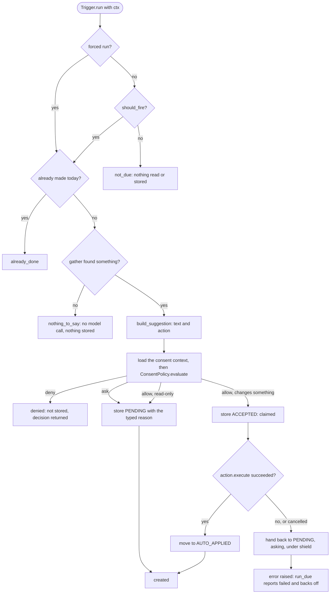

| Outcome | Where | What the service does with it | Pinned by |
|---|---|---|---|
| `not_due` | `anticipation.py:375-376` | Nothing; checked again next tick. A trigger in backoff is also reported `not_due` (`service.py:246-248`). | `tests/test_trigger_template.py::test_trigger_run__not_due__nothing_stored` |
| `already_done` | `:377-378` | Settles the local day; a manual run returns the day's suggestion with it (`service.py:226-229`). | `tests/test_trigger_template.py::test_trigger_run__already_done__gather_never_called`; `tests/test_anticipation_api.py::test_anticipation_api__run_already_done__returns_todays_suggestion` |
| `nothing_to_say` | `:379-381` | Settles the day; zero model calls. | `tests/test_trigger_template.py::test_trigger_run__nothing_to_say__no_suggestion_and_zero_llm_calls` |
| `denied` | `:386-387` | Settles the day; the decision (reason, kind) goes back to "Check now". | `tests/test_trigger_template.py::test_trigger_run__deny__nothing_stored_decision_returned` |
| `created` (PENDING) | `:389-406, 421` | Settles the day as `already_done`. | `tests/test_trigger_template.py::test_trigger_run__allowed_read_only__pending_and_never_executed` |
| `created` (AUTO_APPLIED) | `:407-421` | As above; the claim means no user accept can run it twice. | `tests/test_trigger_template.py::test_trigger_run__allowed_change__executed_once_and_auto_applied`; `tests/test_anticipation_service.py::test_auto_apply__racing_accept__409_and_action_runs_once` |
| `failed` | `:410-413`; `service.py:254-270` | Logged by type; that (user, trigger) waits 1, 2, 4 … 30 minutes; other triggers still run. | `tests/test_trigger_template.py::test_trigger_run__auto_apply_fails__pending_with_ask_reason_and_raises`; `tests/test_anticipation_service.py::test_run_due__one_trigger_raises__the_next_still_runs` |

The service around `run`: a per-user lock (`app/services/anticipation/user_locks.py:23-48`; `service.py:216, 244`), the settled-day memo (`service.py:377-388, 408-413`), the 10 s manual cooldown (`service.py:399-406`; `config.py:194`). Pinned by `tests/test_anticipation_service.py::test_run_trigger__concurrent_runs__one_suggestion`, `::test_run_trigger__two_manual_runs_inside_the_cooldown__evaluated_once`, `::test_run_due__settled_for_the_day__no_reads_until_the_next_local_day`.

---

## State machines

Each machine is drawn from the table the code enforces. A move the table does not allow raises `InvalidStateTransition` (409) before anything is written, and every status write that can race is a compare-and-set on the status it read.

### Draft status (`DRAFT_TRANSITIONS`, `app/domain/entities.py:162-183`)

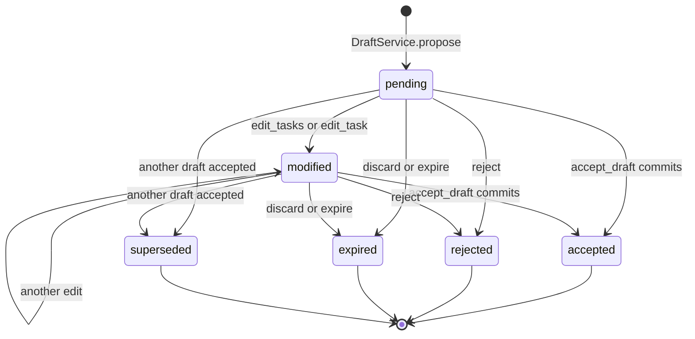

| Move | Code | Pinned by |
|---|---|---|
| Checked in Python | `entities.py:370-385` (`DraftSchedule.transition`) | `tests/test_domain.py` |
| propose | `draft_service.py:111-123` | `tests/test_planning_graph.py::test_create_draft__stores_tasks_and_sets_draft_id` |
| edit (a closed draft is refused before anything is written) | `draft_service.py:147-176` | `tests/test_draft_endpoints.py::test_edit_routes__accepted_draft__409_and_draft_stays_accepted` |
| accept, and supersede of the other open drafts, in SQL | `…user_tasks_not_before.sql:66-68, 97-106` | `tests/test_repository_contracts.py::test_drafts__accept_atomic__two_open_drafts__the_other_is_superseded` |
| reject / discard / expire (compare-and-set, 3 tries) | `draft_service.py:178-183, 232-240`; `supabase_repos.py:399-424` | `tests/test_draft_endpoints.py::test_reject_endpoint__accepted_draft__409_envelope` |
| expiry after 24 h counts as closed in the SQL check | `_mapping.py:48, 254`; `…user_tasks_not_before.sql:66` | `tests/test_repository_contracts.py::test_drafts__accept_atomic__expired__raises` |

### Task status (`_Move` table, `app/services/task_service.py:66-84`)

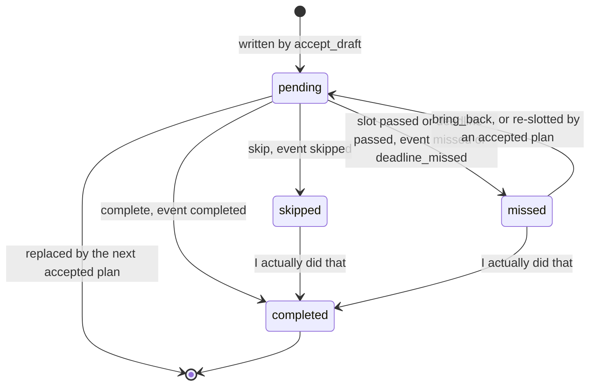

| Move | Code | Pinned by |
|---|---|---|
| written, replaced, re-slotted (row deleted and re-inserted, `rescheduled` event on accept) | `…user_tasks_not_before.sql:70-95`; `draft_service.py:300-331` | `tests/test_repository_contracts.py::test_drafts__accept_atomic__reslots_missed_row_with_same_task_id` |
| complete (from pending, missed or skipped) | `task_service.py:74-79, 109-126` | `tests/test_task_service.py::test_complete__missed_task__allowed_and_status_completed`, `::test_complete__skipped_task__allowed_and_status_completed` |
| skip (from pending only) | `:80, 128-140` | `tests/test_task_service.py::test_skip__completed_task__returns_none_no_event` |
| slot passed (sweep, 30-minute grace, held to the slot it read) | `:84, 170-217` | `tests/test_task_service.py::test_sweep__accept_reslots_task_mid_sweep__new_slot_never_marked_missed` |
| deadline passed (planning's scan) | `:81-83, 142-152` | `tests/test_task_service.py::test_mark_deadline_missed__pending__deadline_missed_event_and_status_missed` |
| bring back (no outcome event) | `:154-168` | `tests/test_task_service.py::test_bring_back__missed__pending_with_deadline_cleared_and_no_outcome_event` |

The status column is the current state only; the history is the append-only `task_events` table (ADR-11), and learning reads only that.

### Suggestion status (`SUGGESTION_TRANSITIONS`, `app/domain/entities.py:186-224`)

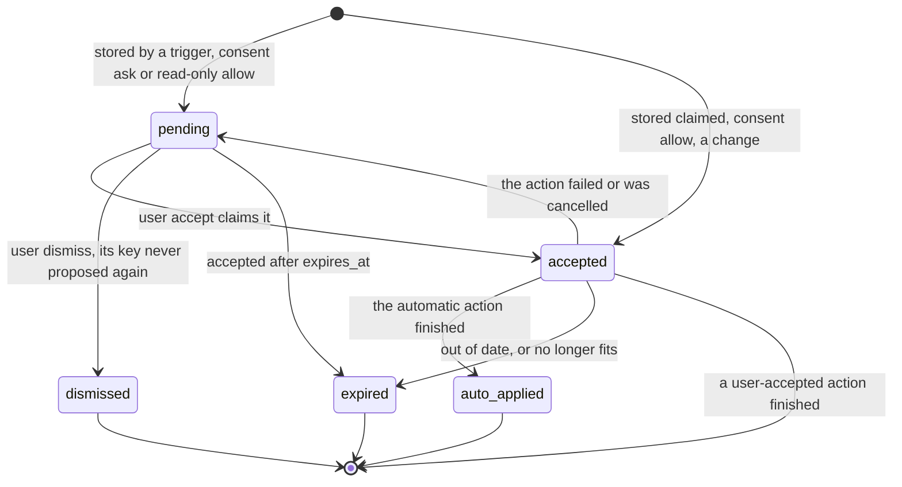

| Move | Code | Pinned by |
|---|---|---|
| The one way a status changes: checked, then compare-and-set from the expected status | `app/domain/anticipation.py:291-311` | `tests/test_anticipation_design.py` |
| store PENDING or claimed ACCEPTED; AUTO_APPLIED; hand back on failure | `anticipation.py:389-421, 322-339` | `tests/test_trigger_template.py::test_trigger_run__auto_apply__claimed_while_the_action_runs`, `::test_trigger_run__auto_apply_cancelled__pending_with_ask_reason` |
| user accept, release on error, expire when out of date or no fit | `service.py:300-355, 415-440` | `tests/test_anticipation_service.py::test_accept__action_out_of_date__expired_and_409_plain_message`, `::test_accept__action_conflict__expired_never_back_to_pending`, `::test_accept__store_down__back_to_pending_and_503` |
| dismiss | `service.py:357-366` | `tests/test_anticipation_service.py::test_dismiss__then_same_key__denied_next_time`, `::test_dismiss__not_pending__409` |

### Memory status (`MEMORY_TRANSITIONS`, `app/domain/entities.py:111-153`)

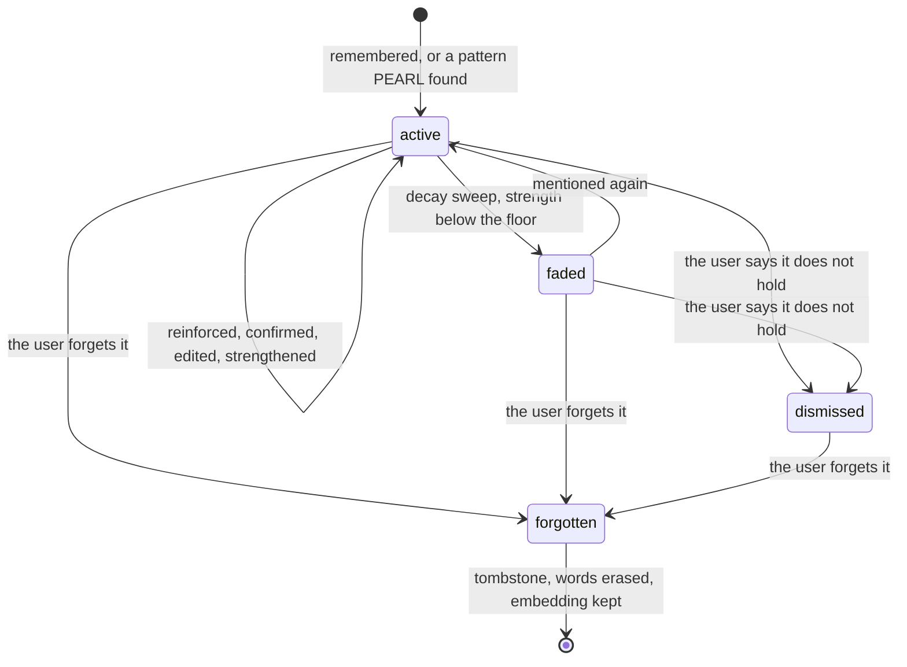

| Move | Code | Pinned by |
|---|---|---|
| create / reinforce / supersede / suppress | `memory_service.py:197-272, 552-577` | `tests/test_memory_service.py::test_remember__same_fact_again__reinforced_not_duplicated_and_confirmed`, `::test_remember__contradiction__old_superseded_new_active` |
| PEARL create / strengthen | `patterns.py:638-681` | `tests/test_patterns.py::test_observe__more_evidence__strengthened` |
| fade (daily decay sweep) / come back | `memory_service.py:523-551, 609-639` | `tests/test_memory_service.py::test_fade_stale__month_unused__faded_and_constraint_kept`, `::test_remember__faded_fact_mentioned__reactivated` |
| confirm / dismiss / forget | `memory_service.py:274-320` | `tests/test_memory_service.py::test_confirm_or_edit__dismissed_or_forgotten__conflict_and_unchanged`; `tests/test_memories_api.py::test_memories_api__confirm_after_dismiss__409_envelope` |

A contradiction does not change the old memory's status: a new memory is stored and the old one points to it (`superseded_by`), so the old one leaves recall without becoming a status of its own (`memory_service.py:245-248, 552-577`).

---

## Not drawn: ask-back

Ask-back (spec §8.3: a deterministic clarify gate with typed `clarify_request` frames) is **not built**; the only clarification today is `validate_goal`'s question and the infeasible scope message, both shown in A2.

---

## Differences from the spec

| Spec | Code (what the diagrams show) |
|---|---|
| §7 sequence: the brief asks `UserModel` and `EnergyEstimator`, then `PlanningService`. | `MorningBriefTrigger` reads the repositories, `PatternService` and `EnergyEstimator` directly and drafts through the `DraftPlanner` port (`PlanningGraphReplanner`); there is no `PlanningService` class (S6). |
| §7: four triggers. | Two are built: MorningBrief and PatternRule (`container.py:208-216`). PreTaskPrep and DeadlineRisk are not. |
| §7: the frontend accepts the brief by calling `DraftService.accept`. | The frontend accepts the *suggestion*; `ApplyDraftAction` checks the draft is current and accepts it, or re-plans first (S6 steps 19–25). |
| §13: an ask-back sequence. | Not built (above). |
| §10 (c): a `version` column for read-modify-write paths. | Status compare-and-set everywhere; drafts carry a computed `version` hash for `expected_version` (`entities.py:359-368`). |

---

## How to verify this document

```bash
cd Jarvis-Engine
git log -1 --oneline            # the references are at d3e9132

# 1. Every diagram renders. Paste each mermaid block into GitHub's preview or
#    https://mermaid.live, or render them all locally with the Mermaid CLI:
python3 - <<'EOF'
import re, pathlib
text = pathlib.Path("docs/capstone/06-sequence-and-activity.md").read_text()
for i, block in enumerate(re.findall(r"```mermaid\n(.*?)```", text, re.S), 1):
    pathlib.Path(f"/tmp/d06_{i:02}.mmd").write_text(block)
print("blocks:", i)
EOF
for f in /tmp/d06_*.mmd; do npx -y @mermaid-js/mermaid-cli -i "$f" -o "${f%.mmd}.svg"; done

# 2. The tests named in the walk-throughs (offline, no network).
.venv/bin/python -m pytest -q tests/test_chat_turn.py tests/test_turn_locks.py tests/test_sse_golden.py \
  tests/test_sse_contract.py tests/test_orchestrator.py tests/test_planning_graph.py          # S1, A1, A2
.venv/bin/python -m pytest -q tests/test_draft_service.py tests/test_drafts_one_path.py \
  tests/test_draft_endpoints.py tests/test_accept_on_time.py tests/test_migrations.py \
  tests/test_repository_contracts.py -k "accept or draft"                                     # S2a, S2b
.venv/bin/python -m pytest -q tests/test_turn_learning.py tests/test_stated_rules.py \
  tests/behaviour/test_learning.py tests/behaviour/test_local_day.py                         # S3, S5
.venv/bin/python -m pytest -q tests/test_task_service.py tests/test_patterns.py \
  tests/test_observation.py tests/test_task_lifecycle.py                                     # S4
.venv/bin/python -m pytest -q tests/test_memory_service.py tests/test_memories_api.py \
  tests/behaviour/test_long_term_memory.py                                                   # S5
.venv/bin/python -m pytest -q tests/test_triggers.py tests/test_trigger_template.py \
  tests/test_anticipation_service.py tests/test_anticipation_scheduler.py tests/test_consent.py \
  tests/test_anticipation_api.py tests/behaviour/test_anticipation.py                        # S6, S7, A3
.venv/bin/python -m pytest -q tests/test_llm_providers.py tests/test_claude_provider.py \
  tests/test_model_router.py tests/test_prompt_layout.py tests/test_usage_ledger.py \
  tests/test_layering.py                                                                      # S8
.venv/bin/python -m pytest -q tests/                  # everything (at 670e2d5: 2361 passed, 2 xfailed, 2 deselected)

# 3. Spot-check any reference: e.g. the lock order of accept_draft and the transition tables.
sed -n '42,68p' supabase/migrations/20261115000007_user_tasks_not_before.sql
sed -n 111,224p app/domain/entities.py

# 4. Live: with the backend running against real Supabase and the model chain
#    (costs model calls; uses a throwaway e2e- user and deletes its rows).
.venv/bin/python scripts/live_e2e.py                  # expect the last line: ALL PASSED
```
