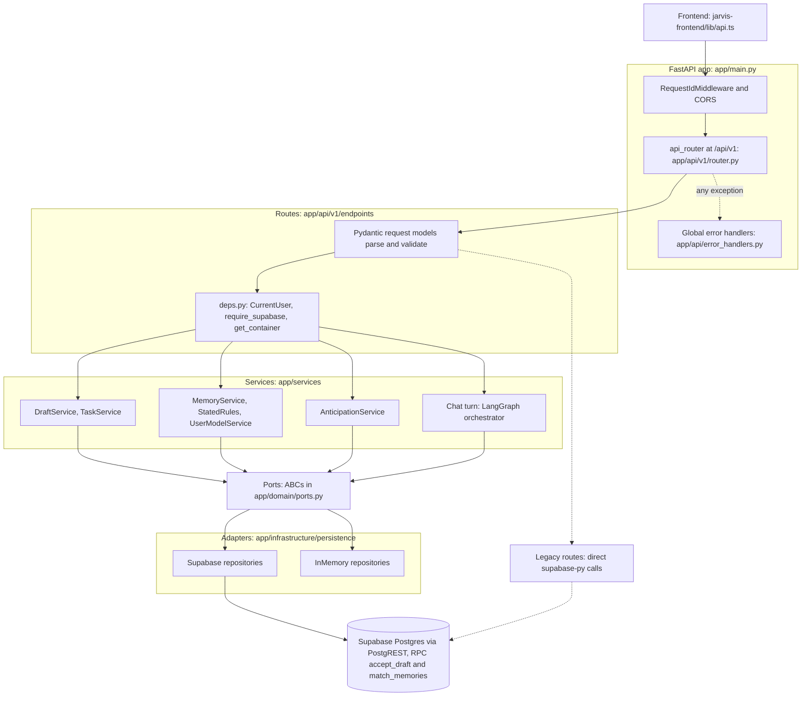
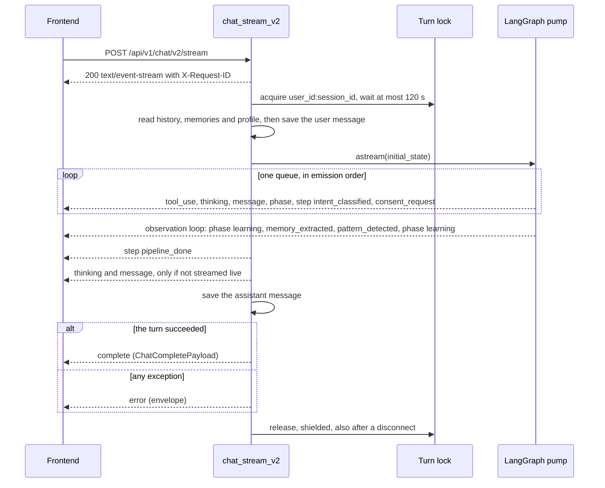

# 07 — API design

Jarvis's backend is a FastAPI application. Every route sits under `/api/v1`, except `/` and `/health`. The running server exposes 58 operations on 50 paths (`GET /openapi.json`). Of those, 54 are current and 4 deprecated v1 chat routes, listed in Appendix A, are being retired in the next plan. All user interaction goes through one entry point, `POST /api/v1/chat/v2/stream`. It is a server-sent-events (SSE) stream: frames show the turn's progress, learning frames say what Jarvis remembered and noticed, and one typed `complete` frame closes the turn. The REST resources around it cover the other actions: accepting a proposed plan (a draft), recording what happened to a task, seeing and correcting what Jarvis remembers, letting Jarvis make the first move with consent (anticipation), and managing documents and conversations. Every failed request returns one error envelope, `{"error": {"code", "message", "details", "request_id"}}`, over HTTP and inside the stream. This document is written from the code at commit `5c6ffd3` (branch `capstone-lld`) and checked against the live `/openapi.json`. Where the two disagree it says so. §11 lists where the design spec and the code differ.

Owner: ______

---

## Contents

1. [Layering](#1-layering)
2. [Conventions](#2-conventions)
3. [The error envelope](#3-the-error-envelope)
4. [Shared response schemas](#4-shared-response-schemas)
5. [Endpoint catalogue](#5-endpoint-catalogue)
6. [The chat stream: SSE event catalogue](#6-the-chat-stream-sse-event-catalogue)
7. [How the frontend consumes the API](#7-how-the-frontend-consumes-the-api)
8. [Inconsistencies found while writing this document](#8-inconsistencies-found-while-writing-this-document)
9. [OpenAPI vs code](#9-openapi-vs-code)
10. [Appendix A — Deprecated v1 routes (slated for removal)](#10-appendix-a--deprecated-v1-routes-slated-for-removal)
11. [Where the spec and the code differ](#11-where-the-spec-and-the-code-differ)
12. [How to verify this document](#12-how-to-verify-this-document)

---

## 1. Layering

A request passes through four layers, and each layer depends only on the one below it. `tests/test_layering.py` enforces the import direction.



| Layer | Responsibility | Where |
|---|---|---|
| **App shell** | Gives every request an id (`RequestIdMiddleware`: `request.state.request_id` and the `X-Request-ID` response header, exposed through CORS). CORS allows `localhost:3000` and `localhost:3001` only. Routes every exception to one envelope (`register_error_handlers`). `redirect_slashes=False`. | `app/main.py:198–219`, `app/api/error_handlers.py` |
| **Routes** | Routing and parsing only. A Pydantic model validates the body or query; a dependency resolves who is asking; the route calls one service method and maps the result to a response model. | `app/api/v1/endpoints/*.py` |
| **Dependencies** | `CurrentUser`: the **auth seam**. Today it reads a required `user_id` query parameter (1–128 characters); when auth lands, a verified JWT subject replaces it here, and every route that declares `user: CurrentUser` follows. `require_supabase`: the live client, or `PersistenceError` (503). Without the database the container falls back to in-memory repositories, which would answer "no memories" or "no suggestions" when the true answer is "can't tell". `get_container`: the composition root (`AppContainer`) built in the lifespan. | `app/api/deps.py` |
| **Services** | Domain rules and transactions. Examples: `DraftService.accept` (atomic accept), `TaskService` (status compare-and-set plus one event), `MemoryService` (lifecycle), `AnticipationService` (triggers, consent, suggestions), `UserModelService` (the You page). | `app/services/` |
| **Ports → adapters** | ABC repositories, each with a Supabase and an InMemory implementation under one contract suite. Every method takes `user_id` first. | `app/domain/ports.py`, `app/infrastructure/persistence/` |

**Routes that follow the layering fully:** `memories`, `you`, `anticipation`, `DELETE /habits/constraints/{id}` (through `StatedRules`), `drafts` accept and reject, and `tasks` complete and skip.

**Routes that still reach the database directly,** recorded honestly: these handlers build supabase-py queries themselves, or pass the raw client to a legacy service.
- `tasks` list, `PATCH` and `DELETE`: synchronous calls inside `async def`, so they block the event loop for each round trip.
- `sessions`, `documents`, `GET /habits/constraints`, `ingestion/pending-calendar*`.
- The habit tracker routes, through `sm2_engine`.
- The draft reads and edits, through the legacy `DraftStore` (`app/services/draft_store.py`).
- The chat stream's session and message writes (`app/services/chat_history.py`).

The plan 2 ledger carries these to plan 3 as "two persistence paths".

---

## 2. Conventions

### 2.1 Paths and methods

- **Resource-shaped paths, plural nouns:** `/tasks/{task_id}`, `/drafts/{draft_id}`, `/memories/{memory_id}`, `/sessions/{session_id}`, `/documents/{source_id}`, `/anticipation/suggestions/{suggestion_id}`.
- **State transitions are `POST` to a verb sub-resource:** `/drafts/{id}/accept`, `/drafts/{id}/reject`, `/tasks/{id}/complete`, `/tasks/{id}/skip`, `/memories/{id}/confirm`, `/memories/{id}/dismiss`, `/anticipation/suggestions/{id}/accept`, `/anticipation/suggestions/{id}/dismiss`, `/anticipation/run`. Each one is a move in a state machine (see `08-database-schema.md` §7), not a field update, so it is not a `PATCH`.
- `PATCH` edits fields (`/tasks/{id}`, `/memories/{id}`, `/drafts/{id}/tasks/{task_id}`, `/you/settings`). `PUT` appears once (`/sessions/{id}`). `DELETE` removes, and what that means differs per resource (§8).
- **Trailing slashes matter.** The app sets `redirect_slashes=False` (`app/main.py:198`), so `/api/v1/memories/` is a route and `/api/v1/memories` is a 404. Collection roots declared as `"/"` keep the slash: `/chat/`, `/tasks/`, `/memories/`, `/sessions/`, `/documents/`. The newer `/you` does not.

### 2.2 Who is asking: three transports for `user_id`

| Transport | Validation | Routes |
|---|---|---|
| `CurrentUser` query parameter (the auth seam) | required, 1–128 chars | `/memories/*`, `/you`, `/you/settings`, `/anticipation/*`, `/habits/tracker/*`, `/ingestion/pending-calendar*` |
| Plain `user_id` query parameter | required, no length bounds | `/tasks/` GET and DELETE, `DELETE /tasks/{id}`, `/tasks/{id}/workspace`, `/drafts/{id}` GET and DELETE, `PATCH /drafts/{id}/tasks/{task_id}`, `/habits/constraints*`, `/documents/*`, `/sessions/*` (GET, DELETE), `DELETE /ingestion/behavioral-constraint/{id}` |
| `user_id` field in the JSON body | required, no length bounds | `POST /chat/v2/stream` and every other `/chat/*` route, `POST /tasks/{id}/complete`, `/skip`, `PATCH /tasks/{id}`, `POST /drafts/{id}/accept`, `/reject`, `/modify`, `/rearrange`, `/chat`, `PUT /sessions/{id}` |
| optional body field | — | `POST /ingestion/process` |
| none | — | `/reasoning/decompose-goal`, `/schedule/generate-schedule`, `/ingestion/ingest`, `/models/status`, `/`, `/health` |

Every query filters on `user_id`. Another user's row reads as absent and answers **404, never 403**, because a 403 would confirm that the row exists. Only the first transport goes through the auth seam. Moving the others onto `CurrentUser` is a follow-up (§8).

### 2.3 Naming vocabulary

The vocabulary is stated in `app/schemas/chat_stream.py` (module docstring):

- An id is named `<kind>_id` wherever the record is referred to: `draft_id`, `memory_id`, `message_id`, `task_id`. It is a bare `id` only on a list item that *is* the record (a suggestion, a rule).
- `conversation_id` is the chat session's id, the one the frontend sends back.
- Where a memory came from is `provenance`: `said` (the user's own words) or `inferred` (noticed from what happened).
- Work that did not happen is "set aside" in user-facing text, never anything that blames.

The places where this vocabulary is not yet followed are listed in §8.

### 2.4 Bounds and pagination

**No route paginates with a cursor or an offset.** Lists are bounded or capped, and PostgREST's `max_rows = 1000` (`supabase/config.toml`) silently caps every read. Repository reads are ordered newest first, so the cap can drop only the oldest rows.

| Route | Bound | Order |
|---|---|---|
| `GET /tasks/` | 200 rows, fixed | newest `created_at` first |
| `GET /memories/` | none beyond the 1000-row cap | oldest first |
| `GET /anticipation/suggestions` | 100 (`_LIST_LIMIT`, `app/services/anticipation/service.py:70`) | newest first |
| `GET /sessions/` | `limit` query, default 50, not range-checked | pinned first, then `updated_at` desc |
| `GET /sessions/{id}/messages` | `limit` query, default 100, not range-checked | the newest N, returned oldest first |
| `GET /sessions/{id}` | 100 messages, fixed | oldest first |
| `GET /habits/constraints`, `GET /documents/`, `GET /ingestion/pending-calendar` | none beyond the cap | newest first / newest first / unspecified |
| `GET /you` | the receipt reads 30 days of usage, 1000 rows a page, at most 20 pages; `truncated: true` if it stops early | — |

**Request bounds that are enforced:**

| Field | Bound | Model |
|---|---|---|
| `user_id` (via `CurrentUser`) | 1–128 chars | `app/api/deps.py` |
| `TaskSkipRequest.reason` | ≤ 500 chars | `tasks.py` |
| `TaskCompleteRequest.quality` | 0–5 | `tasks.py` |
| `TaskCompleteRequest.actual_duration_minutes` | ≥ 1 | `tasks.py` |
| `TaskUpdateRequest.duration_minutes` | 1–120 | `tasks.py` |
| `TaskUpdateRequest.difficulty_weight` | 0–1 | `tasks.py` |
| `DraftTaskEdit.duration_minutes` | ≤ 25, no minimum | `app/schemas/draft.py:153` |
| `DraftTaskEdit.difficulty_weight` | 0–1 | `app/schemas/draft.py:153` |
| `MemoryEdit.content` | 1–2000 chars | `memories.py` |
| `SettingsUpdate.wake_time` | `HH:MM`, a real time of day | `you.py` |
| `SettingsUpdate.timezone` | ≤ 64 chars, a known IANA zone | `you.py` |
| `SettingsUpdate` (whole model) | unknown keys rejected (`extra="forbid"`) | `you.py` |
| `RunTriggerRequest.trigger` | 1–64 chars, a registered name | `anticipation.py` |
| `ChatRequest.day_start_hour` and the duration caps | ranges as in the model | `chat.py:84` |

**Not bounded:** `ChatRequest.user_prompt` and `file_base64`, `IngestionRequest.file_base64`, and the ids in paths, which are plain strings. A non-UUID id matches nothing in the repositories, which pre-check the form with `is_uuid`.

### 2.5 Idempotency and concurrency

| Operation | A repeated or concurrent call | Mechanism |
|---|---|---|
| `POST /drafts/{id}/accept` | The second accept answers **409 `invalid_state_transition`** and writes nothing. Two concurrent accepts, of the same draft or of two drafts of one user: exactly one wins. | `accept_draft()` locks the user's profile row, then the draft, then checks the status, in one transaction (`08-database-schema.md` §6.1) |
| `POST /drafts/{id}/reject` | 409 once the draft is closed | `DraftRepository.set_status` compare-and-set |
| `POST /tasks/{id}/complete`, `/skip` | 200 again, with **no second event** | `TaskService`: compare-and-set on the status, then one append-only event |
| `DELETE /memories/{id}` | 200 again; forgetting a forgotten memory changes nothing | `MemoryService.forget` |
| `POST /memories/{id}/dismiss` | 200 again (no change); a forgotten memory gives 409 | `MemoryService.dismiss` |
| `POST /memories/{id}/confirm` | **Not idempotent**: each call reinforces the memory again (observation count, strength) | `MemoryService.confirm` |
| `POST /anticipation/suggestions/{id}/accept`, `/dismiss` | 409 once the suggestion is no longer pending | `move_suggestion` compare-and-set on the status |
| `POST /anticipation/run` | Once a day per trigger: the second run reports `already_done` with the existing suggestion. A manual repeat within 10 s returns the first run's outcome. | `AnticipationService.run_trigger`; `ANTICIPATION_MANUAL_COOLDOWN_SECONDS` (`app/core/config.py:199`) |
| `POST /chat/v2/stream` | Turns on one conversation run one at a time. A turn that waits more than 120 s ends in an `error` frame with code `conflict`. | `app/services/turn_locks.py` (`TURN_LOCK_WAIT_SECONDS = 120.0`) |

### 2.6 Status codes

| Status | When | Typical codes |
|---|---|---|
| **200** | Success. Also the stream's status: an error inside a turn arrives as an `error` frame. Also `POST /drafts/{id}/accept` with `status: "empty"` when the draft holds nothing schedulable. | — |
| **400** | Legacy parse checks raised as `HTTPException`: bad base64, a missing `media_type`, a draft modify with a component other than `tasks`, an empty draft edit | `http_error` |
| **404** | Unknown id, or another user's id | `not_found`; `http_error` on the routes that raise `HTTPException(404)`: drafts, sessions, documents, the legacy constraint delete |
| **409** | State conflicts: a closed draft, a suggestion that is no longer pending, a lost compare-and-set, a task-id clash on accept, a draft whose every slot has begun, a queued turn timing out | `invalid_state_transition`, `stale_version`, `conflict`, `draft_outdated` |
| **422** | Request validation (Pydantic) and domain validation. An infeasible plan on accept. | `validation_error`, `schedule_infeasible`; `http_error` for `/schedule/generate-schedule` infeasible |
| **500** | A bug or an uncaught exception, answered with a fixed message | `internal_error` |
| **501** | `POST /drafts/{id}/chat` | `http_error` |
| **502** | A model returned unusable output on `/reasoning/decompose-goal` or `/ingestion/ingest` | `http_error` |
| **503** | A dependency is down: database, embedder, language model | `persistence_unavailable`, `embedding_unavailable`, `llm_unavailable`, `llm_timeout`, `llm_error`, `llm_output_parse`, `llm_refused`; `http_error` where a route raises `HTTPException(503)` |

`ConsentRequiredError` (code `consent_required`, HTTP 202) is defined in `app/domain/errors.py:63` but **raised nowhere**. Consent reaches the client as the `consent_request` SSE frame (§6).

---

## 3. The error envelope

Every error response has one shape, whatever raised it: a `JarvisError`, request validation, an `HTTPException`, or an exception nobody caught (`app/api/error_handlers.py`).

```json
{
  "error": {
    "code": "invalid_state_transition",
    "message": "This draft is no longer open, so it cannot be accepted.",
    "details": {"draft_id": "6f1c…", "to": "accepted"},
    "request_id": "3b9e0c4f2a6d4e0f9a1b2c3d4e5f6a7b"
  }
}
```

| Field | Type | Meaning |
|---|---|---|
| `error.code` | string | stable, machine-readable |
| `error.message` | string | human-readable and safe to show; **never** the text of a lower-level exception |
| `error.details` | object \| null | structured context, such as field errors or the id involved |
| `error.request_id` | string | the same value as the `X-Request-ID` response header; logged with the cause |

**How each kind of exception is mapped:**

| Raised | HTTP status | `code` | `message` | `details` |
|---|---|---|---|---|
| `JarvisError` subclass | its `http_status` | its `code` | its `message` | its `details` |
| `RequestValidationError` | 422 | `validation_error` | `"The request is invalid."` | `{"errors": [{"loc", "msg", "type"}]}` (never `input` or `ctx`: no echo of the payload) |
| `HTTPException` with a string detail | its status | `http_error` | the detail | null |
| `HTTPException` with a structured detail | its status | `http_error` | the standard reason phrase | `{"detail": …}` |
| `HTTPException` 204, 205, 304 or < 200 | its status | — | no body (RFC 9110) | — |
| any other exception | 500 | `internal_error` | `"Something went wrong on our side."` | null; the cause is logged with the request id |

**The codes** (from `app/domain/errors.py`):

| Code | HTTP | Raised for (examples) |
|---|---|---|
| `validation_error` | 422 | a malformed body; `PATCH /tasks/{id}` with a `status`; an unknown trigger name; an edit with nothing to change; an unknown timezone |
| `not_found` | 404 | an unknown or another user's task, memory, suggestion, tracker or rule |
| `conflict` | 409 | a plan whose task ids clash with tasks the user finished; a queued chat turn that waited past 120 s; a suggestion whose plan no longer fits |
| `invalid_state_transition` | 409 | accepting, rejecting or editing a closed draft; confirming or editing a dismissed or forgotten memory; accepting an out-of-date suggestion |
| `stale_version` | 409 | a compare-and-set lost three times; dismissing or accepting a suggestion that is no longer pending |
| `draft_outdated` | 409 | accepting a draft every one of whose slots has already begun |
| `schedule_infeasible` | 422 | accepting a partly-past draft whose remaining tasks no longer fit when re-solved from now |
| `persistence_unavailable` | 503 | the database cannot be reached, or the app has no client |
| `embedding_unavailable` | 503 | the text embedder could not run (for example, while editing a memory's words) |
| `llm_error`, `llm_timeout`, `llm_unavailable`, `llm_output_parse`, `llm_refused` | 503 | the model chain failed; for example, the user's habits could not be read for the re-solve on accept |
| `consent_required` | 202 | defined, never raised |
| `http_error` | varies | an `HTTPException` raised by a legacy route |
| `internal_error` | 500 | anything else |

**Examples:**

```json
// 422 — POST /api/v1/tasks/t1/skip with {"user_id": "demo", "reason": "<501 characters>"}
{"error": {"code": "validation_error", "message": "The request is invalid.",
           "details": {"errors": [{"loc": ["body", "reason"],
                                   "msg": "String should have at most 500 characters",
                                   "type": "string_too_long"}]},
           "request_id": "…"}}

// 404 — POST /api/v1/memories/{id}/confirm?user_id=demo for someone else's memory
{"error": {"code": "not_found", "message": "That memory does not exist.",
           "details": {"memory_id": "…"}, "request_id": "…"}}

// 409 — the second POST /api/v1/drafts/{id}/accept
{"error": {"code": "invalid_state_transition",
           "message": "This draft is no longer open, so it cannot be accepted.",
           "details": {"draft_id": "…", "to": "accepted"}, "request_id": "…"}}

// 409 — accepting a plan that reuses a finished task's id
{"error": {"code": "conflict", "message": "That plan clashes with tasks you already have.",
           "details": {"draft_id": "…"}, "request_id": "…"}}

// 503 — the database is down (GET /api/v1/you?user_id=demo)
{"error": {"code": "persistence_unavailable", "message": "Could not reach the database.",
           "details": null, "request_id": "…"}}

// 404 from a legacy route (GET /api/v1/drafts/{id}?user_id=demo, unknown id)
{"error": {"code": "http_error", "message": "Draft not found or expired",
           "details": null, "request_id": "…"}}
```

The `//` comments are labels only; the bodies are plain JSON. The messages are the literal strings in `app/services/memory/memory_service.py:558` (`_get`), `app/infrastructure/persistence/_mapping.py` (`task_id_clash`), `supabase_repos.py` (`accept_atomic`), `deps.py` (`require_supabase`) and `drafts.py` (`_NOT_FOUND`).

**Bodies that are not the envelope** (all on legacy surfaces):
- The deprecated `POST /chat/accept-schedule` answers 503 with `{"status": "failed", "detail": "schedule could not be persisted"}` (`chat.py:989`).
- `POST /chat/modify-schedule` answers 200 with `{"status": "error", "message": …}` when it cannot parse the request.
- The deprecated v1 SSE routes send `event: error` with `{"error": "<text>"}`.

---

## 4. Shared response schemas

Field tables are taken from the Pydantic models and agree with `/openapi.json` `components.schemas`. In the "Req" column, "yes" means the field is always present in responses; fields with a default are present too.

### 4.1 `MemoryOut` (`app/api/v1/endpoints/memories.py:26`)

| Field | Type | Req | Meaning |
|---|---|---|---|
| `memory_id` | string | yes | the memory's id |
| `memory_type` | `fact` \| `preference` \| `behavioral_pattern` \| `temporal_event` \| `goal` \| `feedback` \| `constraint` | yes | |
| `content` | string | yes | |
| `confidence` | number | yes | 0–1 |
| `provenance` | `said` \| `inferred` | yes | |
| `freshness` | number | yes | strength now (`Memory.strength_at(now)`) |
| `noted_at` | date-time | yes | the entity's `created_at` |
| `last_confirmed_at` | date-time \| null | yes | |
| `observation_count` | integer | yes | |
| `pattern_key` | string \| null | yes | |

### 4.2 `SuggestionOut`, `ConsentOut`, `ActionResultOut` (`app/api/v1/endpoints/anticipation.py:33, 95, 75`)

| `SuggestionOut` field | Type | Meaning |
|---|---|---|
| `id` | string | suggestion id |
| `trigger` | string | `morning_brief` or `pattern_rule` today |
| `kind` | string | |
| `title`, `body` | string | |
| `status` | `pending` \| `accepted` \| `dismissed` \| `expired` \| `auto_applied` | |
| `consent_behavior` | `allow` \| `ask` \| `deny` | |
| `consent_kind` | `rule_match` \| `mode_decision` \| `risk_check` \| `learned_preference` \| null | null on older rows |
| `consent_reason` | string | the reason, in words the user can read |
| `created_at` | date-time | |
| `expires_at` | date-time \| null | |
| `details` | object | the stored action, column `action` (named `details` on the wire; see §8) |

| `ConsentOut` field | Type |
|---|---|
| `behavior` | `allow` \| `ask` \| `deny` |
| `kind` | `ConsentReasonKind` |
| `message` | string |

| `ActionResultOut` field | Type |
|---|---|
| `kind` | string |
| `message` | string |
| `tasks_written` | integer \| null |
| `draft_id` | string \| null |

### 4.3 The You page models (`app/api/v1/endpoints/you.py`, `app/services/user_model_service.py:74, 105, 127`, `app/domain/entities.py:482, 495`)

| `YouProfile` | Type | `PatternShown` | Type | `RuleShown` | Type |
|---|---|---|---|---|---|
| `display_name` | string \| null | `memory_id` | string \| null | `id` | string |
| `timezone` | string | `pattern_key` | string | `text` | string |
| `wake_time` | string `HH:MM` | `detector` | string | `provenance` | `said` \| `inferred` |
| `autonomy_mode` | `AutonomyMode` | `description` | string | `created_at` | date-time \| null |
| | | `confidence` | number | | |
| | | `occurrences` | integer | | |
| | | `evidence` | string[] (≤ 5, newest first) | | |
| | | `confirmed` | boolean | | |

| `FocusProfile` | Type | `HourFocus` | Type | `PrivacyReceipt` | Type |
|---|---|---|---|---|---|
| `source` | `prior` \| `learned` | `hour` | 0–23 | `since` | date-time |
| `observations` | integer ≥ 0 | `score` | 0–1 | `truncated` | boolean |
| `hours` | exactly 24 `HourFocus`, index = hour | `done` | integer ≥ 0 | `on_device_calls` | integer |
| | | `not_done` | integer ≥ 0 | `cloud_calls` | integer |
| | | | | `pii_redactions` | integer |
| | | | | `input_tokens` | integer |
| | | | | `output_tokens` | integer |

### 4.4 Draft models (`app/schemas/draft.py`)

| `DraftStateResponse` | Type | Meaning |
|---|---|---|
| `draft_id` | string | `draft_schedules.id` |
| `user_id` | string | |
| `goal_id` | string \| null | |
| `tasks` | object[] | the proposed task chunks |
| `horizon_start` | string \| null | ISO minute 0 (08:00 on the user's clock) |
| `status` | `DraftStatus` | `pending` / `modified` (open), `accepted` / `rejected` / `expired` / `superseded` (closed) |
| `rejection_reason` | string \| null | |
| `created_at` | string \| null | |
| `schedule` | `DraftScheduleView` \| null | null when no slots were stored |

| `DraftScheduleView` | Type | `DraftSlot` | Type |
|---|---|---|---|
| `horizon_start` | string | `task_id` | string |
| `schedule` | map `task_id → DraftSlot` | `title` | string \| null |
| | | `start_min`, `end_min` | integer (minutes from `horizon_start`) |
| | | `start`, `end` | date-time, with the offset of the user's zone |
| | | `duration_minutes` | integer |

| `DraftAcceptResponse` | Type | Meaning |
|---|---|---|
| `status` | `accepted` \| `empty` | `empty`: nothing in it could be scheduled, and nothing was written |
| `draft_id` | string | |
| `task_count` | integer ≥ 0 | tasks written |
| `moved` | boolean | true when some times had already gone by and were re-solved from now |
| `message` | string \| null | what to tell the user when `moved` |

### 4.5 `TaskResponse` (`app/api/v1/endpoints/tasks.py:96`)

| Field | Type | Meaning |
|---|---|---|
| `task_id` | string | |
| `status` | string | free text: `completed`, `skipped`, `updated`, `unchanged`, `deleted`, or the task's current status when a skip changed nothing |
| `message` | string | user-facing text without blame |
| `replan_triggered` | boolean | always `false`: the background re-plan is off |

---

## 5. Endpoint catalogue

The "Use case" lines name the user goal each route serves. UC1–UC8 are the use cases of `01-requirements.md` as numbered when this was written; routes that serve no numbered use case say what they support. "CU" means the route resolves the user through `CurrentUser`.

### 5.1 Chat (the entry point)

#### `POST /api/v1/chat/v2/stream` — talk to Jarvis (SSE)

**Use case:** UC1 (plan from a brain dump), UC3 (teach a rule and re-plan), UC5 (remember a fact), and UC2 when the plan is accepted in words. It also carries document uploads and resuming a conversation (`since_last_spoke`).

**Request:** `ChatRequest` (`app/api/v1/endpoints/chat.py:84`), JSON body. The v2 handler reads only the fields marked ✓. The rest are v1 fields: the model accepts them, but they are ignored on this route.

| Field | Type | Read by v2 | Notes |
|---|---|---|---|
| `user_prompt` | string, required | ✓ | the message |
| `user_id` | string, required | ✓ | body transport (§2.2) |
| `conversation_id` | string \| null | ✓ | the session to continue. Unknown, or another user's: a new session is created (`chat_history.get_or_create_session`). |
| `model_mode` | string, default `auto` | ✓ | `4b`, `cloud` or `gemini` force every model call of the turn to the cloud. Any other value is auto (local first). |
| `file_base64` | string \| null | ✓ | a document for the knowledge module |
| `media_type` | string \| null | ✓ | `pdf` / `image` / `png` / `jpeg` |
| `file_name` | string \| null | ✓ | |
| `day_start_hour` (0–23), `deadline_override`, `max_daily_deep_work_minutes` (30–600), `min_daily_deep_work_minutes` (15–240), `max_task_duration_minutes` (1–25), `min_task_duration_minutes` (1–25), `confirm_before_schedule`, `draft_schedule` | as named | — | ignored on this route |

**Response:** `200 text/event-stream` with headers `Cache-Control: no-cache`, `X-Accel-Buffering: no`, `Connection: keep-alive` and `X-Request-ID`. The frames are in §6. The last frame is one `complete` (`ChatCompletePayload`) or one `error` (the envelope).

**Errors:**
- Before the stream starts: 422 `validation_error` for a malformed body.
- After it starts: an `error` frame (§6.4). The HTTP status stays 200.

#### `POST /api/v1/chat/modify-schedule` — change a draft schedule in words (live, not deprecated in code)

**Use case:** change a proposed plan. It has **no caller in the frontend** (`lib/api.ts`). The conversational path is the negotiation flow inside the chat stream.

| Request `ModifyScheduleRequest` | Type |
|---|---|
| `user_id` | string, required |
| `user_prompt` | string, required |
| `current_tasks` | object[], required |
| `execution_graph` | object \| null |
| `current_schedule` | object \| null |
| `horizon_start` | string \| null |

**Responses:**
- 200 `{"status": "modified", "modification": {…}, "execution_graph": {…}, "schedule": {…}, "schedule_status": "draft"}`.
- 200 `{"status": "error", "message": …}` when the request cannot be understood. This is not the envelope (§3).

Nothing is persisted.

### 5.2 Drafts — proposed plans

All draft routes read through the legacy `DraftStore` and answer `HTTPException` 404 or 503 (`http_error`) when the draft is missing or the store is absent. Accept and reject go through `DraftService` from the container.

| Method + path | Purpose | Request | Response | Errors |
|---|---|---|---|---|
| `GET /drafts/{draft_id}?user_id=` | Read a draft with its solved slots | — | `DraftStateResponse` | 404 `http_error` "Draft not found or expired"; 503 `http_error` (no store) |
| `POST /drafts/{draft_id}/accept` | **Accept the plan.** The only REST path that writes `user_tasks`. One atomic call writes the tasks, marks the draft accepted and supersedes the user's other open drafts. A partly-past draft is re-solved from now first (`moved`). | `DraftAcceptRequest {user_id, components?}` (`components` ignored) | `DraftAcceptResponse` | 404 `http_error`; 409 `invalid_state_transition` (closed: second accept, rejected, superseded, expired); 409 `draft_outdated` (every slot begun); 409 `conflict` (task-id clash); 422 `schedule_infeasible` (re-solve found no room; draft stays open); 503 `llm_unavailable` (habits unreadable for the re-solve); 503 `persistence_unavailable` "The schedule could not be saved. The draft is still open; try again." |
| `POST /drafts/{draft_id}/reject` | Reject. A non-blank `reason` is also remembered as a `feedback` memory, origin `draft_rejection`. | `DraftRejectRequest {user_id, components?, reason?}` | `{"status": "rejected", "draft_id"}` | 404 `http_error`; 409 `invalid_state_transition`; 503 |
| `POST /drafts/{draft_id}/modify` | Replace the task list; the status becomes `modified` | `DraftModifyRequest {user_id, component: "tasks", data: object[]}` | `{"status": "modified", "component": "tasks", "draft_id"}` | 400 `http_error` (component ≠ `tasks`, or `data` not a list); 404; 409 `invalid_state_transition` |
| `PATCH /drafts/{draft_id}/tasks/{task_id}?user_id=` | Edit one task | `DraftTaskEdit {title?, duration_minutes? (≤25), difficulty_weight? (0–1), start_min?}` | `{"status": "modified", "draft_id", "task_id", "updated_draft": <draft row>}` | 400 `http_error` "No edits provided"; 404 "Draft or task not found"; 409 |
| `POST /drafts/{draft_id}/rearrange` | Reorder tasks; ids not mentioned keep their relative place at the back | `DraftRearrangeRequest {user_id, task_order: string[]}` | `{"status": "rearranged", "draft_id", "task_count", "needs_resolve": true}` (no re-solve runs) | 404; 409 |
| `DELETE /drafts/{draft_id}?user_id=` | Discard: a **hard delete**, in any status | — | `{"status": "deleted", "draft_id"}` | 404 |
| `POST /drafts/{draft_id}/chat` | Not implemented | `DraftChatRequest {user_id, message}` | — | **501** `http_error` always |

**Use case:** UC2 (accept a plan atomically).

### 5.3 Tasks — outcomes and edits

| Method + path | Purpose | Request | Response | Errors |
|---|---|---|---|---|
| `POST /tasks/{task_id}/complete` | Record **done**, from `pending`, `missed` or `skipped`. One `completed` event (quality and actual duration in its metadata) plus a completion-signal row. | `TaskCompleteRequest {user_id, quality: 0–5 = 3, actual_duration_minutes? ≥1}` | `TaskResponse` (`status: "completed"`) | 404 `not_found`; 409 `stale_version`; 503 `persistence_unavailable` |
| `POST /tasks/{task_id}/skip` | **Set aside** a pending task. One `skipped` event carries the reason. The message suggests today's buffer or tomorrow morning; nothing is re-placed. | `TaskSkipRequest {user_id, reason? ≤500}` | `TaskResponse` (`status: "skipped"`, or the current status with "already done / set aside, so nothing changed") | 404; 409; 503 |
| `PATCH /tasks/{task_id}` | Edit title, duration, difficulty or deadline. **Any `status` is a 422**: status moves only through complete and skip. | `TaskUpdateRequest {user_id, title?, duration_minutes? 1–120, difficulty_weight? 0–1, deadline_hint?, status? (rejected)}` | `TaskResponse` (`updated` / `unchanged`) | 422 `validation_error`; 404; 503 |
| `DELETE /tasks/{task_id}?user_id=` | Hard delete | — | `TaskResponse` (`deleted`) | 404; 503 |
| `DELETE /tasks/?user_id=&status_filter=` | Bulk delete (all, or one status) | — | `TaskClearResponse {status: "cleared", deleted_count, filter}` | 503 |
| `GET /tasks/?user_id=&status=` | List raw `user_tasks` rows, newest first, at most 200 | — | `TaskListResponse {tasks: object[], count}` | 503 |
| `GET /tasks/{task_id}/workspace?user_id=&prompt=&refresh=false` | The proactive workspace (RAG chunks, links, practice, WOOP card); cached 24 h | — | `TaskWorkspace {task_id, task_title, primary_objective, surfaced_assets: StudyAsset[], woop_card: WoopCard \| null, notices: string[]}` (`app/schemas/workspace.py`) | 400 `http_error` (empty `user_id`); 500 `internal_error` "Could not build the task workspace."; a `JarvisError` passes through with its own status |
| `DELETE /tasks/{task_id}/workspace?user_id=` | Drop the cached workspace | — | `{"status": "invalidated"}` | — |

**Use case:** UC4 (complete or skip a task). The workspace routes support preparing for a task (no numbered use case).

### 5.4 Memories — what Jarvis remembers (CU)

Every route first requires the database (503). Another user's memory is a 404.

| Method + path | Purpose | Request | Response | Errors |
|---|---|---|---|---|
| `GET /memories/?user_id=&memory_type=` | Memories in use: active, not superseded, not expired, at least 0.1 strong | — | `MemoryListResponse {memories: MemoryOut[], count}` (oldest first) | 422 (bad `memory_type`); 503 |
| `PATCH /memories/{memory_id}?user_id=` | Change words and/or type; new words are embedded again | `MemoryEdit {content? 1–2000, memory_type?}` (at least one) | `MemoryOut` | 404; 409 `invalid_state_transition` (dismissed or forgotten); 422; 503 `embedding_unavailable` |
| `DELETE /memories/{memory_id}?user_id=` | **Forget for good.** The words are erased and a tombstone keeps the embedding and `pattern_key`, so the same fact is not stored again. Rules the memory was the saying of are deleted with it. | — | `ForgetResponse {status: "forgotten", forgotten_rule_ids: string[]}` | 404; 503 |
| `POST /memories/{memory_id}/confirm?user_id=` | "It holds": reinforce it, confidence ≥ 0.9, `last_confirmed_at = now` | — | `MemoryOut` | 404; 409; 503 |
| `POST /memories/{memory_id}/dismiss?user_id=` | "It doesn't hold": hidden for good, words kept; a rule resting on it goes too | — | `MemoryOut` | 404; 409 (forgotten); 503 |

**Use case:** UC5 (remember or forget a fact), UC8 (review what Jarvis knows).

### 5.5 You — the user model and the privacy receipt (CU)

| Method + path | Purpose | Request | Response | Errors |
|---|---|---|---|---|
| `GET /you?user_id=` | Everything Jarvis knows, in one read: profile, the patterns PEARL sees (with evidence), rules, memories in use, the focus profile, and the privacy receipt for the last 30 days. It looks for new patterns first and asks no model. | — | `YouResponse {profile: YouProfile, patterns: PatternShown[], rules: RuleShown[], memories: MemoryOut[], focus: FocusProfile, receipt: PrivacyReceipt}` | 503 |
| `PATCH /you/settings?user_id=` | Change `autonomy_mode`, `wake_time`, `timezone`; fields left out stay as they are | `SettingsUpdate` (`extra="forbid"`) | `YouProfile` | 422 (unknown key, bad time, unknown zone; nothing changes); 503 |

**Usage** has no resource of its own. The usage ledger (`llm_usage_events`) is exposed only as `GET /you` → `receipt`.

**Use case:** UC8 (review "what Jarvis knows about you", including the autonomy setting and the privacy receipt).

### 5.6 Anticipation — Jarvis makes the first move (CU)

| Method + path | Purpose | Request | Response | Errors |
|---|---|---|---|---|
| `GET /anticipation/suggestions?user_id=&status=pending` | Suggestions in one status, newest first, at most 100. A pending suggestion past `expires_at` is not listed. | — | `SuggestionListResponse {suggestions: SuggestionOut[]}` | 422 (bad status); 503 |
| `POST /anticipation/suggestions/{id}/accept?user_id=` | Claim the suggestion and run its action once: `apply_plan` accepts its draft, `adopt_rule` stores a rule and proposes a re-plan draft, `share_insight` | — | `AcceptSuggestionResponse {suggestion: SuggestionOut, result: ActionResultOut}` | 404; 409 `stale_version` (not pending); 409 `invalid_state_transition` (out of date: marked expired); 409 `conflict` (its plan no longer fits: marked expired); 422 `validation_error` (unknown action kind); 503 |
| `POST /anticipation/suggestions/{id}/dismiss?user_id=` | Dismiss; the same suggestion (its `dedupe_key`) is never made again | — | `SuggestionOut` | 404; 409 `stale_version`; 503 |
| `GET /anticipation/triggers?user_id=` | Registered triggers | — | `TriggerListResponse {triggers: [{name, description}]}` (today `morning_brief`, `pattern_rule`) | 503 |
| `POST /anticipation/run?user_id=` | Run a trigger now, even if it is not due; once a day still holds | `RunTriggerRequest {trigger: 1–64}` | `RunTriggerResponse {status: created \| already_done \| not_due \| nothing_to_say \| denied, suggestion: SuggestionOut \| null, consent: ConsentOut \| null}` | 422 (unregistered name; `details.known` lists the names); 503 |

**Use case:** UC6 (morning brief and accept), UC7 (pattern to rule proposal).

### 5.7 Habits and constraints (rules)

| Method + path | Purpose | Request | Response | Errors |
|---|---|---|---|---|
| `POST /habits/tracker/{tracker_id}/complete?user_id=` (CU) | Record an SM-2 review | `TrackerCompleteRequest {quality: 0–5}` | `{"next_review_date", "next_interval_days"}` | 404 `not_found` "Tracker not found."; 503 |
| `GET /habits/tracker/due?user_id=` (CU) | Trackers due today or earlier, by dates in the user's zone | — | `{"due_trackers": [...]}` | 503 |
| `GET /habits/constraints?user_id=` | The user's saved rules, newest first | — | `{"constraints": [{"id", "raw_text", "constraint_type", "created_at"}]}` | 503 `persistence_unavailable` |
| `DELETE /habits/constraints/{constraint_id}?user_id=` | Delete a rule. A rule stated in chat takes the memory of stating it with it (forgotten). | — | `{"status": "deleted", "id"}` | 404 `not_found`; 503 |
| `DELETE /ingestion/behavioral-constraint/{constraint_id}?user_id=` | **Older duplicate** of the route above, through the legacy `behavioral_store`. It does **not** forget the linked memory. | — | `{"status": "deleted", "id"}` | 404, 503, 500 as `http_error` |

**Use case:** UC3 (teach a rule); letting a rule go again (UC5/UC8 from the You page).

### 5.8 Documents and ingestion

| Method + path | Purpose | Request | Response | Errors |
|---|---|---|---|---|
| `GET /documents/?user_id=` | Ingested documents, newest first, each with `linked_task_ids` | — | `{"documents": [<ingested_documents row> + linked_task_ids]}` | 503 (`http_error` without a client; `persistence_unavailable` when the query fails) |
| `DELETE /documents/{source_id}?user_id=` | Delete the user's ChromaDB chunks, links and record | — | `{"status": "deleted", "source_id"}` | 404 `http_error` "Document not found"; 503 |
| `GET /documents/{source_id}/chunks?user_id=` | The user's text chunks for a document | — | `{"source_id", "chunks": string[], "count"}` | 503 `persistence_unavailable` |
| `POST /ingestion/ingest` | Classify text or a file (no user, nothing stored) | `IngestionRequest {payload = "", file_base64?, media_type?}` | `IntentClassification {intent: IntentType, confidence: 0–1, summary}` | 400 `http_error` (no input, bad base64, missing `media_type`); 502 `http_error` (could not classify) |
| `POST /ingestion/process` | Full extraction pipeline: classify, then route to calendar, knowledge, behavioural or action extraction | `ProcessIngestionRequest {payload, file_base64?, media_type?, user_id?}` | `IngestionPipelineResult {intent, classification_summary, calendar_result?, pending_calendar_id?, knowledge_result?, behavioral_result?, action_proposal?}` (`app/schemas/context.py:252`) | 400 `http_error`; errors from the pipeline propagate |
| `GET /ingestion/pending-calendar?user_id=` (CU) | Timetable extractions awaiting approval | — | `{"pending": [<pending_calendar_updates row>]}` | 503 |
| `POST /ingestion/pending-calendar/{pending_id}/approve?user_id=` (CU) | Approve one; returns the slots for scheduling | — | `{"status": "approved", "daily_context": TimeSlot[]}` | 404 `not_found` (also when already processed); 503 |
| `POST /ingestion/pending-calendar/{pending_id}/reject?user_id=` (CU) | Reject one | — | `{"status": "rejected"}` | 404; 503 |

**Use case:** supports ingestion of documents and timetables (no numbered use case).

### 5.9 Sessions — conversations

| Method + path | Purpose | Request | Response | Errors |
|---|---|---|---|---|
| `GET /sessions/?user_id=&limit=50` | Non-archived sessions, pinned first | — | `{"sessions": [{"id", "title", "created_at", "updated_at", "is_archived", "is_pinned"}]}` | **none**: without a client, or on a failure, it returns `{"sessions": []}` |
| `GET /sessions/{session_id}/messages?user_id=&limit=100` | The newest N messages, oldest first | — | `{"messages": [{"id", "session_id", "role", "content", "intent", "metadata", "created_at"}]}` | 503 `http_error` |
| `GET /sessions/{session_id}?user_id=` | The session row (`*`) and its newest 100 messages | — | `{"session": {…}, "messages": [...]}` | 404 `http_error` "Session not found"; 503 |
| `PUT /sessions/{session_id}` | Rename, archive, pin | `UpdateSessionRequest {user_id, title?, is_archived?, is_pinned?}` | `{"status": "updated", "session_id"}` or `{"status": "no_changes"}` | 503 `http_error`. An unknown session still answers `updated`. |
| `DELETE /sessions/{session_id}?user_id=` | **Archive** (soft delete) | — | `{"status": "archived", "session_id"}` | 503. No 404. |
| `DELETE /sessions/?user_id=` | Archive all | — | `{"status": "archived", "archived_count"}` | 503 |

**Use case:** supports resuming a conversation (no numbered use case).

### 5.10 Planning tools (stateless)

| Method + path | Purpose | Request | Response | Errors |
|---|---|---|---|---|
| `POST /reasoning/decompose-goal` | Break a goal into tasks of at most 25 minutes (local model first, cloud fallback) | `{"user_prompt": string}` (embedded body) | `ExecutionGraph {goal_metadata: GoalMetadata, decomposition: TaskChunk[] (≥1), cognitive_load_estimate: {str: number}}` (`app/schemas/decomposition.py`) | 502 `http_error` (fewer than 5 tasks, or unparseable); 503 `llm_*` |
| `POST /schedule/generate-schedule` | A deterministic OR-Tools schedule for an `ExecutionGraph` | `ScheduleRequest {graph, daily_context: TimeSlot[], horizon_minutes = 2880, plan_start?, max/min_daily_deep_work_minutes?, max/min_task_duration_minutes?}` | `GenerateScheduleResponse {status: FEASIBLE \| OPTIMAL, schedule: {task_id: {start_min, end_min, tmt_score, title?}}, goal_metadata, horizon_start}` | **422 `http_error`** "Schedule infeasible; …" |

`TaskChunk` fields: `task_id`, `title`, `duration_minutes` (1–25), `difficulty_weight` (0–1), `dependencies`, `completion_criteria`, `implementation_intention?` (`{obstacle_trigger, behavioral_response}`), `deadline_hint?`.

### 5.11 System

| Method + path | Response | Errors |
|---|---|---|
| `GET /` | `{"message": "Hello, Jarvis this side."}` | — |
| `GET /health` | `{"status": "healthy", "database": "connected"}`. The probe reads `user_tasks` (`app/db/supabase_py.py:49`). | 503 `persistence_unavailable`, `details: {"database": "disconnected"}` |
| `GET /api/v1/models/status` | `{"primary_model", "fast_model", "cloud_model", "gemini_primary", "local_available"}` | — |

---

## 6. The chat stream: SSE event catalogue

### 6.1 Frame format

Each frame is `event: <type>\ndata: <one line of JSON>\n\n`. The route `POST /api/v1/chat/v2/stream` sends **ten frame types**: `phase`, `step`, `tool_use`, `thinking`, `message`, `memory_extracted`, `pattern_detected`, `consent_request`, `complete`, `error`.

Sources:
- `app/api/v1/endpoints/chat.py:1276–1983`: the handler, `render_progress_event` (line 43) and `NODE_TO_PHASE` (line 70).
- `app/core/observation.py`: `_emit_event`, `memory_frame`, `_pattern_frame`.
- `app/core/module_framework.py`: `_emit_tool_use`.
- `app/orchestrator/graph.py`: `make_token_emitter`.
- `app/schemas/chat_stream.py`: `ChatCompletePayload`.

| Frame | `data` payload | Emitted by |
|---|---|---|
| `phase` | Three forms. (1) After an orchestrator node: `{phase, verb, detail?}`. `phase` comes from `NODE_TO_PHASE`: `loading_context`, `brain_dump_extraction`, `intent_classified`, `planning`, `researching`, `coaching`, `ingesting`, `responding`, `synthesizing`, `learning`. `verb` is a spinner verb. `detail` is node-specific: `load_context` → `{memories_count, conversation_turns}`; `classify_intent` → `{intent, method: "rule-based"}`; a module → `{module}`; `observation_loop` → `{memories_extracted, patterns_detected}`. (2) From the observation loop: `{phase: "learning"}` when it starts and when it ends; `{phase: "learning", skipped: true}` for a trivial message; `{phase: "learning", timeout: true}` when the 0.5 s PEARL cap was hit. (3) Any other progress-queue entry with no known `_event_type`, re-dumped without that key. | `chat.py:1655–1684`; `observation.py:457–485`; `render_progress_event` |
| `step` | `{intent, stage: "intent_classified"}` after intent classification, then once after the graph: `{intent, stage: "pipeline_done", model_mode, synthesis_model, force_cloud}` | `chat.py:1687, 1721` |
| `tool_use` | `{module, tool, status, detail?}`. `status` is `started` \| `done` \| `error` \| `skipped`. `detail` is the step's `_tool_detail` on `done`, `{error: "timeout"}` or `{error: <public message>}` on `error`, and `{reason}` on `skipped` (feature flag off, or a hook said deny or ask). | `module_framework.py:68–158` |
| `thinking` | `{token}`: the model's own reasoning, streamed or sent once | `graph.make_token_emitter`; `chat.py:1742…1820` |
| `message` | `{token}`: a piece of the reply, or the whole reply as one frame when it was not streamed | same |
| `memory_extracted` | `{memory_id, type, content, confidence, provenance: "said", action: "created" \| "reinforced" \| "superseded"}`. One frame per memory the turn wrote. A suppressed fact (one the user forgot or dismissed) sends none. | `observation.memory_frame` (line 318) |
| `pattern_detected` | `{type, content, confidence, occurrence_count, action: "created" \| "strengthened", pattern_key: string \| null, memory_id}`. `type` is the detector and `content` the description. One frame per learning moment held for the user, this turn's and any PEARL learned in the background since the last turn. | `observation._pattern_frame` (line 355) |
| `consent_request` | `{reason, module}`. Sent when a `PreModuleExecution` hook answers ASK and the module did not run. There is no resume path; the UI explains why. | `chat.py:1690`; `app/orchestrator/module_wrapper.py:34` |
| `complete` | `ChatCompletePayload` (§6.3), validated before it is sent | `chat.py:1924–1927` |
| `error` | the error envelope (§3) | `chat.py:1928–1945` |

### 6.2 Ordering guarantees

All frames from the graph go through **one FIFO queue** (`progress_queue`). Node events, token events, tool events and learning events are therefore sent in the order they were produced. They are not batched at the end. From that design:

1. **Nothing is sent before the turn lock is held.** The handler takes the per-conversation lock (`user_id:session_id`), reads the history and memories, and saves the user's message before the graph starts. A turn still queued after 120 s gets exactly one `error` frame (`conflict`) and nothing else.
2. **A node's `phase` frame follows that node's own frames.** LangGraph's `astream` yields a node's update after the node has run, so `phase: planning` arrives after the planning module's `tool_use` frames.
3. **Every learning frame comes before `complete`.** The observation loop is a graph node. It queues its `memory_extracted` and `pattern_detected` frames before it returns, and the handler drains the queue until the graph has finished. So every learning frame precedes `step: pipeline_done` and `complete`. Nothing learning-related runs after `complete`. The only background work started after it is conversation compaction. A trivial message (a greeting) sends no learning frames; `complete.pearl_insights` is then read from PEARL directly.
4. **`step: pipeline_done` is sent exactly once,** after the graph succeeds. It is followed by `thinking` and `message` frames only when the reply was not already streamed live.
5. **The assistant message is saved, then the terminal frame is sent.** A stream that is not cut off ends with **exactly one** terminal frame: `complete` or `error`, never both. A `complete` that fails its own validation becomes an `error` (`internal_error`).
6. `tool_use` frames with `status: "error"` are **not terminal**: a step failed, and the turn may still complete.



### 6.3 The `complete` frame: `ChatCompletePayload` (`app/schemas/chat_stream.py:61`)

`model_config = ConfigDict(extra="forbid")`: a frame with an unknown key fails validation and becomes an `error` frame. `tests/test_turn_learning.py` pins the exact field set (`COMPLETE_FIELDS`, line 690). Every field is always present; nullable fields are sent as `null`.

| Field | Type | Meaning |
|---|---|---|
| `intent` | string | the turn's intent (`PLAN_DAY`, `CHAT`, …) |
| `message` | string | the reply, as saved |
| `schedule` | object \| null | the proposed schedule (`horizon_start` + `task_id → minutes`) when the turn planned |
| `execution_graph` | object \| null | the decomposition behind it |
| `ingestion_result` | object \| null | what a document upload produced |
| `action_proposals` | object[] \| null | always null on this route |
| `search_result` | object \| null | always null on this route |
| `suggested_action` | `"replan"` \| null | `replan` when a rule was saved or work was set aside |
| `thinking_process` | string \| null | the model's own reasoning; never made up |
| `awaiting_task_confirmation` | boolean | always `false` on this route |
| `schedule_status` | `"draft"` \| `"infeasible"` \| null | `draft`: a plan awaits accept (`draft_id`); `infeasible`: it did not fit |
| `conflict_summary` | string \| null | why it did not fit, without blame; only when infeasible |
| `draft_id` | string \| null | set only on the turn that proposed the draft; accept it at `/drafts/{draft_id}/accept` |
| `saved_constraints` | string[] \| null | the rules this turn saved, in the user's words |
| `conversation_id` | string \| null | the session id; send it back next turn |
| `message_id` | string \| null | the saved reply's id |
| `clarification_options` | string[] \| null | always null on this route |
| `memories` | `MemoryShown[]` \| null | what the model was given about the user this turn |
| `since_last_spoke` | string \| null | what the model was told about the previous conversation: set on the first turn of a new session that has an earlier one to pick up from, else null |
| `pearl_insights` | `PearlInsight[]` \| null | what PEARL noticed and has confirmed enough to say |
| `generation_metrics` | `GenerationMetrics` | how the reply was generated |

| `MemoryShown` | Type | `PearlInsight` | Type | `GenerationMetrics` | Type |
|---|---|---|---|---|---|
| `memory_id` | string | `insight` | string | `total_tokens` | integer (tokens or frames) |
| `memory_type` | `MemoryType` | `confidence` | number | `total_time_s` | number |
| `content` | string | `occurrences` | integer | `tok_per_sec` | number |
| `confidence` | number | `memory_id` | string \| null | `ttft_ms` | number \| null |
| `provenance` | `said` \| `inferred` | | | `model` | string: the model that wrote the reply, or how it was made (`"none (structured response)"`, `"cloud"`, `"local"`) |

All four nested models also forbid extra keys.

### 6.4 Errors inside the stream

The response status is already 200 when a turn fails, so the failure arrives as a frame:

- A `JarvisError` raised in the turn becomes `event: error` with its own `code`, `message` and `details`. Example: a lock timeout gives `conflict`.
- Any other exception becomes `internal_error` with the fixed message "Something went wrong on our side.". The cause is logged with the request id, and its text never reaches the client.
- `request_id` in the frame equals the response's `X-Request-ID`.
- A malformed request body never opens a stream: it is a 422 envelope over HTTP.

### 6.5 Disconnect semantics

When the client goes away, Starlette cancels the generator. The `finally` block runs under `anyio.CancelScope(shield=True)` (`chat.py:1946–1959`): it cancels the graph pump task, waits for it to stop writing, and only then releases the turn lock. A queued turn on the same conversation therefore never starts while this one is still unwinding.

What a cut-off turn leaves behind:
- the user's message (saved before the graph ran);
- any memory the observation loop had already written;
- **no** assistant message (it is saved just before `complete`);
- no compaction (it is scheduled just before `complete`).

Usage attribution and the per-turn `force_cloud` flag are reset in the response's background task.

The frontend separates the two ways a stream can end early (`createStreamControl`, `lib/api.ts`):
- **Stop** aborts the request.
- **Leaving the page** (`detach`) only silences the handlers and keeps reading, so the server finishes the turn and the reply lands in history.

---

## 7. How the frontend consumes the API

The frontend repository is `/Users/madhav/Jarvis-cursor/jarvis-frontend` (branch `capstone-lld`, commit `744c1cc`).

| Concern | Where | What it does |
|---|---|---|
| Identity | `lib/api.ts:141` `userQuery()` | `?user_id=…` for every `CurrentUser` route; body `user_id` elsewhere |
| Error envelope | `lib/api.ts:79` `readApiError`, `:92` `readApiErrorCode`, `:107` `ApiError` | Reads `error.message` and `error.code`, with fallbacks to the legacy `detail`, `message` and `error` strings. `ApiError` carries `status`, `code` and `serverMessage`. |
| SSE | `lib/api.ts:245` `consumeSSE`, `:375` `chatStream` | A line parser that dispatches each `event:`/`data:` pair in stream order to typed handlers (`onPhase`, `onStep`, `onThinkingToken`, `onMessageToken`, `onToolUse`, `onMemoryExtracted`, `onPatternDetected`, `onConsentRequest`, `onComplete`, `onError`). A malformed line is skipped. A `memory_extracted` or `pattern_detected` frame that carries a list is handled item by item. |
| `complete` | `consumeSSE`, plus `lib/learning.ts` `toSinceLastSpoke` | Cast to `ChatResponse` (`lib/types.ts:347`). Only `since_last_spoke` is normalised: a non-string or blank value becomes null. The frame is **not** strictly parsed. |
| `consent_request` | `lib/learning.ts` `toConsentRequest` | Dropped unless `reason` is a non-blank string |
| Strict REST parsers | `lib/contracts.ts` | `parseMemoryOut` / `parseMemoryList`, `parseYouProfile` / `parseYouResponse` (pattern, rule, 24-hour focus, receipt), `parseSuggestion` / `parseSuggestionList`, `parseAcceptResponse`, `parseRunTriggerResponse`, `parseDraftState`. Each checks field names and types and throws `ContractError` on drift; extra fields are ignored. Pinned by `lib/__tests__/contracts.test.ts`. |
| Types | `lib/types.ts` | `ChatResponse`, `ToolUseEvent`, `MemoryExtractedEvent`, `PatternDetectedEvent`, `ConsentRequestEvent`, `PearlInsight`, `DraftState`, `SettingsUpdate`, … |

**Where the frontend and the backend disagree** (found while writing this document):

| # | Frontend | Backend | Effect |
|---|---|---|---|
| F1 | `ToolUseEvent.status: "started" \| "done" \| "error"` (`lib/types.ts:701`) | also sends `"skipped"` (`module_framework.py:108–128`) | A skipped step is typed as impossible. |
| F2 | `PearlInsight.memory_id: string` (`lib/types.ts:145`) | `str \| None` (`chat_stream.py:44`) | A null id would be read as a string. |
| F3 | `ChatResponse.saved_constraints?: string[]` | `list[str] \| None`: sends `null` | Optional versus nullable. Harmless in practice. |
| F4 | `deleteDocument` calls `DELETE /api/v1/documents/{id}/?user_id=…`, **with a trailing slash** (`lib/api.ts:660–661`; used by `app/(app)/documents/page.tsx:200`) | the route is `/documents/{source_id}` and `redirect_slashes=False` | Reading the code, the call matches no route (404 envelope). Not exercised live for this document. |
| F5 | still calls the deprecated `/chat/confirm-schedule` (`lib/hooks/useJarvisChat.ts:506`) and `/chat/accept-schedule` (`useJarvisChat.ts:666`); keeps an unused `chat()` for `POST /chat/` | Appendix A: deprecated | Retiring v1 needs a frontend change in the same plan. |
| F6 | `TaskUpdateRequest.status?` (`updateTask`, which has no callers) | `PATCH /tasks/{id}` answers 422 to any `status` | Dead type field. |
| F7 | `ChatRequest.model_mode: 'auto' \| '4b' \| '27b'`, labelled "'27b' force local primary, '4b' force cloud" | On v2, `4b` forces the cloud (the backend's own field description says "force SLM"), and `27b` is treated as `auto`; only v1 honoured it | Labels and descriptions drift. |
| F8 | `TriggerName = "morning_brief" \| "pattern_rule"`, hard-coded | `GET /anticipation/triggers` lists the registry | Matches today; a new trigger needs a frontend change. |
| F9 | `parseSuggestion` reads `status` and `consent_kind` as any string | both are enums | Looser than the contract, never stricter. |
| F10 | `acceptDraft` is typed `{status, draft_id?, task_count?}` | `DraftAcceptResponse` also has `moved` and `message` | Fields arrive at runtime but are untyped. |

---

## 8. Inconsistencies found while writing this document

These are stated plainly so a reviewer does not have to find them.

**Naming.**
- `<kind>_id` versus `id`: `SuggestionOut.id` and `RuleShown.id` follow the stated exception (the item is the record). But the raw rows from `/tasks/`, `/sessions/`, `/documents/`, `/habits/constraints` and `/ingestion/pending-calendar` expose database column names (`id`, `session_id`, …).
- The chat session is `conversation_id` in the stream and `session_id` in `/sessions/{session_id}`.
- One concept, three names: "rule" in `RuleShown` and the docstrings, "constraint" in `/habits/constraints` and `/ingestion/behavioral-constraint`, "habit" in the router tag.
- Wire names differ from storage names: `SuggestionOut.details` is the column `action`; `MemoryOut.noted_at` is `created_at`; `freshness` is the computed strength.
- The same idea is named differently across payloads:
  - the memory type is `type` in `memory_extracted` and `memory_type` in `MemoryOut` and `MemoryShown`;
  - the pattern text is `content` in `pattern_detected`, `description` in `PatternShown` and `insight` in `PearlInsight`;
  - the count is `occurrence_count` in the frame and `occurrences` in the models.
- `TaskResponse.status` mixes task statuses with action outcomes (`updated`, `unchanged`, `deleted`).
- The drafts router tag is lowercase (`drafts`); every other tag is title case.
- `/api/v1/chat/v2/stream` carries a second version inside `/api/v1` (spec §8.5 plans the rename to `/chat/stream`).

**Status codes and envelopes.**
- 404 is `not_found` on service-backed routes and `http_error` on drafts, sessions and documents.
- 503 is `persistence_unavailable` on most routes and `http_error` where a route raises `HTTPException(503)`: drafts (no store), sessions, documents, the legacy constraint delete.
- An infeasible schedule is `schedule_infeasible` on accept and `http_error` (422) on `/schedule/generate-schedule`.
- `GET /sessions/` returns `[]` when the database is down; every other list answers 503.
- `PUT /sessions/{id}` and `DELETE /sessions/{id}` answer success for an unknown id.

**Semantics.**
- `DELETE` means four different things:
  - **archive** for sessions;
  - **tombstone** for memories;
  - **hard delete** for drafts (in any status) and for tasks;
  - **cascade cleanup** for documents.
- Two routes delete a rule, and only `/habits/constraints/{id}` also forgets the linked memory.
- The SSE `phase` frames for the start and the end of the learning step are identical (`{phase: "learning"}`), because the observation loop's `phase_start` and `phase_end` types fall through `render_progress_event`, which drops `_event_type`.
- `GET /api/v1/models/status` reports `cloud_model = GEMINI_MODEL`, while the cloud tier of the provider chain starts with Claude (`CLAUDE_MODEL`).
- `TaskUpdateRequest.duration_minutes` allows up to 120, while planned chunks are capped at 25 and the database requires only `> 0`.
- `DraftTaskEdit.duration_minutes` has a maximum (25) but no minimum. A 0 would be stored in the draft and fail `user_tasks_duration_minutes_positive` at accept.
- `ChatRequest` carries eight fields the v2 route ignores (§5.1).
- A non-UUID `draft_id` is not pre-checked by `DraftStore.get_draft` (`draft_store.py:88–92`). Reading the code, the uuid column's rejection would surface as a 500 rather than a 404; this was not exercised.

---

## 9. OpenAPI vs code

Checked against `GET http://localhost:8000/openapi.json` on the running server: 58 operations, 50 paths, 73 component schemas.

| OpenAPI says | The code does |
|---|---|
| Every operation's 422 response is `HTTPValidationError` (`{"detail": [ValidationError]}`), FastAPI's default | Every 422, and every other error, is the envelope `{"error": {...}}` (§3). `ErrorResponse` is not in `components.schemas`. |
| `POST /chat/v2/stream` 200 has no schema | The body is an SSE stream whose `complete` frame is `ChatCompletePayload`. Only the operation's description names it, and the model is not in `components.schemas` because a streaming response has no `response_model`. |
| 32 operations show a 200 of type `object` or no schema at all: the three SSE routes (`/chat/stream`, `/chat/confirm-schedule`, `/chat/v2/stream`); `/chat/accept-schedule` and `/chat/modify-schedule`; the drafts reject, modify, task `PATCH`, rearrange, delete and chat routes; all six sessions routes; the three documents routes; the four habits routes; the three pending-calendar routes and the legacy constraint delete; the workspace delete; `/models/status`; `/`; `/health` | They return the literal shapes listed in §5. |
| `POST /chat/modify-schedule` is not marked deprecated | It is v1-adjacent and has no frontend caller (§5.1). |
| The four v1 chat routes are `deprecated: true` | Correct; see Appendix A. |

Everything else checked agrees with the Pydantic models: every route, method, parameter, request body and response model in §5.

---

## 10. Appendix A — Deprecated v1 routes (slated for removal)

These four routes are marked `deprecated=True` in code and in `/openapi.json`. Each logs a warning per call. Spec §8.5 retires them, together with `execute_agentic_flow`, in the next plan. Do not build on them. This appendix exists so the rest of the document stays correct once they are gone.

| Method + path | Replacement | Still called by | Error shape |
|---|---|---|---|
| `POST /api/v1/chat/` | `POST /api/v1/chat/v2/stream` | the frontend's unused `chat()` (`lib/api.ts:322`) | response model `ChatResponse` (`app/schemas/context.py:279`) |
| `POST /api/v1/chat/stream` | `POST /api/v1/chat/v2/stream` | nobody | SSE; `event: error` carries `{"error": "<text>"}`, not the envelope |
| `POST /api/v1/chat/confirm-schedule` | the chat stream's planning flow | **the frontend** (`useJarvisChat.ts:506`) | SSE as above |
| `POST /api/v1/chat/accept-schedule` | `POST /api/v1/drafts/{draft_id}/accept` | **the frontend's no-draft fallback** (`useJarvisChat.ts:666`) | 503 `{"status": "failed", "detail": "schedule could not be persisted"}`; 200 `{"status": "error", …}` for unparseable tasks |

`POST /chat/accept-schedule` no longer writes tasks on its own when the app has a composition root, which it always does in the app. It stores the posted plan as a draft and accepts it through `DraftService` (`chat.py:1103`, `_accept_as_a_draft`). The same atomic `accept_draft()` and the same 409 on a task-id clash therefore apply. A failed accept marks that draft `expired`.

---

## 11. Where the spec and the code differ

The spec is `docs/superpowers/specs/2026-11-14-capstone-lld-and-anticipation-design.md`. In every case below, the code wins.

| Spec says | Code does |
|---|---|
| §8.5: retire v1 and rename `/v2/stream` → `/stream` | The four v1 routes are deprecated but still live; the entry point is still `/api/v1/chat/v2/stream`. |
| §10: "`user_id` required, resolved by the `CurrentUser` dependency" | Only the routes in the first row of §2.2 use `CurrentUser`; the rest take `user_id` as a plain query parameter or in the body. |
| §10: "an upper bound on `file_base64`" | No bound on `ChatRequest.file_base64` or `IngestionRequest.file_base64`. |
| §10: "`UUID` … types on every request model" | Path and body ids are plain strings; repositories check the UUID form themselves. |
| §10: "duration and `start_min` bounds on draft edits" | `DraftTaskEdit.duration_minutes ≤ 25` with no minimum; `start_min` unbounded. |
| §10: `ConsentRequiredError` → "202 / SSE `consent_request`" | The error is never raised; the `consent_request` frame comes from a hook answering ASK. |
| §10: `ScheduleInfeasibleError` → 422 "not HTTPException-as-signal" | True on accept; `/schedule/generate-schedule` still raises `HTTPException(422)`. |
| §10: "List endpoints no longer return `[]` on a DB failure; they return 503" | True everywhere except `GET /sessions/`. |
| §12 (phase 2b): "`response_model` on every remaining route plus typed SSE events" | Only the `complete` frame is typed. The other nine frame types are plain dicts. 32 of the 58 operations have no typed 200 response in `/openapi.json`: 3 SSE streams and 29 routes that return a plain `dict` or a raw response (§9). |
| §11 (via `08-database-schema.md`): "point the health check at `user_profiles`" | `/health` probes `user_tasks`. |

---

## 12. How to verify this document

From `Jarvis-Engine/` on branch `capstone-lld`, with the backend running on port 8000 for the live steps:

```bash
# Routes, parameters and response models: compare against §5.
curl -s http://localhost:8000/openapi.json | python3 -m json.tool | less
curl -s http://localhost:8000/openapi.json | python3 -c \
  'import json,sys; d=json.load(sys.stdin); print(sum(len(v) for v in d["paths"].values()), "operations")'

# The error envelope, request ids, CORS exposure, /health 503.
.venv/bin/python -m pytest tests/test_errors.py tests/test_error_text_leaks.py -q

# The complete frame's exact field set, learning frames before complete, since_last_spoke.
.venv/bin/python -m pytest tests/test_turn_learning.py tests/test_conversation_memory.py -q

# Route contracts for the newer resources.
.venv/bin/python -m pytest tests/test_memories_api.py tests/test_you_api.py tests/test_anticipation_api.py \
  tests/test_draft_endpoints.py tests/test_chat_accept_schedule.py -q

# Writes name only real columns; migrations match the domain enums.
.venv/bin/python -m pytest tests/test_schema_alignment.py tests/test_migrations.py -q

# Layering (routes → services → ports; no upward imports).
.venv/bin/python -m pytest tests/test_layering.py -q

# Frontend parsers against these shapes (in jarvis-frontend).
( cd ../jarvis-frontend && npm test -- lib/__tests__/contracts.test.ts lib/__tests__/sse.test.ts )

# Live end to end, the way the frontend drives it: plan, accept, double accept (409), teach a rule,
# re-plan, memory recall, forget, receipt, since_last_spoke, morning brief, outcomes, cleanup.
.venv/bin/python scripts/live_e2e.py --base-url http://localhost:8000
```
