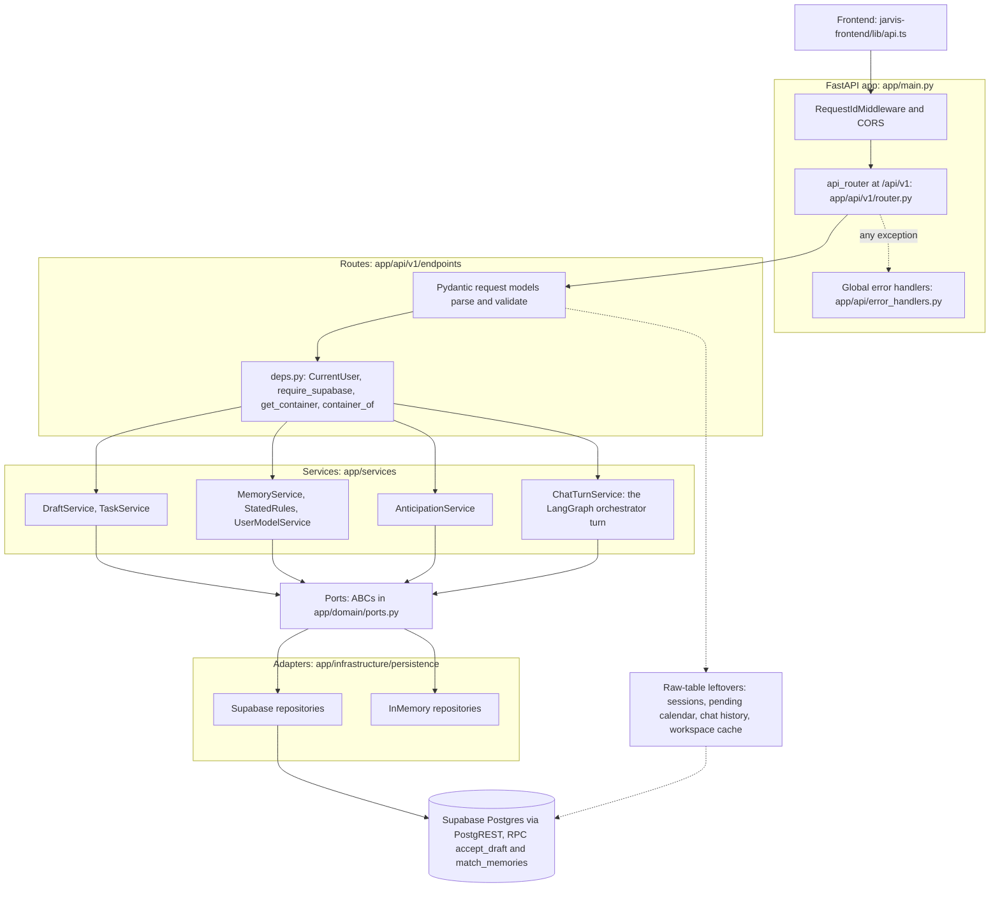
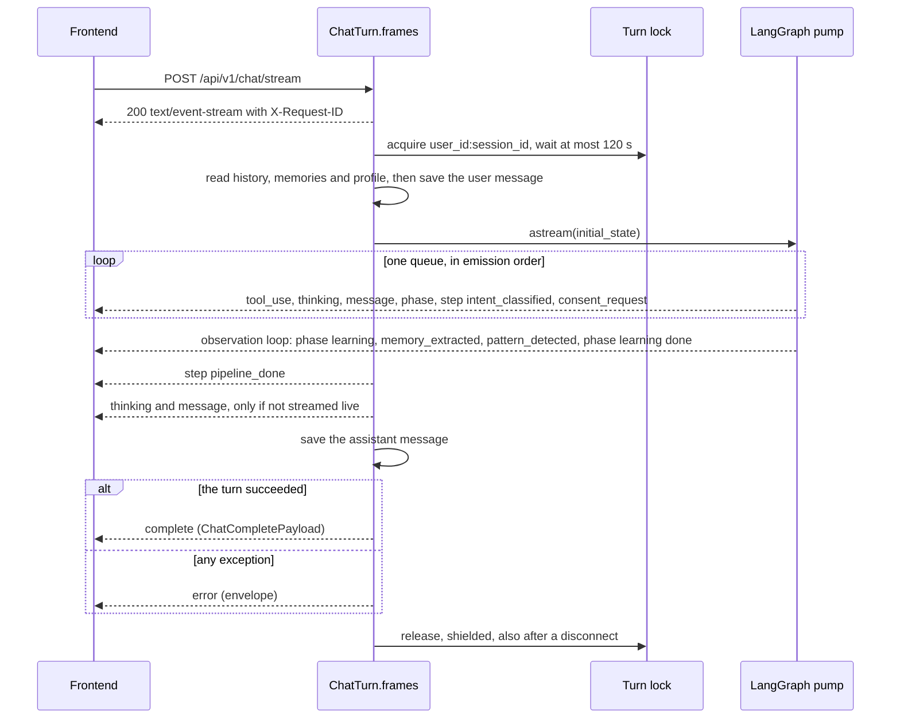

# 07 — API design

Jarvis's backend is a FastAPI application. Every route sits under `/api/v1`, except `/` and `/health`. The running server documents 49 operations on 43 paths in `GET /openapi.json`, none deprecated. All user interaction goes through one entry point, `POST /api/v1/chat/stream`. It is a server-sent-events (SSE) stream: frames show the turn's progress, learning frames say what Jarvis remembered and noticed, and one typed `complete` frame closes the turn. The REST resources around it cover the other actions: accepting a proposed plan (a draft), recording what happened to a task, seeing and correcting what Jarvis remembers, letting Jarvis make the first move with consent (anticipation), and managing documents and conversations. Every failed request returns one error envelope, `{"error": {"code", "message", "details", "request_id"}}`, over HTTP and inside the stream. Every JSON route declares a typed response model, and the OpenAPI document gives the envelope as the 422, 4XX and 5XX response of every operation. This document is written from the code at commit `d3e9132` (now part of `main`) and checked against the live `/openapi.json`. Where the two disagree it says so. §11 lists where the design spec and the code differ.

Owner: ______

---

## Contents

1. [Layering](#1-layering)
2. [Conventions](#2-conventions)
3. [The error envelope](#3-the-error-envelope)
4. [Shared response schemas](#4-shared-response-schemas)
5. [Endpoint catalogue](#5-endpoint-catalogue)
6. [The chat stream: SSE event catalogue](#6-the-chat-stream-sse-event-catalogue)
7. [How the frontend consumes the API](#7-how-the-frontend-consumes-the-api)
8. [Inconsistencies found while writing this document](#8-inconsistencies-found-while-writing-this-document)
9. [OpenAPI vs code](#9-openapi-vs-code)
10. [Retired in the restructure](#10-retired-in-the-restructure)
11. [Where the spec and the code differ](#11-where-the-spec-and-the-code-differ)
12. [How to verify this document](#12-how-to-verify-this-document)

---

## 1. Layering

A request passes through four layers, and each layer depends only on the one below it. `tests/test_layering.py` enforces the import direction: nothing below the API imports the API (`test_layering__nothing_below_the_api__imports_the_api`), and raw table calls are allowed only in six listed files (`_RAW_TABLE_CALLS_ALLOWED`, `tests/test_layering.py:451-462`).



| Layer | Responsibility | Where |
|---|---|---|
| **App shell** | Gives every request an id (`RequestIdMiddleware`: `request.state.request_id` and the `X-Request-ID` response header, exposed through CORS). CORS allows `localhost` and `127.0.0.1` on ports 3000 and 3001 only. Routes every exception to one envelope (`register_error_handlers`). `redirect_slashes=False`. `responses=ERROR_RESPONSES` documents the envelope on every operation. | `app/main.py:185-214`, `app/api/error_handlers.py:34-47, 197-202` |
| **Routes** | Routing and parsing only. A Pydantic model validates the body or query; a dependency resolves who is asking; the route calls a service and maps the result to its response model. No route raises `HTTPException` (`tests/test_api_contract.py::test_endpoints__raise_no_http_exception`). | `app/api/v1/endpoints/*.py` |
| **Dependencies** | `CurrentUser`: the **auth seam**. Today it reads a required `user_id` query parameter (1–128 characters); when auth lands, a verified JWT subject replaces it here, and every route that declares `user: CurrentUser` follows. `require_supabase`: the live client, or `PersistenceError` (503). Without the database the container falls back to in-memory repositories, which would answer "no memories" or "no suggestions" when the true answer is "can't tell". `get_container` / `container_of`: the composition root (`AppContainer`) the lifespan put on `app.state`. | `app/api/deps.py:16-51` |
| **Services** | Domain rules and transactions. Examples: `DraftService.accept` (atomic accept), `TaskService` (status compare-and-set plus one event), `MemoryService` (lifecycle), `AnticipationService` (triggers, consent, suggestions), `UserModelService` (the You page), `ChatTurnService` (one chat turn). | `app/services/` |
| **Ports → adapters** | ABC repositories, each with a Supabase and an InMemory implementation under one contract suite. Every method takes `user_id` first. | `app/domain/ports.py`, `app/infrastructure/persistence/` |

**Routes that follow the layering fully:** `memories`, `you`, `anticipation`, `drafts`, `tasks` (complete, skip, list), `habits` (trackers and rules) and `documents` (list, file, delete through `DocumentService`; the chunks read goes to ChromaDB, not a table).

**Routes that still reach the database directly.** These files are on the raw-table allow-list (`tests/test_layering.py:451-462`), each with its reason; Task 6 of the restructure (repositories for sessions and the pending calendar) was dropped:
- `sessions` (`chat_sessions`);
- `ingestion` pending-calendar routes (`pending_calendar_updates`), and `/ingestion/process` through `services/extraction/orchestrator.py` (its pending calendar row; a kept document goes through `DocumentService`);
- the workspace routes, through `workspace_builder.py` (`task_workspaces` cache only; the task and its documents come through repositories) and `user_preferences.py`;
- the chat stream's session and message writes (`app/services/chat_history.py`).

The pending-calendar handlers make synchronous supabase-py calls inside `async def` (`ingestion.py:208-218`), and the document chunks read calls ChromaDB the same way (`documents.py:137-142`), so each round trip blocks the event loop. The other documents routes go through `DocumentService`, whose repositories and file store run their calls on worker threads.

---

## 2. Conventions

### 2.1 Paths and methods

- **Resource-shaped paths, plural nouns:** `/tasks/{task_id}`, `/drafts/{draft_id}`, `/memories/{memory_id}`, `/sessions/{session_id}`, `/documents/{source_id}`, `/anticipation/suggestions/{suggestion_id}`.
- **State transitions are `POST` to a verb sub-resource:** `/drafts/{id}/accept`, `/drafts/{id}/reject`, `/tasks/{id}/complete`, `/tasks/{id}/skip`, `/memories/{id}/confirm`, `/memories/{id}/dismiss`, `/anticipation/suggestions/{id}/accept`, `/anticipation/suggestions/{id}/dismiss`, `/anticipation/run`. Each one is a move in a state machine (see `08-database-schema.md` §7), not a field update, so it is not a `PATCH`.
- `PATCH` edits fields (`/memories/{id}`, `/drafts/{id}/tasks/{task_id}`, `/you/settings`). `PUT` appears once (`/sessions/{id}`). `DELETE` removes, and what that means differs per resource (§8).
- **No route edits or deletes a task.** A task's row is written by draft acceptance alone (`app/api/v1/endpoints/tasks.py:1-7`).
- **Trailing slashes matter.** The app sets `redirect_slashes=False` (`app/main.py:188`), so `/api/v1/memories/` is a route and `/api/v1/memories` is a 404. Collection roots declared as `"/"` keep the slash: `/tasks/`, `/memories/`, `/sessions/`, `/documents/`. The newer `/you` does not.

### 2.2 Who is asking: three transports for `user_id`

| Transport | Validation | Routes |
|---|---|---|
| `CurrentUser` query parameter (the auth seam) | required, 1–128 chars | `/memories/*`, `/you`, `/you/settings`, `/anticipation/*`, `/habits/tracker/*`, `/ingestion/pending-calendar*` |
| Plain `user_id` query parameter | required, no length bounds | `GET /tasks/`, `/tasks/{id}/workspace` (GET, DELETE), `/drafts/{id}` (GET, DELETE), `PATCH /drafts/{id}/tasks/{task_id}`, `/habits/constraints*`, `/documents/*`, `/sessions/*` (GET, DELETE) |
| `user_id` field in the JSON body | required, no length bounds | `POST /chat/stream`, `POST /tasks/{id}/complete`, `/skip`, `POST /drafts/{id}/accept`, `/reject`, `/modify`, `/rearrange`, `PUT /sessions/{id}` |
| optional body field | — | `POST /ingestion/process` |
| none | — | `/reasoning/decompose-goal`, `/schedule/generate-schedule`, `/ingestion/ingest`, `/models/status`, `/`, `/health` |

Every query filters on `user_id`. Another user's row reads as absent and answers **404, never 403**, because a 403 would confirm that the row exists. Only the first transport goes through the auth seam. Moving the others onto `CurrentUser` is a follow-up (§11).

### 2.3 Naming vocabulary

The vocabulary is stated in `app/schemas/chat_stream.py:22-27` (module docstring):

- An id is named `<kind>_id` wherever the record is referred to: `draft_id`, `memory_id`, `message_id`, `task_id`. It is a bare `id` only on a list item that *is* the record (a suggestion, a rule).
- `conversation_id` is the chat session's id, the one the frontend sends back.
- Where a memory came from is `provenance`: `said` (the user's own words) or `inferred` (noticed from what happened).
- Work that did not happen is "set aside" in user-facing text, never anything that blames.

The places where this vocabulary is not yet followed are listed in §8.

### 2.4 Bounds and pagination

**No route paginates with a cursor or an offset.** Lists are bounded or capped, and PostgREST's `max_rows = 1000` (`supabase/config.toml:18`) silently caps every read. Repository reads are ordered newest first, so the cap can drop only the oldest rows.

| Route | Bound | Order |
|---|---|---|
| `GET /tasks/` | 500 (`TASK_LIST_LIMIT`, `app/domain/ports.py:51`) | newest `created_at` first |
| `GET /habits/tracker/due` | one check-in per rule in effect; 500 trackers read (`TRACKER_LIST_LIMIT`, `ports.py:53`) | due: the one waiting longest first; not due yet: the soonest first |
| `GET /habits/constraints` | the rules in effect (`list_active`), read newest first so the cap drops the oldest | newest first |
| `GET /memories/` | none beyond the 1000-row cap | oldest first |
| `GET /anticipation/suggestions` | 100 (`_LIST_LIMIT`, `app/services/anticipation/service.py:70`) | newest first |
| `GET /sessions/` | `limit` query, default 50, not range-checked | pinned first, then `updated_at` desc |
| `GET /sessions/{id}/messages` | `limit` query, default 100, not range-checked | the newest N, returned oldest first |
| `GET /sessions/{id}` | 100 messages, fixed | oldest first |
| `GET /documents/`, `GET /ingestion/pending-calendar` | none beyond the cap | newest first / unspecified |
| `GET /you` | the receipt reads 30 days of usage, 1000 rows a page, at most 20 pages; `truncated: true` if it stops early | — |

**Request bounds that are enforced:**

| Field | Bound | Model |
|---|---|---|
| `user_id` (via `CurrentUser`) | 1–128 chars | `app/api/deps.py:16-25` |
| `ChatStreamRequest.user_prompt` | ≤ 8,000 chars (`MAX_CHAT_PROMPT_CHARS`, `app/core/config.py:278`) | `app/schemas/chat_stream.py:57-59` |
| `ChatStreamRequest.file_base64`, `IngestionRequest.file_base64` | ≤ 10 MB decoded (`MAX_CHAT_UPLOAD_BYTES`, `config.py:279`), checked by `within_upload_limit` | `app/schemas/upload.py:16-27` |
| `ChatStreamRequest.media_type`, `IngestionRequest.media_type` | `"pdf"`, `"image"`, `"png"` or `"jpeg"` (`UploadMediaType`) | `upload.py:13` |
| `ChatStreamRequest.model_mode` | `"auto"`, `"cloud"`, `"gemini"` or `"4b"` (`ModelMode`) | `chat_stream.py:44, 77-85` |
| `IngestionRequest.file_name` | ≤ 255 chars (added after `d3e9132`) | `app/api/v1/endpoints/ingestion.py` |
| `TaskSkipRequest.reason` | ≤ 500 chars | `app/api/v1/endpoints/tasks.py:44-56` |
| `TaskCompleteRequest.quality` | 0–5 | `tasks.py:27-41` |
| `TaskCompleteRequest.actual_duration_minutes` | ≥ 1 | `tasks.py:37-41` |
| `GET /tasks/` `status` | a `TaskStatus` | `tasks.py:201-204` |
| `DraftTaskEdit.duration_minutes` | 1–25 | `app/schemas/draft.py:211-214` |
| `DraftTaskEdit.difficulty_weight` | 0–1 | `draft.py:215` |
| `DraftTaskEdit.start_min` | ≥ 0 | `draft.py:216-218` |
| `DraftAcceptRequest.expected_version` | ≤ 64 chars | `draft.py:87-95` |
| `MemoryEdit.content` | 1–2000 chars | `app/api/v1/endpoints/memories.py:86` |
| `SettingsUpdate.wake_time` | `HH:MM`, a real time of day | `app/api/v1/endpoints/you.py:88-90, 95-100` |
| `SettingsUpdate.timezone` | ≤ 64 chars, a known IANA zone | `you.py:91-93` |
| `SettingsUpdate` (whole model) | unknown keys rejected (`extra="forbid"`) | `you.py:80-83` |
| `RunTriggerRequest.trigger` | 1–64 chars, a registered name | `app/api/v1/endpoints/anticipation.py:109` |
| `ScheduleRequest` deep-work and task-duration caps | ranges as in the model | `app/api/v1/endpoints/schedule.py:23-65` |

**Not bounded:** `ChatStreamRequest.user_id`, `conversation_id` and `file_name`; `IngestionRequest.payload`; `DraftRejectRequest.reason`; `UpdateSessionRequest.title`; and the ids in paths, which are plain strings. A non-UUID id matches nothing in the repositories, which pre-check the form with `is_uuid` (for drafts, `supabase_repos.py:345`).

### 2.5 Idempotency and concurrency

| Operation | A repeated or concurrent call | Mechanism |
|---|---|---|
| `POST /drafts/{id}/accept` | The second accept answers **409 `invalid_state_transition`** and writes nothing. Two concurrent accepts, of the same draft or of two drafts of one user: exactly one wins. | `accept_draft()` locks the user's profile row, then the draft, then checks the status, in one transaction (`08-database-schema.md` §6.1) |
| `POST /drafts/{id}/accept` with `expected_version` | **409 `stale_version`** when the draft's tasks or slots changed since the read that gave that version; `details.draft` holds the latest draft; nothing is written | `check_version` (`app/services/draft_service.py:62-71`), run in `accept_on_time` and in `DraftService.accept`; the version is a hash of `tasks` and `schedule` (`app/domain/entities.py:359-368`) |
| `POST /drafts/{id}/reject` | 409 once the draft is closed | `DraftRepository.set_status` compare-and-set |
| `DELETE /drafts/{id}` | 409 once the draft is closed (the first call already expired it) | `DraftService.discard` (`draft_service.py:178-183`) |
| `POST /tasks/{id}/complete`, `/skip` | 200 again, with **no second event** | `TaskService`: compare-and-set on the status, then one append-only event |
| `DELETE /memories/{id}` | 200 again; forgetting a forgotten memory changes nothing | `MemoryService.forget` |
| `POST /memories/{id}/dismiss` | 200 again (no change); a forgotten memory gives 409 | `MemoryService.dismiss` |
| `POST /memories/{id}/confirm` | **Not idempotent**: each call reinforces the memory again (observation count, strength) | `MemoryService.confirm` |
| `POST /anticipation/suggestions/{id}/accept`, `/dismiss` | 409 once the suggestion is no longer pending | `move_suggestion` compare-and-set on the status |
| `POST /anticipation/run` | Once a day per trigger: the second run reports `already_done` with the existing suggestion. A manual repeat within 10 s returns the first run's outcome. | `AnticipationService.run_trigger`; `ANTICIPATION_MANUAL_COOLDOWN_SECONDS` (`app/core/config.py:194`) |
| `GET /habits/tracker/due` | Not read-only: the first read starts a tracker for each rule without one. Repeated or concurrent reads start **one tracker per rule**; later reads write nothing. | The repository reads before it inserts (`habit_trackers` has no unique key on `(user_id, constraint_id)`), and `RuleCheckIns` holds a per-user lock around it in the one server process |
| `POST /habits/tracker/{id}/complete` | **Not idempotent**: each call is another check-in and moves the next one | `RuleCheckIns.review` |
| `POST /chat/stream` | Turns on one conversation run one at a time. A turn that waits more than 120 s ends in an `error` frame with code `conflict`. | `app/services/turn_locks.py:24` (`TURN_LOCK_WAIT_SECONDS = 120.0`) |

### 2.6 Status codes

No route answers 400, 501 or 502 any more: malformed input is 422, and a model that fails or returns unusable output is 503.

| Status | When | Typical codes |
|---|---|---|
| **200** | Success. Also the stream's status: an error inside a turn arrives as an `error` frame. Also `POST /drafts/{id}/accept` with `status: "empty"` when the draft holds nothing schedulable. | — |
| **404** | Unknown id, or another user's id | `not_found`; `http_error` only for Starlette's own 404 on a path no route matches |
| **405** | A method no route declares on a known path (for example `DELETE /tasks/`, a retired route; `GET /tasks/` remains) | `http_error` (Starlette's) |
| **409** | State conflicts: a closed draft, a draft changed since it was read, a suggestion that is no longer pending, a lost compare-and-set, a task-id clash on accept, a draft whose every slot has begun, a queued turn timing out | `invalid_state_transition`, `stale_version`, `conflict`, `draft_outdated` |
| **413** | A body larger than any valid request on `POST /chat/stream` or `POST /ingestion/process` (about 14 MB: the largest file in base64 plus room for the message), refused from its `Content-Length` before it is read, or as soon as a chunked body passes the cap; no route runs (`BodyLimitMiddleware`, `app/api/request_limits.py:21-33, 38-96`) | `payload_too_large` |
| **422** | Request validation (Pydantic: a malformed body, a message over 8,000 characters, a file over 10 MB, an unknown `model_mode` or `media_type`) and domain validation (bad base64, a missing `media_type`, a draft modify with a component other than `tasks`, an empty draft edit). An infeasible plan on accept or on `/schedule/generate-schedule`. | `validation_error`, `schedule_infeasible` |
| **500** | A bug or an uncaught exception, answered with a fixed message; also a task workspace that could not be built | `internal_error` |
| **503** | A dependency is down or too slow: database, embedder, document reader, language model | `persistence_unavailable`, `embedding_unavailable`, `document_read_timeout`, `llm_unavailable`, `llm_timeout`, `llm_error`, `llm_output_parse`, `llm_refused` |

Consent is never an error. A step that needs the user's say-so reaches the client as the `consent_request` SSE frame (§6), and a suggestion that needs it is stored PENDING with `consent_behavior: "ask"` (`tests/test_api_contract.py::test_consent__is_data_not_an_exception`).

---

## 3. The error envelope

Every error response has one shape, whatever raised it: a `JarvisError`, request validation, an `HTTPException` (only Starlette's own, for an unknown path or method), or an exception nobody caught. The model is `ErrorResponse` (`app/schemas/errors.py:11-21`); the handlers are in `app/api/error_handlers.py:124-202`, and the chat stream sends the same model as its `error` frame.

```json
{
  "error": {
    "code": "invalid_state_transition",
    "message": "This draft is no longer open, so it cannot be accepted.",
    "details": {"draft_id": "6f1c…", "to": "accepted"},
    "request_id": "3b9e0c4f2a6d4e0f9a1b2c3d4e5f6a7b"
  }
}
```

| Field | Type | Meaning |
|---|---|---|
| `error.code` | string | stable, machine-readable |
| `error.message` | string | human-readable and safe to show; **never** the text of a lower-level exception |
| `error.details` | object \| null | structured context, such as field errors or the id involved |
| `error.request_id` | string | the same value as the `X-Request-ID` response header; logged with the cause |

**How each kind of exception is mapped:**

| Raised | HTTP status | `code` | `message` | `details` |
|---|---|---|---|---|
| `JarvisError` subclass | its `http_status` | its `code` | its `message` | its `details` |
| `RequestValidationError` | 422 | `validation_error` | `"The request is invalid."` | `{"errors": [{"loc", "msg", "type"}]}` (never `input` or `ctx`: no echo of the payload) |
| `HTTPException` with a string detail | its status | `http_error` | the detail | null |
| `HTTPException` with a structured detail | its status | `http_error` | the standard reason phrase | `{"detail": …}` |
| `HTTPException` 204, 205, 304 or < 200 | its status | — | no body (RFC 9110) | — |
| any other exception | 500 | `internal_error` | `"Something went wrong on our side."` | null; the cause is logged with the request id |

**The codes** (from `app/domain/errors.py`):

| Code | HTTP | Raised for (examples) |
|---|---|---|
| `validation_error` | 422 | a malformed body; a message or file over its limit; an unknown `model_mode`; bad base64; an unknown trigger name; an edit with nothing to change; an unknown timezone |
| `not_found` | 404 | an unknown or another user's task, draft, memory, suggestion, tracker, rule, session or document |
| `conflict` | 409 | a plan whose task ids clash with tasks the user finished; a queued chat turn that waited past 120 s; a suggestion whose plan no longer fits |
| `invalid_state_transition` | 409 | accepting, rejecting, editing or discarding a closed draft; confirming or editing a dismissed or forgotten memory; accepting an out-of-date suggestion |
| `stale_version` | 409 | an accept whose `expected_version` the draft no longer has; a compare-and-set lost three times; dismissing or accepting a suggestion that is no longer pending |
| `draft_outdated` | 409 | accepting a draft every one of whose slots has already begun |
| `schedule_infeasible` | 422 | accepting a partly-past draft whose remaining tasks no longer fit when re-solved from now; `/schedule/generate-schedule` when nothing fits |
| `persistence_unavailable` | 503 | the database cannot be reached, or the app has no client |
| `embedding_unavailable` | 503 | the text embedder could not run (for example, while editing a memory's words) |
| `document_read_timeout` | 503 | the document reader (Docling) did not finish an upload within 120 s, on `POST /ingestion/ingest` or `/ingestion/process` (`DocumentReadTimeoutError`, added after `d3e9132`) |
| `llm_error`, `llm_timeout`, `llm_unavailable`, `llm_output_parse`, `llm_refused` | 503 | the model chain failed; for example, the ingestion classifier is down (`llm_unavailable`), a goal decomposition is unusable (`llm_output_parse`), or the user's habits could not be read for the re-solve on accept |
| `http_error` | 404 / 405 | Starlette's own answer for a path or method no route declares |
| `internal_error` | 500 | anything else |

**Examples:**

```json
// 422 — POST /api/v1/tasks/t1/skip with {"user_id": "demo", "reason": "<501 characters>"}
{"error": {"code": "validation_error", "message": "The request is invalid.",
           "details": {"errors": [{"loc": ["body", "reason"],
                                   "msg": "String should have at most 500 characters",
                                   "type": "string_too_long"}]},
           "request_id": "…"}}

// 422 — POST /api/v1/chat/stream with a user_prompt of 8,001 characters (no turn starts)
{"error": {"code": "validation_error", "message": "The request is invalid.",
           "details": {"errors": [{"loc": ["body", "user_prompt"],
                                   "msg": "String should have at most 8000 characters",
                                   "type": "string_too_long"}]},
           "request_id": "…"}}

// 404 — POST /api/v1/memories/{id}/confirm?user_id=demo for someone else's memory
{"error": {"code": "not_found", "message": "That memory does not exist.",
           "details": {"memory_id": "…"}, "request_id": "…"}}

// 409 — the second POST /api/v1/drafts/{id}/accept
{"error": {"code": "invalid_state_transition",
           "message": "This draft is no longer open, so it cannot be accepted.",
           "details": {"draft_id": "…", "to": "accepted"}, "request_id": "…"}}

// 409 — POST /api/v1/drafts/{id}/accept with an expected_version the draft no longer has
{"error": {"code": "stale_version",
           "message": "This plan changed since you looked — here is the latest.",
           "details": {"draft_id": "…", "expected_version": "…", "version": "…",
                       "draft": {"draft_id": "…", "tasks": […], "schedule": {…}, "version": "…", …}},
           "request_id": "…"}}

// 409 — accepting a plan that reuses a finished task's id
{"error": {"code": "conflict", "message": "That plan clashes with tasks you already have.",
           "details": {"draft_id": "…"}, "request_id": "…"}}

// 503 — the database is down (GET /api/v1/you?user_id=demo)
{"error": {"code": "persistence_unavailable", "message": "Could not reach the database.",
           "details": null, "request_id": "…"}}
```

The `//` comments are labels only; the bodies are plain JSON. The messages are the literal strings in `app/services/memory/memory_service.py:581-583` (`_get`), `app/services/draft_service.py:59` (`PLAN_CHANGED`, with the latest draft added at `app/api/v1/endpoints/drafts.py:114-119`), `app/infrastructure/persistence/_mapping.py:147-155` (`task_id_clash`), `supabase_repos.py:438-442` (`accept_atomic`) and `app/api/deps.py:31-37` (`require_supabase`).

Every body a client receives on an error is this envelope; `tests/test_api_contract.py::test_endpoints__no_ad_hoc_error_bodies` checks that no route builds an error body of its own.

---

## 4. Shared response schemas

Field tables are taken from the Pydantic models and agree with `/openapi.json` `components.schemas`. In the "Req" column, "yes" means the field is always present in responses; fields with a default are present too.

### 4.1 `MemoryOut` (`app/api/v1/endpoints/memories.py:26`)

| Field | Type | Req | Meaning |
|---|---|---|---|
| `memory_id` | string | yes | the memory's id |
| `memory_type` | `fact` \| `preference` \| `behavioral_pattern` \| `temporal_event` \| `goal` \| `feedback` \| `constraint` | yes | |
| `content` | string | yes | |
| `confidence` | number | yes | 0–1 |
| `provenance` | `said` \| `inferred` | yes | |
| `freshness` | number | yes | strength now (`Memory.strength_at(now)`) |
| `noted_at` | date-time | yes | the entity's `created_at` |
| `last_confirmed_at` | date-time \| null | yes | |
| `observation_count` | integer | yes | |
| `pattern_key` | string \| null | yes | |

### 4.2 `SuggestionOut`, `ConsentOut`, `ActionResultOut` (`app/api/v1/endpoints/anticipation.py:33, 95, 75`)

| `SuggestionOut` field | Type | Meaning |
|---|---|---|
| `id` | string | suggestion id |
| `trigger` | string | `morning_brief` or `pattern_rule` today |
| `kind` | string | |
| `title`, `body` | string | |
| `status` | `pending` \| `accepted` \| `dismissed` \| `expired` \| `auto_applied` | |
| `consent_behavior` | `allow` \| `ask` \| `deny` | |
| `consent_kind` | `rule_match` \| `mode_decision` \| `risk_check` \| `learned_preference` \| null | null on older rows |
| `consent_reason` | string | the reason, in words the user can read |
| `created_at` | date-time | |
| `expires_at` | date-time \| null | |
| `details` | object | the stored action, column `action` (named `details` on the wire; see §8) |

| `ConsentOut` field | Type |
|---|---|
| `behavior` | `allow` \| `ask` \| `deny` |
| `kind` | `ConsentReasonKind` |
| `message` | string |

| `ActionResultOut` field | Type |
|---|---|
| `kind` | string |
| `message` | string |
| `tasks_written` | integer \| null |
| `draft_id` | string \| null |

### 4.3 The You page models (`app/api/v1/endpoints/you.py:27, 49`, `app/services/user_model_service.py:75, 106, 128`, `app/domain/entities.py:594, 607`)

`YouResponse` is `{profile: YouProfile, patterns: PatternShown[], rules: RuleShown[], memories: MemoryOut[], focus: FocusProfile, receipt: PrivacyReceipt, streak_days: integer ≥ 0}`. `streak_days` is the number of consecutive days, on the user's clock, with at least one task completed, read from the outcome history. A streak is not broken until the local day ends: with nothing done yet today it counts back from yesterday (`you.py:70-77`).

| `YouProfile` | Type | `PatternShown` | Type | `RuleShown` | Type |
|---|---|---|---|---|---|
| `display_name` | string \| null | `memory_id` | string \| null | `id` | string |
| `timezone` | string | `pattern_key` | string | `text` | string |
| `wake_time` | string `HH:MM` | `detector` | string | `provenance` | `said` \| `inferred` |
| `autonomy_mode` | `AutonomyMode` | `description` | string | `created_at` | date-time \| null |
| | | `confidence` | number | | |
| | | `occurrences` | integer | | |
| | | `evidence` | string[] (≤ 5, newest first) | | |
| | | `confirmed` | boolean | | |

| `FocusProfile` | Type | `HourFocus` | Type | `PrivacyReceipt` | Type |
|---|---|---|---|---|---|
| `source` | `prior` \| `learned` | `hour` | 0–23 | `since` | date-time |
| `observations` | integer ≥ 0 | `score` | 0–1 | `truncated` | boolean |
| `hours` | exactly 24 `HourFocus`, index = hour | `done` | integer ≥ 0 | `on_device_calls` | integer |
| | | `not_done` | integer ≥ 0 | `cloud_calls` | integer |
| | | | | `pii_redactions` | integer |
| | | | | `input_tokens` | integer |
| | | | | `output_tokens` | integer |

### 4.4 Draft models (`app/schemas/draft.py`)

| `DraftStateResponse` (`draft.py:39`) | Type | Meaning |
|---|---|---|
| `draft_id` | string | `draft_schedules.id` |
| `user_id` | string | |
| `goal_id` | string \| null | |
| `tasks` | object[] | the proposed task chunks |
| `horizon_start` | string \| null | ISO minute 0 (08:00 on the user's clock) |
| `status` | `DraftStatus` | `pending` / `modified` (open), `accepted` / `rejected` / `expired` / `superseded` (closed) |
| `rejection_reason` | string \| null | |
| `created_at` | string \| null | |
| `schedule` | `DraftScheduleView` \| null | null when no slots were stored |
| `version` | string | what this read saw, as one opaque value (16 hex characters of a SHA-256 over the draft's `tasks` and `schedule`, `entities.py:359-368`); send it back as the accept's `expected_version` |

| `DraftScheduleView` (`draft.py:27`) | Type | `DraftSlot` (`draft.py:11`) | Type |
|---|---|---|---|
| `horizon_start` | string | `task_id` | string |
| `schedule` | map `task_id → DraftSlot` | `title` | string \| null |
| | | `start_min`, `end_min` | integer (minutes from `horizon_start`) |
| | | `start`, `end` | date-time, with the offset of the user's zone |
| | | `duration_minutes` | integer |

| `DraftAcceptRequest` (`draft.py:76`) | Type | Meaning |
|---|---|---|
| `user_id` | string, required | body transport (§2.2) |
| `components` | string[] \| null | ignored; a draft is accepted whole |
| `expected_version` | string \| null, ≤ 64 chars | the `version` of the read the user acted on; omitted: no check |

| `DraftAcceptResponse` (`draft.py:98`) | Type | Meaning |
|---|---|---|
| `status` | `accepted` \| `empty` | `empty`: nothing in it could be scheduled, and nothing was written |
| `draft_id` | string | |
| `task_count` | integer ≥ 0 | tasks written |
| `moved` | boolean | true when some times had already gone by and were re-solved from now |
| `message` | string \| null | what to tell the user when `moved` |

The edit responses: `DraftRejectResponse {status: "rejected", draft_id}` (`draft.py:118`); `DraftEditResponse {status: "modified", draft_id, component?, task_id?, updated_draft?}` (`draft.py:125`), shared by modify and edit-one-task with `response_model_exclude` keeping each route's keys (`drafts.py:171-174, 204-207`); `DraftRearrangeResponse {status: "rearranged", draft_id, task_count, needs_resolve}` (`draft.py:139`); `DraftDiscardResponse {status: "discarded", draft_id}` (`draft.py:150`).

### 4.5 Task models (`app/api/v1/endpoints/tasks.py`)

| `TaskResponse` (`tasks.py:68`) | Type | Meaning |
|---|---|---|
| `task_id` | string | |
| `status` | string | `completed`, `skipped`, or the task's current status when a skip changed nothing |
| `message` | string | user-facing text without blame |
| `replan_triggered` | boolean | always `false`: no task route starts a re-plan |

`TaskListResponse` (`tasks.py:59`) is `{tasks: Task[], count}`. Each row is the `Task` entity (`app/domain/entities.py:275`): `id`, `user_id`, `task_id`, `goal_id`, `plan_id`, `title`, `duration_minutes`, `difficulty_weight`, `status`, `dependencies`, `scheduled_start`, `scheduled_end`, `deadline_hint`, `not_before`. Columns the entity does not model are not returned.

---

## 5. Endpoint catalogue

Generated from the live `/openapi.json` (49 operations) and the Pydantic models. The "Use case" lines name the user goal each route serves. UC1–UC8 are the use cases of `01-requirements.md`; routes that serve no numbered use case say what they support. "CU" means the route resolves the user through `CurrentUser`. Every operation also documents `ErrorResponse` for 422, 4XX and 5XX; the Errors column lists what each route actually raises.

### 5.1 Chat (the entry point)

#### `POST /api/v1/chat/stream` — talk to Jarvis (SSE)

**Use case:** UC1 (plan from a brain dump), UC3 (teach a rule and re-plan), UC5 (remember a fact), and UC2 when the plan is accepted in words. It also carries document uploads and resuming a conversation (`since_last_spoke`).

**Request:** `ChatStreamRequest` (`app/schemas/chat_stream.py:49-87`), JSON body. The handler reads every field.

| Field | Type | Notes |
|---|---|---|
| `user_prompt` | string, required, ≤ 8,000 chars | the message |
| `user_id` | string, required | body transport (§2.2) |
| `conversation_id` | string \| null | the session to continue. Unknown, or another user's: a new session is created (`chat_history.get_or_create_session`). |
| `file_base64` | string \| null, ≤ 10 MB decoded | a document for the knowledge module |
| `media_type` | `pdf` \| `image` \| `png` \| `jpeg` \| null | |
| `file_name` | string \| null | |
| `model_mode` | `auto` \| `cloud` \| `gemini` \| `4b`, default `auto` | `cloud`, `gemini` and `4b` put every model call of the turn on the cloud providers (`CLOUD_MODEL_MODES`, `app/services/chat_turn/service.py:45`); `auto` is local first. Any other value, `"27b"` included, is a 422. |

**Response:** `200 text/event-stream` (`EventStreamResponse`, `app/api/sse.py:31-38`) with headers `Cache-Control: no-cache`, `X-Accel-Buffering: no`, `Connection: keep-alive` and `X-Request-ID`. The frames are in §6. The last frame is one `complete` (`ChatCompletePayload`) or one `error` (the envelope). The router is routing and parsing only (`app/api/v1/endpoints/chat.py:22-56`): it opens the turn with `ChatTurnService.for_app(app.state).open_turn(...)` and streams `turn.frames()`; `turn.finish` runs as the response's background task.

**Errors:**
- Before the stream starts, as a JSON envelope: 422 `validation_error` for a malformed body, a message over 8,000 characters, a file over 10 MB decoded, or an unknown `model_mode` or `media_type`. No turn starts and the input is not echoed (`tests/test_chat_turn.py::test_chat_stream__request_over_a_limit__422_envelope_and_no_turn`, `tests/test_api_contract.py::test_chat_stream__unknown_model_mode__422_envelope`, `::test_chat_stream__unknown_media_type__422_envelope`).
- After it starts: an `error` frame (§6.4). The HTTP status stays 200.

### 5.2 Drafts — proposed plans

Every draft route goes through the composition root's `DraftService` (`app/api/v1/endpoints/drafts.py:49-54`); with no container on `app.state` it answers 503 `persistence_unavailable`. A missing draft, or another user's, is 404 `not_found` "That draft does not exist." (`draft_service.py:125-130`).

| Method + path | Purpose | Request | Response | Errors |
|---|---|---|---|---|
| `GET /drafts/{draft_id}?user_id=` | Read a draft with its solved slots and its `version` | — | `DraftStateResponse` | 404; 503 |
| `POST /drafts/{draft_id}/accept` | **Accept the plan.** The only REST path that writes `user_tasks`. One atomic call writes the tasks, marks the draft accepted and supersedes the user's other open drafts. A partly-past draft is re-solved from now first (`moved`). | `DraftAcceptRequest {user_id, components?, expected_version?}` | `DraftAcceptResponse` | 404; 409 `invalid_state_transition` (closed: second accept, rejected, superseded, expired); 409 `stale_version` (changed since `expected_version` was read; `details.draft` is the latest); 409 `draft_outdated` (every slot begun); 409 `conflict` (task-id clash); 422 `schedule_infeasible` (re-solve found no room; draft stays open); 503 `llm_unavailable` (habits unreadable for the re-solve); 503 `persistence_unavailable` "The schedule could not be saved. The draft is still open; try again." |
| `POST /drafts/{draft_id}/reject` | Reject. A non-blank `reason` is also remembered as a `feedback` memory, origin `draft_rejection`. | `DraftRejectRequest {user_id, components?, reason?}` (`components` ignored) | `DraftRejectResponse` | 404; 409 `invalid_state_transition`; 503 |
| `POST /drafts/{draft_id}/modify` | Replace the task list; the status becomes `modified` | `DraftModifyRequest {user_id, component: "tasks", data: object[]}` | `DraftEditResponse` (`status`, `component`, `draft_id`) | 422 `validation_error` (component ≠ `tasks`, or `data` not a list); 404; 409 `invalid_state_transition` |
| `PATCH /drafts/{draft_id}/tasks/{task_id}?user_id=` | Edit one task | `DraftTaskEdit {title?, duration_minutes? (1–25), difficulty_weight? (0–1), start_min? (≥ 0)}` | `DraftEditResponse` (`status`, `draft_id`, `task_id`, `updated_draft`) | 422 `validation_error` (out of bounds, or "No edits provided."); 409 `invalid_state_transition` (a closed draft, checked before the task); 404 "That task is not in this draft." |
| `POST /drafts/{draft_id}/rearrange` | Reorder tasks; ids not mentioned keep their relative place at the back | `DraftRearrangeRequest {user_id, task_order: string[]}` | `DraftRearrangeResponse` (`needs_resolve: true`; no re-solve runs) | 404; 409 |
| `DELETE /drafts/{draft_id}?user_id=` | **Discard**: the draft becomes `expired`; its row stays | — | `DraftDiscardResponse` | 404; 409 `invalid_state_transition` (already closed) |

**Use case:** UC2 (accept a plan atomically).

### 5.3 Tasks — outcomes

Every task route first requires the database (`require_supabase`, `tasks.py:116, 150, 207`): on the in-memory fallback every task would be unknown, and a 404 would tell the user the task is gone.

| Method + path | Purpose | Request | Response | Errors |
|---|---|---|---|---|
| `POST /tasks/{task_id}/complete` | Record **done**, from `pending`, `missed` or `skipped`. One `completed` event carries the quality and actual duration in its metadata. | `TaskCompleteRequest {user_id, quality: 0–5 = 3, actual_duration_minutes? ≥1}` | `TaskResponse` (`status: "completed"`) | 404 `not_found`; 409 `stale_version`; 503 `persistence_unavailable` |
| `POST /tasks/{task_id}/skip` | **Set aside** a pending task. One `skipped` event carries the reason. The message suggests today's buffer or tomorrow morning; nothing is re-placed. | `TaskSkipRequest {user_id, reason? ≤500}` | `TaskResponse` (`status: "skipped"`, or the current status with "already done / set aside, so nothing changed") | 404; 409; 503 |
| `GET /tasks/?user_id=&status=` | The user's tasks, newest first, at most 500; `status` filters to one `TaskStatus` | — | `TaskListResponse {tasks: Task[], count}` | 422 (unknown status); 503 |
| `GET /tasks/{task_id}/workspace?user_id=&prompt=&refresh=false` | The proactive workspace (RAG chunks, links, practice, WOOP card); cached 24 h. Links, and practice links when the task has no document chunks, come only from Gemini's web search; when it fails, `notices` says "Web results are unavailable right now, so no links are shown", the workspace is not cached, and the search is not tried again for 5 minutes. Its database reads still block the event loop (a raw-table leftover) | — | `TaskWorkspace {task_id, task_title, primary_objective, surfaced_assets: StudyAsset[], woop_card: WoopCard \| null, notices: string[], linked_documents: LinkedDocument[]}` (`app/schemas/workspace.py:55`). `linked_documents` (`{source_id, file_name: string \| null, has_file: boolean}`, `app/schemas/documents.py`) are the user's documents linked to the task, read through `DocumentService.linked_documents` on every request after the cache (never cached), `[]` when there are none or they cannot be read | 422 `validation_error` (empty `user_id`); 500 `internal_error` "Could not build the task workspace."; a `JarvisError` passes through with its own status (`app/api/v1/endpoints/workspace.py:39-62`) |
| `DELETE /tasks/{task_id}/workspace?user_id=` | Drop the cached workspace | — | `WorkspaceInvalidated {status: "invalidated"}` (`workspace.py:19`) | — (a failed delete is swallowed) |

**Use case:** UC4 (complete or skip a task). The workspace routes support preparing for a task (no numbered use case).

### 5.4 Memories — what Jarvis remembers (CU)

Every route first requires the database (503). Another user's memory is a 404.

| Method + path | Purpose | Request | Response | Errors |
|---|---|---|---|---|
| `GET /memories/?user_id=&memory_type=` | Memories in use: active, not superseded, not expired, at least 0.1 strong | — | `MemoryListResponse {memories: MemoryOut[], count}` (oldest first) | 422 (bad `memory_type`); 503 |
| `PATCH /memories/{memory_id}?user_id=` | Change words and/or type; new words are embedded again | `MemoryEdit {content? 1–2000, memory_type?}` (at least one) | `MemoryOut` | 404; 409 `invalid_state_transition` (dismissed or forgotten); 422; 503 `embedding_unavailable` |
| `DELETE /memories/{memory_id}?user_id=` | **Forget for good.** The words are erased and a tombstone keeps the embedding and `pattern_key`, so the same fact is not stored again. Rules the memory was the saying of are deleted with it. | — | `ForgetResponse {status: "forgotten", forgotten_rule_ids: string[]}` | 404; 503 |
| `POST /memories/{memory_id}/confirm?user_id=` | "It holds": reinforce it, confidence ≥ 0.9, `last_confirmed_at = now` | — | `MemoryOut` | 404; 409; 503 |
| `POST /memories/{memory_id}/dismiss?user_id=` | "It doesn't hold": hidden for good, words kept; a rule resting on it goes too | — | `MemoryOut` | 404; 409 (forgotten); 503 |

**Use case:** UC5 (remember or forget a fact), UC8 (review what Jarvis knows).

### 5.5 You — the user model and the privacy receipt (CU)

| Method + path | Purpose | Request | Response | Errors |
|---|---|---|---|---|
| `GET /you?user_id=` | Everything Jarvis knows, in one read: profile, the patterns PEARL sees (with evidence), rules, memories in use, the focus profile, the privacy receipt for the last 30 days, and the completion streak. It looks for new patterns first and asks no model. | — | `YouResponse` (§4.3) | 503 |
| `PATCH /you/settings?user_id=` | Change `autonomy_mode`, `wake_time`, `timezone`; fields left out stay as they are | `SettingsUpdate` (`extra="forbid"`) | `YouProfile` | 422 (unknown key, bad time, unknown zone; nothing changes); 503 |

**Usage** has no resource of its own. The usage ledger (`llm_usage_events`) is exposed only as `GET /you` → `receipt`.

**Use case:** UC8 (review "what Jarvis knows about you", including the autonomy setting and the privacy receipt).

### 5.6 Anticipation — Jarvis makes the first move (CU)

| Method + path | Purpose | Request | Response | Errors |
|---|---|---|---|---|
| `GET /anticipation/suggestions?user_id=&status=pending` | Suggestions in one status, newest first, at most 100. A pending suggestion past `expires_at` is not listed. | — | `SuggestionListResponse {suggestions: SuggestionOut[]}` | 422 (bad status); 503 |
| `POST /anticipation/suggestions/{id}/accept?user_id=` | Claim the suggestion and run its action once: `apply_plan` accepts its draft, `adopt_rule` stores a rule and proposes a re-plan draft, `share_insight` | — | `AcceptSuggestionResponse {suggestion: SuggestionOut, result: ActionResultOut}` | 404; 409 `stale_version` (not pending); 409 `invalid_state_transition` (out of date: marked expired); 409 `conflict` (its plan no longer fits: marked expired); 422 `validation_error` (unknown action kind); 503 |
| `POST /anticipation/suggestions/{id}/dismiss?user_id=` | Dismiss; the same suggestion (its `dedupe_key`) is never made again | — | `SuggestionOut` | 404; 409 `stale_version`; 503 |
| `GET /anticipation/triggers?user_id=` | Registered triggers | — | `TriggerListResponse {triggers: [{name, description}]}` (today `morning_brief`, `pattern_rule`) | 503 |
| `POST /anticipation/run?user_id=` | Run a trigger now, even if it is not due; once a day still holds | `RunTriggerRequest {trigger: 1–64}` | `RunTriggerResponse {status: created \| already_done \| not_due \| nothing_to_say \| denied, suggestion: SuggestionOut \| null, consent: ConsentOut \| null}` | 422 (unregistered name; `details.known` lists the names); 503 |

**Use case:** UC6 (morning brief and accept), UC7 (pattern to rule proposal).

### 5.7 Habits and rules

Every route first requires the database (`require_supabase`). Check-ins go through the container's `RuleCheckIns` (`app/services/analytical/rule_check_ins.py`), rules through its `ConstraintRepository` and `StatedRules` (`app/api/v1/endpoints/habits.py:1-7`). A habit tracker follows one rule: a check-in asks "Still how you work?", and SM-2 spaces the next one out while the rule holds (1 day, 6 days, then the interval times the easiness); an answer under 3 brings it back the next day. The response models are in `app/schemas/habits.py`.

| Method + path | Purpose | Request | Response | Errors |
|---|---|---|---|---|
| `POST /habits/tracker/{tracker_id}/complete?user_id=` (CU) | Answer a check-in on one of the user's rules (an SM-2 review) | `TrackerCompleteRequest {quality: 0–5}` | `CheckInReviewed {next_review_date (UTC), next_interval_days ≥ 1, next_due_on (a date on the user's clock)}` | 404 `not_found` "That tracker does not exist." (another user's too); 503 |
| `GET /habits/tracker/due?user_id=` (CU) | Every rule in effect with its check-in, split by whether it is due today or earlier, by dates in the user's zone. A rule with no tracker gets one here, counting from when it was learned (its first check-in is due the day after), so this read may write once per rule. A tracker whose rule is gone is never listed. | — | `RuleCheckInList {timezone, today, due_trackers: RuleCheckIn[], upcoming_trackers: RuleCheckIn[]}`, each `RuleCheckIn {id (the tracker), constraint_id (the rule), rule_text, source: said \| inferred, learned_at \| null, last_reviewed_at \| null, next_due_on, interval_days}` | 503 |
| `GET /habits/constraints?user_id=` | The user's rules in effect, newest first: the same list the You page shows (a rule past its validity window is in neither) | — | `ConstraintListResponse {constraints: ConstraintOut[]}`, each `{id, raw_text, constraint_type, created_at}` (`habits.py:47, 67`) | 503 `persistence_unavailable` |
| `DELETE /habits/constraints/{constraint_id}?user_id=` | Delete a rule and its check-ins (the tracker goes first). A rule stated in chat takes the memory of stating it with it (forgotten). | — | `ConstraintDeleteResponse {status: "deleted", id}` (`habits.py:73`) | 404 `not_found`; 503 |

**Use case:** UC3 (teach a rule, and confirm it still holds); letting a rule go again (UC5/UC8 from the You page or the Habits page).

### 5.8 Documents and ingestion

| Method + path | Purpose | Request | Response | Errors |
|---|---|---|---|---|
| `GET /documents/?user_id=` | Ingested documents, newest first, each with `has_file` (its file is kept and opens) and `linked_tasks` (the tasks it is linked to that the user still has, with titles); `linked_task_ids` repeats their ids for older clients. One read each of the records, the links and the tasks, and one listing of the user's stored files; if the links, tasks or file store cannot answer, the documents are still listed, without them | — | `DocumentListResponse {documents: DocumentOut[]}`, `DocumentOut {source_id, id, user_id, file_name, media_type, document_topics, chunk_count, created_at, has_file: boolean, linked_tasks: {task_id, title}[], linked_task_ids: string[]}` (`app/schemas/documents.py`) | 503 `persistence_unavailable` (no database, or the records cannot be read) |
| `GET /documents/{source_id}/file?user_id=` | The uploaded file itself, as raw bytes with the content type it was uploaded as, `Content-Disposition: inline; filename="…"` (the uploaded name with any folder part, quotes, semicolons and control characters removed; RFC 6266 `filename*` added for a non-ASCII name), `X-Content-Type-Options: nosniff`, `Cache-Control: private, no-store` | — | the file's bytes (not JSON; with the chat stream, the one untyped route, `tests/test_api_contract.py`) | 404 `not_found` "Document not found." (not the caller's) or "This document's file was not kept, so it cannot be opened." (pasted text, or an upload whose file could not be stored); 503 `persistence_unavailable` (no database, or the file store cannot be reached) |
| `DELETE /documents/{source_id}?user_id=` | Delete the user's ChromaDB chunks, task links, record and stored file; the linked tasks' cached workspaces are dropped | — | `DocumentDeleteResponse {status: "deleted", source_id}` | 404 `not_found` "Document not found."; 503 |
| `GET /documents/{source_id}/chunks?user_id=` | The user's text chunks for a document | — | `DocumentChunksResponse {source_id, chunks: string[], count}` | 503 `persistence_unavailable` |
| `POST /ingestion/ingest` | Classify text or a file (no user, nothing stored) | `IngestionRequest {payload = "", file_base64? (≤ 10 MB), media_type?, file_name? (≤ 255)}` (`app/api/v1/endpoints/ingestion.py:51`) | `IntentClassification {intent: IntentType, confidence: 0–1, summary}` (`app/schemas/context.py:34`) | 422 `validation_error` (no input, bad base64, missing `media_type`, oversized file); 503 `document_read_timeout` (the file took more than 120 s to read); 503 `llm_unavailable` "Could not classify the payload. Try again shortly." |
| `POST /ingestion/process` | Full extraction pipeline: classify, then route to calendar, knowledge, behavioural or action extraction. Rules, tasks, goals and documents go through the container, only when there is a database. A kept document's row stores `file_name`, so the document list shows the file's own name; an uploaded file is kept too, and the document is linked to the user's pending tasks it fits (`knowledge_result.linked_task_ids`). | `ProcessIngestionRequest {payload, file_base64?, media_type?, file_name? (≤ 255), user_id?}` (`ingestion.py:155`) | `IngestionPipelineResult {intent, classification_summary, calendar_result?, pending_calendar_id?, knowledge_result?, behavioral_result?, action_proposal?}` (`app/schemas/context.py:234`) | 422 `validation_error`; 503 `document_read_timeout`; other errors from the pipeline propagate |
| `GET /ingestion/pending-calendar?user_id=` (CU) | Timetable extractions awaiting approval | — | `PendingCalendarListResponse {pending: PendingCalendarOut[]}` (`ingestion.py:71, 87`) | 503 |
| `POST /ingestion/pending-calendar/{pending_id}/approve?user_id=` (CU) | Approve one; returns the slots for scheduling | — | `PendingCalendarApproved {status: "approved", daily_context: TimeSlot[]}` | 404 `not_found` (also when already processed); 503 |
| `POST /ingestion/pending-calendar/{pending_id}/reject?user_id=` (CU) | Reject one | — | `PendingCalendarRejected {status: "rejected"}` | 404; 503 |

**Use case:** supports ingestion of documents and timetables (no numbered use case).

**What is kept of an upload.** Its text chunks (in ChromaDB), one `ingested_documents` row (name, media type, topics, chunk count), and the file itself, in the private Supabase Storage bucket `jarvis-documents` at `{user_id}/{source_id}` with its content type (`DocumentFileStore`; the bucket is created on first use, limited to 10 MB, the largest upload ingestion accepts). The key is derived from the row, so no column records it (`s3_key` is unused). Keeping the file is best effort: if the store fails, the document is kept without it (`has_file: false`) and the failure is logged. Reading a file runs on a worker thread, one document at a time, for at most 120 s (`read_document`, `app/utils/docling_helper.py`).

**Linking documents and tasks.** A document is linked to a task when one of its topics, or the subject in its file name ("DBMS unit 3 notes.pdf" gives "DBMS"), is within cosine similarity 0.52 of the task's title (`DOCUMENT_LINK_SIMILARITY`, measured on the local sentence model). Both directions: a new document is linked to the user's pending tasks when it is kept, and the tasks an accepted plan writes are linked to the user's documents right after the accept commits (`DocumentLinkListener` on `DraftAccepted`; a failure there is logged and never fails the accept). A change to a task's links drops its cached workspace.

### 5.9 Sessions — conversations

| Method + path | Purpose | Request | Response | Errors |
|---|---|---|---|---|
| `GET /sessions/?user_id=&limit=50` | Non-archived sessions, pinned first | — | `SessionListResponse {sessions: SessionSummary[]}` (`app/api/v1/endpoints/sessions.py:28, 63`) | **none**: without a client, or on a failure, it returns `{"sessions": []}` |
| `GET /sessions/{session_id}/messages?user_id=&limit=100` | The newest N messages, oldest first | — | `SessionMessagesResponse {messages: SessionMessage[]}` | 503 `persistence_unavailable` without a client; a failed query returns `[]` |
| `GET /sessions/{session_id}?user_id=` | The session row and its newest 100 messages | — | `SessionDetailResponse {session: SessionRecord, messages: SessionMessage[]}` | 404 `not_found` "Session not found."; 503 |
| `PUT /sessions/{session_id}` | Rename, archive, pin | `UpdateSessionRequest {user_id, title?, is_archived?, is_pinned?}` (`sessions.py:159`) | `SessionUpdateResponse {status: "updated" \| "no_changes", session_id}` | 503. An unknown session still answers `updated`. |
| `DELETE /sessions/{session_id}?user_id=` | **Archive** (soft delete) | — | `SessionArchiveResponse {status: "archived", session_id}` | 503. No 404. |
| `DELETE /sessions/?user_id=` | Archive all | — | `SessionsArchivedResponse {status: "archived", archived_count}` | 503 |

**Use case:** supports resuming a conversation (no numbered use case).

### 5.10 Planning tools (stateless)

| Method + path | Purpose | Request | Response | Errors |
|---|---|---|---|---|
| `POST /reasoning/decompose-goal` | Break a goal into tasks of at most 25 minutes (local model first, cloud fallback) | `{"user_prompt": string}` (embedded body) | `ExecutionGraph {goal_metadata: GoalMetadata, decomposition: TaskChunk[] (≥1), cognitive_load_estimate: {str: number}}` (`app/schemas/decomposition.py:150`) | 503 `llm_output_parse` (fewer than 5 tasks, or unparseable; `app/api/v1/endpoints/reasoning.py:150-162`); 503 `llm_*` |
| `POST /schedule/generate-schedule` | A deterministic OR-Tools schedule for an `ExecutionGraph` | `ScheduleRequest {graph, daily_context: TimeSlot[], horizon_minutes = 2880, plan_start?, max/min_daily_deep_work_minutes?, max/min_task_duration_minutes?}` (`schedule.py:23`) | `GenerateScheduleResponse {status: FEASIBLE \| OPTIMAL, schedule: {task_id: ScheduledTask}, goal_metadata, horizon_start}` (`app/schemas/schedule.py:15, 24`) | 422 `schedule_infeasible` "Schedule infeasible; consider reducing scope or extending deadline." (`run_schedule`, `app/services/planning/scheduling.py:327-329`) |

`TaskChunk` fields (`decomposition.py:41`): `task_id`, `title`, `duration_minutes` (1–25), `difficulty_weight` (0–1), `dependencies`, `completion_criteria`, `implementation_intention?` (`{obstacle_trigger, behavioral_response}`), `deadline_hint?`, `not_before?` (the earliest start, when the goal says when to do the work). `ScheduledTask`: `start_min`, `end_min`, `tmt_score`, `title?`.

### 5.11 System

| Method + path | Response | Errors |
|---|---|---|
| `GET /` | `RootResponse {message: "Hello, Jarvis this side."}` (`app/main.py:217`) | — |
| `GET /health` | `HealthResponse {status: "healthy", database: "connected"}` (`main.py:221`). The probe reads `user_tasks` (`app/db/supabase_py.py:116`). | 503 `persistence_unavailable`, `details: {"database": "disconnected"}` (`main.py:232-246`) |
| `GET /api/v1/models/status` | `ModelStatus {primary_model, fast_model, cloud_model, gemini_primary, local_available}` (`app/api/v1/endpoints/models.py:11`) | — |

---

## 6. The chat stream: SSE event catalogue

### 6.1 Frame format

Each frame is `event: <type>\ndata: <one line of JSON>\n\n`, written by `SseEncoder.frame` (`app/schemas/chat_stream.py:338-342`), whose JSON carries exactly the fields the emitter set (`exclude_unset`). The route sends **ten frame types**, the values of `SseEvent` (`chat_stream.py:196-208`). Each has a model in the catalogue `SSE_EVENTS` (`chat_stream.py:308-319`). Every model except `PhaseFrame` forbids extra keys.

Entries from the progress queue (tool steps, learning moments, streamed tokens, phases a module reports) go through `SseEncoder.render_progress` (`chat_stream.py:345-374`): it picks the channel by `_event_type` (`_PROGRESS_CHANNELS`, `chat_stream.py:324-330`) and validates the entry against that channel's model. An entry that does not fit is logged by its event type and sent as it came, so a frame is never dropped; an entry that is not JSON is sent as a phase frame as it came.

Sources:
- `app/services/chat_turn/service.py:123-237`: `ChatTurn.frames`, the turn's stream.
- `app/services/chat_turn/frames.py:15-26` (`NODE_TO_PHASE`), `:36-39` (`error_frame`), `:42-72` (`node_frames`).
- `app/services/chat_turn/reply.py:68`: `reply_frames`, the reply's `thinking` and `message` frames when the graph did not stream it.
- `app/core/observation.py:86` (`_emit_event`), `:321` (`memory_frame`), `:357` (`_pattern_frame`), `:458-491` (the learning phase frames).
- `app/core/module_framework.py:67-158`: `_emit_tool_use`.
- `app/orchestrator/graph.py:743`: `make_token_emitter`.

| Frame | Model | `data` payload | Emitted by |
|---|---|---|---|
| `phase` | `PhaseFrame` (`chat_stream.py:211`, extra keys allowed) | Three forms. (1) After an orchestrator node: `{phase, verb, detail?}`. `phase` comes from `NODE_TO_PHASE`: `loading_context`, `brain_dump_extraction`, `intent_classified`, `planning`, `researching`, `coaching`, `ingesting`, `responding`, `synthesizing`, `learning`. `verb` is a spinner verb. `detail` is node-specific: `load_context` → `{memories_count, conversation_turns}`; `classify_intent` → `{intent, method: "rule-based"}`; a module → `{module}`; `observation_loop` → `{memories_extracted, patterns_detected}`, the real counts. (2) From the observation loop: `{phase: "learning"}` when it starts; `{phase: "learning", status: "done"}` when it ends, with `timeout: true` when the 0.5 s PEARL cap was hit; `{phase: "learning", skipped: true}` for a trivial message. (3) Any other progress-queue entry with no known `_event_type`, re-dumped without that key. | `frames.node_frames`; `observation.py:458-491`; `render_progress` |
| `step` | `StepFrame` (`:224`) | `{intent, stage: "intent_classified"}` after intent classification, then once after the graph: `{intent, stage: "pipeline_done", model_mode, synthesis_model, force_cloud}` | `frames.py:64-67`; `service.py:172-175` |
| `tool_use` | `ToolUseFrame` (`:252`) | `{module, tool, status, detail?}`. `status` is `started` \| `done` \| `error` \| `skipped`. `detail` is the step's `_tool_detail` on `done`, `{error: "timeout"}` or `{error: <public message>}` on `error`, and `{reason}` on `skipped` (feature flag off, or a hook said deny or ask). | `module_framework.py:67-158` |
| `thinking` | `TokenFrame` (`:244`) | `{token}`: the model's own reasoning, streamed or sent once | `graph.make_token_emitter`; `reply.py` |
| `message` | `TokenFrame` | `{token}`: a piece of the reply, or the whole reply as one frame when it was not streamed | same |
| `memory_extracted` | `MemoryExtractedFrame` (`:267`) | `{memory_id, type, content, confidence, provenance: "said", action: "created" \| "reinforced" \| "superseded"}`. One frame per memory the turn wrote. A suppressed fact (one the user forgot or dismissed) sends none. | `observation.memory_frame` |
| `pattern_detected` | `PatternDetectedFrame` (`:282`) | `{type, content, confidence, occurrence_count, action: "created" \| "strengthened", pattern_key: string \| null, memory_id}`. `type` is the detector and `content` the description. One frame per learning moment held for the user, this turn's and any PEARL learned in the background since the last turn. | `observation._pattern_frame` |
| `consent_request` | `ConsentRequestFrame` (`:298`) | `{reason, module}`. Sent when a `PreModuleExecution` hook answers ASK and the module did not run. There is no resume path; the UI explains why. | `frames.py:68-71`; `app/orchestrator/module_wrapper.py:34` |
| `complete` | `ChatCompletePayload` (`:129`) | §6.3, validated before it is sent | `service.py:211` |
| `error` | `ErrorResponse` (`app/schemas/errors.py:20`) | the error envelope (§3) | `frames.error_frame`, from `service.py:212-223` |

Pinned by `tests/test_sse_contract.py` (every event the frontend handles has a model; every frame a real planning turn and a real learning turn emit parses into its model) and by `tests/test_sse_golden.py`, which compares the raw bytes of eleven recorded turns with `tests/golden/sse/*.sse`.

### 6.2 Ordering guarantees

All frames from the graph go through **one FIFO queue** (`progress_queue`). Node events, token events, tool events and learning events are therefore sent in the order they were produced. They are not batched at the end (`service.py:46-49, 141-164`). From that design:

1. **Nothing is sent before the turn lock is held.** `ChatTurn.frames` takes the per-conversation lock (`user_id:session_id`), then reads the history and memories and saves the user's message, before the graph starts (`service.py:135-139`). A turn still queued after 120 s gets exactly one `error` frame (`conflict`) and nothing else.
2. **A node's `phase` frame follows that node's own frames.** LangGraph's `astream` yields a node's update after the node has run, so `phase: planning` arrives after the planning module's `tool_use` frames.
3. **Every learning frame comes before `complete`.** The observation loop is a graph node. It queues its `memory_extracted` and `pattern_detected` frames before it returns, and the turn drains the queue until the graph has finished. So every learning frame precedes `step: pipeline_done` and `complete`. Nothing learning-related runs after `complete`. The only background work started after it is conversation compaction. A trivial message (a greeting) sends no learning frames; `complete.pearl_insights` is then read from PEARL directly (`service.py:194-196`).
4. **`step: pipeline_done` is sent exactly once,** after the graph succeeds. It is followed by `thinking` and `message` frames only when the reply was not already streamed live.
5. **The assistant message is saved, then the terminal frame is sent.** A stream that is not cut off ends with **exactly one** terminal frame: `complete` or `error`, never both. A `complete` that fails its own validation becomes an `error` (`internal_error`).
6. `tool_use` frames with `status: "error"` are **not terminal**: a step failed, and the turn may still complete.



### 6.3 The `complete` frame: `ChatCompletePayload` (`app/schemas/chat_stream.py:129-190`)

`model_config = ConfigDict(extra="forbid")`: a frame with an unknown key fails validation and becomes an `error` frame. `tests/test_turn_learning.py` pins the exact field set (`COMPLETE_FIELDS`, line 689; `draft_version` is the one optional key, `OPTIONAL_COMPLETE_FIELDS`, line 697). Every other field is always present; nullable fields are sent as `null`. The payload is built by `build_complete_payload` (`app/services/chat_turn/reply.py:186-232`).

| Field | Type | Meaning |
|---|---|---|
| `intent` | string | the turn's intent (`PLAN_DAY`, `CHAT`, …) |
| `message` | string | the reply, as saved |
| `schedule` | object \| null | the proposed schedule (`horizon_start` + `task_id → minutes`) when the turn planned |
| `execution_graph` | object \| null | the decomposition behind it |
| `ingestion_result` | object \| null | what a document upload produced |
| `action_proposals` | object[] \| null | always null on this route |
| `search_result` | object \| null | always null on this route |
| `suggested_action` | `"replan"` \| null | `replan` when a rule was saved or work was set aside |
| `thinking_process` | string \| null | the model's own reasoning; never made up |
| `schedule_status` | `"draft"` \| `"infeasible"` \| null | `draft`: a plan awaits accept (`draft_id`); `infeasible`: it did not fit |
| `conflict_summary` | string \| null | why it did not fit, without blame; only when infeasible |
| `draft_id` | string \| null | set only on the turn that proposed the draft; accept it at `/drafts/{draft_id}/accept` |
| `draft_version` | string, only with `draft_id` | that draft's `version` (as `GET /drafts/{id}` reports it); send it as `expected_version` on accept, and a plan changed since is refused (409 `stale_version`). Absent when the turn handed over no draft |
| `saved_constraints` | string[] \| null | the rules this turn saved, in the user's words |
| `conversation_id` | string \| null | the session id; send it back next turn |
| `message_id` | string \| null | the saved reply's id |
| `clarification_options` | string[] \| null | always null on this route |
| `memories` | `MemoryShown[]` \| null | what the model was given about the user this turn |
| `since_last_spoke` | string \| null | what the model was told about the previous conversation: set on the first turn of a new session that has an earlier one to pick up from, else null |
| `pearl_insights` | `PearlInsight[]` \| null | what PEARL noticed and has confirmed enough to say |
| `generation_metrics` | `GenerationMetrics` | how the reply was generated |

| `MemoryShown` (`:90`) | Type | `PearlInsight` (`:104`) | Type | `GenerationMetrics` (`:117`) | Type |
|---|---|---|---|---|---|
| `memory_id` | string | `insight` | string | `total_tokens` | integer (tokens or frames) |
| `memory_type` | `MemoryType` | `confidence` | number | `total_time_s` | number |
| `content` | string | `occurrences` | integer | `tok_per_sec` | number |
| `confidence` | number | `memory_id` | string \| null | `ttft_ms` | number \| null |
| `provenance` | `said` \| `inferred` | | | `model` | string: the model that wrote the reply, or how it was made (`"none (structured response)"`, `"cloud"`, `"local"`) |

All four nested models also forbid extra keys. The frame carries the proposed draft's version as `draft_version`, so the chat card accepts with it as `expected_version` (§7) (`tests/behaviour/test_chat_turns.py::test_chat__draft_proposed__complete_names_its_version_and_the_card_can_accept_with_it`).

### 6.4 Errors inside the stream

The response status is already 200 when a turn fails, so the failure arrives as a frame (`service.py:212-223`, built by `error_frame`, `frames.py:36-39`):

- A `JarvisError` raised in the turn becomes `event: error` with its own `code`, `message` and `details`. Example: a lock timeout gives `conflict`.
- Any other exception becomes `internal_error` with the fixed message "Something went wrong on our side.". The cause is logged with the request id, and its text never reaches the client.
- `request_id` in the frame equals the response's `X-Request-ID`.
- A malformed or over-limit request body never opens a stream: it is a 422 envelope over HTTP (§5.1).

### 6.5 Disconnect semantics

The response is an `EventStreamResponse`, a `ClosingStreamingResponse` (`app/api/sse.py:16-38`). Whether the stream ends normally or the client leaves, its `stream_response` closes the body iterator inside `anyio.CancelScope(shield=True)` (`sse.py:19-28`). That runs the turn's `finally` at once, even when the client left while a frame was waiting to be sent, instead of leaving it for the garbage collector. The turn's own `finally` also runs under a shielded scope (`service.py:224-237`): it cancels the graph pump task, waits for it to stop writing, and only then releases the turn lock. A queued turn on the same conversation therefore never starts while this one is still unwinding. Pinned by `tests/test_chat_turn.py::test_chat_stream__client_gone_while_a_frame_waits_to_send__lock_released_without_gc` and the disconnect tests in `tests/test_turn_locks.py`.

What a cut-off turn leaves behind:
- the user's message (saved before the graph ran);
- any memory the observation loop had already written;
- **no** assistant message (it is saved just before `complete`);
- no compaction (it is scheduled just before `complete`).

Usage attribution and the per-turn `force_cloud` flag are reset by `ChatTurn.finish`, the response's background task (`service.py:72-77`).

The frontend separates the two ways a stream can end early (`createStreamControl`, `lib/api.ts:255`):
- **Stop** aborts the request.
- **Leaving the page** (`detach`) only silences the handlers and keeps reading, so the server finishes the turn and the reply lands in history.

---

## 7. How the frontend consumes the API

The frontend repository is `/Users/madhav/Jarvis-cursor/jarvis-frontend` (references at commit `4fa06ef`, now part of its `main`). Later frontend work that changes how the API is used, uncommitted in the frontend's working tree when this was written: a reopened conversation with a pending plan shows its review card again (`storedPlanOf`, `lib/draftCard.ts`, which finds the newest assistant message with a `draft_id` and a schedule; whether that draft is still open is checked with `GET /drafts/{id}`); Discard asks its reason in the page instead of a native prompt; a dashboard quick brain dump starts a clean conversation; and concurrent workspace requests for one task share one call.

| Concern | Where | What it does |
|---|---|---|
| Identity | `lib/api.ts:210` `userQuery()` | `?user_id=…` for every `CurrentUser` route; body `user_id` elsewhere |
| Error envelope | `lib/api.ts:128` `readApiError`, `:143` `readApiErrorCode`, `:165` `ApiError` | Reads a 422's field reason first, then `error.message` and `error.code`, with fallbacks to the legacy `detail`, `message` and `error` strings. `ApiError` carries `status`, `code`, `serverMessage` and `details`. |
| SSE | `lib/api.ts:331` `consumeSSE`, `:437` `chatStream` | A line parser that dispatches each `event:`/`data:` pair in stream order to typed handlers (`onPhase`, `onStep`, `onThinkingToken`, `onMessageToken`, `onToolUse`, `onMemoryExtracted`, `onPatternDetected`, `onConsentRequest`, `onComplete`, `onError`). A malformed line is skipped. `chatStream` posts to `/api/v1/chat/stream` (`lib/api.ts:25`). |
| `complete` | `consumeSSE`, plus `lib/learning.ts:117` `toSinceLastSpoke` | Cast to `ChatResponse` (`lib/types.ts:354`). Only `since_last_spoke` is normalised: a non-string or blank value becomes null. The frame is **not** strictly parsed. |
| `consent_request` | `lib/learning.ts:105` `toConsentRequest` | Dropped unless `reason` is a non-blank string |
| Strict REST parsers | `lib/contracts.ts` | `parseMemoryOut` / `parseMemoryList`, `parseYouProfile` / `parseYouResponse` (pattern, rule, 24-hour focus, receipt, optional `streak_days`), `parseSuggestion` / `parseSuggestionList`, `parseAcceptResponse`, `parseRunTriggerResponse`, `parseDraftState` (requires `version`). Each checks field names and types and throws `ContractError` on drift; extra fields are ignored. Pinned by `lib/__tests__/contracts.test.ts`. |
| Stale accept | `lib/api.ts:674-691` `acceptDraft`, `lib/draftBanner.ts:191`, `lib/draftCard.ts:134` | The dashboard banner and the chat card (with the `complete` frame's `draft_version`) send `expected_version`; a 409 with code `stale_version` shows the latest draft from `details.draft`. |
| Types | `lib/types.ts` | `ChatResponse`, `ToolUseEvent` (status includes `"skipped"`, `:682`), `MemoryExtractedEvent`, `PatternDetectedEvent`, `ConsentRequestEvent`, `PearlInsight` (`memory_id: string \| null`, `:150`), `DraftState`, `SettingsUpdate`, … |

**Where the frontend and the backend still disagree** (checked for this document):

| # | Frontend | Backend | Effect |
|---|---|---|---|
| F1 | `ChatResponse.saved_constraints?: string[]` (`lib/types.ts:387`) | `list[str] \| None`: sends `null` | Optional versus nullable. Harmless in practice. |
| F2 | `ModelMode = 'auto' \| '4b'` (`lib/types.ts:461`) | `model_mode` accepts `auto`, `cloud`, `gemini`, `4b` | Narrower than the contract, never wider: everything the frontend sends is accepted. |
| F3 | `TriggerName = "morning_brief" \| "pattern_rule"`, hard-coded (`lib/types.ts:328`) | `GET /anticipation/triggers` lists the registry | Matches today; a new trigger needs a frontend change. |
| F4 | `parseSuggestion` reads `status` and `consent_kind` as any string (`lib/contracts.ts:254-270`) | both are enums | Looser than the contract, never stricter. |
| F5 | `acceptDraft` is typed `{status, draft_id?, task_count?}` (`lib/api.ts:674-677`) | `DraftAcceptResponse` also has `moved` and `message` | Fields arrive at runtime but are untyped. |

The earlier mismatches (the `"skipped"` tool status, a nullable insight `memory_id`, the trailing slash on `deleteDocument`, the calls to the retired v1 routes, the dead `updateTask`, and the model-mode labels) were fixed in the restructure.

---

## 8. Inconsistencies found while writing this document

These are stated plainly so a reviewer does not have to find them.

**Naming.**
- `<kind>_id` versus `id`: `SuggestionOut.id`, `RuleShown.id` and `ConstraintOut.id` follow the stated exception (the item is the record). But the rows from `/sessions/`, `/documents/` and `/ingestion/pending-calendar` expose database column names (`id`, `session_id`, `source_id`, …), and a `Task` row has both `id` (the storage row) and `task_id`.
- The chat session is `conversation_id` in the stream and `session_id` in `/sessions/{session_id}`.
- One concept, three names: "rule" in `RuleShown` and the docstrings, "constraint" in `/habits/constraints`, "habit" in the router tag (`Habits`).
- Wire names differ from storage names: `SuggestionOut.details` is the column `action`; `MemoryOut.noted_at` is `created_at`; `freshness` is the computed strength.
- The same idea is named differently across payloads:
  - the memory type is `type` in `memory_extracted` and `memory_type` in `MemoryOut` and `MemoryShown`;
  - the pattern text is `content` in `pattern_detected`, `description` in `PatternShown` and `insight` in `PearlInsight`;
  - the count is `occurrence_count` in the frame and `occurrences` in the models.
- `DELETE /drafts/{id}` answers `status: "discarded"` while the stored status becomes `expired` (`drafts.py:197-201`, `draft_service.py:178-183`).
- The drafts router tag is lowercase (`drafts`); every other tag is title case (`app/api/v1/router.py:58`).

**Status codes and envelopes.**
- Every route's own 404 is `not_found`; Starlette's 404 for an unmatched path, and its 405 for an undeclared method, are `http_error`.
- `GET /sessions/` and `GET /sessions/{id}/messages` answer 503 `persistence_unavailable` like every other list when the database is down or its query fails, never `[]` (`app/services/chat_history.py:254-255, 271-275, 341-342, 359-361`).
- `PUT /sessions/{id}` and `DELETE /sessions/{id}` answer success for an unknown id.
- `DELETE /tasks/{id}/workspace` always answers `invalidated`; a failed delete is swallowed (`app/services/analytical/workspace_builder.py:491-505`).
- OpenAPI's shared 422 description names `schedule_infeasible` on every operation, though only the accept and `/schedule/generate-schedule` raise it (`error_handlers.py:34-41`).

**Semantics.**
- `DELETE` means six different things:
  - **archive** for sessions;
  - **tombstone** for memories;
  - **discard** for drafts (the status becomes `expired`, the row stays, a closed draft is 409);
  - **hard delete** for rules;
  - **cascade cleanup** for documents;
  - **cache invalidation** for a task's workspace.
- `POST /drafts/{id}/rearrange` stores the new order but keeps the solver's start times (`needs_resolve: true`; `drafts.py:252-258`).
- `components` on `DraftAcceptRequest` and `DraftRejectRequest` is accepted and ignored.
- `GET /api/v1/models/status` reports `cloud_model = GEMINI_MODEL` (`models.py:33`), while the cloud tier of the provider chain starts with Claude (`CLAUDE_MODEL`).

---

## 9. OpenAPI vs code

Checked against `GET http://localhost:8000/openapi.json` on the running server at `d3e9132`: 48 operations, 42 paths, 102 component schemas, no operation deprecated. Re-checked at `de0f285` against the app built in-process (`app.openapi()` and `app.routes`): the same 48 operations on 42 paths and 102 component schemas, none deprecated; the hidden `/chat/v2/stream` alias, never in the schema, is gone. Re-checked at `cc8d170` the same way: still 48 operations on 42 paths and 102 component schemas (`file_name` is a new field of an existing request, not a new path). Re-checked in-process after the documents work: 49 operations on 43 paths (the new `GET /documents/{source_id}/file`) and 104 component schemas (`LinkedTask`, `LinkedDocument`).

What agrees:
- Every operation declares a typed 2xx response model (`tests/test_api_contract.py::test_openapi__every_json_route__declares_a_typed_response_model`, `::test_openapi__schema__every_operation_has_a_typed_2xx_but_the_stream`).
- Every operation documents `ErrorResponse` for 422, 4XX and 5XX (`FastAPI(responses=ERROR_RESPONSES)`, `app/main.py:185-190`); FastAPI's default `HTTPValidationError` is not in the schema (`::test_openapi__errors__documented_with_the_envelope_never_the_default_shape`).
- `POST /api/v1/chat/stream` documents its 200 as `text/event-stream` whose schema is a `$ref` to `ChatCompletePayload`, and its errors as the JSON envelope (`json_error_responses`, `error_handlers.py:50-61`; `::test_openapi__chat_stream__documents_the_complete_frame`).
- `ChatStreamRequest.user_prompt` shows `maxLength: 8000`, and `model_mode` and `media_type` show their enums.

What OpenAPI does not show:

| OpenAPI says | The code does |
|---|---|
| The stream's 200 schema is `ChatCompletePayload` | That is only the last frame. The other nine frame models of `SSE_EVENTS` (`chat_stream.py:308-319`) are not in `components.schemas`; §6 is their contract. |
| No operation lists a 413 | `BodyLimitMiddleware` answers 413 `payload_too_large`, in the documented `ErrorResponse` envelope (the 4XX), on the two upload routes before any route runs (`app/api/request_limits.py:38-96`) |
| `file_base64` has no bound | `within_upload_limit` refuses a file over 10 MB decoded (`app/schemas/upload.py:22-27`); a validator does not appear in the schema. The stream route's description states the limit (`chat.py:25-33`). |

Everything else checked agrees with the Pydantic models: every route, method, parameter, request body and response model in §5.

---

## 10. Retired in the restructure

Removed between `dca181d` and `d3e9132`, and absent from both the app's routes and `/openapi.json`: the v1 chat routes `POST /chat/`, the v1 handler of `POST /chat/stream` (the path now serves the turn stream), `/chat/confirm-schedule`, `/chat/accept-schedule` and `/chat/modify-schedule`; `POST /drafts/{id}/chat` (it always answered 501); `PATCH /tasks/{id}`, `DELETE /tasks/{id}` and `DELETE /tasks/`; and `DELETE /ingestion/behavioral-constraint/{id}` (rules are deleted at `DELETE /habits/constraints/{id}`).
The hidden, deprecated `POST /chat/v2/stream` alias of the turn stream was removed after the final live run; the old path answers 404 (`tests/test_routes.py::test_routes__old_chat_path__404_envelope`).

Pinned by `tests/test_routes.py`, `tests/test_tasks_one_path.py::test_task_routes__patch_and_deletes__gone_405_or_404` and `tests/test_drafts_one_path.py::test_draft_routes__no_501_chat_route_and_every_route_typed`.

---

## 11. Where the spec and the code differ

The spec is `docs/superpowers/specs/2026-11-14-capstone-lld-and-anticipation-design.md`. In every case below, the code wins.

| Spec says | Code does |
|---|---|
| §10: "`user_id` required, resolved by the `CurrentUser` dependency" | Only the routes in the first row of §2.2 use `CurrentUser`; the rest take `user_id` as a plain query parameter or in the body. |
| §10: "`Literal`, `max_length`, `UUID` and date types on every request model" | The chat and ingestion requests and the draft edit are bounded (§2.4), but path and body ids are plain strings, repositories check the UUID form themselves, and some text fields have no `max_length` (§2.4, "Not bounded"). |
| §10: `ConsentRequiredError` → "202 / SSE `consent_request`" | There is no such error (it was never raised and was deleted). The `consent_request` frame comes from a hook answering ASK; a suggestion that needs consent is stored PENDING with `consent_behavior: "ask"`. |
| §10: "List endpoints no longer return `[]` on a DB failure; they return 503" | True everywhere except `GET /sessions/` and a failed query on `GET /sessions/{id}/messages`. |
| §12 (phase 2b): "remaining repositories (sessions, memories, documents, pending-calendar)" | Documents have one now (`DocumentRepository`, and `DocumentFileStore` for the files). Sessions and the pending calendar still use raw table calls (Task 6 of the restructure was dropped; §1). |
| §11 (via `08-database-schema.md`): "point the health check at `user_profiles`" | `/health` probes `user_tasks` (`app/db/supabase_py.py:116`). |

---

## 12. How to verify this document

From `Jarvis-Engine/` on branch `main`, with the backend running on port 8000 for the live steps:

```bash
# Routes, parameters and response models: compare against §5 (expect 49 operations).
curl -s http://localhost:8000/openapi.json | python3 -m json.tool | less
curl -s http://localhost:8000/openapi.json | python3 -c \
  'import json,sys; d=json.load(sys.stdin); print(sum(len(v) for v in d["paths"].values()), "operations")'

# Typed responses, the envelope in OpenAPI, request bounds, no HTTPException, retired routes.
.venv/bin/python -m pytest tests/test_api_contract.py tests/test_routes.py tests/test_drafts_one_path.py \
  tests/test_tasks_one_path.py -q

# The error envelope, request ids, CORS exposure, /health 503.
.venv/bin/python -m pytest tests/test_errors.py tests/test_error_text_leaks.py -q

# The SSE catalogue and encoder, the wire bytes of eleven turns, the thin router and request limits.
.venv/bin/python -m pytest tests/test_sse_contract.py tests/test_sse_golden.py tests/test_chat_turn.py -q

# The complete frame's exact field set, learning frames before complete, since_last_spoke.
.venv/bin/python -m pytest tests/test_turn_learning.py tests/test_conversation_memory.py -q

# Route contracts for the newer resources.
.venv/bin/python -m pytest tests/test_memories_api.py tests/test_you_api.py tests/test_anticipation_api.py \
  tests/test_draft_endpoints.py tests/test_accept_on_time.py -q

# Writes name only real columns; migrations match the domain enums.
.venv/bin/python -m pytest tests/test_schema_alignment.py tests/test_migrations.py -q

# Layering (routes → services → ports; no upward imports; raw tables only on the allow-list).
.venv/bin/python -m pytest tests/test_layering.py -q

# Frontend parsers against these shapes (in jarvis-frontend).
( cd ../jarvis-frontend && npm test -- lib/__tests__/contracts.test.ts lib/__tests__/sse.test.ts )

# Live end to end, the way the frontend drives it: plan, accept, double accept (409), teach a rule,
# re-plan, memory recall, forget, receipt, since_last_spoke, morning brief, outcomes, cleanup.
.venv/bin/python scripts/live_e2e.py --base-url http://localhost:8000
```
