# 08 — Database schema

Jarvis keeps its state in one Supabase Postgres database (PostgreSQL 17 per `supabase/config.toml`, with the `vector` extension). The schema is built by the 19 files in `supabase/migrations/`, applied in filename order; all of them are applied to the live project. It holds 19 tables. One root table, `user_profiles`, owns every row: each of the other 18 tables carries a `user_id` that is a foreign key to it, and every table has row-level security with one owner-only policy. Five tables were added for the capstone design (`user_profiles`, `goals`, `task_events`, `proactive_suggestions`, `llm_usage_events`). The other 14 are older tables that the capstone migration brought under the same rules: NOT NULL `user_id`, foreign keys, CHECK constraints that match the domain enums. Two SQL functions carry the invariants that application code cannot guarantee on its own. `accept_draft()` accepts a draft and writes its tasks in one transaction. `match_memories()` runs a filtered pgvector similarity search. This document is generated from the migration files and checked against the code at commit `e76bff9` (now part of `main`), not from memory. No migration changed between `5c6ffd3`, where it was first written, and `e76bff9`: the plan 3 restructure changed only how the application reaches the tables (§4). Each claim names the file it comes from, and §11 lists where the design spec and the code differ.

Owner: ______

---

## Contents

1. [Conventions used in this document](#1-conventions-used-in-this-document)
2. [Entity–relationship diagram](#2-entityrelationship-diagram)
3. [Table specifications](#3-table-specifications)
4. [Class → table mapping](#4-class--table-mapping)
5. [Soft references (no foreign key, on purpose)](#5-soft-references-no-foreign-key-on-purpose)
6. [SQL functions and triggers](#6-sql-functions-and-triggers)
7. [Enumerations, where each is defined, and their transitions](#7-enumerations-where-each-is-defined-and-their-transitions)
8. [Migration history](#8-migration-history)
9. [Data lifecycle](#9-data-lifecycle)
10. [Normalisation and known trade-offs](#10-normalisation-and-known-trade-offs)
11. [Where the spec and the code differ](#11-where-the-spec-and-the-code-differ)
12. [How to verify this document](#12-how-to-verify-this-document)

---

## 1. Conventions used in this document

- **Source of truth.** The SQL files in `supabase/migrations/`. Older files live in `app/db/migrations/001–014`. Those were hand-run, are never applied by the Supabase CLI, and are not authoritative: the baseline file ports the parts of them still in use.
- **Types** are written as Postgres types. `float8` is `double precision`, which the SQL spells `FLOAT`. `text[]` is a text array. `vector(384)` is pgvector.
- **Null** column: `NO` means `NOT NULL`.
- **Constraint names** are quoted as the migrations declare them. When a migration declares a constraint inline without a name, Postgres generates one (`<table>_<column>_check`, `<table>_<cols>_key`, `<table>_<col>_fkey`), and the generated name is marked *(generated)*.
- **RLS.** All 19 tables have RLS enabled and exactly one policy, `owner_all`:
  `FOR ALL USING (user_id = (select auth.uid())::text) WITH CHECK (user_id = (select auth.uid())::text)`
  (`20261114000001_capstone_lld.sql` §11; restated for `chat_sessions` in `20261115000003`). The backend connects with the service-role key, which bypasses RLS. The policies take effect once clients sign in through Supabase Auth and `user_id`s are auth UUIDs. Until then they record the intent and lock out the `anon` role (`docs/capstone/_schema_notes.md`, "Row-level security").
- **The `ensure_user_profile` trigger** (`BEFORE INSERT`) is on all 18 tables that reference `user_profiles`. It is not repeated in each table below.

---

## 2. Entity–relationship diagram

The diagram shows all 19 tables. For each table it shows the key columns and every column that takes part in a relationship, plus the main status and enum columns. The full column list for each table is in §3.

**Line legend.**
- A **solid line** is a real foreign key declared in a migration.
- A **dashed line** labelled `SOFT` is a *soft reference*: the column points at another row, but no database constraint enforces it. §5 explains each one.

Mermaid draws `..` as a "non-identifying" relationship. This diagram uses the dashed line only to mean "soft reference".

```mermaid
erDiagram
    user_profiles {
        text user_id PK "not blank"
        text timezone "default Asia/Kolkata"
        time wake_time "default 07:00"
        text autonomy_mode "CHECK AutonomyMode"
    }
    goals {
        text user_id PK, FK
        text id PK "unique per user"
        text title
        timestamptz deadline
        text status "default active, no CHECK"
    }
    user_tasks {
        uuid id PK
        text user_id FK, UK "UK with task_id"
        text task_id UK "UK with user_id"
        text goal_id FK "with user_id to goals"
        text plan_id "SOFT, minted per accept"
        text status "CHECK TaskStatus"
        int duration_minutes "gt 0"
        float8 difficulty_weight "0 to 1"
        jsonb dependencies "SOFT task_ids"
        timestamptz scheduled_start
        timestamptz scheduled_end
    }
    task_events {
        uuid id PK
        text user_id FK
        text task_id "SOFT to user_tasks"
        text event_type "CHECK TaskEventType"
        timestamptz occurred_at
        jsonb metadata
    }
    draft_schedules {
        uuid id PK
        text user_id FK
        text goal_id FK "with user_id to goals"
        jsonb tasks
        jsonb schedule
        text horizon_start "ISO text"
        text status "CHECK DraftStatus"
        timestamptz expires_at
    }
    behavioral_constraints {
        uuid id PK
        text user_id FK
        text raw_text
        text constraint_type
        jsonb structured_semantics "memory_id is SOFT"
        text source "said or inferred"
    }
    habit_trackers {
        uuid id PK
        text user_id FK
        uuid constraint_id FK "SET NULL"
        text habit_id "SOFT, free text"
        numeric ef "ge 1.3"
    }
    user_memories {
        uuid id PK
        text user_id FK, UK "UK with pattern_key"
        text pattern_key UK "partial unique"
        text memory_type "CHECK MemoryType"
        text status "CHECK MemoryStatus"
        text provenance "said or inferred"
        uuid superseded_by FK "self, NO ACTION"
        uuid source_session_id "SOFT"
        uuid source_message_id "SOFT"
        uuid source_id "SOFT, polymorphic"
        vector384 embedding
    }
    chat_sessions {
        uuid id PK
        text user_id FK
        text title
        text summary "le 4000 chars"
        timestamptz summary_through
        timestamptz summary_covered_through
        timestamptz updated_at "last activity"
    }
    chat_messages {
        uuid id PK
        uuid session_id FK "CASCADE"
        text user_id FK
        text role "user, assistant, system"
        jsonb metadata "draft_id is SOFT"
    }
    proactive_suggestions {
        uuid id PK
        text user_id FK
        text trigger
        text kind
        jsonb action "draft_id, memory_id SOFT"
        text status "CHECK SuggestionStatus"
        text consent_behavior "allow, ask, deny"
        text consent_kind "CHECK ConsentReasonKind"
    }
    llm_usage_events {
        uuid id PK
        text user_id FK "nullable, SET NULL"
        text session_id "SOFT"
        text location "local or cloud"
        int input_tokens
        int output_tokens
    }
    ingested_documents {
        uuid id PK
        text user_id FK, UK "UK with source_id"
        text source_id UK "UK with user_id"
        text s3_key
    }
    task_materials {
        uuid id PK
        text user_id FK, UK
        text task_id UK "SOFT to user_tasks"
        text source_id FK, UK "with user_id to documents"
    }
    pending_calendar_updates {
        uuid id PK
        text user_id FK
        jsonb extracted_slots
        text status "pending, approved, rejected"
    }
    user_plan_updates {
        uuid id PK
        text user_id FK
        text goal_id FK "with user_id to goals"
        date deadline_date
    }
    user_preferences {
        uuid id PK
        text user_id FK, UK "one row per user"
        text learning_style "watcher, reader, interactive"
    }
    task_workspaces {
        uuid id PK
        text user_id FK, UK "UK with task_id"
        text task_id UK "SOFT to user_tasks"
        jsonb workspace_json
        timestamptz expires_at
    }
    task_completion_signals {
        uuid id PK
        text user_id FK
        text task_id "SOFT to user_tasks"
        text signal_type "no CHECK"
        int quality
    }

    user_profiles ||--o{ goals : "owns CASCADE"
    user_profiles ||--o{ user_tasks : "owns CASCADE"
    user_profiles ||--o{ task_events : "owns CASCADE"
    user_profiles ||--o{ draft_schedules : "owns CASCADE"
    user_profiles ||--o{ behavioral_constraints : "owns CASCADE"
    user_profiles ||--o{ habit_trackers : "owns CASCADE"
    user_profiles ||--o{ user_memories : "owns CASCADE"
    user_profiles ||--o{ chat_sessions : "owns CASCADE"
    user_profiles ||--o{ chat_messages : "owns CASCADE"
    user_profiles ||--o{ proactive_suggestions : "owns CASCADE"
    user_profiles |o--o{ llm_usage_events : "attributed SET NULL"
    user_profiles ||--o{ ingested_documents : "owns CASCADE"
    user_profiles ||--o{ task_materials : "owns CASCADE"
    user_profiles ||--o{ pending_calendar_updates : "owns CASCADE"
    user_profiles ||--o{ user_plan_updates : "owns CASCADE"
    user_profiles ||--o| user_preferences : "owns CASCADE"
    user_profiles ||--o{ task_workspaces : "owns CASCADE"
    user_profiles ||--o{ task_completion_signals : "owns CASCADE"

    goals |o--o{ user_tasks : "groups SET NULL goal_id"
    goals |o--o{ draft_schedules : "plans for SET NULL goal_id"
    goals |o--o{ user_plan_updates : "deadline of SET NULL goal_id"
    chat_sessions ||--o{ chat_messages : "contains CASCADE"
    behavioral_constraints |o--o{ habit_trackers : "tracked by SET NULL"
    ingested_documents ||--o{ task_materials : "linked by CASCADE"
    user_memories |o--o{ user_memories : "superseded_by"

    user_tasks |o..o{ task_events : "SOFT task_id"
    user_tasks |o..o{ task_materials : "SOFT task_id"
    user_tasks |o..o| task_workspaces : "SOFT task_id"
    user_tasks |o..o{ task_completion_signals : "SOFT task_id"
    user_tasks }o..o{ user_tasks : "SOFT dependencies"
    chat_sessions |o..o{ user_memories : "SOFT source_session_id"
    chat_messages |o..o{ user_memories : "SOFT source_message_id"
    chat_sessions |o..o{ llm_usage_events : "SOFT session_id"
    user_memories |o..o{ behavioral_constraints : "SOFT semantics memory_id"
    draft_schedules |o..o{ proactive_suggestions : "SOFT action draft_id"
    user_memories |o..o{ proactive_suggestions : "SOFT action memory_id"
    draft_schedules |o..o{ chat_messages : "SOFT metadata draft_id"
```



**Foreign keys at a glance** (from `20261114000001_capstone_lld.sql` §1, §5, §6, §9 and the files that created the older keys):

| Child | Columns | Parent | On delete | Declared in |
|---|---|---|---|---|
| 17 user tables | `user_id` | `user_profiles (user_id)` | CASCADE | capstone §1 (new tables, inline) and §5 (legacy tables) |
| `llm_usage_events` | `user_id` (nullable) | `user_profiles (user_id)` | SET NULL | capstone §1 |
| `user_tasks` | `(user_id, goal_id)` | `goals (user_id, id)` | SET NULL (`goal_id`) | capstone §6, `user_tasks_goal_fkey` |
| `draft_schedules` | `(user_id, goal_id)` | `goals (user_id, id)` | SET NULL (`goal_id`) | capstone §6, `draft_schedules_goal_fkey` |
| `user_plan_updates` | `(user_id, goal_id)` | `goals (user_id, id)` | SET NULL (`goal_id`) | capstone §6, `user_plan_updates_goal_fkey` |
| `task_materials` | `(user_id, source_id)` | `ingested_documents (user_id, source_id)` | CASCADE | capstone §9, `task_materials_document_fkey` |
| `chat_messages` | `session_id` | `chat_sessions (id)` | CASCADE | `20260329000000` |
| `habit_trackers` | `constraint_id` | `behavioral_constraints (id)` | SET NULL | baseline (003) |
| `user_memories` | `superseded_by` | `user_memories (id)` | NO ACTION | `20260329000001` |

`ON DELETE SET NULL (goal_id)` clears only the `goal_id` column. The whole-row form would also null `user_id` and break the NOT NULL rule. It needs PostgreSQL 15 or later. The three goal keys include `user_id`, so a row can never point at another user's goal. Three older keys do not include `user_id`: `chat_messages → chat_sessions`, `habit_trackers → behavioral_constraints` and `user_memories.superseded_by`. For those three the database does not check that both rows belong to the same user (see §10).

---

## 3. Table specifications

Each table lists every column with its final type, nullability and default after all 19 migrations. It also lists the CHECKs, keys, indexes and triggers. The *Origin* line names the migration that created the table. For brevity it says "baseline" for `20260101000000_baseline_legacy_tables.sql` and "capstone" for `20261114000001_capstone_lld.sql`.

### 3.1 `user_profiles` — the user root

*Origin:* capstone §1. Entity: `UserProfile`.

| Column | Type | Null | Default | Constraints / notes |
|---|---|---|---|---|
| `user_id` | `text` | NO | — | **PK**; `user_profiles_user_id_not_blank` CHECK `btrim(user_id) <> ''` |
| `display_name` | `text` | yes | — | Read by `GET /you`. No API writes it; only the demo seed does. |
| `timezone` | `text` | NO | `'Asia/Kolkata'` | IANA name, validated in code (`_mapping.day_bounds`, `apply_profile_update`) |
| `wake_time` | `time` | NO | `'07:00'` | |
| `autonomy_mode` | `text` | NO | `'ask_first'` | `user_profiles_autonomy_mode_check` IN (`suggest_only`, `ask_first`, `auto_low_risk`) |
| `created_at` | `timestamptz` | NO | `now()` | |
| `updated_at` | `timestamptz` | NO | `now()` | kept current by the `set_updated_at` trigger |

Indexes: the PK only. Triggers: `set_updated_at` (BEFORE UPDATE). RLS: `owner_all`.
Rows are created on demand: by `SupabaseProfileRepository.get_or_create` and by the `ensure_user_profile` trigger, the first time any of the user's rows is inserted anywhere.

### 3.2 `goals`

*Origin:* capstone §1. Entity: `Goal`. `GoalRepository.get` can read it (`supabase_repos.py:514`). No application code writes it; only the `ensure_goal` trigger does.

| Column | Type | Null | Default | Constraints / notes |
|---|---|---|---|---|
| `user_id` | `text` | NO | — | **PK part 1**; FK `goals_user_id_fkey` → `user_profiles` CASCADE |
| `id` | `text` | NO | — | **PK part 2**: a goal id is unique per user, not globally |
| `title` | `text` | NO | — | the trigger sets it to the goal id |
| `deadline` | `timestamptz` | yes | — | never written by app code |
| `status` | `text` | NO | `'active'` | no CHECK; never written by app code |
| `created_at` | `timestamptz` | NO | `now()` | |

Primary key `(user_id, id)`. Triggers: `ensure_user_profile`. RLS: `owner_all`.

### 3.3 `user_tasks` — the user's committed tasks (current state only)

*Origin:* baseline (from hand-run 004). Widened by baseline (006, 007, 014), `20260401000000`, `20260501000001`, `20260808000000`, capstone §5–§7, `20261114000002` and `20261115000000`. Entity: `Task`.

| Column | Type | Null | Default | Constraints / notes |
|---|---|---|---|---|
| `id` | `uuid` | NO | `gen_random_uuid()` | **PK** (surrogate). `accept_draft()` never takes it from the row it is given. |
| `user_id` | `text` | NO | — | FK `user_tasks_user_id_fkey` → `user_profiles` CASCADE |
| `plan_id` | `text` | yes | — | a fresh UUID per `build_task_rows` call (`app/services/planning/task_rows.py:173`); no plans table |
| `task_id` | `text` | NO | — | **UK** `user_tasks_user_id_task_id_key` `(user_id, task_id)` |
| `title` | `text` | NO | — | |
| `topic_keywords` | `text[]` | yes | `'{}'` | |
| `created_at` | `timestamptz` | NO | `now()` | |
| `goal_id` | `text` | yes | — | FK `user_tasks_goal_fkey` `(user_id, goal_id)` → `goals` SET NULL (`goal_id`) |
| `status` | `text` | NO | `'pending'` | `user_tasks_status_check` IN (`pending`, `completed`, `skipped`, `missed`) (`20261115000000`) |
| `duration_minutes` | `int` | NO | `25` | `user_tasks_duration_minutes_positive` CHECK `> 0` |
| `difficulty_weight` | `float8` | NO | `0.5` | `user_tasks_difficulty_weight_range` CHECK `between 0 and 1` |
| `dependencies` | `jsonb` | yes | `'[]'` | JSON array of `task_id`s (soft, §5) |
| `deadline_hint` | `text` | yes | — | free text |
| `quality_score` | `int` | yes | — | dead: nothing reads or writes it; mastery reads the `quality` of `completed` events instead (§10) |
| `reschedule_count` | `int` | yes | `0` | dead: Skip stopped writing it in plan 2, and mastery counts `skipped` events instead (§10) |
| `completed_at` | `timestamptz` | yes | — | dead: nothing reads or writes it |
| `scheduled_start` | `timestamptz` | yes | — | `user_tasks_scheduled_window_check`: `scheduled_end is null or scheduled_start is null or scheduled_end > scheduled_start` |
| `scheduled_end` | `timestamptz` | yes | — | see above |
| `completion_criteria` | `text` | yes | — | |
| `implementation_intention` | `jsonb` | yes | — | the WOOP if-then plan |
| `scheduled_hour` | `smallint` | yes | — | dead: backfilled once by `20260501000001`; nothing reads or writes it |
| `actual_duration_minutes` | `integer` | yes | — | dead column: Complete records the value in `task_events.metadata` (`app/services/task_service.py:124`) |
| `original_duration_minutes` | `integer` | yes | — | `user_tasks_original_duration_minutes_check`: `null or > 0`; dead: nothing reads or writes it |
| `original_deadline_hint` | `text` | yes | — | dead: nothing reads or writes it |

Indexes:

| Index | Columns | Kind | From |
|---|---|---|---|
| `user_tasks_pkey` | `id` | PK | baseline |
| `user_tasks_user_id_task_id_key` | `(user_id, task_id)` | unique | capstone §7 |
| `idx_user_tasks_user_plan` | `(user_id, plan_id)` | | baseline |
| `idx_user_tasks_status` | `(user_id, status)` | | baseline / `20260401000000` |
| `idx_user_tasks_scheduled` | `(user_id, scheduled_start)` WHERE `status = 'pending'` | partial | `20260401000000` |
| `user_tasks_scheduled_hour_idx` | `(user_id, scheduled_hour)` WHERE `scheduled_hour is not null` | partial | `20260501000001` |
| `idx_user_tasks_user_goal` | `(user_id, goal_id)` | serves the goal FK | capstone §6 |
| `idx_user_tasks_user_scheduled_start` | `(user_id, scheduled_start)` | full; serves `list_scheduled_between` across every status | capstone §7 |

Triggers: `ensure_user_profile`, `ensure_goal`. RLS: `owner_all`.

### 3.4 `task_events` — append-only outcome history

*Origin:* capstone §1. Entity: `TaskEvent`.

| Column | Type | Null | Default | Constraints / notes |
|---|---|---|---|---|
| `id` | `uuid` | NO | `gen_random_uuid()` | **PK**. The repository mints it in code (`prepare_new`). |
| `user_id` | `text` | NO | — | FK `task_events_user_id_fkey` → `user_profiles` CASCADE |
| `task_id` | `text` | NO | — | **soft** reference to `user_tasks (user_id, task_id)` (§5) |
| `event_type` | `text` | NO | — | `task_events_event_type_check` IN (`scheduled`, `completed`, `skipped`, `missed`, `rescheduled`, `deadline_missed`) |
| `occurred_at` | `timestamptz` | NO | `now()` | |
| `scheduled_start` | `timestamptz` | yes | — | the task's slot when the event happened |
| `scheduled_end` | `timestamptz` | yes | — | |
| `metadata` | `jsonb` | NO | `'{}'` | title, goal_id, deadline_hint, plus per-event detail: `reason` (skip), `quality` and `actual_duration_minutes` (complete), `previous_start` (rescheduled) |

Indexes: `idx_task_events_user_occurred (user_id, occurred_at desc)`, `idx_task_events_user_task (user_id, task_id)`. RLS: `owner_all`.
This table is the one outcome record. Mastery and the completion streak read it (`app/services/analytical/mastery_tracker.py`; the streak is `compute_streak_from_events`, line 241, served through `streak_as_of`, line 263), as do the PEARL detectors and the focus profile (§4.2).

### 3.5 `draft_schedules` — proposed plans under review

*Origin:* `20260329000002_phase1_missing_tables.sql`. Widened by `20260813000001` (`schedule`) and capstone §2, §5, §6, §8. Entity: `DraftSchedule`.

| Column | Type | Null | Default | Constraints / notes |
|---|---|---|---|---|
| `id` | `uuid` | NO | `gen_random_uuid()` | **PK** |
| `user_id` | `text` | NO | — | FK `draft_schedules_user_id_fkey` → `user_profiles` CASCADE |
| `goal_id` | `text` | yes | — | FK `draft_schedules_goal_fkey` `(user_id, goal_id)` → `goals` SET NULL (`goal_id`) |
| `tasks` | `jsonb` | NO | `'[]'` | the proposed task chunks |
| `horizon_start` | `text` | yes | — | an offset-aware ISO timestamp. Kept TEXT on purpose (§11). Made nullable by capstone §2. |
| `status` | `text` | NO | `'pending'` | `draft_schedules_status_check` IN (`pending`, `modified`, `accepted`, `rejected`, `expired`, `superseded`) |
| `rejection_reason` | `text` | yes | — | |
| `created_at` | `timestamptz` | NO | `now()` | |
| `expires_at` | `timestamptz` | yes | `now() + interval '24 hours'` | `accept_draft()` refuses a draft past it. Both repository families stamp every new draft from the one constant `_mapping.DRAFT_TTL` (24 h, `app/infrastructure/persistence/_mapping.py:48`), which matches the default. |
| `schedule` | `jsonb` | yes | — | solver output: `task_id → {start_min, end_min}` |

Indexes: `idx_draft_schedules_user_status (user_id, status)`, `idx_draft_schedules_user_goal (user_id, goal_id)`. Triggers: `ensure_user_profile`, `ensure_goal`. RLS: `owner_all`.
**No version column.** `GET /drafts/{id}` returns a `version` that is computed, not stored: the first 16 hex characters of a sha256 over the draft's `tasks` and `schedule` as canonical JSON (`DraftSchedule.version`, `app/domain/entities.py:360`). An accept that names a stale `expected_version` is refused with 409 `stale_version` before `accept_draft()` is called (`check_version`, `app/services/draft_service.py:62`).

### 3.6 `behavioral_constraints` — rules plans must respect

*Origin:* baseline (001, 002). Widened by capstone §2, §5, §8. Entity: `BehavioralConstraint`.

| Column | Type | Null | Default | Constraints / notes |
|---|---|---|---|---|
| `id` | `uuid` | NO | `gen_random_uuid()` | **PK** |
| `user_id` | `text` | NO | — | FK `behavioral_constraints_user_id_fkey` → `user_profiles` CASCADE |
| `raw_text` | `text` | NO | — | the rule in the user's words |
| `constraint_type` | `text` | NO | `'preference'` | no CHECK |
| `structured_override` | `jsonb` | yes | `'{}'` | dead: nothing in `app/` reads or writes it |
| `created_at` | `timestamptz` | NO | `now()` | |
| `recurrence` | `text` | yes | `'daily'` | no CHECK. The repository writes the entity's `None` as an explicit NULL, so the default applies only to inserts that leave the column out. Both application writers set `'daily'` (`app/services/extraction/behavioral_store.py:42`, `app/services/anticipation/actions.py:229`). |
| `valid_from` | `timestamptz` | yes | — | read by `SupabaseConstraintRepository.list_active` (`_applies_at`) |
| `valid_until` | `timestamptz` | yes | — | same |
| `structured_semantics` | `jsonb` | yes | `'{}'` | what the scheduler consumes; `memory_id` inside it is a soft link to the memory of stating the rule (§5) |
| `source` | `text` | NO | `'said'` | `behavioral_constraints_source_check` IN (`said`, `inferred`) |

Indexes: `idx_behavioral_user (user_id)`. RLS: `owner_all`.

### 3.7 `habit_trackers` — SM-2 spaced-repetition state

*Origin:* baseline (003); capstone §5, §8. Entity: `HabitTracker`, through `HabitTrackerRepository` (§4). One tracker follows one rule (`constraint_id`): `RuleCheckIns` (`app/services/analytical/rule_check_ins.py`) starts it when the rule is stored, or on the first read of the check-ins for an older rule, reviews it through `sm2_engine`, and deletes it just before the rule is deleted. Before its first review a tracker's `last_done_at` is when its rule was learned and `quality_last` is NULL, so its first check-in is due one interval (1 day) later. Nothing in the table makes `(user_id, constraint_id)` unique, and there was no DDL access to add a key: `add_for_constraint` reads before it inserts, and a second row a race could leave is read as one (§10).

| Column | Type | Null | Default | Constraints / notes |
|---|---|---|---|---|
| `id` | `uuid` | NO | `gen_random_uuid()` | **PK** |
| `user_id` | `text` | NO | — | FK `habit_trackers_user_id_fkey` → `user_profiles` CASCADE |
| `habit_id` | `text` | yes | — | free text; soft |
| `constraint_id` | `uuid` | yes | — | FK `habit_trackers_constraint_id_fkey` *(generated)* → `behavioral_constraints (id)` SET NULL. The application deletes the tracker before its rule (`StatedRules._delete`), so SET NULL only catches a delete made outside it; such a tracker is never listed |
| `repetitions` | `int` | NO | `0` | |
| `quality_last` | `int` | yes | — | |
| `ef` | `numeric(5,3)` | NO | `2.5` | `habit_trackers_ef_floor` CHECK `ef >= 1.3` (the SM-2 floor) |
| `next_interval_days` | `int` | NO | `1` | |
| `last_done_at` | `timestamptz` | yes | — | the last review; before the first one (`quality_last` NULL), when the tracker's rule was learned |
| `created_at` | `timestamptz` | NO | `now()` | |
| `updated_at` | `timestamptz` | NO | `now()` | `set_updated_at` trigger |

Indexes: `idx_habit_trackers_user (user_id)`, `idx_habit_trackers_last_done (user_id, last_done_at)`. RLS: `owner_all`.

### 3.8 `user_memories` — what Jarvis knows about the user

*Origin:* `20260329000001_phase1_memory_system.sql`. Widened by capstone §5, §8 and by `20261115000002_memory_lifecycle_and_vectors.sql`. Entity: `Memory`.

| Column | Type | Null | Default | Constraints / notes |
|---|---|---|---|---|
| `id` | `uuid` | NO | `gen_random_uuid()` | **PK** `user_memories_pkey` |
| `user_id` | `text` | NO | — | FK `user_memories_user_id_fkey` → `user_profiles` CASCADE |
| `memory_type` | `text` | NO | — | `user_memories_memory_type_check` *(generated)* IN (`fact`, `preference`, `behavioral_pattern`, `temporal_event`, `goal`, `feedback`, `constraint`) |
| `content` | `text` | NO | — | `''` only for a forgotten memory (a tombstone). The entity enforces this; the DB does not. |
| `source` | `text` | NO | `'conversation'` | the entity's `origin` (`conversation`, `behavior`, `ingestion`, `draft_rejection`, …); no CHECK |
| `source_id` | `uuid` | yes | — | legacy polymorphic link (message or task); soft; no entity field |
| `confidence` | `float8` | NO | `0.5` | `user_memories_confidence_range` CHECK `between 0 and 1` |
| `strength` | `float8` | NO | `1.0` | `user_memories_strength_range` CHECK `between 0 and 1`; the value as of `strength_as_of` |
| `stability` | `float8` | NO | `1.0` | `user_memories_stability_range` CHECK `between 0.01 and 20` |
| `last_accessed` | `timestamptz` | yes | `now()` | legacy: no entity field, and nothing in `app/` reads or writes it |
| `last_reinforced` | `timestamptz` | yes | `now()` | legacy: same |
| `superseded_by` | `uuid` | yes | — | FK `user_memories_superseded_by_fkey` *(generated)* → `user_memories (id)` NO ACTION |
| `expires_at` | `timestamptz` | yes | — | temporal events |
| `observation_count` | `integer` | NO | `1` | `user_memories_observation_count_check` CHECK `>= 1` |
| `applied_as` | `text` | yes | — | `hard_constraint` / `soft_preference` / NULL; no CHECK |
| `embedding` | `vector(384)` | yes | — | all-MiniLM-L6-v2. Never selected by reads (`_mapping.MEMORY_COLUMNS`). |
| `created_at` | `timestamptz` | NO | `now()` | |
| `updated_at` | `timestamptz` | yes | `now()` | `set_updated_at` trigger; still nullable |
| `status` | `text` | NO | `'active'` | `user_memories_status_check` IN (`active`, `dismissed`, `forgotten`, `faded`) |
| `provenance` | `text` | NO | `'said'` | `user_memories_provenance_check` IN (`said`, `inferred`) |
| `pattern_key` | `text` | yes | — | stable identity of a fact; unique per user when set |
| `source_session_id` | `uuid` | yes | — | soft → `chat_sessions (id)` |
| `source_message_id` | `uuid` | yes | — | soft → `chat_messages (id)` |
| `last_confirmed_at` | `timestamptz` | yes | — | |
| `strength_as_of` | `timestamptz` | NO | `now()` | |

Indexes:

| Index | Columns | Kind | From |
|---|---|---|---|
| `user_memories_pkey` | `id` | PK | `20260329000001` |
| `idx_user_memories_user_type` | `(user_id, memory_type)` | | `20260329000001` |
| `idx_user_memories_user_active` | `(user_id)` WHERE `superseded_by IS NULL AND strength > 0.1` | partial | `20260329000001` |
| `idx_user_memories_user_pattern_key` | `(user_id, pattern_key)` WHERE `pattern_key is not null` | unique, partial | `20261115000002` |
| `idx_user_memories_user_status` | `(user_id, status)` | | `20261115000002` |

There is no ANN index. A user holds tens to hundreds of memories, which are scanned exactly behind the `user_id` filter (comment in `20261115000002` §6). Triggers: `ensure_user_profile`, `set_updated_at`. RLS: `owner_all`.

### 3.9 `chat_sessions` — conversations

*Origin:* `20260329000000_chat_sessions.sql`. Widened by `20260331000000`, capstone §5, `20261115000003` and `20261115000006`. Entity: `ConversationSession`.

| Column | Type | Null | Default | Constraints / notes |
|---|---|---|---|---|
| `id` | `uuid` | NO | `gen_random_uuid()` | **PK** |
| `user_id` | `text` | NO | — | FK `chat_sessions_user_id_fkey` → `user_profiles` CASCADE |
| `title` | `text` | yes | — | |
| `created_at` | `timestamptz` | NO | `now()` | |
| `updated_at` | `timestamptz` | NO | `now()` | **last activity**; see the trigger in §6.4 |
| `is_archived` | `boolean` | NO | `false` | soft delete used by the sessions API |
| `metadata` | `jsonb` | NO | `'{}'::jsonb` | |
| `is_pinned` | `boolean` | NO | `false` | |
| `summary` | `text` | yes | — | `chat_sessions_summary_length_check`: `summary is null or char_length(summary) <= 4000` |
| `summary_through` | `timestamptz` | yes | — | `chat_sessions_summary_through_check`: `(summary is null) = (summary_through is null)` |
| `summary_updated_at` | `timestamptz` | yes | — | |
| `summary_covered_through` | `timestamptz` | yes | — | `chat_sessions_summary_covered_through_check`: `null or (summary_through is not null and summary_covered_through >= summary_through)` |

Indexes: `idx_chat_sessions_user_id (user_id, updated_at desc)`, `idx_chat_sessions_pinned (user_id, is_pinned desc, updated_at desc)`. Triggers: `ensure_user_profile`, and `set_updated_at`, which runs the function `set_chat_session_updated_at()`. RLS: `owner_all`.

### 3.10 `chat_messages`

*Origin:* `20260329000000_chat_sessions.sql`; capstone §5. Entity: `ChatMessage`.

| Column | Type | Null | Default | Constraints / notes |
|---|---|---|---|---|
| `id` | `uuid` | NO | `gen_random_uuid()` | **PK** |
| `session_id` | `uuid` | NO | — | FK `chat_messages_session_id_fkey` *(generated)* → `chat_sessions (id)` CASCADE |
| `user_id` | `text` | NO | — | FK `chat_messages_user_id_fkey` → `user_profiles` CASCADE |
| `role` | `text` | NO | — | `chat_messages_role_check` *(generated)* IN (`user`, `assistant`, `system`) |
| `content` | `text` | NO | — | |
| `intent` | `text` | yes | — | |
| `metadata` | `jsonb` | NO | `'{}'::jsonb` | assistant replies carry `schedule`, `draft_id`, `intent` |
| `created_at` | `timestamptz` | NO | `now()` | |

Indexes: `idx_chat_messages_session (session_id, created_at asc)`, `idx_chat_messages_user (user_id, created_at desc)`. RLS: `owner_all`.

### 3.11 `proactive_suggestions` — what Jarvis offers on its own

*Origin:* capstone §1; `20261115000004`. Entity: `Suggestion`, with the value object `ConsentDecision` embedded in three columns.

| Column | Type | Null | Default | Constraints / notes |
|---|---|---|---|---|
| `id` | `uuid` | NO | `gen_random_uuid()` | **PK** |
| `user_id` | `text` | NO | — | FK `proactive_suggestions_user_id_fkey` → `user_profiles` CASCADE |
| `trigger` | `text` | NO | — | `morning_brief` or `pattern_rule` (no CHECK) |
| `kind` | `text` | NO | — | no CHECK |
| `title` | `text` | NO | — | |
| `body` | `text` | NO | — | |
| `action` | `jsonb` | NO | `'{}'` | the Command payload: `kind` (`apply_plan`, `adopt_rule`, `share_insight`), `dedupe_key`, and `draft_id` or `memory_id`/`pattern_key`; `expired_because` after an expiry |
| `status` | `text` | NO | `'pending'` | `proactive_suggestions_status_check` IN (`pending`, `accepted`, `dismissed`, `expired`, `auto_applied`) |
| `consent_behavior` | `text` | NO | — | `proactive_suggestions_consent_behavior_check` IN (`allow`, `ask`, `deny`) |
| `consent_reason` | `text` | NO | `''` | the sentence the user reads |
| `created_at` | `timestamptz` | NO | `now()` | |
| `expires_at` | `timestamptz` | yes | — | |
| `resolved_at` | `timestamptz` | yes | — | dead: nothing reads or writes it |
| `consent_kind` | `text` | yes | — | `proactive_suggestions_consent_kind_check` IN (`rule_match`, `mode_decision`, `risk_check`, `learned_preference`); NULL for older rows |

Indexes: `idx_proactive_suggestions_user_status_created (user_id, status, created_at desc)`. RLS: `owner_all`.

### 3.12 `llm_usage_events` — the usage ledger

*Origin:* capstone §1. Entity: `LLMUsageEvent`.

| Column | Type | Null | Default | Constraints / notes |
|---|---|---|---|---|
| `id` | `uuid` | NO | `gen_random_uuid()` | **PK** (the entity has no `id`) |
| `user_id` | `text` | yes | — | FK `llm_usage_events_user_id_fkey` → `user_profiles` **SET NULL**. Some calls serve no user. |
| `session_id` | `text` | yes | — | soft → `chat_sessions (id)` (text, not uuid) |
| `task` | `text` | NO | — | routing task name |
| `role` | `text` | NO | — | `primary` / `fast` / `cloud`; no CHECK |
| `provider` | `text` | NO | — | |
| `model` | `text` | NO | — | |
| `location` | `text` | NO | — | `llm_usage_events_location_check` IN (`local`, `cloud`) |
| `input_tokens` | `int` | NO | `0` | the entity requires `>= 0`; no DB CHECK |
| `output_tokens` | `int` | NO | `0` | same |
| `cache_read_tokens` | `int` | NO | `0` | same |
| `latency_ms` | `int` | NO | `0` | same |
| `pii_redactions` | `int` | NO | `0` | no range check in the entity or the DB |
| `created_at` | `timestamptz` | NO | `now()` | |

Indexes: `idx_llm_usage_events_user_created (user_id, created_at desc)`. RLS: `owner_all`. A row whose `user_id` is NULL matches no signed-in user, so only the service role can see it.

### 3.13 `ingested_documents`

*Origin:* baseline (008); capstone §2, §5, §9. Entity `IngestedDocument` (`SupabaseDocumentRepository`). The uploaded file itself is not in the database: it is in Supabase Storage, bucket `jarvis-documents`, at `{user_id}/{source_id}` (`SupabaseDocumentFileStore`).

| Column | Type | Null | Default | Constraints / notes |
|---|---|---|---|---|
| `id` | `uuid` | NO | `gen_random_uuid()` | **PK** |
| `user_id` | `text` | NO | — | FK `ingested_documents_user_id_fkey` → `user_profiles` CASCADE |
| `source_id` | `text` | NO | — | **UK** `ingested_documents_user_id_source_id_key` `(user_id, source_id)`; the key ChromaDB chunks carry |
| `file_name` | `text` | yes | — | the upload's own name; since `be76c48` `POST /ingestion/process` passes it through (`IngestionRequest.file_name`, at most 255 characters) |
| `media_type` | `text` | yes | — | |
| `document_topics` | `text[]` | yes | `'{}'` | |
| `chunk_count` | `integer` | yes | `0` | |
| `created_at` | `timestamptz` | **yes** | `now()` | nullable since 008 |
| `s3_key` | `text` | yes | — | added by capstone §2 for an S3 upload that never ran (`boto3` was never installed). Unused and always null: the file is kept in Supabase Storage at a key derived from `user_id` and `source_id`, so no column records it. No migration drops the column |

Indexes: the UK; `idx_ingested_documents_user_id (user_id)`. RLS: `owner_all`.

### 3.14 `task_materials` — document ↔ task links

*Origin:* baseline (004); capstone §5, §9. Entity `TaskMaterialLink` (`SupabaseDocumentRepository.link`, `links_for_documents`, `links_for_task`).

| Column | Type | Null | Default | Constraints / notes |
|---|---|---|---|---|
| `id` | `uuid` | NO | `gen_random_uuid()` | **PK** |
| `user_id` | `text` | NO | — | FK `task_materials_user_id_fkey` → `user_profiles` CASCADE |
| `task_id` | `text` | NO | — | soft → `user_tasks (user_id, task_id)` |
| `source_type` | `text` | NO | — | |
| `source_id` | `text` | NO | — | FK `task_materials_document_fkey` `(user_id, source_id)` → `ingested_documents` CASCADE |
| `document_topics` | `text[]` | yes | `'{}'` | |
| `linked_at` | `timestamptz` | NO | `now()` | |

Keys and indexes: UK `task_materials_user_id_task_id_source_id_key` *(generated)* `(user_id, task_id, source_id)`; `idx_task_materials_user_task (user_id, task_id)`; `idx_task_materials_user_source (user_id, source_id)`. Triggers: `ensure_user_profile`, `ensure_ingested_document`. RLS: `owner_all`.

### 3.15 `pending_calendar_updates`

*Origin:* baseline (001, 002); capstone §2, §5. No entity.

| Column | Type | Null | Default | Constraints / notes |
|---|---|---|---|---|
| `id` | `uuid` | NO | `gen_random_uuid()` | **PK** |
| `user_id` | `text` | NO | — (the `''` default was dropped) | FK `pending_calendar_updates_user_id_fkey` → `user_profiles` CASCADE |
| `extracted_slots` | `jsonb` | NO | `'[]'` | `TimeSlot` objects |
| `source_summary` | `text` | yes | `''` | |
| `status` | `text` | NO | `'pending'` | `pending_calendar_updates_status_check` *(generated)* IN (`pending`, `approved`, `rejected`) |
| `created_at` | `timestamptz` | NO | `now()` | |
| `valid_until` | `timestamptz` | yes | — | |

Indexes: `idx_pending_calendar_user_status (user_id, status)`. RLS: `owner_all`.

### 3.16 `user_plan_updates` — goal-level deadlines

*Origin:* baseline (006); capstone §5, §6. Entity: `GoalDeadlineUpdate`, through `GoalRepository` (`latest_context` reads the newest snippet for a goal; `add_deadline_update` inserts).

| Column | Type | Null | Default | Constraints / notes |
|---|---|---|---|---|
| `id` | `uuid` | NO | `gen_random_uuid()` | **PK** |
| `user_id` | `text` | NO | — | FK `user_plan_updates_user_id_fkey` → `user_profiles` CASCADE |
| `goal_id` | `text` | yes | — | FK `user_plan_updates_goal_fkey` `(user_id, goal_id)` → `goals` SET NULL (`goal_id`) |
| `source` | `text` | NO | — | |
| `deadline_date` | `date` | yes | — | |
| `deadline_raw` | `text` | yes | — | |
| `context_snippet` | `text` | yes | — | |
| `created_at` | `timestamptz` | NO | `now()` | |

Indexes: `idx_user_plan_updates_user (user_id)`; `idx_user_plan_updates_goal (user_id, goal_id)`, which also serves the goal FK. Triggers: `ensure_user_profile`, `ensure_goal`. RLS: `owner_all`.

### 3.17 `user_preferences`

*Origin:* `20260329000002`; capstone §5. No entity. The application only reads it (`app/services/user_preferences.py:25`).

| Column | Type | Null | Default | Constraints / notes |
|---|---|---|---|---|
| `id` | `uuid` | NO | `gen_random_uuid()` | **PK** |
| `user_id` | `text` | NO | — | **UK** `user_preferences_user_id_key` *(generated)*, which makes the table 1:0..1 with `user_profiles`; FK `user_preferences_user_id_fkey` CASCADE |
| `learning_style` | `text` | yes | `'interactive'` | `user_preferences_learning_style_check` *(generated)* IN (`watcher`, `reader`, `interactive`) |
| `created_at` | `timestamptz` | yes | `now()` | |
| `updated_at` | `timestamptz` | yes | `now()` | `set_updated_at` trigger |

Indexes: the UK; `idx_user_preferences_user (user_id)`, which duplicates the UK's index. RLS: `owner_all`.

### 3.18 `task_workspaces` — workspace cache (24 h TTL)

*Origin:* `20260501000002`; capstone §5. No entity.

| Column | Type | Null | Default | Constraints / notes |
|---|---|---|---|---|
| `id` | `uuid` | NO | `gen_random_uuid()` | **PK** |
| `user_id` | `text` | NO | — | FK `task_workspaces_user_id_fkey` → `user_profiles` CASCADE |
| `task_id` | `text` | NO | — | soft → `user_tasks`; **UK** `task_workspaces_user_id_task_id_key` *(generated)* `(user_id, task_id)` |
| `workspace_json` | `jsonb` | NO | — | a serialised `TaskWorkspace` |
| `built_at` | `timestamptz` | NO | `now()` | |
| `expires_at` | `timestamptz` | NO | — | |
| `created_at` | `timestamptz` | NO | `now()` | |

Indexes: the UK; `task_workspaces_user_task_idx (user_id, task_id)`, which duplicates the UK's index; `task_workspaces_expires_idx (expires_at)`. RLS: `owner_all`.

### 3.19 `task_completion_signals` — completion telemetry (no longer written)

*Origin:* `20260329000002`; capstone §5. No entity. Nothing in `app/` reads or writes it: plan 3 (commit `7547d4f`) removed the insert from Complete, because the `completed` task event is the one outcome record. No migration drops the table.

| Column | Type | Null | Default | Constraints / notes |
|---|---|---|---|---|
| `id` | `uuid` | NO | `gen_random_uuid()` | **PK** |
| `user_id` | `text` | NO | — | FK `task_completion_signals_user_id_fkey` → `user_profiles` CASCADE |
| `task_id` | `text` | NO | — | soft → `user_tasks` |
| `signal_type` | `text` | NO | — | no CHECK; the old writer only ever wrote `completed` |
| `quality` | `integer` | yes | — | no DB CHECK |
| `metadata` | `jsonb` | yes | `'{}'::jsonb` | old rows hold `{"actual_duration_minutes": …}` |
| `created_at` | `timestamptz` | yes | `now()` | |

Indexes: `idx_task_completion_signals_user (user_id, task_id)`. RLS: `owner_all`.

---

## 4. Class → table mapping

Entities live in `app/domain/entities.py`. Both repository families, Supabase (`app/infrastructure/persistence/supabase_repos.py`) and InMemory (`in_memory.py`), map them through the shared rules in `app/infrastructure/persistence/_mapping.py`. `RepositoryFactory` (`factory.py`) builds the families, and the composition root (`app/container.py`) is the only place that builds one (`tests/test_layering.py::test_layering__only_container_builds_repositories`). A storage row may carry columns its entity does not model. `from_row` builds the entity from the fields it declares and ignores the rest (`_mapping.py:169`).

Since plan 3, `draft_schedules`, `behavioral_constraints`, `user_memories`, `habit_trackers` and `user_plan_updates` each have one persistence path, their repository, and so does `user_tasks` apart from three raw reads (end of §4.2). Gone: the legacy `DraftStore` (`app/services/draft_store.py`), the v1 `MemoryStore` (`app/services/memory/store.py`) and the legacy `app/services/memory/pearl.py`, and the raw `.table(...)` reads and writes in `behavioral_store`, `mastery_tracker`, `sm2_engine`, `missed_deadlines`, `core/user_model.py` and the task and habit endpoints. `chat_sessions` and `chat_messages` still have raw writers beside their read repository (below).

### 4.1 Entities that are stored

| Entity (`entities.py` line) | Table | Repository | Mapping notes |
|---|---|---|---|
| `UserProfile` (229) | `user_profiles` | `SupabaseProfileRepository` | 1:1. `created_at` and `updated_at` have no field. |
| `Goal` (245) | `goals` | `SupabaseGoalRepository.get` (read only) | No application code writes a goal. Rows come only from the `ensure_goal` trigger. `created_at` has no field. |
| `GoalDeadlineUpdate` (257) | `user_plan_updates` | `SupabaseGoalRepository` (`latest_context`, `add_deadline_update`) | 7 fields ↔ 8 columns: the entity has no `id`. |
| `Task` (275) | `user_tasks` | `SupabaseTaskRepository` (reads; status compare-and-set; `bring_back`); inserts only through `accept_draft()` | 13 fields ↔ 24 columns. Unmapped: `topic_keywords`, `created_at`, `completion_criteria`, `implementation_intention`, `quality_score`, `reschedule_count`, `completed_at`, `scheduled_hour`, `actual_duration_minutes`, `original_duration_minutes`, `original_deadline_hint`. A stored `pacing_pushed` reads as `skipped` (`_mapping._LEGACY_TASK_STATUSES`, line 51). |
| `TaskEvent` (314) | `task_events` | `SupabaseTaskEventRepository` | 1:1, all 8 columns. |
| `DraftSchedule` (333) | `draft_schedules` | `SupabaseDraftRepository`, reached only through `DraftService` | 10 fields ↔ 10 columns. `version` is a computed property, not a column (§3.5). An unset `created_at` is left out of the insert so the column default stamps it (`_mapping.draft_to_row`, line 258). |
| `BehavioralConstraint` (386) | `behavioral_constraints` | `SupabaseConstraintRepository` | 8 fields ↔ 11 columns. Unmapped: `structured_override`, `valid_from`, `valid_until`. The validity window is read from the raw row (`supabase_repos._applies_at`, line 500). |
| `HabitTracker` (412) | `habit_trackers` | `SupabaseHabitTrackerRepository` (`get`, `list_for_user`, `record_review`, `add_for_constraint` (read, then insert), `delete_for_constraint`), reached through `RuleCheckIns` | 9 fields ↔ 11 columns; `created_at` and `updated_at` are unmapped. |
| `Memory` (482) | `user_memories` | `SupabaseMemoryRepository` | 20 fields ↔ 25 columns. **Renamed:** field `origin` ↔ column `source` (`_mapping._MEMORY_COLUMN_FOR`, line 66). Unmapped: `source_id`, `last_accessed`, `last_reinforced`, `updated_at`; `embedding` is passed beside the entity, never inside it. |
| `Suggestion` (649) | `proactive_suggestions` | `SupabaseSuggestionRepository` | 13 fields ↔ 14 columns; `resolved_at` is unmapped. `ConsentDecision` (635) is a value object stored in `consent_behavior` + `consent_kind` + `consent_reason`. |
| `LLMUsageEvent` (724) | `llm_usage_events` | `SupabaseUsageRepository` | 13 fields ↔ 14 columns: the entity has no `id`. The ledger only appends and summarises. |
| `ConversationSession` (677) | `chat_sessions` | `SupabaseConversationRepository` (reads; writes only the four summary columns); `app/services/chat_history.py` and `app/api/v1/endpoints/sessions.py` write the rest | 9 fields ↔ 12 columns; `is_archived`, `is_pinned` and `metadata` are unmapped. |
| `ChatMessage` (713) | `chat_messages` | `SupabaseConversationRepository` (read-only); `chat_history.py` writes | 6 fields ↔ 8 columns; `intent` and `metadata` are unmapped. |
| `IngestedDocument` (438) | `ingested_documents` | `SupabaseDocumentRepository` (`save` upserts on `(user_id, source_id)`, `get`, `list_for_user`, `delete`), reached through `DocumentService` | 8 fields ↔ 9 columns; `s3_key` is unmapped (unused). |
| `TaskMaterialLink` (460) | `task_materials` | `SupabaseDocumentRepository` (`link` upserts on `(user_id, task_id, source_id)`; two reads), written by `DocumentLinker` | 6 fields ↔ 7 columns; `id` is unmapped. |

### 4.2 What does not map 1:1

| Item | Why |
|---|---|
| `Pattern` (562) | Computed by the PEARL detectors from `task_events`; never stored as itself. A pattern the user keeps is stored as a `Memory` with `memory_type = 'behavioral_pattern'` and the pattern's `pattern_key`. |
| `FocusProfile` (607), `HourFocus` (594) | Computed by `HistoryEnergyEstimator` from `task_events`; never stored. |
| `ConsentDecision` (635) | A value object embedded in `proactive_suggestions` (three columns), not a table. |
| `MemoryMatch` (`app/domain/ports.py:396`) | A port DTO: one row of the `match_memories()` result (a `Memory` plus `similarity`). |
| `Goal` | Read-only repository; written only by a trigger (see above). |
| 4 tables with no entity | `pending_calendar_updates`, `user_preferences`, `task_workspaces`, `task_completion_signals`. The first three are reached straight through supabase-py: calendar extraction and the pending-calendar endpoints (`pending_calendar_updates`), the learning-style read (`user_preferences`), and `workspace_builder` (`task_workspaces`; it also reads `task_materials` directly for a task's chunks). Nothing reads or writes `task_completion_signals` (§3.19). |
| Raw table access that remains | `tests/test_layering.py` holds an allow-list of exactly 6 files that may still call `.table(...)` (`_RAW_TABLE_CALLS_ALLOWED`, lines 451–462), each with its reason: `workspace_builder` (the `task_workspaces` cache, its own `task_materials` read, and two `user_tasks` reads that need `topic_keywords` and `implementation_intention`, which `Task` does not carry), `user_preferences`, `chat_history` (`chat_sessions` / `chat_messages`), the sessions and ingestion endpoints, and the ingestion orchestrator (`pending_calendar_updates`). Plan 3 cut the task that would have given sessions and calendar rows their repositories; documents and their links have `DocumentRepository`. Outside the scanned directories, the health probe in `app/db/supabase_py.py:116` also reads `user_tasks` raw. |

### 4.3 Associations ↔ keys

| Association (domain) | Multiplicity | Stored as |
|---|---|---|
| UserProfile owns everything | 1 → * | FK `user_id` → `user_profiles`, CASCADE (SET NULL for usage) |
| Goal groups Tasks | 0..1 → * | FK `(user_id, goal_id)` → `goals`, SET NULL (`goal_id`) |
| Goal is planned by DraftSchedules | 0..1 → * | same FK on `draft_schedules` |
| Goal has GoalDeadlineUpdates | 0..1 → * | FK `(user_id, goal_id)` on `user_plan_updates` → `goals`, SET NULL (`goal_id`) |
| DraftSchedule *produces* Tasks on accept | 1 → * | **no column**. `user_tasks.plan_id` is a UUID minted per accept, not the draft id (`task_rows.py:173`). The link exists only in time (the accept) and in `task_events` (`scheduled` events written by `DraftService._record_slots`, `draft_service.py:264`). |
| Task has TaskEvents | 1 → * | **soft**: `task_events.task_id` |
| Task depends on Tasks | * ↔ * | **soft**: `user_tasks.dependencies` (JSON array) |
| Memory supersedes Memory | 0..1 → 0..1 | FK `superseded_by` → `user_memories (id)` |
| Memory learned in a session / message | 0..1 → * | **soft**: `source_session_id`, `source_message_id` |
| BehavioralConstraint ↔ the Memory of stating it (or the pattern memory it was adopted from) | * → 0..1 | **soft**: `structured_semantics.memory_id` (`RULE_MEMORY_KEY`, `app/services/memory/stated_rules.py:30`; set for an adopted rule at `app/services/anticipation/actions.py:236`) |
| HabitTracker tracks a BehavioralConstraint | * → 0..1 (one per rule, kept in code) | FK `habit_trackers.constraint_id` → `behavioral_constraints (id)`, SET NULL |
| Suggestion holds a ProactiveAction (Command) | 1 → 1 | embedded JSON `action` (§10) |
| Suggestion's action → DraftSchedule / Memory | * → 0..1 | **soft**: `action.draft_id`, `action.memory_id` |
| ConversationSession contains ChatMessages | 1 → * | FK `chat_messages.session_id`, CASCADE |
| LLMUsageEvent belongs to a session | * → 0..1 | **soft**: `llm_usage_events.session_id` |

---

## 5. Soft references (no foreign key, on purpose)

These columns name another row, but no database constraint enforces the link. Each one is a deliberate choice. Code that follows one must accept that the target may be gone.

| Column | Points at | Why there is no FK |
|---|---|---|
| `task_events.task_id` | `user_tasks (user_id, task_id)` | `accept_draft()` deletes and re-inserts every pending task, and the re-slotted missed ones, on each accept (§6.1). An FK would either cascade-delete the outcome history that learning reads, or block the accept. The history must outlive the row. |
| `task_materials.task_id`, `task_workspaces.task_id`, `task_completion_signals.task_id` | `user_tasks (user_id, task_id)` | Same reason: links, caches and telemetry survive a re-plan. |
| `user_tasks.dependencies` | `task_id`s | A JSON array cannot carry an FK. |
| `user_tasks.plan_id` | the plan id `build_task_rows` mints | There is no plans table. |
| `draft_schedules.tasks`, `draft_schedules.schedule` | proposed chunks and slots | A draft is a proposal snapshot, stored as JSON (§10). |
| `user_memories.source_id` | a message or a task | Polymorphic: one column, two possible parents. |
| `user_memories.source_session_id`, `source_message_id` | `chat_sessions (id)`, `chat_messages (id)` | A memory learned in a conversation that was never saved (Supabase down, ephemeral session id) must still be stored. A key on the id alone would also not check that the session belongs to the same user. Both repository families check only the UUID form (`_mapping._MEMORY_UUID_FIELDS`, line 62). |
| `behavioral_constraints.structured_semantics ->> 'memory_id'` | `user_memories (id)` | A key inside JSON. Forgetting the memory deletes the linked rules in code (`StatedRules.forget_memory`), not in SQL. |
| `proactive_suggestions.action ->> 'draft_id'` / `'memory_id'` | `draft_schedules (id)` / `user_memories (id)` | The Command payload is polymorphic by `kind`. Accept handles a vanished target by marking the suggestion `expired` (409). |
| `chat_messages.metadata ->> 'draft_id'` | `draft_schedules (id)` | Display metadata on an assistant reply. |
| `habit_trackers.habit_id` | a habit | Free text. |
| `llm_usage_events.session_id` | `chat_sessions (id)` | The column is `text`. Sessions can be ephemeral when persisting them fails, and the cost record must survive a deleted session. |

---

## 6. SQL functions and triggers

All seven functions are `SECURITY INVOKER`, the default: none declares `SECURITY DEFINER`. Each sets its own `search_path`, so a caller's path cannot redirect it. When a signed-in user calls one under RLS, the user's own `owner_all` policy still applies.

### 6.1 `accept_draft(p_draft_id uuid, p_user_id text, p_rows jsonb) returns integer`

Defined in `20261114000001_capstone_lld.sql` §12 and replaced by `20261115000001_accept_draft_reslots_missed.sql` (v2, the live version). `plpgsql`, `set search_path = public`. Called only by `SupabaseDraftRepository.accept_atomic` (`supabase_repos.py:426`, the call at line 427), which `DraftService.accept` reaches (`app/services/draft_service.py:185`, the call at line 213). The REST accept, the chat accept (both through `app/services/draft_actions.py`) and the morning brief's `ApplyDraftAction` (`app/services/anticipation/actions.py:73`) all go through `DraftService.accept`. A stale `expected_version` is refused in `DraftService.accept` before the call (§3.5); the function itself never sees the version, so an edit that lands between that check and the call is not caught.

**Contract.** The function accepts an open draft and replaces the user's pending tasks with `p_rows` in one transaction. It returns how many tasks it inserted. On any error it rolls everything back.

**Steps and locking order:**

1. `SELECT … FROM user_profiles WHERE user_id = p_user_id FOR NO KEY UPDATE`: **the user lock first.** All of one user's accepts run one at a time, even when they target different drafts.
   - *Why a row lock and not an advisory lock:* a draft always has a profile row (its `user_id` is a NOT NULL FK), so if there is no row to lock there is no draft either. A `hashtext()` advisory key can also collide across users.
   - *Why `NO KEY UPDATE`:* every insert into a child table takes `KEY SHARE` on the profile row, and `NO KEY UPDATE` does not block those inserts.
   - *Why before the draft lock:* the function also updates the user's *other* drafts. With the draft locked first, two concurrent accepts deadlock; this was reproduced locally (`_schema_notes.md`, "Serialisation").
2. `SELECT status, expires_at FROM draft_schedules WHERE id = p_draft_id AND user_id = p_user_id FOR UPDATE`: the draft lock. A missing draft, or another user's draft, raises `DRAFT_NOT_FOUND`.
3. The draft must be open: status `pending` or `modified`, and `expires_at` NULL or in the future. Otherwise the function raises `DRAFT_NOT_OPEN`.
4. **Delete, with the re-slot rule (v2):** delete this user's rows where `status = 'pending'`, **or** `status = 'missed'` and `task_id` is one of the `task_id`s in `p_rows`. A passed slot can therefore come back under its own id. Other missed rows stay, and so do completed and skipped rows, which keep their ids. A plan that reuses a completed or skipped task's id therefore hits `user_tasks_user_id_task_id_key`, and the whole call fails.
5. Insert each element of `p_rows` through an explicit column list (`v_columns`): `user_id, plan_id, task_id, goal_id, title, status, duration_minutes, difficulty_weight, dependencies, deadline_hint, completion_criteria, implementation_intention, topic_keywords, scheduled_start, scheduled_end, created_at`.
   - Keys outside the list, such as `id`, are dropped.
   - A column the row leaves out takes its real table default. `select *` from `jsonb_populate_recordset` would set it to NULL instead.
   - `user_id` is always overwritten with `p_user_id`, so a row cannot be written for another user.
6. `UPDATE draft_schedules SET status = 'accepted'` for this draft.
7. `UPDATE draft_schedules SET status = 'superseded'` for every *other* `pending`/`modified` draft of the user.
8. Return the insert count.

**Idempotency.** A second call on the same draft finds it `accepted`, raises `DRAFT_NOT_OPEN` and writes nothing. Two concurrent accepts, of the same draft or of two different drafts, serialise on the profile row: exactly one succeeds, and the other gets `DRAFT_NOT_OPEN`. The repository maps the errors as follows (`supabase_repos.py:437–448`):

| Database error | Domain error | API |
|---|---|---|
| `DRAFT_NOT_OPEN` | `InvalidStateTransition` | 409 `invalid_state_transition` |
| `DRAFT_NOT_FOUND` | `NotFoundError` | 404 `not_found` |
| unique violation `user_tasks_user_id_task_id_key` / SQLSTATE 23505 | `ConflictError` (`task_id_clash`) | 409 `conflict` |
| anything else | `PersistenceError` | 503 `persistence_unavailable` |

**Privileges.** `REVOKE EXECUTE … FROM public, anon` and `GRANT EXECUTE … TO service_role, authenticated` (restated in v2).

**Fake vs SQL.** `tests/fakes.py` (`FakeSupabase._accept_draft`) and `InMemoryDraftRepository.accept_atomic` mirror the delete rule and the return value. They do not strip unknown keys or enforce constraints. The differences are tabled in `_schema_notes.md`, "Fake vs SQL".

### 6.2 `match_memories(p_user_id text, p_query vector(384), p_statuses text[], p_types text[], p_limit int, p_min_similarity double precision)`

Defined in `20261115000002_memory_lifecycle_and_vectors.sql` §7. Called only by `SupabaseMemoryRepository.nearest` (`supabase_repos.py:914`, the call at line 841).

| Property | Value |
|---|---|
| Language / volatility | `language sql stable` |
| Rights | invoker (no `SECURITY DEFINER`); `EXECUTE` revoked from `public, anon`, granted to `service_role, authenticated` (§8 of the file) |
| `search_path` | `public, extensions`, set on the function, so the pgvector `<=>` operator resolves wherever the extension lives |
| Filters | `user_id = p_user_id`; `status = any(p_statuses)`; `p_types is null or memory_type = any(p_types)`; `embedding is not null`; `superseded_by is null`; `1 - (embedding <=> p_query) >= p_min_similarity` |
| Order / limit | `order by embedding <=> p_query` (cosine distance, ascending), `limit p_limit` |
| Returns | every `user_memories` column except `embedding`, plus `similarity double precision` (`1 - cosine distance`) |

**Caller-side checks** (`_mapping.py`, both families):
- The query vector must be exactly 384 finite numbers with a non-zero norm. pgvector's cosine distance to a zero vector is NaN, which sorts above every number, so such a query would return every row.
- `p_limit` must not be negative.

### 6.3 Trigger functions

| Function | Fires | Purpose | Defined in |
|---|---|---|---|
| `ensure_user_profile()` | BEFORE INSERT on the 18 tables that reference `user_profiles` | `insert into user_profiles(user_id) … on conflict do nothing`. The first row a user writes anywhere creates their profile, so legacy insert paths keep working under the FKs. A NULL `user_id` (allowed only on `llm_usage_events`) is skipped. | capstone §4–5 |
| `ensure_goal()` | BEFORE INSERT on `user_tasks`, `draft_schedules`, `user_plan_updates` | When `goal_id` is set, inserts `goals (user_id, id, title = goal_id)` `on conflict do nothing` | capstone §4, §6 |
| `ensure_ingested_document()` | BEFORE INSERT on `task_materials` | Creates the `(user_id, source_id)` row the FK needs when a link arrives before its document (the old pipeline linked first). `DocumentService` now stores the record before linking, so the row is already there; the trigger stays as a guard | capstone §4, §9 |
| `set_updated_at()` | BEFORE UPDATE on `user_profiles`, `user_preferences`, `user_memories`, `habit_trackers` | `new.updated_at := now()` | capstone §4, §10 |
| `set_chat_session_updated_at()` | BEFORE UPDATE on `chat_sessions` (trigger name `set_updated_at`) | See §6.4 | `20261115000003`, restated in `20261115000006` |

### 6.4 `chat_sessions.updated_at` means "last activity"

`set_chat_session_updated_at()` keeps `old.updated_at` when an update changes one or more of `summary`, `summary_through`, `summary_updated_at`, `summary_covered_through` **and nothing else**. It compares `to_jsonb(row)` minus those columns and `updated_at`. Every other update stamps `now()`, including the message-save bump that sets only `updated_at`, and a rename, pin or archive. Why: a summary write is not activity. If it were, the 30-minute idle timer and "since we last spoke" would count from the summary write instead of the last message.

---

## 7. Enumerations, where each is defined, and their transitions

Each vocabulary is defined **once in code**, and a CHECK constraint in SQL mirrors it. `tests/test_migrations.py::test_migrations__status_checks__match_domain_enums` and `::test_migrations__consent_kind__column_and_check_match_the_enum` pin the SQL to the enums.

| Column | Values | Defined in code | SQL constraint |
|---|---|---|---|
| `user_tasks.status` | `pending`, `completed`, `skipped`, `missed` | `TaskStatus`, `app/domain/entities.py:15` | `user_tasks_status_check` |
| `draft_schedules.status` | `pending`, `modified`, `accepted`, `rejected`, `expired`, `superseded` | `DraftStatus`, `entities.py:22` | `draft_schedules_status_check` |
| `task_events.event_type` | `scheduled`, `completed`, `skipped`, `missed`, `rescheduled`, `deadline_missed` | `TaskEventType`, `entities.py:31` | `task_events_event_type_check` |
| `user_profiles.autonomy_mode` | `suggest_only`, `ask_first`, `auto_low_risk` | `AutonomyMode`, `entities.py:40` | `user_profiles_autonomy_mode_check` |
| `proactive_suggestions.status` | `pending`, `accepted`, `dismissed`, `expired`, `auto_applied` | `SuggestionStatus`, `entities.py:46` | `proactive_suggestions_status_check` |
| `proactive_suggestions.action ->> 'expired_because'` | `out_of_date`, `no_fit` | `SuggestionExpiry`, `entities.py:54` (key `EXPIRY_KEY`, line 67) | none (JSON) |
| `proactive_suggestions.consent_kind` | `rule_match`, `mode_decision`, `risk_check`, `learned_preference` | `ConsentReasonKind`, `entities.py:70` | `proactive_suggestions_consent_kind_check` |
| `proactive_suggestions.consent_behavior` | `allow`, `ask`, `deny` | `ConsentBehavior`, `entities.py:107` | `proactive_suggestions_consent_behavior_check` |
| `llm_usage_events.location` | `local`, `cloud` | `LLMLocation`, `entities.py:82` | `llm_usage_events_location_check` |
| `user_memories.status` | `active`, `dismissed`, `forgotten`, `faded` | `MemoryStatus`, `entities.py:87` | `user_memories_status_check` |
| `user_memories.provenance`, `behavioral_constraints.source` | `said`, `inferred` | `MemorySource`, `entities.py:94` | `user_memories_provenance_check`, `behavioral_constraints_source_check` |
| `user_memories.memory_type` | `fact`, `preference`, `behavioral_pattern`, `temporal_event`, `goal`, `feedback`, `constraint` | `MemoryType`, `entities.py:102` | `user_memories_memory_type_check` *(generated)* |
| `chat_messages.role` | `user`, `assistant`, `system` | `ChatMessage.role`, `entities.py:719` | `chat_messages_role_check` *(generated)* |
| `user_preferences.learning_style` | `watcher`, `reader`, `interactive` | `LearningStyle`, `app/schemas/context.py:31` | `user_preferences_learning_style_check` *(generated)* |
| `pending_calendar_updates.status` | `pending`, `approved`, `rejected` | **SQL only**; the code uses string literals (`app/api/v1/endpoints/ingestion.py:214, 235, 257, 275`) | `pending_calendar_updates_status_check` *(generated)* |

**Columns with no enum and no CHECK:** `goals.status`, `behavioral_constraints.constraint_type`, `behavioral_constraints.recurrence`, `proactive_suggestions.trigger` and `.kind`, `llm_usage_events.role`, `task_completion_signals.signal_type`, `user_memories.source` and `.applied_as`.

### 7.1 Task status (`user_tasks.status`)

The legal moves are the `_Move` table in `app/services/task_service.py:74–84`. Each move is a compare-and-set on the status (`SupabaseTaskRepository.update_status(expected=…)`) plus one appended `task_events` row. If the event cannot be stored, the status is set back (`_set_back`).

| From → To | Trigger | Event appended | Code |
|---|---|---|---|
| (insert) → `pending` | Draft accepted | for a row with a slot: `scheduled`, or `rescheduled` when its start moved since the last slot event; none for an unslotted row | `accept_draft()`; `DraftService._record_slots` |
| `pending` / `missed` / `skipped` → `completed` | Complete ("I actually did that" is allowed) | `completed` (metadata `quality`, `actual_duration_minutes`) | `_COMPLETE`, `task_service.py:74` |
| `pending` → `skipped` | Skip | `skipped` (metadata `reason`) | `_SKIP`, line 80 |
| `pending` → `missed` | Deadline passed | `deadline_missed` | `_DEADLINE_MISS`, line 81 |
| `pending` → `missed` | Slot passed: `scheduled_end` + 30 min grace, no outcome since the slot began | `missed` | `_SLOT_MISS`, line 84; `SlotPassedSweep` (line 310) |
| `missed` → `pending` (same row) | Chat "bring them back" | **none**: bringing a task back is not an outcome | `restore_missed` (`app/services/analytical/missed_deadlines.py:129`) → `TaskService.bring_back` (`task_service.py:154`) → `TaskRepository.bring_back` (`supabase_repos.py:266`): one compare-and-set from `missed` that also clears `deadline_hint` |
| `missed` → (deleted) → `pending` (new row, same `task_id`) | A new plan re-slots it | `rescheduled` | `accept_draft()` v2 delete rule |
| `pending` → (deleted) | Every accept replaces the pending set | none | `accept_draft()` step 4 |

No route deletes or edits a task: plan 3 removed `PATCH /tasks/{id}`, `DELETE /tasks/{id}` and `DELETE /tasks/` (commit `7547d4f`).

A row's `id` is therefore not stable across accepts. `task_id` is the stable identity, which is why `task_events` keys on it.

### 7.2 Draft status (`DRAFT_TRANSITIONS`, `entities.py:176`)

| From | Allowed to | Writer of each target |
|---|---|---|
| `pending`, `modified` (open: `OPEN_DRAFT_STATUSES`, line 162) | `modified`, `accepted`, `rejected`, `expired`, `superseded` | `modified`: `DraftService.edit_tasks` (`draft_service.py:147`), reached by `/modify`, `/rearrange` and the per-task `PATCH` (through `edit_task`). It checks the move first, then calls the repository's `replace_tasks`, which writes only to an open draft and keeps the status, then `set_status(MODIFIED)` • `accepted` and `superseded`: `accept_draft()` only • `rejected`: `DraftService.reject` → `set_status` (CAS on the status it read) • `expired`: `DraftService.discard` (`DELETE /drafts/{id}`, line 178) and `DraftService.expire` (the morning brief's `ApplyDraftAction`, `app/services/anticipation/actions.py:85, 88`) |
| `accepted`, `rejected`, `expired`, `superseded` | none (terminal) | — |

A draft past its `expires_at` keeps status `pending`. Expiry is checked when someone tries to accept it (`DRAFT_NOT_OPEN`); no job writes `expired`. `DELETE /drafts/{id}` no longer deletes the row: it discards an open draft (status `expired`, row kept) and answers 409 `invalid_state_transition` for a closed one (`app/api/v1/endpoints/drafts.py:197`).

### 7.3 Memory status (`MEMORY_TRANSITIONS`, `entities.py:123`)

| From | Allowed to |
|---|---|
| `active` | `active` (mention, confirm, edit), `faded` (decay sweep), `dismissed`, `forgotten` |
| `faded` | `active` (it comes back when mentioned), `dismissed`, `forgotten` |
| `dismissed` | `forgotten` |
| `forgotten` | none: nothing automatic brings back what the user let go of |

`SUPPRESSING_STATUSES = {dismissed, forgotten}` (line 111). When a fact in one of those states is said again, the store recognises it by its `pattern_key` and does not store it again. Every write that changes the status is guarded in the UPDATE itself (`only_if_status`, `supabase_repos.py:946`), so a forget that lands between a read and a write still wins.

### 7.4 Suggestion status (`SUGGESTION_TRANSITIONS`, `entities.py:190`)

| From | Allowed to |
|---|---|
| `pending` | `accepted` (claimed, so its action runs), `dismissed`, `expired` |
| `accepted` | `pending` (the action did not finish), `expired` (its plan was replaced, or no longer fits), `auto_applied` |
| `dismissed`, `expired`, `auto_applied` | none (terminal) |

---

## 8. Migration history

All 19 files are idempotent: running the whole set twice succeeds (`tests/test_migrations.py::test_migrations__statements_are_idempotent`; the local PostgreSQL 18 runs are recorded in `_schema_notes.md`). There is no `20261115000005` file: no such file exists in the git history.

| # | File | What it changed | Why |
|---|---|---|---|
| 1 | `20260101000000_baseline_legacy_tables.sql` | Creates `pending_calendar_updates`, `behavioral_constraints` (+ `recurrence`, `valid_from`, `valid_until`, `structured_semantics`), `habit_trackers`, base `user_tasks` (+ `goal_id`, `status`, TaskChunk fields, and the three 014 columns), `task_materials`, `user_plan_updates`, `ingested_documents` | Ports hand-run 001–004, 006–008 and part of 014, so that `supabase/migrations/` alone builds a fresh database. It sorts **first** because four later CLI files `ALTER user_tasks`. 005 (`user_calendar_anchors`) and 014's status CHECK are left out. |
| 2 | `20260329000000_chat_sessions.sql` | `chat_sessions`, `chat_messages` and their indexes | Multi-turn conversation context (009). Later edited to `CREATE INDEX IF NOT EXISTS`; Supabase does not checksum applied files. |
| 3 | `20260329000001_phase1_memory_system.sql` | `user_memories` (SM-2-style scoring, `superseded_by`, `float[]` embedding); `conversation_sessions`/`conversation_messages` | Phase-1 memory tiers. The two `conversation_*` tables were dropped by #12. |
| 4 | `20260329000002_phase1_missing_tables.sql` | `draft_schedules`, `user_preferences`, `task_completion_signals`; `pending_action_items`, `extracted_problems`, `task_completion_criteria` | Tables code used with no migration. The last three were dropped by #12. |
| 5 | `20260331000000_chat_sessions_pinned.sql` | `chat_sessions.is_pinned` + `idx_chat_sessions_pinned` | Pinned conversations |
| 6 | `20260401000000_user_tasks_missing_columns.sql` | `status` and TaskChunk columns, `scheduled_start/end`, `completion_criteria`, `implementation_intention`, `topic_keywords`; a 6-value status CHECK (in an exception-swallowing block); `idx_user_tasks_status`, partial `idx_user_tasks_scheduled` | Fixed `column user_tasks.status does not exist` |
| 7 | `20260501000001_pearl_scheduled_hour.sql` | `user_tasks.scheduled_hour` + partial index + one-time backfill | An optional PEARL optimisation (now dead, §10) |
| 8 | `20260501000002_task_workspaces.sql` | `task_workspaces` (24 h TTL cache) | Persist the proactive workspace |
| 9 | `20260808000000_user_tasks_actual_duration.sql` | `user_tasks.actual_duration_minutes` | `POST /tasks/{id}/complete` returned 500 (PGRST204) whenever the field was sent |
| 10 | `20260813000000_user_tasks_status_missed_pacing.sql` | Status CHECK widened with `missed` and `pacing_pushed` | Both writes were failing with 23514, and the failures were swallowed |
| 11 | `20260813000001_draft_schedules_schedule.sql` | `draft_schedules.schedule jsonb` | Accepted tasks were persisted with no times (every one showed 08:00) |
| 12 | `20261114000001_capstone_lld.sql` | §0 one-time wipe of 14 tables (guarded); §1 `user_profiles`, `goals`, `task_events`, `proactive_suggestions`, `llm_usage_events`; §2 legacy columns (`behavioral_constraints.source`, `draft_schedules.horizon_start` nullable, `ingested_documents.s3_key`, drop the `''` default); §3 drop 6 dead tables; §4 trigger functions; §5 NOT NULL + FK on every `user_id`; §6 goal FKs; §7 `user_tasks` UK, CHECKs, full scheduled index, status CHECK (still with `pacing_pushed`); §8 range and status CHECKs; §9 document FK; §10 `updated_at` triggers; §11 RLS; §12 `accept_draft()` v1 | The capstone LLD: one user root, real keys, the domain's rules enforced at write time, and the atomic accept. The owner decided on 2026-11-14 that live rows were test data, so constraints were added plainly with no `NOT VALID`. |
| 13 | `20261114000002_user_tasks_original_duration.sql` | `original_duration_minutes` (CHECK `> 0`), `original_deadline_hint` | The PEARL task fetch selected both and failed (42703) on every turn |
| 14 | `20261115000000_skip_writes_skipped.sql` | `pacing_pushed` → `skipped`, then the status CHECK becomes the 4 `TaskStatus` values | Skip goes through `TaskService` and writes `skipped` plus an event (plan 2, decision 18) |
| 15 | `20261115000001_accept_draft_reslots_missed.sql` | `accept_draft()` v2: also deletes `missed` rows whose `task_id` is in `p_rows` | A plan bringing back a set-aside task under its own id collided with the missed row, and the whole accept failed |
| 16 | `20261115000002_memory_lifecycle_and_vectors.sql` | pgvector; lifecycle columns (`status`, `provenance`, `pattern_key`, source session and message, `last_confirmed_at`, `strength_as_of`); backfill `provenance`; legacy NULLs filled and made NOT NULL; range CHECKs; `embedding` → `vector(384)` (bad arrays → NULL); unique `(user_id, pattern_key)`; `match_memories()`; grants | Memory becomes a domain entity with a lifecycle, so that forget and dismiss stick, searched by similarity in one filtered query (plan 2, decisions 1–2). Applied with `supabase db push`, its `SET LOCAL` warned that it was outside a transaction, and the type still resolved through the default search path (plan 2 ledger). |
| 17 | `20261115000003_session_summaries.sql` | `chat_sessions.summary`, `summary_through`, `summary_updated_at` + CHECKs; `set_chat_session_updated_at()` | Conversations that remember: compaction and "since we last spoke" (plan 2, decision 9) |
| 18 | `20261115000004_suggestion_consent_kind.sql` | `proactive_suggestions.consent_kind` + CHECK | The typed reason behind a consent decision (plan 2, decision 12) |
| 19 | `20261115000006_session_summary_reach.sql` | `chat_sessions.summary_covered_through` + CHECK; trigger function restated | Without it, every later summary re-sent the newest turns, and the daily rescan could not tell a fully summarised conversation from one with unsummarised turns |

---

## 9. Data lifecycle

| Data | Lifecycle | Where enforced |
|---|---|---|
| **`task_events`** | **Append-only.** No code in `app/` updates or deletes a row. Rows go only through the profile's CASCADE and the demo seed's reset. Learning, mastery and the streak read the *latest* outcome per `(task_id, scheduled_start)` (`task_service.latest_outcome_per_slot`, line 45). Reads are ordered newest first, so PostgREST's 1000-row cap (`supabase/config.toml` `max_rows`) can drop only the oldest rows. Callers narrow every read by `since`, `types` or `task_ids` (a plan 2 ruling; the port allows an unnarrowed read). | `supabase_repos.SupabaseTaskEventRepository` (append, append_many, list_for_user) |
| **`user_tasks`** | Holds the current state only. The pending set is deleted and rewritten on every accept, so row ids change and `task_id` stays. The history lives in `task_events`. | `accept_draft()`; `TaskService` |
| **Habit trackers** | One per rule. Started when the rule is stored (best effort) or on the first read of the check-ins; reviewed in place (`record_review`); deleted just before the rule, by every path that deletes a rule (`StatedRules._delete`: delete a rule, forget or dismiss the memory it rests on). A rule past its validity window keeps its tracker, unlisted. | `RuleCheckIns` (`app/services/analytical/rule_check_ins.py`) |
| **Forgotten memories** | **Tombstone, not delete.** `DELETE /memories/{id}` sets `status = 'forgotten'` and `content = ''`. It keeps `embedding` and `pattern_key`, so the same fact said or noticed again is recognised and not stored again. Linked rules are deleted (`StatedRules.forget_memory`). Not covered: the user's own words stay in `chat_messages`, which a forget does not rewrite. A summary holding the fact is filtered before it is shown, and written back without it by the next background compaction. | `MemoryService.forget` (`memory_service.py:304`); `SummaryFilter` (`app/services/memory/summary_text.py:145`) |
| **Dismissed / faded memories** | `dismissed` hides the memory for good but keeps its text. The daily `MemoryDecaySweep` stores the decayed `strength` as of now (`strength_as_of`) and marks memories below `MEMORY_RETENTION_FLOOR` (0.1) `faded`, except `constraint` memories. A faded memory comes back when it is mentioned. | `MemoryService.fade_stale` |
| **Session summaries and coverage markers** | `summary_through` is where the verbatim window starts. It never moves back: `set_summary` is a compare-and-set in the UPDATE's own filter (`summary_through <= through`, or NULL). `summary_covered_through` is how far the summary reaches, which is past the window start once an idle summary also covered the newest 8 turns. Compaction runs after a turn once more than 16 messages are past `summary_through` (`COMPACT_AFTER_MESSAGES`, `COMPACT_KEEP_RECENT = 8`). `SessionSummarySweep` summarises conversations idle for 30 minutes. A summary write leaves `updated_at` alone (§6.4). | `SupabaseConversationRepository.set_summary` (`supabase_repos.py:1074`); `app/core/config.py:292–294` |
| **Usage ledger (`llm_usage_events`)** | Append-only, one row per completed model call, including billed failures. Deleting a user sets `user_id` to NULL and keeps the cost record. The You page's privacy receipt reads the last 30 days in pages of 1000 rows, up to 20 pages, and sets `truncated` if it stops early. There is no retention or purge job. | `SupabaseUsageRepository.summary` |
| **Drafts** | Created `pending` with `expires_at = now() + 24 h` (`_mapping.DRAFT_TTL`). They are closed by accept, reject, supersede, expire or discard (§7.2), and nothing purges closed drafts. No route deletes a draft row: `DELETE /drafts/{id}` marks it `expired`. | §7.2 |
| **Chat sessions** | "Delete" in the API is a soft archive (`is_archived = true`). Rows are removed only by the profile's CASCADE. | `app/api/v1/endpoints/sessions.py` |
| **Workspace cache** | `task_workspaces` rows expire after 24 h. They are rebuilt on a miss or after expiry, and busted when a document is linked to the task. | `workspace_builder.py` |
| **Deleting a user** | Deleting the `user_profiles` row cascades to all 17 CASCADE tables (`chat_messages` also through `chat_sessions`, `task_materials` also through `ingested_documents`) and nulls `llm_usage_events.user_id`. | FKs, §2 |
| **Capstone wipe** | On its first application only, `20261114000001` §0 truncated 14 legacy user tables (`restart identity cascade`). A guard skips the wipe on any re-run: if `user_profiles` already exists, nothing is truncated. | capstone §0 |
| **Demo seed `--reset`** (`scripts/seed_demo_user.py`) | Refuses any user but `demo`, and refuses while a backend answers. Deletes, scoped by `user_id`, in this order: `llm_usage_events` first (the profile's cascade would only set them to NULL), `task_events`, `user_tasks`, `draft_schedules`, `user_memories`, `habit_trackers`, `behavioral_constraints`, then `user_profiles`, whose cascade takes every other user table. It then checks that no row of the user is left in those eight tables or in `goals`, `proactive_suggestions`, `chat_messages` and `chat_sessions`, and fails if one is (`_RESET_ORDER`, `_CASCADE_ONLY`, lines 135–152; `reset_user`, line 824). The LangGraph checkpoint file (`data/checkpoints.sqlite`) is outside Postgres and is not touched. | the script |

---

## 10. Normalisation and known trade-offs

**Normal form.** The capstone tables (`user_profiles`, `goals`, `task_events`, `proactive_suggestions`, `llm_usage_events`) are in 3NF apart from the JSON columns noted below. Deliberate departures elsewhere:

| Departure | Where | Why it is accepted |
|---|---|---|
| `user_id` repeated on child rows whose parent already names the user | `chat_messages` (has `session_id`), `task_materials` (has `source_id`) | RLS policies and the house rule "every query filters by `user_id`" need it on every row. Cost: `chat_messages.user_id` could disagree with its session's `user_id`, because the FK is on `session_id` alone. |
| FKs without `user_id` | `chat_messages.session_id`, `habit_trackers.constraint_id`, `user_memories.superseded_by` | Older keys. Same-user consistency is left to code (repositories always filter by `user_id`; `_mapping` checks `superseded_by` is a UUID, not whose it is). |
| Arrays (not 1NF) | `user_tasks.topic_keywords`, `task_materials.document_topics`, `ingested_documents.document_topics` | Always read whole and never joined on. |
| Stored derived values | `user_memories.strength` + `strength_as_of` (a decaying value stored as of an instant); `user_tasks.scheduled_hour` (derived from `scheduled_start`) | Strength: reading decays from `strength_as_of`, so the same hours never decay twice. `scheduled_hour` is dead. |
| Surrogate PK *and* natural key | `user_tasks` (`id` + UK `(user_id, task_id)`); `ingested_documents` (`id` + UK `(user_id, source_id)`) | Every endpoint addresses a task by `task_id`; the uuid is what PostgREST and the old code used. |
| Redundant indexes | `idx_user_preferences_user` duplicates the `user_id` UK; `task_workspaces_user_task_idx` duplicates the UK | Harmless, kept from the original files. |

**JSON columns and why.**

| Column | Holds | Why JSON |
|---|---|---|
| `draft_schedules.tasks`, `.schedule` | proposed chunks; `task_id → {start_min, end_min}` | A draft is an immutable-ish proposal reviewed and replaced as a whole. It becomes rows only on accept. |
| `user_tasks.dependencies` | `task_id` array | A small precedence list, read whole by the solver |
| `user_tasks.implementation_intention` | WOOP `{obstacle_trigger, behavioral_response}` | A value object with no identity |
| `task_events.metadata` | per-event detail (reason, quality, actual duration, previous start, title) | Fields vary by `event_type` |
| `proactive_suggestions.action` | the Command payload, polymorphic by `kind` | One table for every kind of proposal |
| `behavioral_constraints.structured_semantics` / `.structured_override` | the scheduler's machine form (+ the memory link) | Shape owned by the scheduler |
| `pending_calendar_updates.extracted_slots`, `task_workspaces.workspace_json`, `chat_*.metadata` | snapshots and caches | Written and read whole |

**Legacy tables kept.** Six tables have no domain entity (§4.2). Five are kept because live features use them: document linking, ingestion, calendar approval, learning style and the workspace cache. The sixth, `task_completion_signals`, has had no reader or writer since plan 3 (§3.19); no migration drops it. Six dead tables were dropped instead (capstone §3: `pending_action_items`, `extracted_problems`, `task_completion_criteria`, `user_calendar_anchors`, `conversation_messages`, `conversation_sessions`).

**Dead columns** (no writer in `app/`; checked with `grep` at HEAD):

| Column | Status |
|---|---|
| `user_tasks.scheduled_hour` | written only by the one-time backfill; no reader since the legacy `app/services/memory/pearl.py` was deleted in plan 3 |
| `user_tasks.quality_score`, `.completed_at`, `.reschedule_count` | no reader or writer. Mastery reads the `quality` of `completed` events and counts `skipped` events instead (`app/services/analytical/mastery_tracker.py:97`, `:148`) |
| `user_tasks.actual_duration_minutes` | no writer: Complete records it in `task_events.metadata` (`task_service.py:124`) |
| `user_tasks.original_duration_minutes`, `.original_deadline_hint` | no reader or writer |
| `behavioral_constraints.structured_override` | no reader or writer |
| `proactive_suggestions.resolved_at` | never read or written |
| `goals.deadline`, `goals.status` | only their defaults; `GoalRepository.get` would read them, and no application code calls it |
| `user_profiles.display_name` | only the demo seed writes it (`scripts/seed_demo_user.py:603`); `PATCH /you/settings` forbids it (`SettingsUpdate`, `extra="forbid"`, `app/api/v1/endpoints/you.py:83`) |
| `user_memories.source_id`, `.last_accessed`, `.last_reinforced` | no entity field, and no reader or writer since the v1 `MemoryStore` was deleted in plan 3 |
| every column of `task_completion_signals` | no reader or writer since plan 3 (§3.19) |

**Other known gaps** (from `_schema_notes.md`, "Known gaps", and the plan ledgers):
- **`goal_id` disagreement.** `build_task_rows` takes a task's `goal_id` from the chunk when present, and only for a chunk without one from the text before the first underscore (`task_rows.py:192`, `_goal_id_of` at line 55). `draft_schedules.goal_id` is the full slug, so older plans could create two goals.
- **No constraint on `user_memories.content` length.** The entity caps it at 2000 characters (`entities.py:489`); the column has no length CHECK.
- **One habit tracker per rule is enforced in code, not by a key.** `habit_trackers` has no unique key on `(user_id, constraint_id)`, and the change that started creating trackers had no DDL access. `add_for_constraint` reads before it inserts, and `RuleCheckIns` holds a per-user lock around it within the one server process; two processes racing could still insert a second row, which the list reads as one (the tracker answered last) and which goes with the rule. A migration adding `unique (user_id, constraint_id) where constraint_id is not null` would close it.

---

## 11. Where the spec and the code differ

The spec is `docs/superpowers/specs/2026-11-14-capstone-lld-and-anticipation-design.md`. The rows compare the code with the design as first written; the spec's own amendments of 2026-11-14 record the rulings in its §15 decision log. In every case below, the code wins. Plan 3 closed one earlier row: the spec's `GoalRepository` port (§6.2) now exists (`app/domain/ports.py:262`).

| Spec says | Code does | Reason / source |
|---|---|---|
| §11: "make `horizon_start` a `timestamptz`" | Stays `text`, made nullable | The app writes an ISO string and parses the same string back. A `timestamptz` would come back reformatted and would read a naive value as UTC (capstone §2 comment). |
| §11: `goals` "backfilled from distinct `goal_id`s" | No backfill; the `ensure_goal` trigger creates goals on first use | The live rows were wiped (owner decision, 2026-11-14). |
| §11: "point the health check at `user_profiles`" | `DatabaseClient.check_connection` queries `user_tasks` | `app/db/supabase_py.py:116`; pinned by `tests/test_schema_alignment.py::test_check_connection__health_probe__queries_user_tasks` |
| §11: CHECK "enums for status, kind, recurrence and signal_type" | Status columns have CHECKs; `kind`, `recurrence`, `signal_type` (and `goals.status`, `constraint_type`) have none | §7 |
| §11: "every entity maps to exactly one table, every association arrow maps to an FK" | `Pattern` and `FocusProfile` are computed and not stored; `Goal` is read-only and written only by a trigger; several associations are soft references (12 are drawn dashed in §2) | §4–§5 |
| §11: "N001–N014 ported in; `app/db/migrations/` retired" | The baseline ports 001–004, 006–008 and three columns of 014; 005 and 014's CHECK are left out. `app/db/migrations/` is still in the tree, though nothing applies it. | baseline header |
| §6.1: `DraftSchedule` has a `version` | No `version` column: `version` is a property computed from `tasks` and `schedule`. It is checked in `DraftService.accept` before `accept_draft()` runs, not inside the SQL function. Concurrency is otherwise a status compare-and-set plus the user lock in `accept_draft()`. | `entities.py:360`; `draft_service.py:62`; `supabase_repos.py:399` |
| §10: `accept_draft(draft_id, user_id)` checks `status = 'pending'` | `accept_draft(p_draft_id, p_user_id, p_rows)` accepts `pending` or `modified`, checks expiry, supersedes the user's other open drafts and re-slots missed rows | §6.1 |
| §9.1: re-slotting a missed task "updates the same `user_tasks` row" | `accept_draft()` deletes the missed row and inserts a new one with the same `task_id` (new `id`) | `20261115000001` |
| §6.3: draft states "Pending → UnderReview → …" | `pending` / `modified` are the open states | `DraftStatus` |

---

## 12. How to verify this document

From `Jarvis-Engine/` on branch `main`:

```bash
# The migrations: tables created, RLS on every table, every user_id an FK,
# idempotent statements, accept_draft column list / lock order / supersede / grants,
# status CHECKs == domain enums, memory + session-summary + consent-kind columns (expect 40 passed).
.venv/bin/python -m pytest tests/test_migrations.py -q

# The health probe queries a table the migrations create (expect 1 passed).
.venv/bin/python -m pytest tests/test_schema_alignment.py -q

# One contract suite, run against both repository families (InMemory and Supabase-over-fake)
# (expect 223 passed).
.venv/bin/python -m pytest tests/test_repository_contracts.py -q

# One persistence path per table: repositories built only in the container, raw .table(...)
# calls only in the 6 allow-listed files, task / rule / draft paths through their services.
.venv/bin/python -m pytest tests/test_layering.py tests/test_tasks_one_path.py tests/test_drafts_one_path.py -q

# Live: introspect the real database (read-only queries in the Supabase SQL editor).
#   select tablename, rowsecurity from pg_tables where schemaname = 'public' order by 1;   -- 19 rows, all true
#   select conrelid::regclass, conname, pg_get_constraintdef(oid)
#     from pg_constraint where connamespace = 'public'::regnamespace order by 1, 2;
#   select indexrelid::regclass, pg_get_indexdef(indexrelid) from pg_index
#     where indrelid::regclass::text in ('user_tasks','user_memories','task_events') order by 1;
#   select proname, prosecdef, proconfig from pg_proc
#     where proname in ('accept_draft','match_memories','ensure_user_profile','ensure_goal',
#                       'ensure_ingested_document','set_updated_at','set_chat_session_updated_at');

# Live end to end (with the backend running): accept, double accept (409), forget,
# usage receipt and the morning brief exercise accept_draft, task_events,
# user_memories tombstones and llm_usage_events against the real schema.
.venv/bin/python scripts/live_e2e.py --base-url http://localhost:8000
```

To check a single claim, open the migration file named next to it. Each column above is listed under the file that last changed it.
