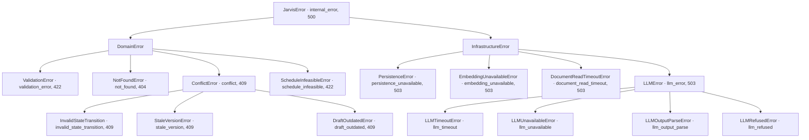
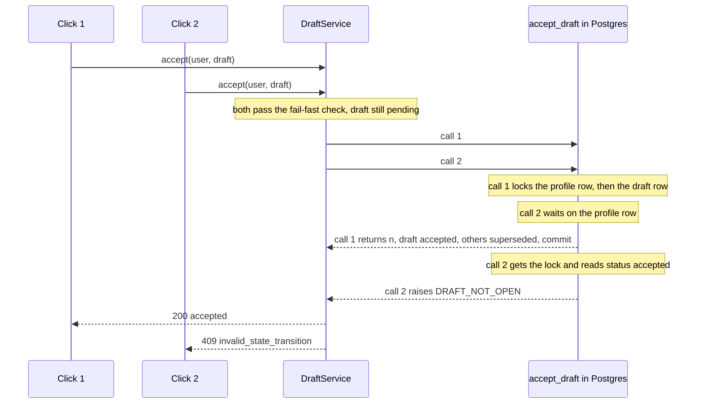

# 09 — Error handling, edge cases and concurrency

Jarvis raises errors on purpose from one hierarchy rooted at `JarvisError`; each class carries a stable machine code and the HTTP status the API answers with. Global handlers turn every error a request can end in — a `JarvisError`, a request-validation error, Starlette's own `HTTPException` for an unknown path or method, or an exception nobody caught — into one JSON envelope `{"error": {"code", "message", "details", "request_id"}}`, whose model is `ErrorResponse` (`app/schemas/errors.py`). A streamed chat turn sends the same model as an SSE `error` frame. No route raises `HTTPException`. Exception text from libraries never reaches a client; it is logged with the request id. This document gives the hierarchy, real envelope examples, a failure-scenario table (what the user sees, what the system does, where, and which test pins it), the concurrency mechanisms in depth (the atomic `accept_draft` function and its lock order, the draft version check, compare-and-set on statuses, the turn lock and the stream that always closes, per-user locks and single-flight, the PRIMARY-model lock, the compaction lock, and what is process-local), and the edge-case rules for the user's clock, read caps and bounded waits. References are `path:line` at commit `d3e9132`, now part of `main`. Rows changed or added by the fixes up to `cc8d170` (a resumed conversation reading its draft's status, a dropped kept-alive connection retried on reads, documents read off the event loop, the web-search cooldown, short questions about notes) cite functions and tests instead of lines.

**Owner: ______**

---

## 1. The error hierarchy

Defined in `app/domain/errors.py` (framework-free; the domain layer imports nothing outer).



| Class | Code / status | Meaning | Raised by (examples) |
|---|---|---|---|
| `JarvisError` (`errors.py:13-22`) | `internal_error` / 500 | Base; carries `message` (user-facing) and optional `details` | A task workspace that could not be built (`app/api/v1/endpoints/workspace.py:59-62`) |
| `DomainError` (`errors.py:25-26`) | — | A rule of the domain was broken; the request cannot be honoured as asked | — |
| `ValidationError` (`errors.py:29-31`) | `validation_error` / 422 | Input the domain rejects | Unknown timezone (`app/services/user_model_service.py:258-261`); a draft modify with a component other than `tasks` (`app/api/v1/endpoints/drafts.py:185-189`); a file that is not base64 (`app/api/v1/endpoints/ingestion.py:117-122`); a repository given another user's entity |
| `PayloadTooLargeError` (`errors.py:34-38`) | `payload_too_large` / 413 | A body larger than any valid request; refused unread | `BodyLimitMiddleware` on `POST /chat/stream` and `POST /ingestion/process` (`app/api/request_limits.py:38-96`) |
| `NotFoundError` (`errors.py:41-43`) | `not_found` / 404 | No such row **for this user** (another user's id reads as absent) | `not_found()` (`app/infrastructure/persistence/_mapping.py:114-115`); `DraftService.get` (`app/services/draft_service.py:125-130`) |
| `ConflictError` (`errors.py:46-48`) | `conflict` / 409 | The request clashes with stored state | A plan reusing a finished task's id (`_mapping.py:147-155`); a turn that waited too long (`app/services/turn_locks.py:58-62`) |
| `InvalidStateTransition` (`errors.py:51-52`) | `invalid_state_transition` / 409 | A move the transition table forbids | `DraftSchedule.transition` (`app/domain/entities.py:370-383`); `check_suggestion_move` (`entities.py:215-226`); `check_memory_move` (`entities.py:141-154`); SQL `DRAFT_NOT_OPEN` (`app/infrastructure/persistence/supabase_repos.py:438-442`) |
| `StaleVersionError` (`errors.py:55-56`) | `stale_version` / 409 | What the caller read has changed since: a compare-and-set lost, or a draft was edited after the read the accept names | `check_version` (`draft_service.py:62-71`); `task_changed` from `update_status` (`_mapping.py:135-144`, `supabase_repos.py:264`); `suggestion_changed` (`_mapping.py:118-123`); `memory_changed` (`_mapping.py:386-391`) |
| `DraftOutdatedError` (`errors.py:59-62`) | `draft_outdated` / 409 | Every slot of the draft has already begun | `DraftService.accept` (`draft_service.py:207-209`) |
| `ScheduleInfeasibleError` (`errors.py:65-67`) | `schedule_infeasible` / 422 | Nothing fits, even widened | `run_schedule` on an INFEASIBLE solve (`app/services/planning/scheduling.py:327-329`); late accept with no room (`app/services/draft_actions.py:96-97`); re-plan past 30 days (`app/modules/planning_replan.py:72-75`) |
| `InfrastructureError` (`errors.py:70-71`) | — | Something Jarvis depends on failed; the request was fine | — |
| `PersistenceError` (`errors.py:74-76`) | `persistence_unavailable` / 503 | Database unreachable or a stored row unreadable | `_SupabaseRepository._run` (`supabase_repos.py:173-180`); `require_supabase` (`app/api/deps.py:31-37`) |
| `EmbeddingUnavailableError` (`errors.py:79-83`) | `embedding_unavailable` / 503 | The local sentence model cannot run | `MiniLMEmbedder.embed` (`app/infrastructure/embedding.py:21-32`) |
| `DocumentReadTimeoutError` (`app/domain/errors.py`) | `document_read_timeout` / 503 | The document reader (Docling) did not finish within 120 s; the request was fine | `_read_off_the_loop` in `app/utils/docling_helper.py`, behind `read_document` and `read_document_with_provenance` |
| `LLMError` (`errors.py:86-88`) | `llm_error` / 503 | A model service failed; falls over to the next provider, never retried | `to_llm_error` for other API statuses (`app/infrastructure/llm/transport.py:77-82`) |
| `LLMTimeoutError` (`errors.py:91-92`) | `llm_timeout` | A call passed its timeout; transient, retried | `TimeoutProvider` (`app/infrastructure/llm/decorators.py:188-198`) |
| `LLMUnavailableError` (`errors.py:95-96`) | `llm_unavailable` | Unreachable, 429, 5xx, credential rejected, PII gate refused, or the whole chain failed; transient, retried | `transport.py:75-81`; `claude.py:201-223`; `FallbackChainProvider` (`app/infrastructure/llm/chain.py:95`); the ingestion classifier (`ingestion.py:150-152`) |
| `LLMOutputParseError` (`errors.py:99-100`) | `llm_output_parse` | Structured output did not parse, or the reply was cut off; not retried, next provider | `transport.py:83-86`; `claude.py:301-304`; an unusable goal decomposition (`app/api/v1/endpoints/reasoning.py:150-162`) |
| `LLMRefusedError` (`errors.py:103-106`) | `llm_refused` | The model declined (after Anthropic's server-side fallback model also declined); not retried | `_check_stop` (`app/infrastructure/llm/claude.py:292-300`) |

Retry and fallback are decided by type: `ExponentialBackoff.should_retry` retries only `LLMTimeoutError` and `LLMUnavailableError` (`app/infrastructure/llm/retry.py:24-27`); the chain moves on for any `LLMError` and lets every other exception propagate, because a non-model exception is a bug and must not quietly ship the prompt to the next (cloud) provider (`chain.py:35-39`, `transport.py:3-6`).

`public_message(exc, fallback)` (`errors.py:109-115`) is the one helper for showing an error to a user: a `JarvisError`'s own message, anything else replaced by a fixed fallback.

---

## 2. One envelope

### 2.1 How it is produced
- `RequestIdMiddleware` (`app/api/error_handlers.py:64-89`) gives every HTTP request an id (`request.state.request_id`) and the `X-Request-ID` response header. It is pure ASGI so SSE streams pass through untouched.
- The envelope's model is `ErrorResponse` wrapping `ErrorBody` (`app/schemas/errors.py:11-21`). `_envelope` builds every HTTP error response from it (`error_handlers.py:101-116`).
- `register_error_handlers` (`error_handlers.py:197-202`) routes four kinds of error to that one shape:

| Error | Handler | Status | `code` | `message` |
|---|---|---|---|---|
| `JarvisError` | `_handle_jarvis_error` (`:124-132`) | its `http_status` | its `code` | its `message`; 5xx are logged with the request id |
| `RequestValidationError` (Pydantic, at the boundary) | `_handle_request_validation` (`:135-150`) | 422 | `validation_error` | "The request is invalid."; `details.errors` lists `loc`, `msg`, `type` only (the caller's input is never echoed) |
| `HTTPException` (only Starlette's own: no route raises one) | `_handle_http_exception` (`:165-181`) | its status | `http_error` | its string detail; structured detail kept under `details`; 204/205/304 answered with no body |
| any other exception | `_handle_unhandled` (`:184-194`) | 500 | `internal_error` | "Something went wrong on our side."; the exception is logged with the request id, never sent |

- The OpenAPI document gives `ErrorResponse` as the 422, 4XX and 5XX response of every operation (`ERROR_RESPONSES`, `error_handlers.py:34-47`, set with `FastAPI(responses=…)` at `app/main.py:185-190`).
- For a streamed chat turn the HTTP 200 has already gone out, so an error becomes an SSE `error` frame: `error_frame` builds an `ErrorResponse` and `SseEncoder.frame` writes it (`app/services/chat_turn/frames.py:36-39`). A `JarvisError` keeps its code, message and details (`app/services/chat_turn/service.py:212-215`); anything else is logged with the request id and sent as `internal_error` (`service.py:216-223`).

### 2.2 Real examples

Second accept of the same draft (`POST /api/v1/drafts/{id}/accept`, sequential double click; the fail-fast check in `DraftSchedule.transition`, `entities.py:377-382`, reached first through `accept_on_time`, `draft_actions.py:87`):

```json
{
  "error": {
    "code": "invalid_state_transition",
    "message": "This draft is accepted and cannot become accepted.",
    "details": {"draft_id": "<draft id>", "from": "accepted", "to": "accepted"},
    "request_id": "<32 hex chars, same as the X-Request-ID header>"
  }
}
```

The concurrent double click is stopped inside the database instead, and answers 409 with "This draft is no longer open, so it cannot be accepted." and `details: {"draft_id": ..., "to": "accepted"}` (`supabase_repos.py:438-442`). Pinned by `tests/test_draft_endpoints.py::test_accept_endpoint__second_call__409_envelope`.

Accept of a draft edited after the read the client names (`POST /api/v1/drafts/{id}/accept` with `expected_version`; `check_version`, `draft_service.py:62-71`; the latest draft added at `drafts.py:114-119`):

```json
{"error": {"code": "stale_version", "message": "This plan changed since you looked — here is the latest.", "details": {"draft_id": "<id>", "expected_version": "<the version read>", "version": "<the version now>", "draft": {"draft_id": "<id>", "tasks": ["…"], "schedule": {"…": "…"}, "version": "<the version now>"}}, "request_id": "<id>"}}
```

Pinned by `tests/test_drafts_one_path.py::test_rest_accept__edited_after_the_read__409_with_the_latest_and_nothing_written`.

A chat message over the limit (`POST /api/v1/chat/stream` with 8,001 characters; the stream never opens):

```json
{"error": {"code": "validation_error", "message": "The request is invalid.", "details": {"errors": [{"loc": ["body", "user_prompt"], "msg": "String should have at most 8000 characters", "type": "string_too_long"}]}, "request_id": "<id>"}}
```

A file over 10 MB decoded gives `loc: ["body", "file_base64"]` and `msg: "Value error, The file can be at most 10 MB."`. Pinned by `tests/test_chat_turn.py::test_chat_stream__request_over_a_limit__422_envelope_and_no_turn`.

Database down on any route that needs it (`require_supabase`, `app/api/deps.py:31-37`):

```json
{"error": {"code": "persistence_unavailable", "message": "Could not reach the database.", "details": null, "request_id": "<id>"}}
```

Pinned by `tests/test_memories_api.py::test_memories_api__no_database__503_on_every_route_never_empty_or_404` and `tests/test_api_contract.py::test_no_database__503_persistence_unavailable_envelope`.

Unknown timezone in `PATCH /api/v1/you/settings` (`user_model_service.py:258-261`):

```json
{"error": {"code": "validation_error", "message": "That timezone isn't one Jarvis knows. Use a name like Asia/Kolkata.", "details": {"fields": ["timezone"]}, "request_id": "<id>"}}
```

Pinned by `tests/test_you_api.py::test_you_api__bad_timezone__422_envelope`.

A second chat turn on the same conversation that waited past 120 s (SSE frame, `turn_locks.py:58-62`):

```text
event: error
data: {"error": {"code": "conflict", "message": "Your previous message in this conversation is still being answered. Send this one again once that reply has arrived.", "details": null, "request_id": "<id>"}}
```

Pinned by `tests/test_turn_locks.py::test_chat_stream__turn_queued_past_the_wait_limit__honest_conflict_frame`.

An exception nobody caught (`error_handlers.py:184-194`):

```json
{"error": {"code": "internal_error", "message": "Something went wrong on our side.", "details": null, "request_id": "<id>"}}
```

Pinned by `tests/test_errors.py::test_error_envelope__unhandled_exception__hides_internals` and `::test_error_envelope__unhandled_exception__logged_with_the_responses_request_id`; the chat equivalent by `tests/test_error_text_leaks.py::test_chat_stream__graph_crashes__error_frame_is_the_envelope_without_exception_text` and the byte-for-byte recording `tests/test_sse_golden.py::test_sse_golden__graph_crashes__error_frame_bytes_unchanged`.

---

## 3. Failure scenarios

"User sees" is what reaches the screen or the API client. All `path:line` are at `d3e9132`.

### 3.1 Language models

| # | Scenario | What the user sees | What the system does | Where | Pinned by |
|---|---|---|---|---|---|
| L1 | A model call hangs | An answer from the next provider, a little later; or, if all fail, L5 | `TimeoutProvider` raises `LLMTimeoutError` after `timeout_s` (60 s complete, 120 s between stream tokens); cloud calls retry up to 3 attempts with jittered backoff; then the chain falls over | `decorators.py:181-209`; `app/core/config.py:59-60`; `retry.py:9-32`; `chain.py:87-95` | `tests/test_llm_providers.py::test_timeout__hung_complete__raises_llm_timeout`, `::test_retrying__transient_then_success__retries_with_backoff`, `::test_chain__timeout_on_first__second_answers` |
| L2 | Claude refuses | An answer from Anthropic's fallback model, or from the next provider | Every call opts into the server-side fallback (`fallbacks: "default"`); a refusal that survives it is `LLMRefusedError`, metered (it was billed), never retried, and the chain moves on | `claude.py:171-173, 292-300` | `tests/test_claude_provider.py::test_claude__every_call__opts_into_default_refusal_fallback`, `::test_claude__refusal__usage_recorded_and_refused_without_retry` |
| L3 | Invalid structured output | Nothing different if another provider answers | Local: the reply is fence-stripped and validated against the schema; failure is `LLMOutputParseError`, not retried, next provider. Claude: structured outputs make the reply schema-valid by construction; a cut-off reply (`max_tokens`) is `LLMOutputParseError` | `transport.py:38-54, 83-86`; `claude.py:127-145, 301-304` | `tests/test_llm_providers.py::test_local__schema_mismatch__raises_output_parse_error`, `::test_retrying__parse_error__not_retried`, `::test_chain__parse_error_on_first__falls_over`; `tests/test_claude_provider.py::test_claude__max_tokens_stop__raises_output_parse_error` |
| L4 | A bug inside an adapter (`TypeError`, `KeyError`) | `internal_error` envelope or frame | Not translated to `LLMError`, so it propagates at once; the next provider is not tried and the prompt is not sent to the cloud | `transport.py:90-99`; `chain.py:36-39` | `tests/test_llm_providers.py::test_chain__programming_error__propagates_and_second_not_called`, `::test_local__programming_error__propagates_unchanged` |
| L5 | Every provider fails (chain exhausted) | Chat: "A minor hiccup on my end, sir. Shall we try that again?" (in code; no test pins this sentence). Planning: the plan says the habits could not be read and offers a redo. Late REST accept: 503 `llm_unavailable`, draft still open. Brief: nothing that minute | `LLMUnavailableError("No language model is reachable right now.")`; `route_llm_call` raises `RuntimeError` instead when no cloud provider is configured; the brief's trigger is reported failed and backs off 1, 2, 4 … 30 minutes | `chain.py:95`; `app/core/model_router.py:413-416`; `app/modules/conversation.py:194-198`; `app/services/anticipation/service.py:273-285` | `tests/test_llm_providers.py::test_chain__all_fail__raises_llm_unavailable`, `::test_route_llm_call__no_cloud_available_after_local_fails__runtime_error`; `tests/test_accept_on_time.py::test_rest_accept__late_and_habits_cannot_be_read__503_and_the_draft_stays_open`; `tests/behaviour/test_anticipation.py::test_plan__habits_could_not_be_read__the_reply_says_so_and_offers_a_redo`; `tests/test_triggers.py::test_brief__habits_could_not_be_read__tick_failed_nothing_settled_next_tick_retries` |
| L6 | A stream fails after its first token | The reply stops; the stream still ends | No retry and no fall-over after a token has been sent (that would restart the reply mid-sentence) | `decorators.py:164-178`; `chain.py:110-112` | `tests/test_llm_providers.py::test_chain__stream_fails_midway__raises`, `::test_retrying__stream_fails_midway__not_retried` |
| L7 | Claude rejects its credential (401/403) | Answers from Gemini or local | `ClaudeProvider` switches itself off for the rest of the process; `RetryingProvider` does not retry a provider that turned unavailable | `claude.py:201-207`; `decorators.py:150-151` | `tests/test_claude_provider.py::test_claude__auth_error__disables_provider_and_raises_unavailable`; `tests/test_llm_providers.py::test_retrying__provider_turns_unavailable__not_retried` |
| L8 | The PII gate denies or asks | Same as L5 if no local model can answer | `PreCloudLLMRedactor` raises `LLMUnavailableError`: nothing is sent; redaction sits outside retry, so the refusal is not retried | `model_router.py:71-94` | `tests/test_llm_providers.py::test_redactor__hook_denies_or_asks__fails_closed_and_nothing_is_sent`, `::test_route_llm_call__hooks_deny__nothing_reaches_the_cloud` |
| L9 | The usage ledger cannot write | Nothing | The write runs in the background and is dropped with one warning; at most 8 writes in flight, extras dropped and counted | `app/services/usage_ledger.py:29, 49-59` | `tests/test_usage_ledger.py::test_usage_ledger__storage_unreachable__call_unharmed_and_warned_once`, `::test_usage_ledger__more_than_8_writes_in_flight__extras_dropped_and_counted` |
| L10 | The ingestion classifier or the goal decomposer cannot answer usefully | 503 `llm_unavailable` "Could not classify the payload. Try again shortly." / 503 `llm_output_parse` (fewer than 5 tasks, or unparseable); no exception text | The route raises the typed error from the chained cause, which is logged | `ingestion.py:150-152`; `reasoning.py:150-162` | `tests/test_error_text_leaks.py::test_ingest__classifier_fails__503_llm_unavailable_fixed_message_no_exception_text`, `::test_decompose_goal__unparseable_reply__503_llm_output_parse_no_exception_text` |
| L11 | A web search with no event bus to meter it on | Never reaches the user: every caller passes the composition root's bus | `metered_web_search` requires the bus and refuses a search without one before searching (`TypeError`), so no Gemini call goes unmetered | `app/core/model_router.py:106-157`; `app/services/analytical/workspace_builder.py:40` | `tests/test_injection.py::test_metered_web_search__bus_passed__usage_published_and_no_bus__refused_before_searching` |
| L12 | The web search fails (no Gemini key, no credits, provider down) | The workspace shows the task, its completion criteria and the notice "Web results are unavailable right now, so no links are shown"; a workspace opened in the next 5 minutes does not wait on the search | An empty search answer is `WebSearchUnavailableError`, and the search is switched off for `WEB_SEARCH_COOLDOWN_S` = 300 s (`web_search_cooldown`, process-local); a workspace with a notice is not cached for the day, so the next open rebuilds it | `_search_web`, `_WebSearchCooldown` (`app/services/analytical/workspace_builder.py`) | `tests/test_workspace_web_search.py::test_search_web__search_just_failed__not_called_again_during_the_cooldown`, `::test_search_web__cooldown_over__searched_again`, `::test_search_web__search_answers__no_cooldown` |

### 3.2 Persistence and the embedder

| # | Scenario | What the user sees | What the system does | Where | Pinned by |
|---|---|---|---|---|---|
| P1 | Database outage during a request | 503 `persistence_unavailable`; never an empty list, never a 404 (the session reads included) | Any transport failure becomes `PersistenceError` with the driver text chained, not repeated; routes check `require_supabase` first | `supabase_repos.py:173-180`; `deps.py:31-37`; `app/api/v1/endpoints/tasks.py:116, 150, 207` | `tests/test_you_api.py::test_you_api__store_down__503_envelope`; `tests/test_memories_api.py::test_memories_api__store_down__503_envelope`; `tests/test_anticipation_api.py::test_anticipation_api__database_unavailable__503_on_every_route`; `tests/test_tasks_one_path.py::test_task_and_rule_lists__store_unreachable__503_never_an_empty_list`; `tests/test_api_contract.py::test_no_database__503_persistence_unavailable_envelope`; `tests/test_errors.py::test_health__database_unreachable__503_persistence_envelope` |
| P2 | Database unreachable at startup | 503 on routes that need it; the app keeps answering | `AppContainer.build` falls back to the in-memory family and logs "nothing is persisted"; routes still answer 503 rather than serve the empty in-memory store | `app/container.py:131-139`; `deps.py:31-37` | `tests/test_container.py::test_container__no_supabase__uses_in_memory_family` |
| P3 | Database outage during a background sweep or tick | Nothing | One warning per run, counted by exception type, no traceback; one user's failure never stops the others; the next tick tries again | `app/services/task_service.py:319-341`; `app/services/anticipation/scheduler.py:59-69` | `tests/test_task_service.py::test_slot_passed_sweep__db_down__one_warning_with_count_and_no_traceback`; `tests/test_anticipation_scheduler.py::test_tick__profiles_unreachable__logged_and_next_tick_runs` |
| P4 | A stored row the entity rejects (legacy data) | 503 | Read as a storage fault (`PersistenceError` "Stored data is not readable."), not a request fault | `supabase_repos.py:115, 140-162` | `tests/test_repository_contracts.py::test_supabase_repos__unreadable_stored_row__raises_persistence_error` |
| P5 | Concurrent queries break a shared HTTP/2 connection | Nothing (this was a spurious 503) | The Supabase client uses HTTP/1.1, one pooled connection per concurrent query | `app/db/supabase_py.py:69-94` | `tests/test_you_api.py::test_you_api__three_loads_at_once__all_200_same_content_and_one_look` |
| P6 | The text embedder is missing or fails | The turn goes on; nothing new is remembered; editing a memory answers 503 `embedding_unavailable` | `MiniLMEmbedder` raises `EmbeddingUnavailableError`; recall serves the always-on profile only; the observation loop stops learning for that turn | `app/infrastructure/embedding.py:21-32`; `app/services/memory/memory_service.py:419-422`; `app/core/observation.py:256-258` | `tests/test_embedding.py::test_minilm_embedder__model_unavailable__raises_infrastructure_error`; `tests/test_recall.py::test_recall__embedder_down__profile_only_and_logged`; `tests/test_memories_api.py::test_memories_api__embedder_unavailable_on_edit__503_envelope`; `tests/test_observation.py::test_observation__embedder_unavailable__turn_goes_on_with_no_memory_frame` |
| P7 | The outcome event cannot be stored after a task's status moved | 503; the click can be retried | The status is set back (compare-and-set from the new status) before the error is re-raised, so a retry records the outcome once | `task_service.py:287-307` | `tests/test_task_service.py::test_complete__event_write_fails__status_restored_and_error_raised` |
| P8 | The SCHEDULED/RESCHEDULED events cannot be stored after an accept | The accept succeeds | Best effort after the commit: one warning, the accept is never undone | `draft_service.py:264-297` | `tests/test_draft_service.py::test_accept__event_store_down__accept_still_succeeds_and_logs` |
| P9 | A connection to the database cannot be made (a TCP or TLS blip), or the server drops a kept-alive connection as a read reuses it | Nothing, when the retry answers; otherwise P1 | One retry after a 0.1–0.4 s random pause, only when the request provably did no work: `ConnectError` and `ConnectTimeout` (the request never left, so a write cannot apply twice), and `RemoteProtocolError` on a `GET` or `HEAD` (a read sent twice changes nothing). A dropped connection on a write, a read timeout or an HTTP error is raised as it came | `ConnectRetryTransport` (`app/db/supabase_py.py`) | `tests/test_supabase_client.py::test_connect_retry__first_connect_fails__retried_once_after_a_short_jittered_pause`, `::test_connect_retry__kept_alive_connection_dropped_on_a_read__retried_once`, `::test_connect_retry__request_may_have_been_sent__never_retried`, `::test_health__one_failed_connect__healthy_not_503` |
| P10 | An uploaded document takes long to read, or its parse never returns | Other requests keep being served. REST ingestion: 503 `document_read_timeout` "That document took too long to read. Try again, or a smaller file." after 120 s. Chat upload: the knowledge step's own 60 s limit ends it first, and the reply says the document could not be read | Docling runs on a worker thread (`asyncio.to_thread`), one document at a time (a per-loop lock: its models are loaded once and not built for two parses at once), bounded by `DOCUMENT_READ_TIMEOUT_S` = 120. Before this fix the parse ran on the event loop, and one stuck parse froze the whole server | `read_document`, `read_document_with_provenance`, `_read_off_the_loop` (`app/utils/docling_helper.py`); `ingest_document` step, `timeout_ms=60_000` (`app/modules/knowledge_graph.py`) | `tests/test_document_reading.py::test_read_document__parse_takes_a_while__the_loop_keeps_serving`, `::test_read_document__parse_never_returns__times_out_as_a_503`, `::test_read_document__two_uploads_at_once__parsed_one_at_a_time` |
| P11 | The file store (Supabase Storage) cannot be reached when a document is uploaded, listed, opened or deleted | Upload: the document is kept and answers as usual, without its file. List: every document shows, `has_file: false`. Open: 503 `persistence_unavailable` "Could not open the document's file." Delete: the document is deleted | Keeping, listing and removing a file are best effort around the record: one warning by exception type, never a failed ingestion, listing or delete. Opening needs the file, so it is the one route that answers 503. A document with no file kept (pasted text, or uploaded while the store was down) is 404 `not_found` on open, never a 500 | `app/services/documents/service.py`; `app/infrastructure/persistence/supabase_storage.py` | `tests/test_documents.py::test_process_ingestion__file_store_down__ingestion_still_succeeds_and_logs`, `::test_list__file_store_down__documents_listed_with_has_file_false`, `::test_file_route__file_store_down__503_envelope_no_driver_text`, `::test_delete__file_store_down__document_still_deleted`, `::test_file_route__not_the_callers_or_no_file__404_not_found_envelope` |
| P12 | Linking an accepted plan's tasks to the user's documents fails (the embedder, or a store) | The accept succeeds; the new tasks have no documents linked | `DocumentLinkListener` runs after the atomic accept has committed (it listens to `DraftAccepted`), catches the failure and logs one warning by type, so the bus never logs a traceback and the accept is never undone | `app/services/documents/linker.py` (`DocumentLinkListener`) | `tests/test_document_linking.py::test_accept__linking_fails__accept_stands_and_a_warning_names_the_error` |

### 3.3 Planning and the solver

| # | Scenario | What the user sees | What the system does | Where | Pinned by |
|---|---|---|---|---|---|
| S1 | The work does not fit the horizon | A plan over a longer window | `run_schedule` raises `ScheduleInfeasibleError`; the planning step catches it and walks the horizon 3 → 5 → 7 → 14 → 30 days | `app/modules/planning_graph.py:698-703, 779-789` | `tests/test_planning_graph.py::test_handle_infeasible__walks_the_full_ladder`, `::test_solve_schedule__422_maps_to_infeasible` |
| S2 | It does not fit even in 30 days | "I couldn't fit everything in even with a 30-day window. This is a scope problem, not a you problem. Want to reduce scope or extend the deadline?" — no draft | `INFEASIBLE_EXHAUSTED` with that clarification. The direct solver route answers 422 `schedule_infeasible` with scope wording, through the typed error | `planning_graph.py:790-795`; `scheduling.py:321-329` | `tests/behaviour/test_psychology.py::test_anti_guilt__plan_no_horizon_can_hold__reply_is_the_scope_message_verbatim`, `::test_anti_guilt__solver_api_infeasible__422_says_scope_without_blame`; `tests/test_scheduler.py::test_run_schedule__infeasible__raises_schedule_infeasible_error`, `::test_generate_schedule__infeasible__422_schedule_infeasible_envelope` |
| S3 | The solve reaches its 10 s cap | The best schedule found, or S1/S2 | CP-SAT returns its best (FEASIBLE) or UNKNOWN, which takes the INFEASIBLE path; the idle stop ends a solve 1.0 s after its last improvement | `config.py:223, 232-234`; `app/core/or_tools/solver.py:330-359` | `tests/test_scheduler.py::test_solve_timeout_without_a_solution_reads_as_infeasible`; `tests/behaviour/test_psychology.py::test_planning__solve_runs_to_the_solver_time_cap__best_schedule_still_delivered` |
| S4 | The solve step outlasts its step timeout (30 s) | No plan is claimed, no draft | The step reports an error; "I couldn't work out a schedule for this just now" | `app/core/module_framework.py:30, 140-148`; `planning_graph.py:800-806` (`UNSOLVED_MESSAGE`) | `tests/behaviour/test_chat_turns.py::test_chat__solve_outlasts_its_step_timeout__no_plan_claimed_and_no_draft` |
| S5 | The morning brief's re-plan does not fit | "About today: I couldn't fit everything into today — want to look at it together?" (read-only) | `ScheduleInfeasibleError` caught; a `share_insight` suggestion instead of a plan | `app/services/anticipation/triggers.py:145-162` | `tests/test_triggers.py::test_brief__replan_infeasible__read_only_suggestion_no_draft` |

### 3.4 Drafts, tasks, suggestions, memories

| # | Scenario | What the user sees | What the system does | Where | Pinned by |
|---|---|---|---|---|---|
| D1 | Double click on Accept (REST) | First 200 `accepted`; second 409 `invalid_state_transition`; tasks written once | Sequential: fail-fast `transition`. Concurrent: the SQL function serialises on row locks and the second sees `accepted` (section 4.1) | `draft_actions.py:87`; `draft_service.py:198-213`; `supabase/migrations/20261115000007_user_tasks_not_before.sql:54-68` | `tests/test_draft_endpoints.py::test_accept_endpoint__second_call__409_envelope`; `tests/test_repository_contracts.py::test_drafts__accept_atomic__concurrent_calls__exactly_one_succeeds`; `tests/test_draft_service.py::test_accept__concurrent_double_click__exactly_one_succeeds` |
| D2 | "Looks good" in chat after the REST accept | "That plan is already locked in, sir." — nothing written | `InvalidStateTransition` caught; the draft is re-read to say what really happened | `app/orchestrator/graph.py:617-618` (`_closed_draft_reply`, `:705`) | `tests/behaviour/test_chat_turns.py::test_chat__plan_already_accepted_in_the_review_ui__looks_good_says_already_locked_in`; Live 4 |
| D3 | "Scrap it" after the plan was accepted | "That plan is already locked in, sir, so there was nothing to discard." | The resumed turn reads the draft's status (D11), so the thread is in the accepted phase; `classify_intent` sends "scrap it" (like a second "looks good") to `draft_action`, where `reject_draft` raises `InvalidStateTransition` instead of reporting a discard | `app/services/draft_actions.py:131-141`; `_classify_intent` (`app/orchestrator/graph.py`) | `tests/behaviour/test_chat_turns.py::test_chat__scrap_it_after_accepting_in_the_review_ui__never_claims_a_discard` |
| D4 | Stale (expired) draft | 409; ask for a fresh plan | `accept_draft` treats `expires_at < now()` as not open (`DRAFT_NOT_OPEN`); drafts expire 24 h after creation (database default, and `DRAFT_TTL` stamped by both repository families) | `supabase/migrations/20261115000007_user_tasks_not_before.sql:66-68`; `_mapping.py:48, 254`; `supabase/migrations/20260329000002_phase1_missing_tables.sql:20` | `tests/test_repository_contracts.py::test_drafts__accept_atomic__expired__raises`; `tests/test_drafts_one_path.py::test_draft_ttl__one_constant__24h_and_no_dead_twin_in_config` |
| D5 | Late accept, some slots already passed | 200 with `moved: true` and a note that the times were moved | The draft's own tasks are re-solved from now under every rule (`DraftPlanner.reslot_from_now`), the new schedule stored on the draft, then accepted | `draft_actions.py:61-99` | `tests/test_accept_on_time.py::test_rest_accept__three_hours_late__moved_from_now_and_nothing_swept`, `::test_rest_accept__moved__the_draft_shows_its_new_times` |
| D6 | Late accept, every slot passed | 409 `draft_outdated`: "Every time in this plan has already gone by, so I didn't put it in place. Ask me for a fresh plan and I'll fit it around now." | Nothing written | `draft_service.py:55-58, 207-209` | `tests/test_draft_service.py::test_accept__every_slot_already_started__draft_outdated_and_nothing_written` |
| D7 | Late accept, the rest no longer fits | 422 `schedule_infeasible`; the draft stays open | Nothing written | `draft_actions.py:47-50, 96-97` | `tests/test_accept_on_time.py::test_rest_accept__the_rest_no_longer_fits__422_and_the_draft_stays_open` |
| D8 | A plan reuses the id of a task the user finished | 409 `conflict`: "That plan clashes with tasks you already have." | The unique key `(user_id, task_id)` (or the in-memory check) refuses; nothing written | `supabase_repos.py:445-447`; `_mapping.py:147-155` | `tests/test_draft_endpoints.py::test_accept_endpoint__plan_clashes_with_existing_tasks__409_conflict`; `tests/test_repository_contracts.py::test_drafts__accept_atomic__task_id_already_taken__raises_conflict_and_writes_nothing` |
| D9 | Edit or discard a draft that is already closed | 409; the draft stays as it was. Editing one task of a closed draft is 409 before an unknown task is 404 | `DraftService` moves the draft through `transition(MODIFIED)` (or `set_status(EXPIRED)`) before writing; `replace_tasks`/`replace_schedule` refuse a closed draft too | `draft_service.py:147-183`; `app/domain/ports.py:191-207` | `tests/test_draft_endpoints.py::test_edit_routes__accepted_draft__409_and_draft_stays_accepted`; `tests/test_drafts_one_path.py::test_edit_tasks__closed_draft__invalid_state_transition_and_unchanged`, `::test_discard__open_draft__expired_and_row_kept`; `tests/test_repository_contracts.py::test_drafts__replace_tasks__accepted_draft__raises_invalid_state_transition` |
| D10 | Accept of a draft edited after the user's read | 409 `stale_version` "This plan changed since you looked — here is the latest.", with the latest draft under `details.draft`; nothing written | `check_version` compares the request's `expected_version` with the draft's computed version, in `accept_on_time` and again in `DraftService.accept`. Without `expected_version`, accept is unchanged | `draft_actions.py:88`; `draft_service.py:62-71, 202`; `drafts.py:114-119` | `tests/test_drafts_one_path.py::test_accept__stale_expected_version__stale_version_and_nothing_written`, `::test_rest_accept__edited_after_the_read__409_with_the_latest_and_nothing_written`, `::test_rest_accept__no_expected_version__accepted_as_today` |
| D11 | The plan was accepted or discarded from its card (REST), then the user writes again in that conversation | The next message is answered as a conversation ("thanks, what do you know about how I work?"); nothing is planned again, no draft is made, no task changes | The checkpoint still says the draft is under review, because the REST call never passed through the conversation. Before the graph runs, the resumed turn reads the draft's own status: accepted keeps the thread in the accepted phase (a second "looks good" is still "already locked in"); discarded, expired or gone ends the review. If the store cannot be read, the checkpoint is left as it was | `ChatTurn._close_review_of_a_closed_draft` (`app/services/chat_turn/service.py`) | `tests/behaviour/test_chat_turns.py::test_chat__plan_accepted_from_its_card__next_message_is_a_conversation_not_a_replan`, `::test_chat__plan_discarded_from_its_card__next_message_is_a_conversation_not_a_replan` |
| T1 | Double click on Complete | Both 200 "Task completed."; one event | The second compare-and-set finds the task already completed; nothing is written | `task_service.py:225-250` | `tests/test_task_service.py::test_complete__double_click__second_returns_none_and_one_event` |
| T2 | The slot sweep races a late Complete | The task is completed; no missed event | The sweep's write holds both the status and the slot it read; a lost race is `StaleVersionError`, swallowed, "the next pass decides" | `task_service.py:203-214`; `supabase_repos.py:249-255` | `tests/test_task_service.py::test_sweep__race_with_completion__stale_version_swallowed_one_event`, `::test_sweep__accept_reslots_task_mid_sweep__new_slot_never_marked_missed` |
| T3 | Unknown task / another user's task | 404 `not_found` | — | `task_service.py:219-223` | `tests/test_task_service.py::test_complete__unknown_task__not_found` |
| G1 | Double click on a suggestion's Accept | First runs the action; second 409 `stale_version` "That suggestion was already handled" | Claim-then-execute: PENDING → ACCEPTED by compare-and-set before the action runs | `app/services/anticipation/service.py:326-332`; `_mapping.py:118-123` | `tests/test_anticipation_service.py::test_accept__double_click__second_409_and_action_executed_once`; `tests/test_anticipation_api.py::test_anticipation_api__accept_twice__409_envelope` |
| G2 | The action fails or the client leaves while it runs | The suggestion is waiting again; 503 or nothing | The claim is released to PENDING under `asyncio.shield`, so a cancellation cannot cancel the release | `service.py:351-354` | `tests/test_anticipation_service.py::test_accept__store_down__back_to_pending_and_503`, `::test_accept__cancelled_while_the_action_runs__back_to_pending` |
| G3 | The suggestion is past its `expires_at`, or a newer plan replaced it | 409 "This suggestion is out of date — a newer plan replaced it."; no longer listed | Marked EXPIRED (out of date) | `service.py:317-325, 333-341` | `tests/test_anticipation_service.py::test_accept__past_expires_at__expired_and_409_never_listed`, `::test_accept__action_out_of_date__expired_and_409_plain_message` |
| G4 | The action's plan now clashes with the user's tasks | 409 conflict; the suggestion does not come back as pending | Marked EXPIRED (no fit), so the trigger may make a fresh one the same day | `service.py:342-350` | `tests/test_anticipation_service.py::test_accept__action_conflict__expired_never_back_to_pending` |
| G5 | Accepting a rule proposal whose pattern the user dismissed since | 409 "You told me this pattern doesn't fit, so I haven't made it a rule." | No rule stored, no draft | `app/services/anticipation/actions.py:171-178` | `tests/test_triggers.py::test_pattern_rule__accept_after_pattern_dismissed__no_rule_stored_and_expired` |
| M1 | A forgotten fact is said again | Nothing is remembered; no `memory_extracted` frame | `remember` finds it close (cosine ≥ 0.85) to a forgotten or dismissed memory of any type and writes nothing | `memory_service.py:221-229`; `config.py:263` | `tests/test_memory_service.py::test_remember__after_forget__suppressed_and_nothing_written`, `::test_remember__forgotten_goal_offered_as_another_type__still_suppressed`; Live 10b |
| M2 | A forget lands between a reinforcement's read and its write | The memory stays forgotten | Every write that could resurrect a memory is guarded by the statuses it may start from; the late write matches no row | `memory_service.py:50-61, 263-268`; `supabase_repos.py:967-981` | `tests/test_memory_service.py::test_forget__lands_between_a_read_and_its_write__memory_stays_forgotten`; `tests/test_patterns.py::test_observe__dismissed_while_observing__stays_dismissed` |
| M3 | Confirm or edit a dismissed or forgotten memory | 409 "This memory was dismissed, so it can't be confirmed." | `InvalidStateTransition` | `memory_service.py:587-606` | `tests/test_memories_api.py::test_memories_api__confirm_after_dismiss__409_envelope` |
| M4 | A model-written conversation summary repeats a forgotten fact or blames | The sentence is dropped | The summary filter removes sentences close to let-go facts and sentences with a blame phrase | `app/services/memory/summary_text.py:31, 129`; `app/domain/anti_guilt.py:24-30` | `tests/test_conversation_memory.py::test_compact__new_summary_repeats_a_forgotten_fact__stored_without_it`, `::test_since_last_spoke__model_summary_with_blame_or_tags__dropped_and_neutralised` |

### 3.5 Streaming, page loads and the request boundary

| # | Scenario | What the user sees | What the system does | Where | Pinned by |
|---|---|---|---|---|---|
| C1 | Client disconnects mid-stream, or leaves while a frame waits to be sent | — (they left) | `ClosingStreamingResponse` closes the turn's generator in a shielded scope; the turn's `finally` cancels the graph pump, waits for it, then releases the turn lock, also shielded (section 4.3) | `app/api/sse.py:16-28`; `service.py:224-237` | `tests/test_turn_locks.py::test_chat_stream__client_disconnects_mid_turn__lock_released_once_the_run_unwound`, `::test_chat_stream__client_disconnects_mid_turn__queued_turn_starts_after_the_cleanup`; `tests/test_chat_turn.py::test_chat_stream__client_gone_while_a_frame_waits_to_send__lock_released_without_gc` |
| C2 | Two tabs send on the same conversation | Replies arrive in order; the second sees the first's reply | Per-thread turn lock; history and checkpoint are read under it | `turn_locks.py:40-70`; `service.py:130-136` | `tests/test_turn_locks.py::test_chat_stream__two_tabs_one_session__turns_run_in_order`, `::test_chat_stream__queued_turn__history_includes_the_reply_it_waited_for` |
| C3 | Several You-page loads at once | All 200, same content | PEARL's look is single-flight per user; the other reads run concurrently | `app/services/memory/patterns.py:437-462` | `tests/test_you_api.py::test_you_api__three_loads_at_once__all_200_same_content_and_one_look` |
| C4 | Repeated "Check now" (manual trigger run) | The same outcome; no extra model call | Within 10 s the previous manual outcome is returned; once a day still holds by the stored suggestion | `service.py:399-406`; `config.py:194` | `tests/test_anticipation_service.py::test_run_trigger__two_manual_runs_inside_the_cooldown__evaluated_once` |
| B1 | Malformed request body | 422 `validation_error` with field locations | Pydantic at the boundary; input never echoed | `error_handlers.py:135-150` | `tests/test_errors.py::test_error_envelope__validation__422_with_field_details` |
| B2 | Request too large, or of a kind the turn does not read | 422 `validation_error`; for the chat stream no turn starts | A message over 8,000 characters (`max_length`), a file over 10 MB decoded (`within_upload_limit`), a `model_mode` outside `auto`/`cloud`/`gemini`/`4b` (so `"27b"` is refused) or a `media_type` outside `pdf`/`image`/`png`/`jpeg` fails `ChatStreamRequest`; ingestion uploads have the same file bounds | `app/schemas/chat_stream.py:44, 57-59, 69-87`; `app/schemas/upload.py:13-27`; `config.py:278-279`; `ingestion.py:51-68` | `tests/test_chat_turn.py::test_chat_stream__request_over_a_limit__422_envelope_and_no_turn`, `::test_chat_stream_request__at_the_limits__accepted`; `tests/test_api_contract.py::test_chat_stream__unknown_model_mode__422_envelope`, `::test_chat_stream__unknown_media_type__422_envelope`, `::test_ingestion__oversized_upload__422_envelope` |
| B3 | Malformed ingestion request (no input, bad base64, missing `media_type`) | 422 `validation_error` with a fixed message; no decoder text | `ValidationError` raised by the route | `ingestion.py:102-122, 137-138` | `tests/test_error_text_leaks.py::test_ingestion__invalid_base64__422_fixed_message_no_decoder_text` |
| B4 | Another user's id (draft, memory, suggestion) | 404 | Every repository method filters by `user_id` | `app/domain/ports.py:1-5` | `tests/test_draft_endpoints.py::test_accept_wrong_user`; `tests/test_memories_api.py::test_memories_api__other_users_memory__404`; `tests/test_anticipation_service.py::test_accept__other_users_suggestion__404` |
| B5 | A listener of the event bus raises | Nothing | Logged with the listener's name; the emitter and other listeners carry on | `app/domain/events.py:104-112` | `tests/test_domain.py::test_event_bus__failing_listener__others_still_run` |
| B6 | A body larger than any valid request (about 14 MB) on the chat stream or ingestion | 413 `payload_too_large`, in the envelope with the request id and CORS headers; no route runs | Refused on its declared `Content-Length` without reading the body; a chunked body is cut off as soon as it passes the cap | `app/api/request_limits.py:21-33, 56-76`; `app/main.py:192-194` | `tests/test_api_contract.py::test_upload_routes__content_length_over_the_cap__413_envelope_before_the_body_is_read`, `::test_body_limit__chunked_body_over_the_cap__413_and_the_route_never_runs` |
| B7 | A short message mentions the user's notes, with no file ("According to my uploaded notes, what is…?") | An answer from the stored documents, not "Standing by" | A text-only message is ingested as material only from `PASTED_MATERIAL_MIN_CHARS` = 400 characters; a shorter one goes on through the other intent rules and reaches the conversation path, which reads the user's document chunks | `_classify_intent` (`app/orchestrator/graph.py`) | `tests/behaviour/test_chat_turns.py::test_chat__question_that_mentions_my_notes_with_no_file__answered_not_ingested`, `::test_chat__long_notes_pasted_as_text__still_read_as_material_to_keep` |

---

## 4. Concurrency in depth

### 4.1 Atomic, idempotent accept (`accept_draft`)

**Problem.** Before the capstone, accept was "delete pending tasks, then insert the new ones" in two calls, and a double click inserted every task twice; between the two calls a failure could lose the tasks.

**Mechanism.** One Postgres function, `public.accept_draft(p_draft_id, p_user_id, p_rows)` (`supabase/migrations/20261115000007_user_tasks_not_before.sql:19-109`), called once through the repository (`supabase_repos.py:426-453`). A PL/pgSQL function runs in one transaction, so its writes land together or not at all. In order:

1. **Lock the user** — `select ... from user_profiles where user_id = p_user_id for no key update` (`:51-54`). One accept at a time per user. Without it, two accepts of two *different* drafts would lock different rows, both pass the status check, and both plans would end up pending (`:39-41`).
2. **Lock the draft** — `select status, expires_at ... for update` (`:56-59`).
3. **Check** — no row: `DRAFT_NOT_FOUND`; status not `pending`/`modified` or expired: `DRAFT_NOT_OPEN` (`:60-65`).
4. **Replace** — delete the user's pending tasks plus missed tasks the plan re-slots under their own id (`:67-72`); insert each row with only the allowed columns and the caller's `user_id` forced (`:74-92`).
5. **Close** — mark this draft `accepted` (`:94-96`); mark the user's other open drafts `superseded` (`:98-103`).

**Lock order and why.** User row first, then draft row. The function also updates the user's *other* drafts, so a draft-then-user order would let two concurrent accepts deadlock (`:49-50`). `FOR NO KEY UPDATE` rather than `FOR UPDATE`, because inserts that reference `user_profiles` take `KEY SHARE` on that row, which `NO KEY UPDATE` does not block (`:47-48`). A row lock rather than an advisory lock, because a `hashtext()` advisory key can collide across users, and a user with a draft always has a profile row (FK), so "nothing to lock" means "no draft" (`:42-46`). Execute permission is revoked from `public` and `anon` (`:116-117`).

**Mapping back to Python** (`supabase_repos.py:436-453`): `DRAFT_NOT_OPEN` → `InvalidStateTransition` (409); `DRAFT_NOT_FOUND` → `NotFoundError` (404); unique violation `23505` on `(user_id, task_id)` → `ConflictError` (409); anything else → `PersistenceError` (503, the draft stays open for a retry).

**Two checks, one authoritative.** `accept_on_time` and `DraftService.accept` call `draft.transition(ACCEPTED)` first so a closed draft fails fast without a round trip (`draft_actions.py:87`, `draft_service.py:199-201`); the check inside the function, under its locks, is what stops a concurrent accept. The in-memory family mirrors the same rule under one store lock and deliberately yields between check and write, so the tests prove it is the lock, not the absence of an `await`, that serialises (`app/infrastructure/persistence/in_memory.py:347-365`).



Pinned by `tests/test_repository_contracts.py::test_drafts__accept_atomic__concurrent_calls__exactly_one_succeeds`, `::test_drafts__accept_atomic__two_open_drafts__the_other_is_superseded`, `::test_drafts__accept_atomic__expired__raises`; the SQL text by `tests/test_migrations.py::test_migrations__accept_draft__locks_the_user_before_the_draft`, `::test_migrations__accept_draft__supersedes_the_users_other_open_drafts`, `::test_migrations__accept_draft__executable_by_service_role_and_authenticated_only`; live by Live 3 (double accept → 409). The Supabase family in the offline suite runs against `FakeSupabase`, which mirrors the function's rules; the function itself was validated on a local PostgreSQL during the build and runs live in `scripts/live_e2e.py`.

**The version check, and the window it leaves.** `GET /drafts/{id}` returns the draft's `version`: 16 hex characters of a SHA-256 over its `tasks` and `schedule` (`entities.py:359-368`), so no column is stored. A client that sends it back as `expected_version` gets 409 `stale_version` when the draft has been edited since that read, and nothing is written (`check_version`, `draft_service.py:62-71`, called at `draft_actions.py:88` and `draft_service.py:202`). This catches the realistic race: an edit made between the user's read and their click. The check runs in the service, immediately before `accept_atomic`, not inside the SQL function, so an edit landing between the service's own read and the call is still not detected: the function would accept the draft (now holding the edited tasks) but write the rows built from the earlier read. Closing that needs the version passed into `accept_draft()`, which is a migration. An accept sent without `expected_version` is not checked at all; the dashboard banner and the chat card both send one (the chat card the `complete` frame's `draft_version`, `07-api-design.md` §6.3). Pinned by `tests/test_drafts_one_path.py::test_accept__stale_expected_version__stale_version_and_nothing_written`, `::test_rest_accept__edited_after_the_read__409_with_the_latest_and_nothing_written`; the repository level by `tests/test_repository_contracts.py::test_drafts__accept_atomic__concurrent_task_edit__edit_lands_first_or_is_refused`.

### 4.2 Compare-and-set on status

Every status change that can race is a conditional `UPDATE ... WHERE status IN (allowed)`, so the check and the write are one step in the database.

| Entity | Guarded write | Allowed-from set comes from | On a lost race |
|---|---|---|---|
| Task | `update_status(..., expected=, expected_start=)` (`supabase_repos.py:236-264`); the slot guard compares both bounds at one instant (`:242-248`) | `_Move.allowed_from` (`task_service.py:65-84`) | `StaleVersionError` (`task_changed`); `TaskService._move` re-reads and retries up to 3 times while the move is still legal and the task still in that slot (`task_service.py:225-250`) |
| Suggestion | `set_status(..., expected=)` (`supabase_repos.py:753-793`) | `SUGGESTION_TRANSITIONS` via `move_suggestion` (`app/domain/anticipation.py:291-311`) | `StaleVersionError` → 409 "already handled" |
| Memory | `update(..., only_if_status=)` (`supabase_repos.py:946-981`) | `memory_moves_to(target)` (`app/domain/entities.py:135-138`) | `StaleVersionError`; callers treat it as "let go of meanwhile" and write nothing (`memory_service.py:267-268, 298-299, 319-320`) |
| Draft (non-accept moves) | `set_status` re-reads, checks the table, then updates `WHERE status = seen` (`supabase_repos.py:399-424`) | `DRAFT_TRANSITIONS` | Retried up to 3 times, then `InvalidStateTransition` |
| Pattern memory (PEARL) | `_strengthen` with `only_if_status` (`patterns.py:662-681`); `_create` relies on the unique `(user_id, pattern_key)` index (`patterns.py:654-657`) | `memory_moves_to(ACTIVE)` | Nothing written; a concurrent observe that remembered it first wins |
| Conversation summary | `set_summary` writes only while the stored `summary_through` is null or not later (`app/domain/ports.py:567-570`) | — | Returns False; a slower writer never replaces a summary that reaches further |

A status column is enough for these moves because every legal move changes the status; no `version` column was added. Drafts also carry a computed version for the edit-versus-accept race (4.1).

### 4.3 Turn lock with shielded cleanup

- **What**: one `asyncio.Lock` per checkpoint thread (`user_id:session_id`), held for the whole turn (`app/services/turn_locks.py:40-70`), taken in `ChatTurn.frames` before history, memory and the checkpoint are read (`service.py:135-136`). Two tabs on one conversation would otherwise start from the same checkpoint and the later one would overwrite what the first wrote.
- **Bounded wait**: `asyncio.wait_for(lock.acquire(), 120 s)`; past that the queued turn gets `ConflictError` as an SSE `error` frame and its block never runs (`turn_locks.py:23-24, 56-62`).
- **Released however the turn ends**: normal end, error, or cancellation (`turn_locks.py:63-66`); the registry forgets a thread when nobody holds or awaits it (`turn_locks.py:67-70`).
- **Shielded cleanup**: under uvicorn, a client disconnect cancels Starlette's task group, and anyio re-cancels every await inside it. The turn's `finally` therefore runs inside `anyio.CancelScope(shield=True)`: it cancels the graph pump, waits for it to stop writing, and only then releases the lock (`service.py:224-237`). Otherwise a queued turn could start while the cancelled one was still unwinding.
- **The stream always closes its generator**: when a client leaves while a frame is waiting to be sent, Starlette cancels the `send`, not the body's async generator, which would stay parked at its `yield` with the lock held until the garbage collector ran. The route returns an `EventStreamResponse`, a `ClosingStreamingResponse` whose `stream_response` closes the body iterator inside a shielded cancel scope after streaming or when cancelled (`app/api/sse.py:16-38`), so the turn's `finally` runs at once.
- **Pinned by**: `tests/test_turn_locks.py::test_thread_lock__holder_cancelled__lock_released`, `::test_thread_lock__held_past_the_wait_limit__raises_conflict_and_forgets_the_waiter`, `::test_chat_stream__client_disconnects_mid_turn__lock_released_once_the_run_unwound`, `::test_chat_stream__client_disconnects_mid_turn__queued_turn_starts_after_the_cleanup`; `tests/test_chat_turn.py::test_chat_stream__client_gone_while_a_frame_waits_to_send__lock_released_without_gc`.

### 4.4 Per-user anticipation lock and single-flight

- **Per-user lock.** `UserLocks` (`app/services/anticipation/user_locks.py:23-48`) serialises one user's anticipation work. `run_trigger` (manual) and `run_due` (tick) both run under it (`app/services/anticipation/service.py:216, 244`), so the "already made today?" check and the insert happen inside the lock: concurrent runs make one suggestion. Pinned by `tests/test_anticipation_service.py::test_run_trigger__concurrent_runs__one_suggestion`; `tests/test_anticipation_api.py::test_anticipation_api__concurrent_run__one_suggestion`.
- **Day memo and backoff.** A trigger that settled the user's local day is remembered in-process and not re-run by the tick until the next local day (`service.py:368-388, 408-413`); a failing trigger waits 1, 2, 4 … 30 minutes per (user, trigger), for at most 10,000 pairs (`service.py:78-81, 273-285`). Pinned by `tests/test_anticipation_service.py::test_run_due__denied__gathered_once_until_the_next_local_day`, `::test_run_due__trigger_keeps_failing__backs_off_1_2_4_capped_at_30_min`.
- **Auto-apply claim.** An allowed change is stored already ACCEPTED, so no user accept can run it a second time; on failure or cancellation it is handed back as PENDING under `asyncio.shield` (`app/domain/anticipation.py:389-421`). Pinned by `tests/test_anticipation_service.py::test_auto_apply__racing_accept__409_and_action_runs_once`.
- **Single-flight background work.** `PerUserSingleFlight` (`app/services/background.py:18-76`) runs PEARL after outcomes (`PatternObserver`) and the rule proposal after a pattern (`AnticipationListener`): one run per user at a time; requests arriving meanwhile ask for exactly one more run; the emitter never waits; on shutdown runs get a grace period, then are cancelled. Pinned by `tests/test_anticipation_design.py::test_single_flight__requests_during_a_run__one_more_run_per_user`; `tests/test_patterns.py::test_pattern_observer__burst_of_outcomes__at_most_two_observes`.
- **Single-flight observe.** `PatternService.look` shares one running future per user; a second caller (two page loads, a turn while the observer looks) awaits it under `asyncio.shield`, so a caller that stops waiting never cancels the look for the others (`patterns.py:437-470`). Pinned by `tests/test_you_api.py::test_you_api__three_loads_at_once__all_200_same_content_and_one_look`.
- **Ticks never overlap.** The scheduler holds a tick lock (`scheduler.py:46, 57`). Pinned by `tests/test_anticipation_scheduler.py::test_ticks__called_concurrently__never_overlap`.

### 4.5 PRIMARY-model lock

- **Why**: the heavy local model fits in unified memory once; two calls at the same time OOM or queue-block LM Studio (`app/core/model_router.py:204-211`). With the anticipation scheduler, a background trigger can make a PRIMARY call while a chat turn is planning.
- **What**: one `asyncio.Lock` per event loop (`model_router.py:212-214, 242-247`), held for the whole of any PRIMARY-role call **that may run on the local model** (`model_router.py:294-317`). A call that skips the local model (cloud-first switches, forced cloud, CLOUD role) never touches it (`model_router.py:250-258, 302-304`); FAST calls never wait.
- **Re-entrancy without deadlock**: `hold_primary_model()` lets a planning step take the lock before its own timeout starts, so the timeout counts work, not waiting (`model_router.py:276-291`). Calls made inside that hold (same task, or tasks copied from its context) run under it; a second PRIMARY call *while one is already running inside the same hold* raises `RuntimeError` instead of running two heavy calls together or deadlocking (`model_router.py:305-314`).
- **Streams**: a PRIMARY task cannot stream (`model_router.py:390-391`), since the lock could not cover a stream that outlives the call.
- **Pinned by**: `tests/test_model_router.py::test_route_llm_call__two_primary_calls__never_overlap`, `::test_route_llm_call__fast_call__not_blocked_by_primary`, `::test_route_llm_call__primary_call_cancelled__lock_released_for_the_next`, `::test_route_llm_call__primary_call_nested_in_a_running_one__refused_never_deadlocks`, `::test_route_llm_call__cloud_first_primary_calls__never_wait_on_the_lock`, `::test_primary_hold__children_calling_at_once__refused_never_run_together`.

### 4.6 Compaction lock

Conversation summaries are written by two paths: after a turn (`compact_in_background`) and by the idle sweep. `_summarize` holds a per-(user, session) lock from `UserLocks` (`app/services/memory/conversation_memory.py:328`), and `compact_in_background` runs at most one task per conversation, with a "dirty" flag asking it to look once more (`conversation_memory.py:483-501`). The store-level compare-and-set on `summary_through` (4.2) is the last guard. Pinned by `tests/test_conversation_memory.py::test_compact_in_background__twice_at_once__one_call_tracked_until_shutdown`.

### 4.7 What is process-local, and why that is acceptable here

| Process-local mechanism | If a second server process ran |
|---|---|
| Turn locks (`turn_locks.py:37`) | Two turns on one conversation could interleave on the same checkpoint thread |
| Per-user anticipation lock, day memo, backoff, manual cooldown (`service.py:181-187`) | Two processes could each pass "already made today?" and each store a morning brief; the build ledger notes a `local_day` column with a unique index as the fix |
| PRIMARY lock (`model_router.py:212`) | Two processes could load the heavy model at once |
| Single-flight PEARL and proposals (`background.py:18`), single-flight look (`patterns.py:426`) | Duplicate work; the database guards (unique pattern key, status CAS) keep the result correct |
| Compaction lock (`conversation_memory.py:214`) | Duplicate model calls; `set_summary`'s CAS keeps the furthest summary |
| Scheduler tick lock (`scheduler.py:46`) | Two tick loops; sweeps are idempotent CAS writes, triggers fall back to the once-a-day row check |
| Document-read lock (`_read_lock`, `app/utils/docling_helper.py`) | Two processes could each run a heavy parse at once |
| Web-search cooldown (`web_search_cooldown`, `workspace_builder.py`) | Each process learns on its own that the search is down; one wasted search per process |

Jarvis runs as one server process on one machine: the anticipation scheduler is an in-process loop started by the lifespan (`app/main.py:153-164`, ADR-3), and the local model is a single LM Studio instance on the same machine. Every guard whose failure would corrupt data lives in the database — the `accept_draft` row locks and transaction, the status compare-and-set writes, and the unique keys `(user_id, task_id)` and `(user_id, pattern_key)` — so a second process would cost duplicate work or a duplicate brief, not lost or doubled tasks. The three rows above that would misbehave (turn interleaving, a duplicate brief, two heavy model loads) are stated as limits of the single-process deployment.

---

## 5. Edge-case rules

### 5.1 The user's local day and timezone

| Rule | Where | Pinned by |
|---|---|---|
| The user's zone is the profile's IANA zone; an unknown zone falls back to `DEFAULT_TIMEZONE` (Asia/Kolkata), and a misconfigured default to UTC, never a crash | `app/services/planning/local_time.py:37-48`; `config.py:178` | `tests/test_local_time.py::test_user_zone__profile_names_no_real_zone__the_default`, `::test_user_zone__default_misconfigured__utc_rather_than_a_crash` |
| Minute 0 of every plan is 08:00 on the user's clock; before 08:00 the logical day is yesterday (its night block covers the rest of the night) | `local_time.py:77-92`; `config.py:172` | `tests/behaviour/test_local_day.py::test_local_day__plan_at_half_past_one_ist__yesterdays_day_and_nothing_before_eight` |
| Evening cutoff: from 22:00 local, a new plan starts at 08:00 the next local day, nothing that night | `local_time.py:93-94`; `config.py:173-175` | `tests/behaviour/test_local_day.py::test_local_day__plan_late_in_the_evening__nothing_that_night__starts_at_eight_next_day` |
| When the horizon starts from now, the already-elapsed part of today is blocked | `block_past=True` (`app/modules/planning_graph.py:695`) | `tests/test_triggers.py::test_brief__run_at_10_30__nothing_before_10_30` |
| "Once a day" means once per calendar day on the user's clock (00:30 in India is already the new day) | `SuggestionRepository.exists_today(..., tz=)` (`app/domain/ports.py:382-393`); `Trigger.already_done` (`app/domain/anticipation.py:423-427`) | `tests/test_repository_contracts.py::test_suggestions__exists_today__ist_half_past_midnight_is_new_local_day`; `tests/test_triggers.py::test_brief__utc_midnight_crossing__fires_once_per_local_day` |
| The morning brief is due from wake time for 6 hours on the user's clock | `MorningBriefTrigger.should_fire` (`app/services/anticipation/triggers.py:120-125`); `config.py:196` | `tests/test_triggers.py::test_brief__before_wake__not_due` |
| A slot has passed when `scheduled_end + 30 min <= now`, compared as instants, never by date | `task_service.py:170-189`; `config.py:183` | `tests/test_task_service.py::test_sweep__slot_just_after_local_midnight__uses_instants` |
| A date-only deadline passes at 23:59:59 on the user's clock | `local_time.py:109-111` | `tests/test_local_time.py::test_missed_deadlines__date_only_deadline__missed_after_local_midnight` |
| Patterns and the focus profile bucket outcomes by the local hour of the slot | `patterns.py:93-99`; `app/services/energy.py:106` | `tests/test_patterns.py::test_skip_window__utc_timestamps__bucketed_by_local_hour`; `tests/test_energy.py::test_history_estimator__buckets_by_local_hour_of_slot` |
| A completion streak is not broken until the local day ends: with nothing done yet today it counts back from yesterday | `app/services/analytical/mastery_tracker.py:230, 252` (`compute_streak_from_events`, `streak_as_of`); `GET /you` `streak_days` | `tests/test_local_day_fixes.py::test_streak__nothing_yet_today__counts_back_from_yesterday`, `::test_streak__ist_00_30__yesterdays_evening_keeps_it_and_the_new_day_starts_on_ist` |

India has no daylight saving; for zones that do, the later days of a plan sit an hour off across a transition ("minute 1440 is 08:00 tomorrow" ignores 23- and 25-hour days), stated at `local_time.py:9-11`.

### 5.2 The 1000-row read cap

Supabase's PostgREST answers at most `max_rows = 1000` rows per read and says nothing when it cuts (`supabase/config.toml:18`). Every read that could reach the cap is shaped so a cut can only drop the oldest rows, or is paged, or is narrowed:

| Read | Rule | Where | Pinned by |
|---|---|---|---|
| Task events | Read newest first, returned oldest first, so a cut drops the oldest; callers narrow by `since`, `types`, `task_ids` | `app/domain/ports.py:146-165`; `supabase_repos.py:300-323` | `tests/test_repository_contracts.py::test_task_events__list__read_cap__drops_oldest_never_newest` |
| Slot history on accept | Narrowed to the accepted task ids, so a cap cannot hide a task's latest slot | `draft_service.py:274-284` | `tests/test_draft_service.py::test_accept__history_past_the_read_cap__same_slot_still_no_new_event` |
| Tasks (by status, or all) | Newest first, bounded at 500 (`TASK_LIST_LIMIT`) | `ports.py:50-51, 77-92`; `supabase_repos.py:195-216` | `tests/test_repository_contracts.py::test_tasks__list_for_user__newest_first_bounded_and_status_filtered`, `::test_tasks__list_by_status__filters_and_isolates` |
| Rules in effect | Read newest first, handed back oldest first, so a cut drops the oldest rules | `supabase_repos.py:465-472` | `tests/test_repository_contracts.py::test_constraints__list_active__read_cap__drops_oldest_never_newest` |
| Suggestions | Newest first with a limit; negative limit is a `ValidationError` | `ports.py:337-346` | `tests/test_repository_contracts.py::test_suggestions__list__limit_and_read_cap__keep_the_newest` |
| Usage receipt | Paged 1000 rows at a time, up to 20 pages; past that `truncated: true`, never silently short | `supabase_repos.py:126-130, 991-1012`; `ports.py:669-676` | `tests/test_repository_contracts.py::test_usage__summary__more_rows_than_one_read__exact_totals`, `::test_usage__summary__past_the_page_bound__says_truncated` |
| Memory snapshot per turn | Newest 500 active memories and the ids of the newest 500 let-go ones | `app/services/memory/memory_service.py:74-76` | `tests/test_memory_service.py::test_snapshot__bounded_active_memories_and_only_the_ids_of_let_go_ones` |
| Pattern memories by key | At most 100 keys per read | `supabase_repos.py:133-135` | `tests/test_repository_contracts.py::test_memories__find_by_pattern_keys__many_keys__bounded_reads_all_found` |

### 5.3 Bounded waits

| Wait | Bound | Where |
|---|---|---|
| A turn waiting for the previous turn on the same conversation | 120 s, then a conflict frame | `turn_locks.py:23-24` |
| One model completion / gap between streamed tokens | 60 s / 120 s | `config.py:59-60` |
| Cloud retries | 3 attempts, delays 0.5 s doubling to at most 8 s, plus up to 25% jitter | `retry.py:16-32` |
| One module step | 30 s (the PRIMARY lock is taken first, so the wait for it is not counted) | `module_framework.py:30-36` |
| One CP-SAT solve | 10 s cap; stops 1.0 s after the last improvement | `config.py:223, 232-234` |
| One PostgREST request | 120 s | `app/db/supabase_py.py:17` |
| Remembering a turn's memories | No new write after 2 s; one in flight may finish, up to 5 s | `app/core/observation.py:50, 53` |
| Usage ledger writes in flight / shutdown drain | 8 / 2 s | `usage_ledger.py:29-30` |
| Background PEARL and proposal runs at shutdown | 2 s grace, then cancelled | `patterns.py:77`; `background.py:48-58` |
| A failing trigger's retry | 1, 2, 4 … 30 minutes | `service.py:78-81` |
| Repeated manual trigger runs | 10 s cooldown | `config.py:194` |
| Reading one uploaded document | 120 s (`DOCUMENT_READ_TIMEOUT_S`), then 503 `document_read_timeout`; in a chat upload the step's 60 s limit comes first | `app/utils/docling_helper.py`; `app/modules/knowledge_graph.py` |
| The web search after it failed | not tried again for 300 s (`WEB_SEARCH_COOLDOWN_S`) | `app/services/analytical/workspace_builder.py` |

---

## 6. Where broad catches remain

The code still has `except Exception` in places where a failure must not end the turn: for example the conversation module (`app/modules/conversation.py:194-198`), Voice of Jarvis synthesis (`conversation.py:262-264`), the rule-storing node (`app/orchestrator/graph.py:521-525`), the turn's own last resort (`service.py:216-223`), and the per-user loops of sweeps and ticks. In each, the user receives a fixed message (never the exception text) and the exception is logged by type. They are deliberate degradation points, not silent successes: none of them reports that something was saved when it was not.

---

## 7. Differences from the original design

| Spec §10 | What is built |
|---|---|
| `ConsentRequiredError` → 202 / SSE `consent_request` | No such error: nothing raised it, and the restructure deleted it. Consent that needs the user is data: a stored PENDING suggestion with `consent_behavior: "ask"` and a typed reason (`app/domain/anticipation.py:386-406`), or a `consent_request` frame when a hook answers ASK (`tests/test_api_contract.py::test_consent__is_data_not_an_exception`) |
| `LLMOutputParseError` → "one repair attempt, then honest degraded reply" | No repair attempt: a parse error is never retried (`retry.py:12-14`) and the chain moves to the next provider; Claude calls use structured outputs, which are schema-valid by construction |
| `StaleVersionError` for optimistic concurrency with a `version` column | Compare-and-set on the status column, and for drafts a version computed from `tasks` and `schedule`; no version column (4.1, 4.2) |
| Per-thread turn lock (b), conditional updates (c), user-scoped repositories (d) | Built as specified, plus a bounded wait, shielded release, and a stream that closes its generator at once (4.3) |
| PRIMARY-model calls serialised | The lock covers PRIMARY calls that may run on the local model only; cloud PRIMARY calls run concurrently (ledger ruling: the lock protects local RAM) |
| Once-a-day for triggers | Guarded by a per-user in-process lock plus the stored-suggestion check; there is no database unique constraint on (user, trigger, local day) (4.7) |
| `max_length` on every request model | The chat and ingestion requests are bounded (8,000 characters; 10 MB decoded; `Literal` mode and media types), but some text fields still have none, for example `DraftRejectRequest.reason` (`app/schemas/draft.py:166`) and `UpdateSessionRequest.title` (`app/api/v1/endpoints/sessions.py:161`) |
| Memory source references | `source_session_id` and `source_message_id` are soft references with no foreign key (`08-database-schema.md` §5); both repository families reject a non-UUID value with `ValidationError` (`tests/test_repository_contracts.py::test_memories__non_uuid_reference__raises_validation_and_writes_nothing`) |
| Atomic accept | Built; the version check narrows the draft-edit-versus-accept window to the moment between the service's read and the SQL call, and only when the client sends `expected_version` (4.1) |

---

## How to verify this document

From `Jarvis-Engine/` on branch `main`:

```bash
# Envelope, handlers, no exception text on the wire, the envelope in OpenAPI, request bounds
.venv/bin/python -m pytest tests/test_errors.py tests/test_error_text_leaks.py tests/test_api_contract.py -q

# LLM failure handling: timeouts, retries, fall-over, refusals, redaction
.venv/bin/python -m pytest tests/test_llm_providers.py tests/test_claude_provider.py tests/test_model_router.py -q

# Atomic accept, compare-and-set, read caps (both repository families)
.venv/bin/python -m pytest tests/test_repository_contracts.py tests/test_migrations.py -q

# Drafts: double click, late accept, closed drafts, stale version
.venv/bin/python -m pytest tests/test_draft_service.py tests/test_draft_endpoints.py tests/test_accept_on_time.py \
  tests/test_drafts_one_path.py -q

# Tasks, suggestions, memories under races
.venv/bin/python -m pytest tests/test_task_service.py tests/test_anticipation_service.py tests/test_memory_service.py tests/test_patterns.py -q

# Turn lock, disconnects, the closing stream, single-flight, scheduler, compaction
.venv/bin/python -m pytest tests/test_turn_locks.py tests/test_chat_turn.py tests/test_anticipation_design.py \
  tests/test_anticipation_scheduler.py tests/test_conversation_memory.py tests/test_you_api.py -q

# Fixes after d3e9132: dropped connection on a read, documents off the event loop, web-search cooldown,
# a resumed conversation after a card accept or discard, short questions about notes
.venv/bin/python -m pytest tests/test_supabase_client.py tests/test_document_reading.py tests/test_workspace_web_search.py \
  tests/behaviour/test_chat_turns.py -q

# Local day and timezone rules, the streak
.venv/bin/python -m pytest tests/test_local_time.py tests/test_local_day_fixes.py tests/behaviour/test_local_day.py -q

# Everything (expect at 670e2d5: 2361 passed, 2 xfailed, 2 deselected)
.venv/bin/python -m pytest tests/ -q

# Read the accept_draft function and its lock order
sed -n '42,109p' supabase/migrations/20261115000007_user_tasks_not_before.sql
```
