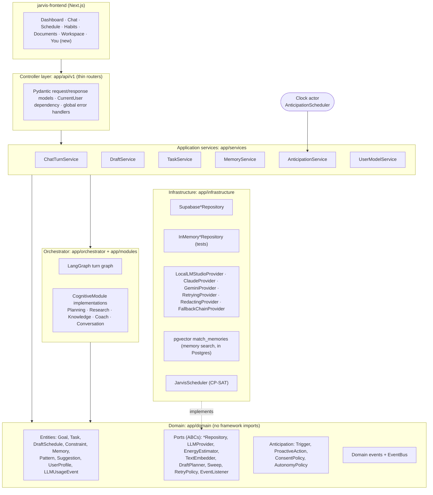
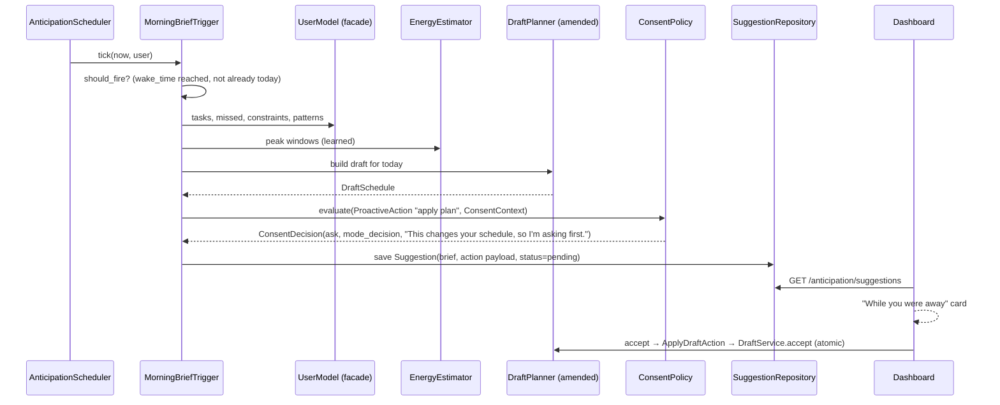

# Capstone LLD Restructure + Anticipation Engine — Design

**Date:** 2026-11-14
**Status:** Draft, awaiting Madhav's approval
**Amended:** 2026-11-14, after implementation (phases 1, 2a, 3a and 2b were built; see §12). Sections §5–§12 were edited so the spec says what the code does; each edit is marked "(amended 2026-11-14 after implementation)", and the rulings behind them are rows 13–26 of the §15 decision log. §2 and §3 are the pre-implementation audit and are left as written.
**Branch:** `capstone-lld` (cut from `spine-may1-wip` in Jarvis-Engine; matching branch to be cut in jarvis-frontend)
**Team:** Madhav (HackHeroic), RAVIYADAV6522, pugazhjs9, amathziah. The work split will be decided later by the team, so every deliverable below has an **owner slot**.
**Evidence base:** four read-only audits run 2026-11-14 covering the backend LLD, the DB/errors/API, features and demo readiness, and Claude Code patterns. Their findings are summarised in §2, with file:line citations kept in the audit outputs.

---

## 1. Intent: why we're doing this

Jarvis is a **hyper-personalized personal intelligence**, not a chat assistant and not a calendar. It builds a living model of one person: when they focus, what drains them, what they avoid and why, and how they respond to failure. It uses that model to **have things ready before they're asked**. The scheduler is a muscle; the User Model plus the observation loop is the brain. (Madhav, 2026-11-14: "keeping things ready even before you need and doing it efficiently, understanding a human both psychologically and mentally.")

The same codebase is the final-year capstone for System Design + Software Engineering. The evaluation is days away and grades 10 Low-Level Design criteria:

1. requirements
2. class diagram
3. OOP
4. SOLID
5. design patterns
6. sequence/activity diagrams
7. API design
8. DB schema
9. error handling
10. a working end-to-end implementation that **reflects the design exactly**

Each member must be able to explain their own part.

So this work has two jobs that pull in the same direction:

1. **Make the design real.** Restructure the code so the class diagram, patterns and SOLID claims are true in the code and an examiner can open any file and find what the diagram says.
2. **Make the vision visible.** Today Jarvis never makes the first move and what it learns stays invisible. The demo must show it anticipating.

## 2. Where we are (audit summary)

**Works end-to-end today:**
- brain dump → plan → CP-SAT schedule as a draft
- negotiate the draft (accept or reject), then persist it
- teach a rule ("no work before 11") → re-plan → the schedule moves
- memory review and forget
- missed-task recovery without guilt (message text only)
- the mastery coach
- resuming a conversation across a restart (SQLite checkpointer)

509 offline tests pass.

**Rubric gaps:**

| # | Criterion | Gap |
|---|---|---|
| 1 | Requirements | Nothing written. There is no Time/Clock actor, which is why nothing is proactive. |
| 2 | Class diagram | Tasks, goals, drafts, habits and memories are `dict` rows. There are about 21 behavioural classes against 339 top-level functions. |
| 3 | OOP | Zero ABCs and one private Protocol. Behavioural inheritance appears once (`ScrubbingSqliteSaver`). |
| 4 | SOLID | God-files: `control_policy.py` (1939 lines), `chat.py` (1618, with a 445-line handler), `graph.py` (658). Adding an intent means editing 3 files. `UserModel._db` is reached into from 5 call sites. 36 collaborators are typed `Any`. |
| 5 | Patterns | Real today: Facade (UserModel), Registry, Chain of Responsibility (hooks), Builder (JarvisScheduler, build_module_graph), function-style Strategy and Decorator. Missing: Repository, State, Observer, Command, and Strategy behind real interfaces. `registry.py` claims inheritance that doesn't exist. |
| 6 | Sequence/activity | Flowcharts exist in PROJECT_STATUS.md, but there are no sequence diagrams. |
| 7 | API | 11 of 50 routes have `response_model`. There are 7 error shapes. `str(exc)` leaks internals. There is no auth seam. Services import domain types from endpoint files (11 upward imports). |
| 8 | DB | 4 FKs in total. No Goal or User table. No RLS. Code writes columns and status values the schema doesn't allow. The health check queries a table no migration creates. 6 tables are dead. |
| 9 | Errors | No custom exceptions and 176 `except Exception` blocks. **Three real bugs:** an IDOR on pending-calendar approve/list, accepting a draft twice duplicates tasks, and a non-atomic delete-then-insert can lose tasks. LLM calls have no timeout. |
| 10 | Demo | Core loop works. Proactive suggestions are stubbed, PEARL has no data within a 10-minute demo, research is a stub, the dashboard shows fake `DEMO_TASKS`, focus windows are a hardcoded hour table, and learning events go out after the stream closes. |

## 3. Goals, non-goals, anti-goals

**Goals**
- G1. Every one of the 10 rubric criteria is demonstrably met, with code as the evidence and docs that point at it.
- G2. A layered architecture: controllers → application services → domain (entities + interfaces) → infrastructure (repositories, LLM providers). There are no upward imports.
- G3. Jarvis visibly anticipates (§7): it acts on a schedule without being asked, within a consent policy the user controls.
- G4. Jarvis visibly understands: a "What Jarvis knows about you" page where every pattern, rule and memory shows its evidence, and a focus profile learned from history instead of hardcoded.
- G5. The three real bugs are fixed, along with every schema mismatch.
- G6. Capstone docs with Mermaid diagrams generated from the finished code, plus an automated **design-conformance test** proving that the diagram matches the code.

**Non-goals (this push)**
- Real authentication or JWT. We add an auth *seam* (a `CurrentUser` dependency) and are honest that it is a stub.
- The Generative UI spec (2026-08-08), MCP, skills, slash commands, DKT, RL, SARIMAX.
- Cloud deployment. The demo runs locally (frontend on localhost, backend on localhost, Supabase cloud).
- The full ask-back spec. Only its deterministic-gate tier is in scope (§8.3).
- Multi-user scale or performance work.

**Anti-goals (failure even if it "works")**
- A diagram that disagrees with the code.
- **Faked intelligence:** hardcoded insights shown as learned. Demo history may be seeded (§9), but every pattern on screen must be computed live by real code from that history.
- Breaking the core loop that works today. The 509 tests stay green throughout.
- Copying Claude Code source. We adopt architectural *ideas* only. Leaked proprietary code in a graded project is an academic-integrity and IP risk.
- Guilt language, or framing Jarvis as a calendar or planner.
- PII sent to the cloud without going through the redaction path.

## 4. Constraints

- **Time:** days. Every phase in §12 ends in a demoable state so we can stop at any phase boundary.
- **Stack stays the same:** Python, FastAPI, LangGraph, OR-Tools, LiteLLM, Supabase (cloud) and ChromaDB on the backend; Next.js 14 and React 18 on the frontend.
- **LLM routing changes (ADR-10, proposed, awaiting Madhav's approval):**
  - Local-first stays: LM Studio Gemma is used whenever it is running.
  - **Claude (Anthropic API, paid from Madhav's existing Console credits) replaces Gemini as the cloud tier.** Gemini stays only as a last resort, so the fallback order is Local → Claude → Gemini.
  - A `CLAUDE_PRIMARY` switch makes Claude first for the demo. It works like today's `GEMINI_PRIMARY`.
  - Claude is called through the official `anthropic` Python SDK (`AsyncAnthropic`), not through LiteLLM.
  - Model `claude-sonnet-5-5` for every cloud call (Madhav's choice, 2026-11-14: Opus is more than this project needs; set by `CLAUDE_MODEL` in config so it can change in one place), using effort to separate the roles: `low` for FAST-role tasks, `medium`/`high` for PRIMARY-role tasks.
  - Structured outputs via `output_config.format` / `messages.parse()` for every schema'd call.
  - Prompt caching on the stable system prompts.
  - Server-side refusal fallback on by default (`fallbacks: "default"`, beta `server-side-fallback-2026-07-01`).
  - Estimated spend: roughly half of the Opus estimate: about $0.05–0.10 per turn, and $5–15 for all development and demo use.
- **Supabase is currently paused.** Madhav must restore it from the dashboard. Code work continues offline because tests never touch the network.
- Tests must stay offline (the conftest socket guard).
- Docs use Mermaid plus ADR-style decision logs (Madhav's standing preference).
- Agents: the main session orchestrates and implementation and review subagents run on Opus. Fan out only for genuinely independent work.

## 5. Target architecture (HLD)



**The dependency rule:**
- `domain` imports nothing from `api`, `services`, `orchestrator` or `infrastructure`.
- `services` and `orchestrator` depend on domain *ports*, never on Supabase or LiteLLM directly.
- The composition root (FastAPI lifespan → `AppContainer`) is the only place that picks concrete implementations.

A test enforces the rule by scanning imports.

**(amended 2026-11-14 after implementation)** Three boxes changed while building:
- There is no `ConsentService`. Consent is `ConsentPolicy` (`app/domain/anticipation.py:218`), a domain class the container builds once (`app/container.py:165`) and hands to `AnticipationService`.
- There is no `ChromaArchive`. Memory search runs in Postgres: the pgvector function `match_memories`, called by `SupabaseMemoryRepository` (`app/infrastructure/persistence/supabase_repos.py:718, 841`) behind `MemoryRepository.nearest` (`app/domain/ports.py:465`). ChromaDB is still used, but only for document chunks: ingestion (`app/services/extraction/knowledge_ingester.py`), the documents API, and document search in chat and planning (`query_knowledge`, `app/utils/chroma_client.py`).
- Services reach planning only through the `DraftPlanner` port (`app/domain/ports.py:618`). Its one implementation is `PlanningGraphReplanner` (`app/modules/planning_replan.py:34`), which the container builds over `PlanningServices` (`app/container.py:168-177`). The morning brief, the brief's apply action and a late REST/chat accept (`app/services/draft_actions.py:63`) all take a `DraftPlanner`, never the planning graph.
- The layering test (`tests/test_layering.py`) scans `services`, `domain`, `infrastructure`, `modules`, `orchestrator`, `core`, `utils` and `schemas` for imports of `app.api`, and every allow-list is pinned to its documented leftovers (`test_layering__allow_lists__are_exactly_the_documented_leftovers`).

## 6. Domain model and design (LLD)

### 6.1 Entities (become real classes; the class diagram is drawn from these)

| Entity | Key attributes | Relationships |
|---|---|---|
| `UserProfile` | user_id, display_name, timezone, wake_time, autonomy_mode | 1 → * of everything below |
| `Goal` | id, title, deadline, status | 1 Goal *composes* 1..* Task |
| `Task` | id, task_id, title, duration_min, difficulty, status, scheduled_start/end, deadline, dependencies | * Task ↔ * Task (depends_on) |
| `DraftSchedule` | id, goal_id, tasks[], status (State), horizon_start, expires_at, version | 0..1 per active plan; on accept *produces* Tasks |
| `BehavioralConstraint` | id, kind (rule/habit), time window, recurrence, source (said / inferred) | *aggregated* by UserModel; 0..1 HabitTracker |
| `Memory` | id, memory_type, content, status (active / dismissed / forgotten / faded), provenance (said / inferred), origin, pattern_key, confidence, strength, stability, strength_as_of, observation_count, source_session_id, source_message_id, created_at, last_confirmed_at, superseded_by, expires_at, applied_as **(amended 2026-11-14 after implementation;** `app/domain/entities.py:438-505`**)** | self-association (supersedes); a stated rule names the memory of saying it (§9.1) |
| `Pattern` | detector, description, occurrences, confidence, evidence[] | *derived from* Tasks; may *propose* a Constraint |
| `Suggestion` | id, trigger, kind, title, body, action (the `ProactiveAction`'s payload, a dict), status, consent_behavior, consent_reason, consent_kind, created_at, expires_at **(amended 2026-11-14 after implementation;** `app/domain/entities.py:605-630`**)** | produced by a Trigger; *holds* 1 ProactiveAction as a payload, rebuilt by `ActionFactory` when accepted |
| `LLMUsageEvent` | role, model, location (local/cloud), tokens, latency, redactions | recorded by UsageLedger |
| `UserModel` | Facade aggregating Profile, Constraints, Memories, Patterns and EnergyProfile | the centre; every module reads it |
| `TaskEvent` **(amended 2026-11-14 after implementation)** | id, task_id, event_type (scheduled / completed / skipped / missed / rescheduled / deadline_missed), occurred_at, scheduled_start/end, metadata (skip reason, quality, actual duration, previous start) (`app/domain/entities.py:314-330`) | * per Task; append-only outcome history (§9.1) |
| `FocusProfile` **(amended 2026-11-14 after implementation)** | source (prior / learned), observations, hours[24] of `HourFocus` (hour, score, done, not_done) (`app/domain/entities.py:550-588`) | produced by an `EnergyEstimator`; only a learned one steers the solver (§9.2) |
| `ConversationSession` **(amended 2026-11-14 after implementation)** | id, title, created_at, updated_at, summary, summary_through, summary_updated_at, summary_covered_through (`app/domain/entities.py:633-666`) | 1 → * `ChatMessage` |

**(amended 2026-11-14 after implementation)** The `UserModel` row is two classes in the code:
- `UserModel` (`app/core/user_model.py:23`) is the planning-side facade over `ProfileRepository`, `ConstraintRepository` and `TaskRepository`, with a per-instance read cache. `UserModel.for_planning(user_id, planning)` builds it from `PlanningServices` (`app/core/user_model.py:42`). It holds no database client. Rules come from `ConstraintRepository.list_active` (`:77-84`), so a rule whose validity window has closed no longer constrains any plan, chat or brief.
- `UserModelService` (`app/services/user_model_service.py:166`) is the You-page facade: `snapshot` gathers patterns, rules, memories in use, the focus profile, the privacy receipt and the completion streak in one call (`:192`).

The entities also gained `Goal`'s companion `GoalDeadlineUpdate`, `HabitTracker` and `ChatMessage` (`app/domain/entities.py:257, 412, 669`). `DraftSchedule.version` is not a stored column: it is a 16-hex sha256 of the draft's tasks and schedule, computed on read (`app/domain/entities.py:360`).

### 6.2 Ports (ABCs)

**Decision (ADR-2):** ports are ABCs, not structural Protocols, so the class diagram's `<<interface>>` and "implements" arrows are literally true and enforced at instantiation.

| Port | Implementations | Pattern |
|---|---|---|
| `TaskRepository`, `GoalRepository`, `DraftRepository`, `ConstraintRepository`, `MemoryRepository`, `SuggestionRepository`, `UsageRepository`, `ProfileRepository` | `Supabase*` and `InMemory*` | Repository; Liskov demonstrated by running the same contract tests against both |
| `LLMProvider` (`complete`, `stream`, `structured`) | `LocalLMStudioProvider`, `ClaudeProvider` (new, official SDK), `GeminiProvider`. `RetryingProvider` and `RedactingProvider` wrap any provider. `FallbackChainProvider` tries providers in order. | Strategy + Decorator + Chain of Responsibility. `LLMProviderFactory` selects by role, availability and the `*_PRIMARY` switches. Adding `ClaudeProvider` without editing any caller is the live OCP demonstration. |
| `EnergyEstimator` | `HeuristicEnergyEstimator` (today's table, kept as prior), `HistoryEnergyEstimator` (learned from completion history, smoothed toward the prior) | Strategy |
| `Trigger` (template method `run()` → `should_fire` / `gather` / `build_suggestion`) | `MorningBriefTrigger`, `PatternRuleTrigger`, `PreTaskPrepTrigger`, `DeadlineRiskTrigger` | Template Method + Strategy |
| `AutonomyPolicy` | `SuggestOnly`, `AskFirst`, `AutoLowRisk` | Strategy, selected by `UserProfile.autonomy_mode` |
| `ConsentRule` chain | deny rules → per-action risk check → user rules → mode policy | Chain of Responsibility; returns `ConsentDecision(behavior, reason)` |
| `RetryPolicy` | `ExponentialBackoff(base, cap, jitter)`, `NoRetry` | Strategy |
| `EventListener` | `PatternObserver` (PEARL), `UsageLedger`, `AnticipationListener`, `TelemetryListener` | Observer via `EventBus` |
| `CognitiveModule` (`name`, `intents`, `build_graph()`) | Planning, Research, Knowledge, Coach, Conversation | Registry + OCP: modules declare their intents, so the router is derived and adding a module touches one file |
| `Step` (Command; `execute`, plus fail-closed `is_read_only`/`is_concurrency_safe` defaults) | `FunctionStep` adapts existing node functions | Command + Adapter; `StepExecutor.run` is the Template Method (flag → validate → consent → pre-hook → execute with timeout → post-hook) |

**(amended 2026-11-14 after implementation)** What the ports are in the code (`app/domain/ports.py` unless named):
- **Added repositories:** `TaskEventRepository` (`:126`), `GoalRepository` (`:257`), `HabitTrackerRepository` (`:278`) and `ConversationRepository` (`:504`), each with a `Supabase*` and an `InMemory*` implementation (`app/infrastructure/persistence/supabase_repos.py`, `in_memory.py`) under the one contract suite (`tests/test_repository_contracts.py`).
- **Added ports:** `TextEmbedder` (`:668`; `MiniLMEmbedder` in `app/infrastructure/embedding.py:10`), `DraftPlanner` (`:618`; `PlanningGraphReplanner`), and `Sweep` (`:601`; `SlotPassedSweep`, `MemoryDecaySweep`, `SessionSummarySweep`, `CheckpointRetentionSweep`).
- **Trigger and consent live in the domain, not in the ports module:** `Trigger`, `ProactiveAction`, `ConsentRule` and its four rules, `AutonomyPolicy` and `ConsentPolicy` are in `app/domain/anticipation.py` (`:58-342`). `ConsentPolicy.evaluate` returns `ConsentDecision(behavior, kind, message)` (`app/domain/entities.py:591`).
- **Not built:** `CognitiveModule`, `Step`, `FunctionStep` and `StepExecutor`. Modules are still `ModuleDefinition`s compiled by `app/core/module_framework.py` and routed by `INTENT_TO_MODULE` (`app/orchestrator/routing.py`). The restructure's task for this was dropped (§12).
- **No `TelemetryListener`.** The listeners are `PatternObserver` (`app/services/memory/patterns.py`), `UsageLedger` (`app/services/usage_ledger.py`) and `AnticipationListener` (`app/services/anticipation/triggers.py:401`).

### 6.3 Design patterns: what goes where, and why (feeds `05-design-patterns.md`)

| Pattern | Where | Why this pattern and not another |
|---|---|---|
| **Singleton** | `AppContainer` (composition root), `EventBus`, `Settings` (one per process via the lifespan) | Exactly one wiring of concrete implementations per process. Accessed through dependency injection, not global lookups, so tests can build their own. |
| **Factory Method / Abstract Factory** | `LLMProviderFactory`, `RepositoryFactory` (supabase / in-memory family), `TriggerFactory` | Construction varies by environment; callers shouldn't know which concrete class they got. |
| **Builder** | `JarvisScheduler` (stepwise CP-SAT model), `ModuleGraphBuilder`, `MorningBriefBuilder` | Complex objects assembled in validated steps. |
| **Strategy** | LLMProvider, EnergyEstimator, AutonomyPolicy, RetryPolicy, PEARL detectors as classes, document handlers | Interchangeable algorithms chosen at runtime; new ones are added without editing callers (OCP). |
| **Observer** | `EventBus` with domain events `TaskCompleted`, `TaskSkipped`, `DraftAccepted`, `PatternDetected`, `LLMCallCompleted` | Learning, telemetry and anticipation react to what happened without the emitter knowing them. This replaces 5 never-fired hook events. |
| **Decorator** | `RetryingProvider`, `RedactingProvider`, the step timeout/hook wrapper | Adds retry and PII redaction around any provider without subclass explosion. |
| **Chain of Responsibility** | Consent rule chain, intent rules (replacing the `_classify_intent` if-ladder), ActionHooks | Ordered handlers where any one can decide. Hooks aggregate **deny > ask > allow regardless of order**, fixing today's first-match bug. |
| **State** | `DraftSchedule` lifecycle (`Pending → UnderReview → Accepted / Rejected / Expired / Superseded`) and `NegotiationPhase` as one transition table | Illegal transitions raise `InvalidStateTransition` (409). This is also how double-accept is rejected. |
| **Command** | `Step`, and `ProactiveAction` held by a `Suggestion` (`describe()`, `execute()`) | A proactive proposal is a deferred, inspectable, consent-gated action. |
| **Facade** | `UserModel` (no more `_db` reach-throughs), `ChatTurnService` | One simple face over many subsystems. |
| **Repository + Unit of Work** | all persistence; atomic accept through a Postgres function | Data access in one layer, user-scoped by construction, which fixes the IDOR class of bug. |
| **Template Method** | `Trigger.run`, `StepExecutor.run`, `BaseRepository` helpers | A fixed algorithm skeleton with variable steps. |
| **Adapter** | LiteLLM → `LLMProvider`, supabase-py → repositories, `FunctionStep` over legacy node functions | Wraps existing code instead of rewriting it. |
| **Null Object** | `NullEventBus`, and `InMemory*` repositories replace `_StubDBClient` | Removes the `hasattr`/`None` checks (the LSP violation today). |

**(amended 2026-11-14 after implementation)**
- **Factory:** there is no `TriggerFactory`; the container constructs and registers the two triggers itself (`app/container.py:188-197`). The third factory is `ActionFactory` (`app/services/anticipation/service.py:84`): each action kind registers a builder, and `from_payload` rebuilds the `ProactiveAction` a stored suggestion describes when the user accepts it (an unknown kind is a 422 `ValidationError`). `build_action_factory` registers the three kinds (`app/services/anticipation/actions.py:290`).
- **Builder:** there is no `MorningBriefBuilder` or `ModuleGraphBuilder`. The brief's text is put together deterministically from facts, with no model call, by helper functions in `app/services/anticipation/triggers.py` (`_lines`, `_reslot_lines`, `_planned_line`, `_peak`; module docstring `:1-8`).
- **Singleton:** `Settings` is not a process-wide object. `Settings.from_config(cfg)` (`app/core/settings.py:79`) is called once by `AppContainer.build` (`app/container.py:130`), which hands each service its own frozen record (`TaskSettings`, `MemorySettings`, `ConversationSettings`, `FocusSettings`, `AnticipationSettings`). The container itself is built once by the lifespan and reaches code by injection (on `app.state`, in a turn's state under `container`, or through constructors); there is no global lookup (`tests/test_injection.py::test_runtime_registry__gone_and_imported_nowhere`).
- **Not built:** `StepExecutor.run` and `BaseRepository` as Template Methods (the Supabase family shares a private `_SupabaseRepository` base, `app/infrastructure/persistence/supabase_repos.py:158`), and the order-independent hook aggregation: `ActionHooks.execute` still returns the first DENY or ASK (`app/orchestrator/hooks.py:39-55`).

### 6.4 SOLID: where each principle is applied (feeds `04-oop-and-solid.md`)

- **SRP:**
  - `chat.py` is split into a thin router, `ChatTurnService` and `SseEncoder`.
  - `control_policy.py` is dissolved: live helpers move into `services/planning/`, and v1 is deleted (§8.5).
  - UserModel loses prompt rendering (moved to `UserModelPromptRenderer`) and the energy heuristic (moved to `EnergyEstimator`).
- **OCP:**
  - New module = new `CognitiveModule` registration.
  - New trigger = new `Trigger` subclass.
  - New provider = new `LLMProvider`.
  - None of these edits the router or graph.
- **LSP:** `InMemory*` and `Supabase*` repositories pass the **same contract test suite**. `HeuristicEnergyEstimator` and `HistoryEnergyEstimator` are interchangeable.
- **ISP:** small role ports (`TaskReader` vs `TaskWriter` where they diverge). Module nodes receive their projected state (`state_in`/`state_out`), not all 35 JarvisState keys.
- **DIP:** services and modules depend on ports, and `AppContainer` injects concretes. No `create_client` outside infrastructure; today there are 9 sites.

**(amended 2026-11-14 after implementation)** Built: the `chat.py` split (`app/api/v1/endpoints/chat.py` routes only; the turn is `app/services/chat_turn/`; frames are encoded by `SseEncoder` in `app/schemas/chat_stream.py:334`), the dissolution of `control_policy.py` (§8.5), the LSP contract suite, the `Trigger` and `LLMProvider` extension points, and one `create_client` site (`app/db/supabase_py.py:94`). Not built: `UserModelPromptRenderer`, the `CognitiveModule` registration (§6.2), and `TaskReader`/`TaskWriter` role ports.

## 7. Anticipation Engine: Jarvis makes the first move

This is my call, because Madhav hadn't answered the "weekday morning" question when this was written. It is built from his own words, "keeping things ready even before you need." Madhav: veto or reshape this section.

**New actor: Clock.** `AnticipationScheduler` is an in-process asyncio loop started in the FastAPI lifespan, ticking every 60s. On each tick it asks each `Trigger` whether it should fire for each active user. For the demo, `POST /api/v1/anticipation/run {trigger}` fires any trigger on demand.

**(amended 2026-11-14 after implementation)** How the clock actually runs:
- **Each tick runs the sweeps first, then the triggers** (`app/services/anticipation/scheduler.py:49-97`). A sweep runs when its interval has passed: `SlotPassedSweep` every minute, `SessionSummarySweep` every 5 minutes, `MemoryDecaySweep` and `CheckpointRetentionSweep` every 24 hours. One sweep's, trigger's or user's failure is logged and never stops the rest.
- **A trigger that settled the user's local day is not run again that day.** Made, already made, denied or nothing to say: the outcome is remembered in this process (`app/services/anticipation/service.py:7-14`). A failing trigger waits 1, 2, 4 … minutes before its next try, never more than 30 (`:20-24`, `:273-285`).
- **A manual run (`POST /api/v1/anticipation/run`) bypasses that day memo** and always re-evaluates; the stored suggestion still keeps it to one per local day. A second manual run of the same trigger within `ANTICIPATION_MANUAL_COOLDOWN_SECONDS` (10, `app/core/config.py:194`) returns the first run's outcome, so repeated clicks cannot each spend a model call (`app/services/anticipation/service.py:197-231`).
- **The brief is due in the window [wake time, wake time + 6 h)** on the user's clock (`MORNING_BRIEF_WINDOW_HOURS`, `app/core/config.py:196`; `MorningBriefTrigger.should_fire`, `app/services/anticipation/triggers.py:120-125`).
- **Only MorningBrief and PatternRule are built** (`app/container.py:188-197`). PreTaskPrep and DeadlineRisk are not built.

| Trigger | Fires | What it has ready | Default consent |
|---|---|---|---|
| **MorningBrief** | at the user's `wake_time` | Today's plan already built. Yesterday's misses re-slotted, framed without guilt. The hardest task placed in the **learned** peak-focus window. The first task's workspace prepped. One "I noticed…" insight with its evidence. **(amended 2026-11-14 after implementation)** No workspace is prepped. The plan is drafted through the `DraftPlanner` (`triggers.py:146`), and the solver's energy term leans hard tasks toward high-focus hours (§9.2). The text says the hardest task is at the user's strongest hour only when the learned profile peaks at that hour with a score of at least 0.7 (`_peak`, `triggers.py:293-300`; `PEAK_CLAIM_MIN_SCORE`, `:70`). | Read-only parts auto; any schedule change → ask |
| **PatternRule** | when PEARL confirms a pattern (≥3 occurrences, ≥0.7 confidence) | "You've skipped 3 of the last 4 study blocks before 10am. Want me to stop putting study there?" Accept → constraint stored → re-plan draft. **(amended 2026-11-14 after implementation)** It fires from an event: when PEARL publishes `PatternDetected` for a pattern whose detector proposes rules, `AnticipationListener` runs it at once as a manual run, one run per user at a time (`triggers.py:401-436`). It is also registered for the tick, where the day memo limits it to once a day. Accepting confirms the pattern's memory, stores the rule once (a hard block on that hour, linked to the memory) and drafts a plan around it for the user to accept (`AdoptRuleAction.execute`, `app/services/anticipation/actions.py:160-204`). | Ask |
| **PreTaskPrep** | 30 min before a scheduled task | The task workspace (linked documents, research results, WOOP if-then plan) is built and waiting. **(amended 2026-11-14 after implementation)** Not built. | Auto (read-only) |
| **DeadlineRisk** | hourly | A goal's TMT risk crossed a threshold. Proposes a re-plan draft that explains what moved and why. **(amended 2026-11-14 after implementation)** Not built. | Ask |



**(amended 2026-11-14 after implementation)** Reading the diagram against the code (`Trigger.run`, `app/domain/anticipation.py:342-421`): the trigger reads tasks and outcome events through its repositories, not through the `UserModel` facade, and plans through the `DraftPlanner` port. A denied action is not stored; the run returns the decision with status `denied`. An allowed action that changes something runs at once and is stored as `auto_applied`; an allowed read-only one is stored as `pending` (it is information). Accept goes through `AnticipationService.accept` (`app/services/anticipation/service.py:300`), which claims the suggestion with a compare-and-set before its action runs and rebuilds the action from its payload with `ActionFactory`. `ApplyDraftAction` refreshes a stale brief at accept: if a slot has begun or a task was finished or skipped since the draft was made, the open tasks are drafted again from now and that plan is accepted instead; nothing left means the stale draft is expired (`app/services/anticipation/actions.py:62-100`).

**Consent model** (idea adopted from Claude Code's permission design, written fresh):
- Every proactive action passes through `ConsentPolicy.evaluate(action) → ConsentDecision(allow | ask | deny, reason)`.
- The reason is typed (`RuleMatch` / `ModeDecision` / `RiskCheck` / `LearnedPreference`), so Jarvis can explain itself: "I didn't move it, because you said never before 11."
- The user sets `autonomy_mode` on the You page.

**(amended 2026-11-14 after implementation)** The signature is `ConsentPolicy.evaluate(action, ctx) → ConsentDecision(behavior, kind, message)` (`app/domain/anticipation.py:227`, `app/domain/entities.py:591-602`). `ctx` is a `ConsentContext`: the autonomy mode, the hours the user said to keep free, and the dedupe keys of dismissed suggestions (`app/domain/anticipation.py:92-106`); it is read only when a run reaches consent. The default chain is: repeat dismissal (deny) → read-only (allow) → an hour already covered by a stated rule (deny) → the autonomy mode (`ConsentPolicy.default`, `:236-241`). Both built actions that change the schedule (`apply_plan`, `adopt_rule`) are `schedule_change` risk, so every mode asks for them; only `share_insight` is read-only (`app/services/anticipation/actions.py:45-46, 114-115, 249-250`).

## 8. Feature work beyond anticipation

### 8.1 Visible understanding: the "You" page (`/you`)

The page shows "What Jarvis knows about you". Each item shows its evidence and source ("you said" vs "I noticed"), and each can be confirmed or forgotten (explicit beats inferred):

- learned patterns with evidence counts
- active rules
- memories with freshness ("noted 12 days ago")
- the **focus profile** (a chart of completion likelihood by hour, from `HistoryEnergyEstimator`)
- autonomy mode and wake time settings
- the **privacy receipt** from the UsageLedger (N calls on-device, M sent to Gemini, K redactions)

**(amended 2026-11-14 after implementation)**
- The receipt counts calls **sent to the cloud** (any cloud provider: Claude or Gemini), not "sent to Gemini" (`PrivacyReceipt.cloud_calls`, `app/services/user_model_service.py:136`). It covers the last 30 days, and the response says where the window opens (`RECEIPT_WINDOW_DAYS`, `:60`; `since`, `:215`).
- The settings are autonomy mode, wake time **and timezone** (an IANA name; an unknown zone is a 422 and nothing changes) through `PATCH /api/v1/you/settings` (`app/api/v1/endpoints/you.py:133-151`).
- `GET /api/v1/you` also returns `streak_days`, the coach's completion streak on the user's days; a streak is not broken until the local day ends (`compute_streak_from_events`, `app/services/analytical/mastery_tracker.py:230`).

### 8.2 Make learning moments arrive

- Memory and learning events are emitted **before** the SSE `complete` frame instead of from a background task after the stream closes.
- Wire up the components that already exist but are never fed or mounted: `pearl_insights`, `LearningToast`, `WoopCard`, `ReplanBanner`, `InfeasibleGuidance`.
- Handle the `consent_request` SSE event in the frontend.
- Remove the dashboard's `DEMO_TASKS` fallback in favour of a real empty state.

**(amended 2026-11-14 after implementation)**
- Learning happens inside the turn, after the reply and before `complete`, and costs no extra model call: the facts to remember come from the turn's one extraction call (`brain_dump.memories`), and PEARL's look is bounded at 0.5 s (`app/core/observation.py:1-23, 50-57`). The `learning` phase frame reports the real counts.
- The `LearningToast` is mounted only on the chat page (`jarvis-frontend/app/(app)/chat/page.tsx`); the other learning surfaces are inline. `WoopCard` is on the workspace page, `ReplanBanner` and `InfeasibleGuidance` in `JarvisResponse`, `pearl_insights` on the dashboard and in the chat panel, and the dashboard has no `DEMO_TASKS`.

### 8.3 Ask-back, tier 1 only

From `2026-08-13-ask-back-clarification-design.md`, take only the deterministic `clarify_gate`:
- a required slot is missing (no real goal, no deadline when one is needed) → typed `clarify_request` → the existing `ClarificationChips` → resume on the same thread.

Solver-conflict explanation (AddAssumptions) is P2.

**(amended 2026-11-14 after implementation)** Not built. The backend has no `clarify_gate` and sends no `clarify_request`; `ClarificationChips` exists in the frontend but nothing feeds it.

### 8.4 Research module, minimum real version (P2)

Replace the stub with a real search-and-summarise path through `LLMProvider`, so it passes through `RedactingProvider` and the usage ledger. Use Claude's server-side web search tool when the cloud tier is Claude, and Gemini grounding otherwise. Today it bypasses both.

**(amended 2026-11-14 after implementation)** Not built. `execute_search` runs the shared web-search helper, which is PII-gated and metered on the turn's event bus; `summarize` makes no model call (it returns "Found N results…") and `link_to_tasks` returns nothing (`app/modules/research_graph.py:29-75`).

### 8.5 Retire v1

Delete the deprecated routes and `execute_agentic_flow`; move the live helpers (`_persist_fused_tasks`, the extraction prompt, etc.) into `services/planning/`. After that, `/api/v1/chat/stream` becomes the single chat endpoint (renamed from `/v2/stream`, frontend updated in the same change). This removes the biggest SRP violation and about 2,000 lines an examiner could ask about.

**(amended 2026-11-14 after implementation)** Done. Deleted:
- **Routes:** `POST /api/v1/chat/`, the v1 handler of `/api/v1/chat/stream` (and its direct local-model stream), `/chat/confirm-schedule`, `/chat/accept-schedule`, `/chat/modify-schedule` and the 501 `POST /drafts/{id}/chat`. Later in the restructure: `PATCH` and `DELETE /tasks/{id}`, `DELETE /tasks/` and `DELETE /ingestion/behavioral-constraint/{id}`.
- **Modules:** `services/analytical/control_policy.py` (with `execute_agentic_flow`), `services/intent_registry.py`, `services/analytical/task_editor.py`, `task_rearranger.py`, `task_retrieval.py`, `services/memory/pearl.py`, `extractor.py`, `retriever.py`, `store.py` (`MemoryStore`), `services/draft_store.py` (`DraftStore`) and `core/runtime.py`.
- **Moved, not deleted:** `derive_goal_id`, `mint_run_token` and `namespace_chunk` to `app/services/planning/goal_ids.py`; the brain-dump extraction prompt to `app/services/planning/brain_dump_prompt.py`; `run_schedule` to `app/services/planning/scheduling.py`.

`/api/v1/chat/stream` (`app/api/v1/endpoints/chat.py`) only routes: it opens a turn with `ChatTurnService` (`app/services/chat_turn/service.py`) and returns its frames, each a typed model encoded by `SseEncoder` (`app/schemas/chat_stream.py`). The frontend posts only to it (`jarvis-frontend/lib/api.ts:25`).

## 9. Demo data: seeded history, real computation

`scripts/seed_demo_user.py` writes about 3 weeks of realistic history for a `demo` profile into Supabase:
- tasks with scheduled and actual times
- completions and skips that contain deliberate, discoverable regularities, such as early-morning study skipped, evenings strong, and a deadline-crunch habit

PEARL, `HistoryEnergyEstimator` and the triggers then compute everything live from that history. The seed is idempotent and resettable (`--reset`). In the viva we say plainly: "seeded history, live inference."

**Honesty rule:** the seed writes exactly the rows and events the live app writes (§9.1). It never writes a shape that only the seed produces.

### 9.1 What "skipped" and "missed" mean (my call, from the builder check)

Today the signals disagree:
- The Skip button writes `pacing_pushed`.
- `missed` means the deadline passed.
- PEARL counts `status == "skipped"`, which nothing writes.

The new semantics:

- **The outcome history lives in a new append-only `task_events` table**, with event types `scheduled | completed | skipped | missed | rescheduled | deadline_missed`. `user_tasks.status` holds only the *current* state.
  - PEARL, `HistoryEnergyEstimator` and the triggers read events, never statuses.
  - Re-slotting a missed task updates the same `user_tasks` row (new times, status back to pending) and appends a `rescheduled` event. No history is lost, and nothing collides with UNIQUE `(user_id, task_id)`.
- **Skip button:** writes a `skipped` event, carrying the reason when one is given. It replaces `pacing_pushed`.
- **Missed is inferred, not asked** ("infer → confirm → adapt"). A `SlotPassedSweep` runs on the AnticipationScheduler tick. A scheduled task whose `scheduled_end` + 30-minute grace has passed, with no `completed` or `skipped` event, gets a `missed` event and the `missed` status.
- **The morning brief re-slots misses with no-guilt framing**, and the user can confirm or correct ("I actually did that").
- **Deadline-passed** becomes its own `deadline_missed` event, so it no longer overloads `missed`.

**(amended 2026-11-14 after implementation)**
- **Re-slotting does not update the row in place.** It happens inside `accept_draft`: accepting a plan deletes the user's pending tasks plus their `missed` tasks whose `task_id` the plan brings back, and re-inserts them as pending under the same id, in one transaction (`supabase/migrations/20261115000001_accept_draft_reslots_missed.sql:1-14, 67`). `DraftService.accept` then appends a `scheduled` event for a new slot or a `rescheduled` event (with the previous start) for a moved one (`app/services/draft_service.py:264-330`). History lives in `task_events`, so nothing is lost.
- **Skip carries a reason.** `TaskService.skip(user_id, task_id, reason=...)` stores it in the `skipped` event's metadata (`app/services/task_service.py:128-140`). `pacing_pushed` is gone from the schema (`supabase/migrations/20261115000000_skip_writes_skipped.sql:11-15`).
- **Bringing a missed task back** (`TaskService.bring_back`, `app/services/task_service.py:154`) is one compare-and-set from `missed` to `pending` that also clears its deadline; it records no event, because it is not an outcome.
- **A completion reported late still counts:** `complete` accepts a task that is pending, missed or skipped (`app/services/task_service.py:117`). The actual duration and quality go in the `completed` event's metadata, not on `user_tasks`.
- **A stated rule and the memory of stating it are linked.** The rule's `structured_semantics` carries the memory's id under `memory_id` (`RULE_MEMORY_KEY`); letting go of one lets go of the other (`app/services/memory/stated_rules.py:1-15, 30`). A rule adopted from a pattern is linked to the pattern's memory the same way (`app/services/anticipation/actions.py:230-237`).

### 9.2 The learned focus profile changes the solver (my call)

- `HistoryEnergyEstimator` produces a per-hour focus score. `run_schedule` gets a **soft** objective term, difficulty × focus score, so hard tasks lean toward the user's learned peak hours. It applies to every plan, not just the brief, because "memory changes the math" is the moat.
- Its weight sits **below** the TMT deadline priority. Hard blocks and the user's own rules always win.
- It sits behind a flag (`JARVIS_ENERGY_OBJECTIVE`, default on) so it can be switched off if it ever destabilises the demo.
- Tests pin that "teach a rule → the schedule moves" still holds with the term on, and that hard blocks are never violated.
- The morning brief's draft re-solves the whole pending set, using the existing multi-goal fusion semantics. There is no new "accept only today" path.

**(amended 2026-11-14 after implementation)**
- **The term applies only with a learned profile.** A profile is "learned" from `MIN_FOCUS_OBSERVATIONS` (10) outcomes in the last `FOCUS_WINDOW_DAYS` (28); a "prior" profile never steers the solver (`app/services/energy.py:119, 154`; `app/core/config.py:198-213`).
- **Weight:** `ENERGY_OBJECTIVE_WEIGHT` = 900 × difficulty, scaled to the makespan weight (`app/core/config.py:204-210`).
- **Zero for a task due within 24 hours** (or overdue), so the term never competes with urgency (`ENERGY_MIN_DELAY_HOURS`, `_energy_weight`, `app/services/planning/scheduling.py:96-111`).
- **The solver stops when idle:** inside the 10 s cap (`SOLVER_MAX_TIME_SECONDS`), the search stops once no better schedule has turned up for `SOLVER_IDLE_STOP_SECONDS` (1.0 s, env `JARVIS_SOLVER_IDLE_STOP_SECONDS`) after the first one (`app/core/config.py:223-234`; `app/core/or_tools/solver.py:28-44, 330-333`).
- `run_schedule` lives in `app/services/planning/scheduling.py`; the `POST /api/v1/schedule/generate-schedule` endpoint only calls it.

## 10. Error handling, validation, concurrency (feeds `09-error-handling.md`)

```
JarvisError
├── DomainError
│   ├── ValidationError            → 422
│   ├── NotFoundError              → 404
│   ├── ConflictError              → 409
│   │   ├── InvalidStateTransition   (e.g. accepting an already-accepted draft)
│   │   └── StaleVersionError        (optimistic concurrency)
│   ├── ScheduleInfeasibleError    → 422 with structured guidance (not HTTPException-as-signal)
│   └── ConsentRequiredError       → 202 / SSE consent_request
└── InfrastructureError
    ├── PersistenceError           → 503
    └── LLMError
        ├── LLMTimeoutError          → retry policy, then fallback provider
        ├── LLMUnavailableError      → fallback provider, then 503
        └── LLMOutputParseError      → one repair attempt, then honest degraded reply
```

- **One error envelope everywhere:** `{"error": {"code", "message", "details?", "request_id"}}` from global handlers, with the same shape inside an SSE `error` event. No `str(exc)` reaches a client; internals are logged with the `request_id`.
- **Validation at the boundary:**
  - `Literal`, `max_length`, `UUID` and date types on every request model
  - an upper bound on `file_base64`
  - duration and `start_min` bounds on draft edits
  - `user_id` required, resolved by the `CurrentUser` dependency
- **LLM:** explicit `timeout` on every completion. `RetryingProvider` with exponential backoff and jitter on transient errors only. A mid-stream failure falls back to the next provider. Local→cloud fallback is decided by error *type*, so a local code bug no longer silently ships the prompt to the cloud.
- **Concurrency:**
  - (a) **Atomic, idempotent accept:** a Postgres function `accept_draft(draft_id, user_id)` checks `status='pending'` and expiry, then deletes and inserts the tasks in one transaction; a second call gets 409. This fixes both the double-accept bug and the delete-then-insert loss window.
  - (b) A per-thread `asyncio.Lock` serialises concurrent turns on the same session.
  - (c) Conditional updates (`.eq("status", expected)` or a `version` column) for read-modify-write paths (`reschedule_count`, SM-2).
  - (d) Every repository method requires `user_id`, which closes the IDOR class of bug.
- **Silent-success removal:**
  - The completion-signal insert is fixed (it wrote non-existent columns and swallowed the error).
  - `'missed'` and `'archived'` status values are reconciled with the CHECK constraint.
  - List endpoints no longer return `[]` on a DB failure; they return 503.

**(amended 2026-11-14 after implementation)** The hierarchy as built (`app/domain/errors.py`):

```
JarvisError                          internal_error, 500
├── DomainError
│   ├── ValidationError              validation_error, 422
│   │   └── PayloadTooLargeError       payload_too_large, 413 (a body larger than any valid request)
│   ├── NotFoundError                not_found, 404
│   ├── ConflictError                conflict, 409
│   │   ├── InvalidStateTransition     invalid_state_transition
│   │   ├── StaleVersionError          stale_version
│   │   └── DraftOutdatedError         draft_outdated (every slot of the draft has begun)
│   └── ScheduleInfeasibleError      schedule_infeasible, 422
└── InfrastructureError
    ├── PersistenceError             persistence_unavailable, 503
    ├── EmbeddingUnavailableError    embedding_unavailable, 503
    └── LLMError                     llm_error, 503
        ├── LLMTimeoutError            llm_timeout
        ├── LLMUnavailableError        llm_unavailable
        ├── LLMOutputParseError        llm_output_parse
        └── LLMRefusedError            llm_refused
```

- **No `ConsentRequiredError`.** Nothing raised it, so it was deleted. Consent is data: a `pending` suggestion whose consent behaviour is `ask`, or a `consent_request` SSE frame when a hook answers ASK during a turn.
- **`EmbeddingUnavailableError`:** the embedder could not run. In a turn, the observation loop catches it and the turn goes on with no memory frame (`app/core/observation.py`).
- **The envelope** is `ErrorResponse` / `ErrorBody` in `app/schemas/errors.py`, produced by the handlers in `app/api/error_handlers.py` and documented in OpenAPI as the 422, 4XX and 5XX of every operation. Inside the stream, the `error` frame is the same `ErrorResponse`, encoded by `SseEncoder`.
- **Stale version:** `GET /api/v1/drafts/{id}` returns a computed `version`; `POST /api/v1/drafts/{id}/accept` with an `expected_version` that no longer matches is a 409 `stale_version` whose `details.draft` is the latest draft, and nothing is written (`check_version`, `app/services/draft_service.py:59-72`). The check runs in the service just before `accept_draft`, not inside the SQL function, so an edit landing between the two is not caught.
- **Request limits:** a chat message over 8,000 characters (`MAX_CHAT_PROMPT_CHARS`) or a file that decodes to more than 10 MB (`MAX_CHAT_UPLOAD_BYTES`) is a 422 envelope before any work starts (`app/core/config.py:276-279`; `app/schemas/upload.py`); a body larger than any valid request (about 14 MB) is refused 413 `payload_too_large` before it is read (`app/api/request_limits.py`). `model_mode` and `media_type` are `Literal`s, so `"27b"` is a 422. Draft edits bound `duration_minutes` to 1–25 and `start_min` to ≥ 0.
- **Infeasible:** `run_schedule` raises `ScheduleInfeasibleError` (422 `schedule_infeasible`); the planning node catches it and walks the horizon ladder, so a chat turn answers with guidance, never an error.
- **The PRIMARY lock covers local calls only.** Every PRIMARY-role call that may run on the local model holds one process-wide lock for the whole call; a call that goes straight to the cloud, and every FAST or CLOUD call, never touches it (`app/core/model_router.py:204-211`).
- **Once a day holds in-process.** A trigger's once-a-day check and its insert run under a per-user lock that lives in memory (`app/services/anticipation/user_locks.py:1-5`); the day memo is in memory too. That is right for the single server process Jarvis runs as, and would not hold across processes.
- **PEARL runs single-flight per user:** one `observe` per user at a time, and outcomes that arrive meanwhile ask for one more run after it (`PerUserSingleFlight`, `app/services/background.py:18`; `PatternObserver`, `app/services/memory/patterns.py:697-708`).
- **The Supabase client speaks HTTP/1.1** (`httpx.HTTPTransport(http1=True, http2=False)` with bounded keep-alive, `app/db/supabase_py.py:69-94`), so concurrent queries do not share one HTTP/2 connection whose failure would read as an outage. A connection that cannot be made is retried once after a short random pause; a request that may have reached the server is never retried (`ConnectRetryTransport`, `:31-66`).
- **No list answers `[]` without a database:** the session reads answer 503 too (`require_supabase`, `app/api/v1/endpoints/sessions.py:107-114`; `app/services/chat_history.py:254-255, 341-342`).

## 11. Database (feeds `08-database-schema.md`)

One migration source: `supabase/migrations/`. Numbered N001–N014 are ported in; `app/db/migrations/` is retired. Then:

- **New tables:**
  - `user_profiles` (PK `user_id`): the User entity, so every `user_id` becomes an FK
  - `goals` (backfilled from distinct `goal_id`s): `user_tasks.goal_id` and `draft_schedules.goal_id` become FKs
  - `proactive_suggestions`
  - `llm_usage_events`
- **Keys and indexes:**
  - UNIQUE `(user_id, task_id)` on `user_tasks`
  - index `(user_id, goal_id)`
  - FK `task_materials → ingested_documents ON DELETE CASCADE`, which replaces the manual cascade
- **CHECK constraints:**
  - `duration_minutes > 0`
  - `difficulty_weight` in [0,1]
  - `confidence` and `strength` in [0,1]
  - `ef ≥ 1.3`
  - `scheduled_end > scheduled_start`
  - enums for status, kind, recurrence and signal_type
  - NOT NULL `user_id` everywhere
- **RLS** enabled with owner policies on every user table. The service role bypasses RLS today; the policies document intent and protect the auth seam.
- **Cleanup:**
  - drop the 6 dead tables and the duplicate `conversation_*` tables
  - point the health check at `user_profiles`
  - make `horizon_start` a `timestamptz`

**Class → table mapping** is part of the doc: every entity in §6.1 maps to exactly one table, and every association arrow maps to an FK.

**(amended 2026-11-14 after implementation)** What the schema settled on (details in `docs/capstone/08-database-schema.md`):
- **`app/db/migrations/` is still in the tree** but nothing applies it; the baseline file ports the parts still in use.
- **Not every association is an FK.** A memory's `source_session_id` and `source_message_id` are soft references with no foreign key, on purpose: a memory learned in a conversation that was never saved is still stored (`supabase/migrations/20261115000002_memory_lifecycle_and_vectors.sql:35-39`).
- **Memory vectors are `vector(384)`** (pgvector, the size of the local MiniLM embedder), searched by `match_memories()` (`20261115000002_memory_lifecycle_and_vectors.sql:101-123, 154`).
- **`chat_sessions` gained summary columns:** `summary`, `summary_through`, `summary_updated_at` (`20261115000003_session_summaries.sql:23-25`) and `summary_covered_through` (`20261115000006_session_summary_reach.sql:22`).
- **`proactive_suggestions.consent_kind`** stores which consent rule decided (`20261115000004_suggestion_consent_kind.sql:11-12`).
- **`pacing_pushed` is dropped:** existing rows became `skipped` and the status CHECK is the four `TaskStatus` values (`20261115000000_skip_writes_skipped.sql:11-15`).
- **The migrations after the capstone one** are `20261115000000_skip_writes_skipped`, `…0001_accept_draft_reslots_missed`, `…0002_memory_lifecycle_and_vectors`, `…0003_session_summaries`, `…0004_suggestion_consent_kind` and `…0006_session_summary_reach`. There is no `20261115000005`. The restructure (§12, 2b) added no migration.
- **Not moved behind ports (the restructure's Task 6 was dropped):** the session routes and `chat_history` still query `chat_sessions` / `chat_messages` directly (`ConversationRepository` serves conversation memory: the window, its summaries and "since we last spoke"), and documents, pending-calendar rows and task materials have no repository. Eight files query tables directly, each listed with its reason in `_RAW_TABLE_CALLS_ALLOWED` (`tests/test_layering.py:451-466`): those, the workspace cache with its own `user_tasks` reads, and `user_preferences`.

## 12. Phases, in order, each ending demoable

| Phase | Contents | Priority |
|---|---|---|
| **0. Unblock** | Madhav restores Supabase. Cut `capstone-lld` in the frontend. Baseline test run. | P0 |
| **1. Make it safe** | The three bugs (IDOR, atomic accept via `accept_draft` + State, delete-then-insert), LLM timeouts, schema mismatches, health check. | P0 |
| **2a. The spine** | `app/domain` entities and all ports. Error hierarchy, envelope, boundary validation. Repositories for tasks, drafts, constraints, suggestions, profiles, usage and task events (Supabase + InMemory, with shared contract tests). `LLMProvider` strategy, decorators and fallback chain, including `ClaudeProvider`. `EventBus`. Draft State pattern. The schema migration (§11, plus `task_events` from §9.1). | P0 |
| **3a. Make the vision visible (core)** | AnticipationScheduler + MorningBrief + PatternRule + ConsentPolicy + suggestions API; slot-passed sweep (§9.1); `HistoryEnergyEstimator` + solver energy term (§9.2); UsageLedger; seed script; `/you` page; dashboard "While you were away" panel; learning-moment fixes (§8.2). | P0 |
| **2b. Finish the restructure** | Retire v1, split `chat.py`, `CognitiveModule` registry with derived routing, `response_model` on every remaining route plus typed SSE events, remaining repositories (sessions, memories, documents, pending-calendar), UserModel encapsulation, route the remaining LLM bypass sites. | P0 |
| **3b. Vision extras** | PreTaskPrep, DeadlineRisk, ask-back tier 1, then research. | P1, with research P2 |
| **4. Prove it** | Capstone docs (§13), design-conformance and layering tests, demo script, two full dry runs on live Supabase. Then merge `capstone-lld` → `main` in both repos, with Madhav's go-ahead at that moment, so examiners and teammates who open the default branch see the finished design. | P0 |

**(amended 2026-11-14 after implementation) Status by phase.**

| Phase | Status | Plan |
|---|---|---|
| 0 | Done. | — |
| 1 | Done. | `docs/superpowers/plans/2026-11-14-capstone-plan-1-safety-and-spine.md` |
| 2a | Done. | same plan |
| 3a | Done. | `docs/superpowers/plans/2026-11-14-capstone-plan-2-vision-core.md` |
| 2b | Done, with two of its tasks dropped (below). | `docs/superpowers/plans/2026-11-14-capstone-plan-3-finish-the-restructure.md` |
| 3b | Not built: PreTaskPrep, DeadlineRisk, ask-back tier 1 and the research module (§7, §8.3, §8.4). | — |
| 4 | In progress: the capstone docs, the design-conformance test and the demo script. The merge to `main` waits for Madhav's go-ahead. | — |

What 2b built: v1 retired (§8.5); `chat.py` a thin router over `ChatTurnService` with typed SSE frames; one persistence path each for drafts (`DraftService` over `DraftRepository`), tasks, rules, goals and habit trackers; the collaborators injected from the composition root, with settings records and no global lookups; a typed response model on every JSON route, with the error envelope documented in OpenAPI; `UserModel` over ports; the remaining LLM bypass sites routed (`_LEGACY_LLM_CALLS_ALLOWED` is empty in `tests/test_layering.py`). The offline suite at the end of 2b: 1833 passed, 2 xfailed, 2 deselected.

What remains, because two 2b tasks were dropped:
- **Task 6 (repositories for sessions, documents, calendar rows and task materials):** those tables are still queried directly, by the eight files on the raw-table allow-list (§11).
- **Task 9 (the `CognitiveModule` registry with derived routing):** not built (§6.2). Routing stays `INTENT_TO_MODULE` plus the module registry in `app/modules/__init__.py`.

**Why this order (ADR-1, revised after the builder check):**
- 2a builds only the parts of the restructure that the anticipation path stands on.
- 3a then builds anticipation on the new design, so nothing gets refactored twice.
- 2b finishes the restructure after that.

If time runs out at any boundary, the demo still shows both the design and the vision. Within each phase, work splits into parallel Opus subagents along layer boundaries. The implementation plan decides the exact cuts.

**Who writes the code (Madhav's instruction, 2026-11-14):**
- For now, agents implement everything on Madhav's branch.
- The team decides later who owns which part. The owner slots in §13 are where that goes.
- The plan should still keep each workstream inside one subsystem, so ownership maps cleanly afterwards.

## 13. Deliverables: `docs/capstone/`, one owner slot per file

| File | Contents |
|---|---|
| `01-requirements.md` | Functional requirements, non-functional requirements (latency, privacy/local-first, reliability, honesty, accessibility), actors (User, Clock, Local LLM, Cloud LLM, Solver, Database), use-case diagram, use-case specs for the 8 core UCs. |
| `02-architecture.md` | HLD: layers, components, deployment, the dependency rule. |
| `03-class-diagrams.md` | Overview class diagram plus one per subsystem (Domain, Persistence, LLM, Orchestration, Anticipation), with multiplicities and association, aggregation, composition and inheritance shown correctly. |
| `04-oop-and-solid.md` | The four OOP pillars and five SOLID principles, each with file:line evidence. |
| `05-design-patterns.md` | §6.3 expanded: problem → pattern → where → alternative rejected. |
| `06-sequence-and-activity.md` | Sequence diagrams for plan-from-brain-dump, accept-draft (including the concurrent double-click), teach-rule-and-replan, morning brief, pattern → rule proposal and ask-back. Activity diagrams for the turn graph and the trigger lifecycle. |
| `07-api-design.md` | Every endpoint with request/response schema, the error envelope, the SSE event catalogue, and the layering. |
| `08-database-schema.md` | ER diagram, table specs, keys, indexes, class→table mapping. |
| `09-error-handling.md` | §10 expanded with a failure-scenario table and the concurrency cases. |
| `10-demo-and-contributions.md` | Demo script (about 10 minutes), the viva Q&A bank, and a contribution map with owner slots. |

**Conformance tests:**
- **Class diagram vs code:** `tests/test_design_conformance.py` parses the Mermaid class diagrams and asserts that every class exists, every `<<interface>>` is an ABC, every "implements" arrow is a real subclass, and every listed method exists.
- **Layering:** `tests/test_layering.py` asserts there are no upward imports.

Together these make "the code reflects the design exactly" checkable, not just a claim.

## 14. Left to the builder

- Exact file layout inside each layer, and the names of private helpers.
- The goal backfill mechanics, including what to do with free-text `goal_id`s.
- Polling vs SSE for suggestion delivery. Polling every 30s is acceptable.
- Which existing tests need patch-target updates after moves. Keep re-exports where cheap.
- Chart library for the focus profile.

## 15. Decision log

| ADR | Decision | Why | Rejected alternative |
|---|---|---|---|
| 1 | **Spine first (2a), then core vision (3a), then finish the restructure (2b)** (revised after the builder check) | The code must match the diagrams, and anticipation must not be built on the old shape. If time runs out, both the design and the vision still show. | Full restructure before any vision work: risks a demo with no anticipation. Features first: fails rubric items 2–9. |
| 11 | Append-only `task_events` holds outcome history; `user_tasks.status` is current state only | Re-slotting keeps the evidence PEARL learns from; one meaning per signal; an Observer-friendly event stream | Status-only history: re-slotting erases what was learned |
| 12 | The learned focus profile is a soft solver objective for every plan, below TMT and hard rules, behind a flag | Makes "understands you" change the actual math; the flag and tests guard the working core loop | Brief-only: safer but hollow. A hard constraint: too brittle. |
| 2 | Ports are **ABCs** | `<<interface>>` and "implements" are literally true and enforced; easier to defend in a viva | `typing.Protocol`: structural, so the diagram's arrows aren't real in code |
| 3 | In-process asyncio `AnticipationScheduler` plus a manual `run` endpoint | No new dependency; a Template Method + Strategy design that is easy to explain; deterministic demo trigger | APScheduler or Celery: more moving parts, for nothing we need at this scale |
| 4 | Stay on Supabase cloud; `InMemory*` repositories for tests | Least change; the in-memory family demonstrates LSP and DIP | Local Postgres: no Docker on this machine, and supabase-py speaks PostgREST |
| 5 | Seeded history, live inference | Patterns need weeks of data; seeding is honest when inference is real | Hardcoded insights: an anti-goal |
| 6 | Consent defaults: read-only prep auto, schedule changes ask | Anticipation without loss of control; matches anti-guilt and agency | Fully autonomous: surprising and unsafe |
| 7 | `user_profiles` as the User entity, FK target for every `user_id` | Correct ER mapping without building auth | `auth.users`: no auth in scope |
| 8 | Adopt Claude Code *ideas* (consent chain with typed reasons, deny>ask>allow hook aggregation, retry with backoff, usage ledger, fail-closed step defaults), never its code | Better design and defensible patterns; avoids an integrity/IP risk | Porting TS code: an integrity risk and wrong language |
| 9 | Retire v1 and rename `/v2/stream` → `/stream` | Removes ~2k lines of dead-weight design debt | Keep deprecated: an examiner finds two architectures |
| 10 | **Claude replaces Gemini as the cloud tier; local stays first** (proposed, pending Madhav) | Guaranteed schema-valid structured output removes the biggest live-demo failure class (bad JSON → retry → degraded reply). Stronger persona and ask-back quality. Credits are already paid. About $10–30 total. Keeps the local-first privacy story. | Claude-only, dropping local: loses the privacy/local-first identity. Keeping Gemini as the cloud tier: cheaper, but weaker structured output and voice in the live demo. |
| 13 | Consent is `ConsentPolicy`, a domain class, not a `ConsentService` (amended 2026-11-14 after implementation, §5) | Its rules are pure decisions over an action and a context, with no I/O; the service that runs triggers (`AnticipationService`) loads the context and calls it | A separate application service that would only pass calls through |
| 14 | Memory search runs in Postgres (pgvector `match_memories`), not in a ChromaDB archive (amended 2026-11-14 after implementation, §5, §11) | Forget and dismiss stick, and similarity search filters by user, status and type in one query | A ChromaDB archive: a second store to keep in step with every forget and dismiss |
| 15 | Services and triggers plan only through the `DraftPlanner` port (amended 2026-11-14 after implementation, §5, §7) | The dependency rule: services never import the planning graph; `PlanningGraphReplanner` is the one implementation | A `PlanningService` calling the graph directly |
| 16 | `ConsentPolicy.evaluate(action, ctx)` returns behaviour, kind and message; a denied suggestion is not stored (amended 2026-11-14 after implementation, §7) | The rules need the user's mode, stated hours and dismissed keys, read only when a run reaches consent; a denied proposal is never shown, and the run returns the decision | `evaluate(action)` reading the store itself; storing denied suggestions |
| 17 | The brief's text is built from facts with no model call, and the brief preps no workspace (amended 2026-11-14 after implementation, §6.3, §7) | Deterministic words that never blame, at no model cost | A model-written brief; workspace prep in the brief (not built) |
| 18 | A stale brief is refreshed at accept (amended 2026-11-14 after implementation, §7) | Accepting slots that have gone by would hand the slot sweep tasks to set aside as if the user had | Accepting the draft as it was made |
| 19 | A manual run bypasses the day memo, with a 10-second cooldown (amended 2026-11-14 after implementation, §7) | The demo can always re-run a trigger; repeated clicks cannot each spend a model call | Manual runs obeying the day memo |
| 20 | A missed task is re-slotted by delete and re-insert of the same `task_id` inside `accept_draft` (amended 2026-11-14 after implementation, §9.1) | `user_tasks` is UNIQUE `(user_id, task_id)`: bringing a missed task back under its own id clashed with its row and failed the whole accept; inside the function it is one transaction | The in-place row update first written in §9.1 |
| 21 | The energy term applies only with a learned profile, weight 900 × difficulty, and is zero for a task due within 24 h (amended 2026-11-14 after implementation, §9.2) | A "prior" profile is the default table, not learned from this user; 900 is an hour of plan length per focus point, enough to move a hard task to a peak the plan already uses but not to stretch the plan; urgency always wins | The prior steering every plan; a weight near 2,000, where easy tasks drift into the peak too |
| 22 | A streak is not broken until the local day ends (amended 2026-11-14 after implementation, §8.1) | One definition for the coach and the dashboard; an evening streak is not reset at breakfast | A streak of 0 every morning until the first completion |
| 23 | A draft's version is a sha256 fingerprint of its tasks and schedule, checked in the service before `accept_draft` (amended 2026-11-14 after implementation, §10) | No schema change; it catches the realistic race (a read minutes before the accept) | A version column checked inside `accept_draft`: a migration the restructure did not allow |
| 24 | `ConsentRequiredError` is deleted (amended 2026-11-14 after implementation, §10) | Nothing raised it; consent is data (a pending suggestion that asks, or a `consent_request` frame), and a 202 "error" would be wrong | Keeping an error class for a non-error |
| 25 | The restructure (2b) dropped Task 6 (session, document and calendar repositories) and Task 9 (`CognitiveModule` registry) (amended 2026-11-14 after implementation, §12) | What examiners see first was done (v1 gone, a thin chat router, one persistence path, a typed API); the cost is a few legacy seams, listed in the docs and pinned by the raw-table allow-list | Finishing every 2b task before the docs |
| 26 | Every plan reads only the rules that apply now (`ConstraintRepository.list_active`) (amended 2026-11-14 after implementation, §6.1) | One source of rules for chat planning, the brief and a late accept; an expired calendar block no longer constrains a chat plan | Chat planning reading every stored rule while the brief read only the active ones |
